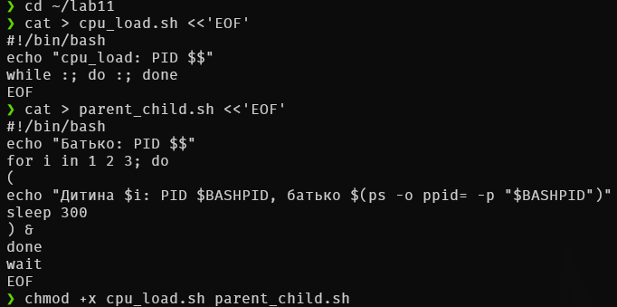
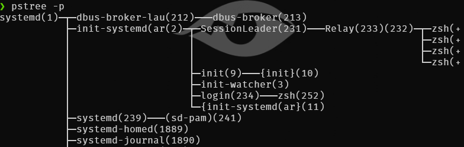
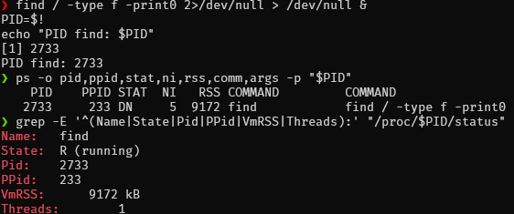
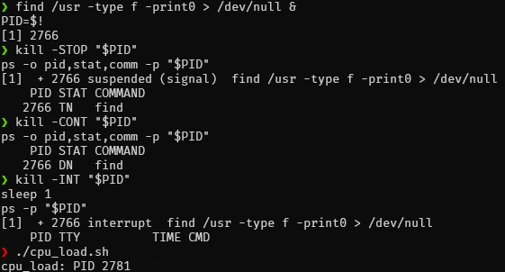
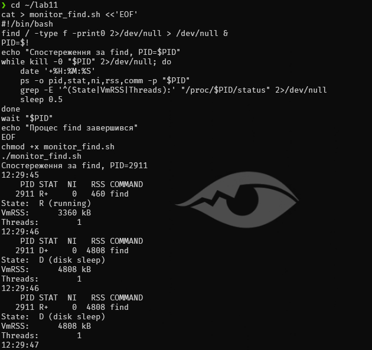

## Хід роботи

### 1. Підготовка робочого середовища

Підготував робоче середовище: встановив необхідні утиліти `htop`, `pstree`, `stress-ng`, `psmisc`, створив каталог `~/lab11` та підготував навчальні Bash-скрипти `cpu_load.sh` і `parent_child.sh`.

### 2. Перегляд процесів системи

Отримав перелік процесів за допомогою команд `ps`, `ps aux` і `ps -ef` та проаналізував відмінності між ними.

- `ps` без параметрів показує процеси поточного користувача, пов'язані з поточним терміналом.
- `ps aux` використовує синтаксис BSD і виводить список процесів системи з інформацією про використання CPU та пам'яті, стан процесу (`STAT`) і команду запуску.
- `ps -ef` використовує синтаксис System V і показує процеси з такими параметрами, як PID, PPID, UID, час запуску та термінал. На відміну від `ps aux`, ця команда не виводить відсотки використання CPU та пам'яті у стандартному наборі стовпців.

### 3. Дослідження дерева процесів

Побудував дерево процесів за допомогою команди `pstree -p` та визначив батьківські процеси поточного термінала. Поточна оболонка `zsh` мала PID 233.

Запустив скрипт `parent_child.sh` у фоновому режимі та перевірив створене дерево процесів.

Для визначення PID дочірніх процесів використав змінну `$BASHPID`. На відміну від `$BASHPID`, змінна `$$` у Bash зберігає PID початкової оболонки навіть усередині подоболонки, створеної конструкцією `( ... )`. Тому `$BASHPID` дає змогу отримати ідентифікатор поточного процесу Bash.

### 4. Дослідження параметрів процесу find

Відповідно до варіанта 19 дослідив процес `find`, який виконував сканування файлової системи. За допомогою команди `ps` та файлу `/proc/PID/status` перевірив ідентифікатори процесу, його стан, пріоритет, використання пам'яті та кількість потоків.

**Таблиця 1 – Результати дослідження процесу find (варіант 19)**

| Джерело / параметр  |  PID | PPID | Стан        |  NI |         Пам'ять | Кількість потоків |
| ------------------- | ---: | ---: | ----------- | --: | --------------: | ----------------: |
| `ps`                | 2733 |  233 | DN          |   0 |   9172 KB (RSS) |                 — |
| `/proc/2733/status` | 2733 |  233 | R (running) |   — | 9172 kB (VmRSS) |                 1 |

Показники стану процесу могли відрізнятися, оскільки команди зчитували інформацію в різні моменти часу. Стан `R` означає, що процес виконується або готовий до виконання, а `D` — що процес перебуває в непереривному очікуванні, зазвичай пов'язаному з операціями введення-виведення.

### 5. Керування процесами за допомогою сигналів

Дослідив керування процесом `find` за допомогою сигналів `SIGSTOP`, `SIGCONT` та `SIGINT`. Сигнал `SIGSTOP` призупиняє виконання процесу, `SIGCONT` відновлює його, а `SIGINT` надсилає запит на переривання.

Після надсилання `SIGSTOP` процес перейшов у призупинений стан, який у виводі `ps` позначається літерою `T`. Після надсилання `SIGCONT` він відновив виконання. Завершення процесу було ініційовано сигналом `SIGINT`.

### 6. Порівняння сигналів SIGTERM і SIGKILL

Порівняв дію сигналів `SIGTERM` та `SIGKILL` на прикладі скрипта `stubborn.sh`, який перехоплює сигнал `SIGTERM`.

Після надсилання `SIGTERM` скрипт виконав обробник сигналу й продовжив роботу. Це демонструє, що програма може перехоплювати та обробляти `SIGTERM`. Після надсилання `SIGKILL` процес було примусово завершено, оскільки цей сигнал не можна перехопити, заблокувати або ігнорувати.

### 7. Дослідження пріоритетів процесів

Запустив два процеси `cpu_load.sh` із різними значеннями `nice`, щоб порівняти їхні параметри за допомогою команди `ps`.

Отримані значення:

|  PID |  NI | PRI | %CPU | STAT |
| ---: | --: | --: | ---: | ---- |
| 2843 |   5 |  14 |  100 | RN   |
| 2844 |  15 |   4 |  100 | RN   |

У цьому запуску обидва процеси використовували близько 100% CPU. Значення `NI` становили 5 і 15, що відображає різні рівні пріоритету планування. Фактичне використання CPU залежить від доступних процесорних ресурсів, навантаження системи та параметрів запуску.

Також спробував змінити значення `nice` другого процесу командою `renice 0 -p PID`. Операція завершилася повідомленням `Permission denied`, оскільки звичайний користувач не мав необхідних прав для підвищення пріоритету процесу. У Linux зменшення значення `nice` зазвичай вимагає відповідних привілеїв.

### 8. Дослідження зомбі- та осиротілих процесів

Відтворив зомбі-процес і осиротілий процес, щоб дослідити їхні особливості.

**Зомбі-процес.** Запустив дочірній процес `sleep`, який завершився раніше за батьківський процес. Оскільки батьківський процес ще не отримав код завершення дочірнього процесу через `wait()`, у системі залишився запис про завершений процес зі станом `Z`, який відображався як `[sleep] <defunct>`.

**Осиротілий процес.** Запустив дочірній процес `sleep 120`, після чого завершив батьківський процес. Дочірній процес продовжив роботу, а його PPID змінився на 232, що було перевірено командою `ps`. Це демонструє механізм усиновлення осиротілих процесів у середовищі WSL.

### 9. Керування процесами у Windows

Виконав аналогічні операції керування процесами в Windows за допомогою PowerShell. Переглянув процеси з найбільшою робочою множиною пам'яті (`WS`), визначив ідентифікатор батьківського процесу `notepad.exe` через `Win32_Process`, змінив пріоритет процесу на `BelowNormal` та завершив його командою `Stop-Process`.

### 10. Індивідуальне завдання: дослідження стану процесу під час дискових операцій

Для виконання індивідуального завдання варіанта 19 створив Bash-скрипт `monitor_find.sh`, який запускає процес `find` у фоновому режимі та періодично перевіряє його стан. Скрипт з інтервалом 0,5 секунди виводить час спостереження, PID, стан процесу, значення `nice`, обсяг використаної пам'яті та кількість потоків із `/proc/PID/status`.

Під час спостереження було зафіксовано перехід процесу між станами `R` та `D`. Стан `R` означає, що процес виконується або готовий до виконання, а стан `D` вказує на непереривне очікування, зазвичай пов'язане з операціями введення-виведення. Отже, моніторинг продемонстрував, що стан процесу може змінюватися під час сканування файлової системи.

## Відповіді на контрольні питання

### Високий рівень (творчий)

**1. Процес не реагує ні на SIGTERM, ні на SIGKILL. Назвіть можливі причини та порядок дій адміністратора.**

Якщо процес не завершується після надсилання `SIGTERM` і `SIGKILL`, адміністратор повинен спочатку визначити його фактичний стан і з'ясувати причину проблеми.

Можливі причини:

- **Стан `D` (uninterruptible sleep).** Процес перебуває в непереривному очікуванні, наприклад, під час операції введення-виведення. Сигнал `SIGKILL` не можна перехопити або ігнорувати, проте завершення процесу може затриматися до виходу з цього стану.
- **Неправильно визначений PID.** Сигнал може надсилатися іншому процесу або процесу, який уже завершився.
- **Недостатньо прав.** Звичайний користувач не може надсилати сигнали процесам, якими він не має права керувати.
- **Проблема з ресурсами або драйвером.** Зависання файлової системи, мережевого сховища чи драйвера може спричинити тривале очікування операцій введення-виведення.
- **Зомбі-процес.** Процес уже завершився, але його батьківський процес ще не отримав код завершення. Повторне надсилання сигналів не видаляє такий запис.

Порядок дій адміністратора:

1. Перевірити існування процесу та його параметри: `ps -p PID -o pid,ppid,stat,ni,%cpu,%mem,cmd`.
2. Переглянути стан і батьківський процес за допомогою `ps`, а за потреби — інформацію у `/proc/PID/status`.
3. Якщо процес перебуває в стані `D`, перевірити журнали ядра, доступність сховищ і стан операцій введення-виведення.
4. Якщо процес активний і реагує на сигнали, спочатку спробувати `kill -TERM PID`, а після перевірки результату — `kill -KILL PID`.
5. Якщо процес є зомбі, перевірити батьківський процес і механізм отримання коду завершення через `wait()`.
6. Якщо зависання пов'язане зі сховищем або драйвером, усунути першопричину та повторно перевірити стан процесу. Перезавантаження системи розглядати лише тоді, коли проблему не вдалося безпечно усунути іншим способом.

Отже, `SIGKILL` не гарантує миттєвого зникнення запису процесу в усіх ситуаціях. Перед примусовим завершенням потрібно встановити стан процесу та причину його зависання.

**2. Сервер періодично «підвисає» під навантаженням. Опишіть, які показники процесів ви перевірите й у якій послідовності.**

Для пошуку причини періодичних зависань я перевірятиму показники послідовно — від загального навантаження системи до конкретних процесів.

1. **Загальне навантаження CPU.** За допомогою `top` або `htop` визначу, чи повністю завантажені процесорні ядра. Перевірю значення `%CPU` та частку часу очікування введення-виведення (`wa`), якщо вона доступна у вибраному засобі моніторингу.
2. **Процеси з найбільшим використанням CPU.** Виконаю `ps -eo pid,ppid,stat,ni,%cpu,%mem,comm --sort=-%cpu | head -n 11`. Це допоможе виявити процеси, які споживають найбільше процесорного часу, та перевірити їхні стани й пріоритети.
3. **Використання оперативної пам'яті.** Перевірю `%MEM`, RSS і VSZ, а також загальний обсяг доступної пам'яті та використання swap за допомогою `free -h`. Якщо пам'ять вичерпується, система може активно використовувати підкачування або запускати механізм OOM.
4. **Стани процесів.** За допомогою `ps -eo pid,ppid,stat,wchan:24,comm` перевірю, чи накопичуються процеси у стані `D`, чи є багато призупинених процесів `T` або зомбі `Z`. Велика кількість процесів у стані `D` може вказувати на проблему з введенням-виведенням.
5. **Кількість процесів і потоків.** Перевірю, чи не створює певна програма надмірну кількість дочірніх процесів або потоків, через що система може витрачати ресурси на їх планування.
6. **Пріоритети та батьківські процеси.** Перегляну значення `NI`, `PRI`, `PID` і `PPID`, щоб встановити, чи не витісняють ресурсоємні задачі важливі системні служби та який процес їх запускає.
7. **Повторне спостереження під час зависання.** Порівняю результати в нормальному режимі та під навантаженням. Якщо проблема пов'язана з дисковими операціями, додатково перевірю показники введення-виведення та системні журнали.

За результатами перевірки визначу першопричину. Якщо проблему створює некритичний процес, який надмірно використовує CPU, можна знизити його пріоритет. Якщо процес аварійно працює або створює небезпечне навантаження, потрібно розглянути його контрольоване завершення. Якщо причина полягає у вичерпанні пам'яті чи зависанні введення-виведення, зміна пріоритету сама по собі проблему не усуне.

**3. Поясніть, чому кількість zombie-процесів, що зростає, є ознакою помилки в програмі, а не в ядрі.**

Зомбі-процес — це процес, який уже завершив виконання, але його батьківський процес ще не отримав і не обробив код завершення за допомогою `wait()` або відповідного системного виклику.

Після завершення дочірнього процесу ядро зберігає невеликий запис із його PID, кодом завершення та іншими необхідними даними. Це потрібно, щоб батьківський процес міг дізнатися результат виконання дочірньої програми.

Якщо кількість зомбі постійно зростає, найчастіше це означає, що батьківська програма створює дочірні процеси, але не отримує результати їх завершення. Наприклад, програма може запускати багато короткочасних команд, проте не викликати `wait()` або `waitpid()` для завершених дочірніх процесів.

Отже, ядро виконує передбачений механізм керування процесами, а проблема зазвичай полягає в логіці батьківської програми. Для усунення причини потрібно перевірити код, який створює дочірні процеси, та забезпечити своєчасне отримання їхніх статусів завершення. Якщо батьківський процес завершиться, зомбі можуть бути передані процесу-всиновителю, який зможе їх зібрати.

Водночас сама наявність кількох зомбі не доводить наявність помилки: вони можуть існувати короткий час, поки батьківський процес обробляє завершення. Ознакою проблеми є саме їхнє тривале накопичення.

**4. Сформулюйте критерій, за яким адміністратор обирає між зміною пріоритету процесу та його завершенням. Проілюструйте прикладом.**

Основний критерій — чи є процес потрібним для роботи системи та чи можна усунути його негативний вплив без припинення виконання.

**Зміна пріоритету** доцільна, якщо процес виконує корисне завдання, але споживає надто багато процесорного часу та заважає роботі важливіших програм. У такому випадку адміністратор може збільшити значення `nice`, щоб знизити відносний пріоритет процесу. Це дасть іншим задачам більше можливостей отримувати процесорний час, не перериваючи поточну роботу.

**Завершення процесу** доцільне, якщо він виконує непотрібні операції, працює некоректно, створює неконтрольоване навантаження або загрожує стабільності системи. Спочатку слід спробувати штатне завершення через `SIGTERM`, а якщо процес не завершується та його примусове припинення виправдане — використати `SIGKILL`. Перед цим потрібно перевірити залежності процесу, щоб не зупинити критичну службу.

Наприклад, сервер обробляє запити користувачів, але паралельно запущений процес архівування споживає значну частину CPU. Якщо архівування потрібне, адміністратор може виконати `renice 10 -p PID`, знизивши його пріоритет, і дозволити серверу швидше обробляти запити. Якщо ж процес є завислим циклом, який не виконує корисної роботи та перевантажує CPU, доцільно спочатку надіслати йому `SIGTERM`, а за необхідності — завершити примусово.

Таким чином, пріоритет змінюють, коли процес потрібно зберегти, але обмежити його вплив на систему. Процес завершують, коли продовження його роботи недоцільне або небезпечне.

## Висновок

Під час виконання лабораторної роботи опанував методи перегляду та керування процесами в Linux і Windows. Дослідив відмінності між командами `ps`, `ps aux`, `ps -ef` і `pstree`, навчився визначати PID та PPID процесів, переглядати їхній стан і використання пам'яті.

На практиці перевірив дію сигналів `SIGTERM`, `SIGKILL`, `SIGSTOP`, `SIGCONT` та `SIGINT`, дослідив вплив значення `nice` на пріоритет процесу, а також відтворив зомбі- й осиротілий процеси. Для індивідуального завдання варіанта 19 створив скрипт `monitor_find.sh`, який відстежує параметри процесу `find`. Під час сканування файлової системи було зафіксовано зміну стану процесу між `R` та `D`, що дало змогу дослідити його поведінку під час виконання операцій введення-виведення.

Поглибив розуміння діагностики завислих процесів, аналізу навантаження сервера, причин накопичення зомбі-процесів та критеріїв вибору між зміною пріоритету й завершенням процесу. Отримані знання дають змогу обґрунтовано визначати причини проблем із процесами та вибирати відповідні способи їх усунення.
