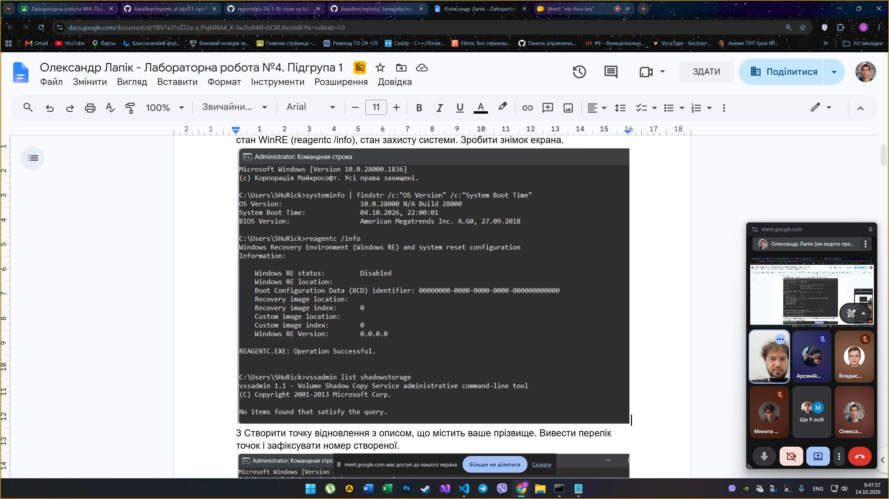

<!--
  Методи відновлення ОС
  Варіант 11: Програма не стартує після оновлення Windows — `/scan` — 1000 — Показати, як переглянути історію оновлень

  Тему, мету й обладнання писати не треба — конвеєр візьме їх із лабораторної.
  Знімки екрана кладіть у assets/, вихідний код — у src/.
  Контрольні питання — лише одного рівня, того, на який захищаєте роботу:
  заголовок «### Достатній рівень», далі «1 Текст питання?» і відповідь.
  Покрокова інструкція — reports/README.md
-->

## Хід роботи

1 Зафіксувати початковий стан системи: версію та збірку, час останнього завантаження, стан WinRE (reagentc /info), стан захисту системи. Зробити знімок екрана.

## Відповіді на контрольні питання

1 Відповів

## Висновок

На цій лабораторній роботі

