<!--
  Принципи функціонування ОС Linux
  Варіант 11: Ім'я поточної оболонки — `/bin`, `/etc`, `/home` — `echo` — `dbus` — Вивести перелік доступних оболонок системи

  Тему, мету й обладнання писати не треба — конвеєр візьме їх із лабораторної.
  Знімки екрана кладіть у assets/, вихідний код — у src/.
  Контрольні питання — лише одного рівня, того, на який захищаєте роботу:
  заголовок «### Достатній рівень», далі «1 Текст питання?» і відповідь.
  Покрокова інструкція — reports/README.md
-->

## Хід роботи

1 Отримав в викладача номер індивідуального варіанта.

2 Склав паспорт системи: версія ядра, назва та версія дистрибутива, архітектура, ім’я вузла, тип віртуалізації, час роботи системи. Скористався командами uname, /etc/os-release, hostnamectl, uptime.

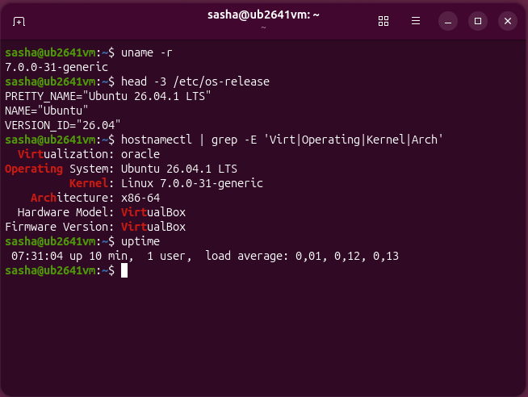

3 Знайшов й записав значення параметра системи, зазначеного у моєму варіанті 11. Навів команду, якою його отримано.

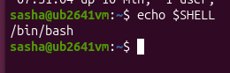

Команда echo $SHELL означає виведення на екран значення спеціальної системної змінної $SHELL, яка зберігає шлях до поточної командної оболонки користувача у мене це /bin/bash. Команда echo просто друкує цей текст у терміналі, дозволяючи швидко дізнатися, яка саме оболонка зараз обробляє мої команди.

4 Вивів перелік каталогів кореня. Для трьох каталогів, зазначених у моєму варіанті, пояснив призначення за стандартом FHS і навів приклад файлу з кожного.

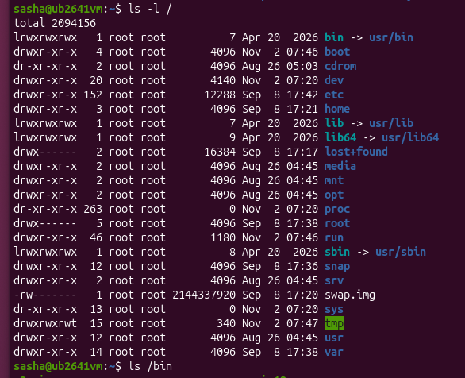

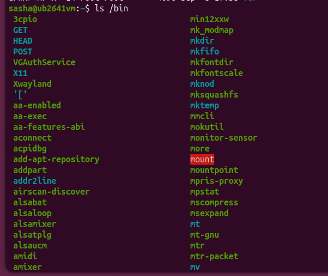

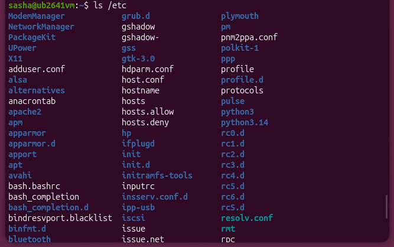

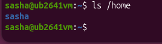

Згідно зі стандартом Filesystem Hierarchy Standard (FHS), я розглянув три каталоги з варіанта. Каталог /bin містить виконувані файли базових команд, доступних усім користувачам, і у Ubuntu цей каталог є символьним посиланням на /usr/bin, а прикладом файлу тут є /bin/ls або посилання /bin/cat. Каталог /etc містить усі текстові файли конфігурації системи та встановлених служб, де прикладом файлу є /etc/passwd (база даних користувачів) або /etc/os-release. Каталог /home — це каталог, що містить домашні директорії окремих користувачів системи, де зберігаються їхні особисті файли та налаштування, а прикладом такого каталогу є /home/student.

5 Визначив для команди мого варіанта: чи є вона вбудованою в оболонку, де розташований її виконуваний файл, що показує однорядковий опис whatis. Навів три ключі команди з поясненням призначення кожного.

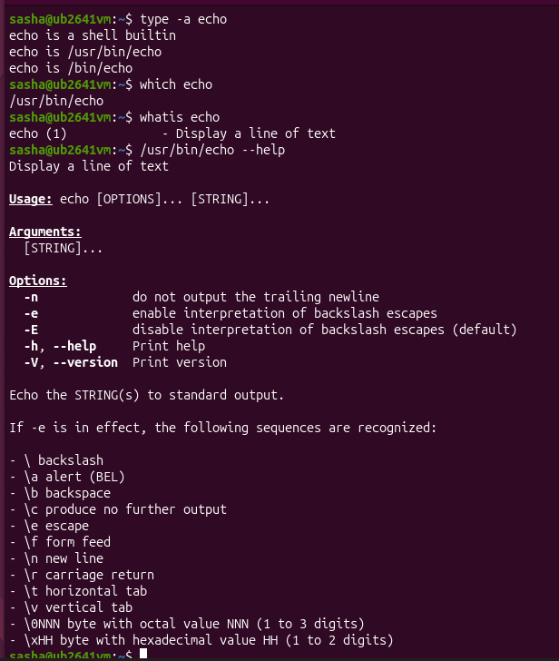

Досліджуючи команду echo, можна зазначити, що вона є вбудованою командою оболонки заради швидкості виконання, хоча в самій системі також існує однойменна зовнішня програма, розташування якої знаходиться за шляхом /usr/bin/echo. Коротка довідка через whatis описує її як засіб для виведення рядка тексту на екран. Ця команда підтримує різноманітні ключі, зокрема ключ -n, який не виводить символ нового рядка в кінці виведеного тексту, ключ -e, що вмикає інтерпретацію ескейп-послідовностей на кшталт перенесення рядка чи табуляції, а також ключ -E, який вимикає інтерпретацію ескейп-послідовностей і використовується за замовчуванням.

6 Знайшов засобами довідки команду, яка виконує задачу, зазначену у варіанті 11 (скористався apropos). Описав, як саме я її знайшов.

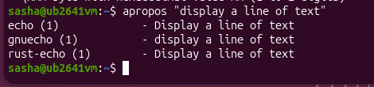

За допомогою команди apropos можна легко знаходити потрібні утиліти за ключовими словами в їхніх описах, оскільки ця утиліта сканує локальну базу даних сторінок посібника та виводить усі команди, у короткому описі яких зустрічається задане слово.

7 Вивів відомості про власний обліковий запис: UID, GID, групи. Пояснив, що дає членство в групі sudo. Продемонстрував різницю доступу до файлу /etc/shadow з sudo і без нього.

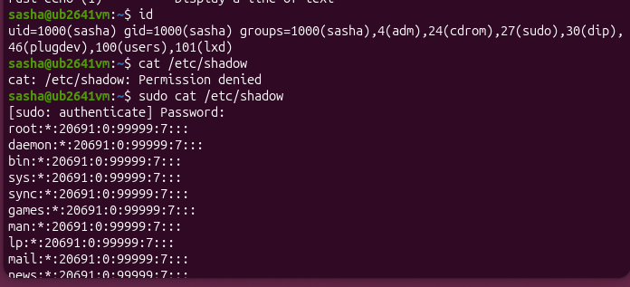

8 Отримав перелік процесів і визначив процес із PID 1. Вивів перелік служб у стані running і показав докладний стан служби мого варіанта 11.

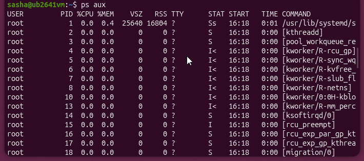

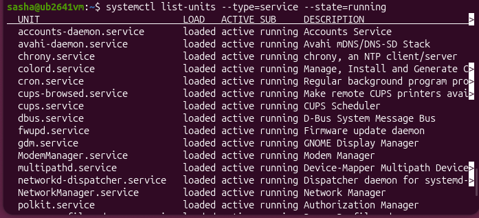

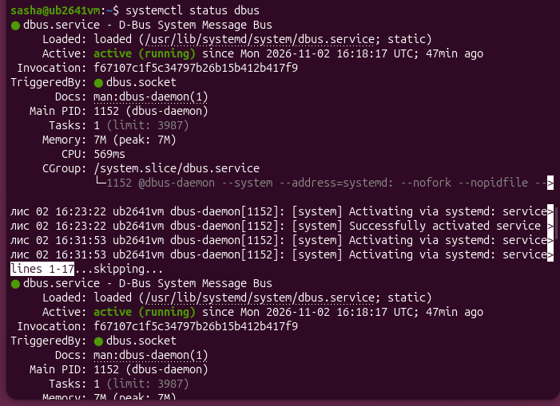

Для виконання цього кроку спочатку за допомогою команди ps aux було отримано перелік процесів у системі, де головним процесом простору користувача з PID 1 є systemd, який керує запуском усіх інших служб і процесів. За допомогою команди systemctl list-units --type=service --state=running було виведено перелік служб, які наразі перебувають у стані running. Для детального дослідження служби за індивідуальним варіантом було використано команду systemctl status dbus, яка показала стан служби dbus.service (D-Bus System Message Bus). Наявність статусу active (running) підтверджує, що служба успішно працює в системі та забезпечує обмін повідомленнями між процесами.

9 Отримав три показники стану системи з віртуальної файлової системи /proc і пояснив, чому ці файли не займають місця на диску.

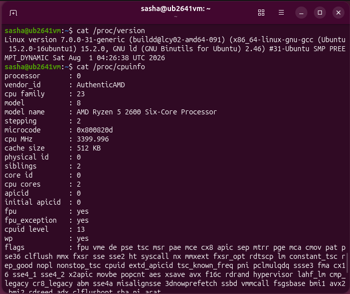

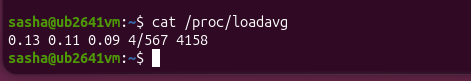

Для отримання показників стану системи з віртуальної файлової системи я звернувся до трьох файлів. Файл /proc/version містить інформацію про версію ядра Linux та компілятор gcc, файл /proc/cpuinfo зберігає детальні технічні характеристики процесора, а файл /proc/loadavg відображає поточні показники середнього навантаження системи. Жоден із цих файлів не займає місця на диску, оскільки каталог /proc є віртуальною файловою системою, у якій ядро формує всі файли динамічно безпосередньо в оперативній пам'яті (RAM) у момент звернення до них, тому вони не зберігаються на жорсткому диску і мають нульовий розмір.

10 Виконав додаткове завдання мого варіанта.

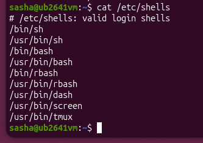

Команда cat /etc/shells використовується для виведення текстових файлів на екран, а файл /etc/shells містить офіційний системний перелік усіх дозволених та зареєстрованих у дистрибутиві командних оболонок (login shells), таких як sh, bash, dash та інші, які можуть призначатися користувачам для роботи в терміналі.

## Відповіді на контрольні питання

1 Поясніть, як принцип «все є файлом» спрощує написання системних утиліт. Проілюструйте на прикладі читання відомостей про процесор.

Принцип «все є файлом» у Linux суттєво спрощує розробку системних утиліт, оскільки дозволяє працювати з різноманітними апаратними пристроями, процесами та системними ресурсами за допомогою стандартних операцій введення-виведення, таких як читання чи відкриття файлів через звичні файлові дескриптори. Завдяки цьому розробникам не потрібно писати спеціалізовані драйвери чи складні програмні інтерфейси для взаємодії з кожним окремим компонентом системи. Яскравим прикладом цього є отримання відомостей про центральний процесор за допомогою звичайного читання вмісту віртуального файлу шляхом виконання команди на кшталт cat /proc/cpuinfo, яка дозволяє вивести детальні технічні характеристики апаратної частини у звичайному текстовому вигляді без використання складних спеціалізованих програмних інтерфейсів.

2 Два комп’ютери мають однакову версію дистрибутива, але різні версії ядра. Назвіть щонайменше три наслідки цієї різниці для адміністратора.

Різниця у версіях ядра Linux на двох комп’ютерах із однаковим дистрибутивом має кілька важливих наслідків для адміністратора. По-перше, новіша версія ядра може містити оновлені драйвери для підтримки новішого апаратного забезпечення, яке може не розпізнаватися або некоректно обслуговуватися старішим ядром на іншій машині. По-друге, відмінності в ядрі безпосередньо впливають на безпеку та стабільність системи, оскільки новіші збірки ядра частіше містять виправлення критичних вразливостей і потенційно нові системні виклики, яких немає у старіших версіях. По-третє, адміністратору доведеться враховувати сумісність специфічного програмного забезпечення чи зовнішніх модулів ядра, які можуть коректно компілюватися й функціонувати лише на певній версії ядра, що вимагає додаткових зусиль для підтримки однакового робочого середовища.

3 Сформулюйте критерії вибору дистрибутива для навчального класу й обґрунтуйте кожен із них.

Вибір дистрибутива Linux для навчального класу ґрунтується на кількох ключових критеріях, кожен з яких має важливе значення для навчального процесу. Першим критерієм є стабільність та довгострокова підтримка, оскільки навчальне середовище повинно працювати безперебійно протягом усього семестру без частих ламаючих оновлень, що дозволяє студентам зосередитися на вивченні матеріалу, а не на усуненні системних збоїв. Другим критерієм є широка популярність та наявність великої спільноти й документації, що значно полегшує пошук відповідей на типові проблеми та гарантує наявність готових пакетів для виконання лабораторних завдань. Третім критерієм є відповідність програмі курсу та сумісність із методичними матеріалами, щоб студенти практично закріплювали знання на стандартних інструментах, які масово використовуються в реальній IT-індустрії.

4 Система завантажилася, але одна зі служб не працює. Опишіть послідовність дій із використанням systemctl і journalctl та поясніть, що саме ви шукаєте на кожному кроці.

Коли після завантаження системи одна зі служб не працює, послідовність дій адміністратора починається з перевірки загального стану цієї служби за допомогою команди systemctl status назва_служби, яка дозволяє побачити поточний статус, код помилки та причину збою. Наступним кроком є аналіз детального журналу подій за допомогою команди journalctl -u назва_служби -e, де адміністратор шукає конкретні системні повідомлення про помилки, відсутні конфігураційні файли, проблеми з правами доступу чи невдалі спроби ініціалізації. Після виявлення та усунення першопричини в конфігурації виконується перезапуск служби за допомогою команди systemctl restart назва_служби, а її працездатність остаточно підтверджується повторним переведенням у статус активної та перевіркою списку запущених процесів.

## Висновок

На цій лабораторній роботі я ознайомився з будовою Linux: навчився визначати версії ядра та дистрибутива, орієнтуватися в структурі FHS, працювати з оболонкою, шукати довідку та моніторити процеси й служби в systemd. Я зрозумів, що ядро — це базова серцевина системи, яка керує апаратурою, пам'яттю та процесами. Дистрибутив — це повний комплекс на базі ядра, що включає системні утиліти, графічне середовище, менеджер пакетів та софт. Також я переконався, як принцип «все є файлом» реалізовано в /proc. Система надає доступ до даних ядра та процесора через віртуальні текстові файли безпосередньо в RAM. Вони не займають місця на диску, але їх можна читати звичайними командами на кшталт cat
