<!--
  Файлова система та управління даними в Linux
  Варіант 3: `/usr/share/doc/bash` — порожні файли — `zip` — Пояснити, у яких випадках потрібен формат zip

  Тему, мету й обладнання писати не треба — конвеєр візьме їх із лабораторної.
  Знімки екрана кладіть у assets/, вихідний код — у src/.
  Контрольні питання — лише одного рівня, того, на який захищаєте роботу:
  заголовок «### Достатній рівень», далі «1 Текст питання?» і відповідь.
  Покрокова інструкція — reports/README.md
-->

## Хід роботи

1 Отримав в викладача номер індивідуального варіанта.Варіант №3.
2 Створив в домашньому каталозі структуру ~/lab7 з підкаталогами src, docs, bak, mnt. Скопіював в src три файли з каталогу, зазначеного у варіанті.

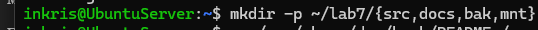

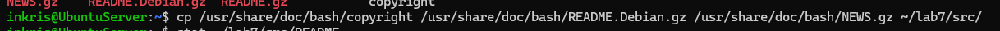
3 Вивів метадані одного з файлів командою stat і пояснив призначення полів Inode, Links, Access. Визначив реальний тип трьох файлів командою file.
 

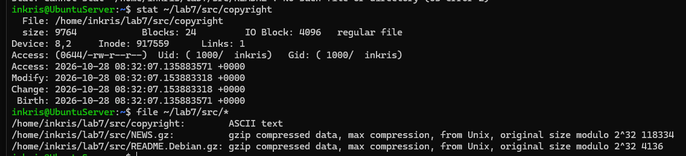

4 Виконав чотири різні пошуки: за іменем, за розміром, за часом зміни та за вмістом. Критерій пошуку за розміром узяти з варіанта. Навеів використані команди з ключами.
 

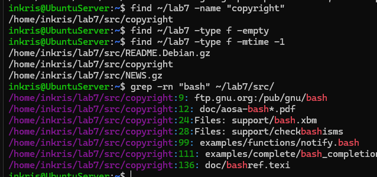

5 Створив жорстке й символічне посилання на один файл. Порівняв номери inode. Видалив оригінал і показати, що сталося з кожним посиланням. Пояснити результат.
 

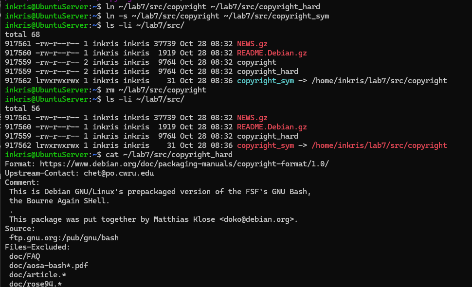

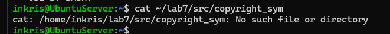

Номери inode оригіналу та жорсткого посилання однакові, а в символічного — інший. Після видалення оригіналу (rm ~/lab7/src/README) жорстке посилання продовжує працювати (лічильник Links зменшився на 1), а символічне стає "битим" (dangling), оскільки вказує на неіснуюче ім'я файлу.

6 Виконав операції копіювання, переміщення та перейменування згідно з варіантом. Показав, чим cp -p відрізняється від звичайного cp.

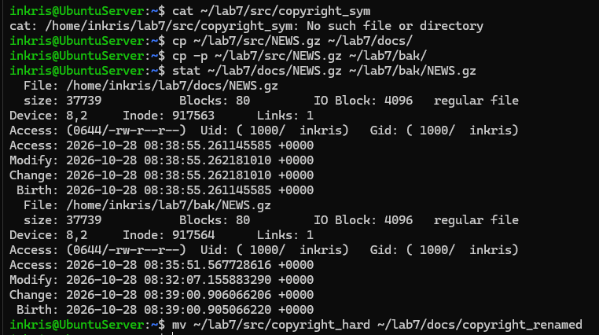

Відмінність: cp створює копію з поточним часом і власником, а cp -p зберігає оригінальні атрибути (час створення, права доступу).

7 Змонтував носій, зазначений викладачем, у каталог ~/lab7/mnt (для vfat і exFAT — з опціями uid і gid). Визначив тип файлової системи, UUID і обсяг вільного місця. Скопіював на носій файл, після чого коректно відмонтував й підтвердив це командою findmnt. Якщо носій уже змонтовано автоматично в /media/&lt;користувач&gt;/, спершу відмонтував його.

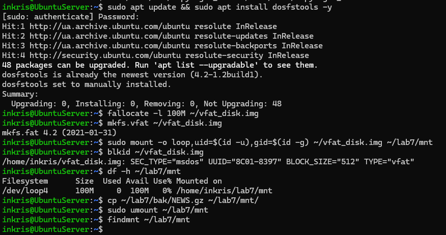

Команда findmnt нічого не виводить після виконання, що підтверджує коректне відмонтування.

8 Проаналізував дисковий простір: знайшов п’ять найбільших підкаталогів каталогу, зазначеного у варіанті. Пояснив різницю між df -h і df -i.

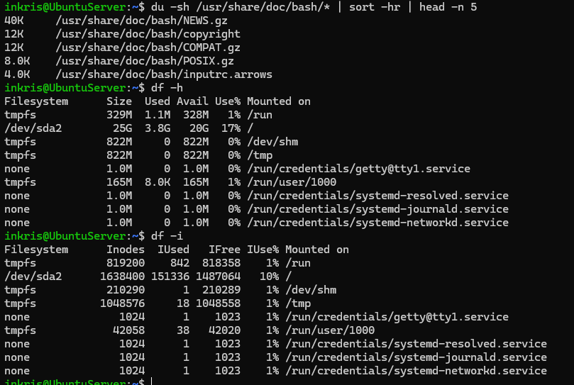

Різниця: df -h відображає використаний і вільний дисковий простір у мегабайтах і гігабайтах, тоді як df -i показує кількість використаних і вільних індексних дескрипторів (inode), тобто скільки ще файлів можна створити на диску.
9 Створив архів каталогів src і docs у форматі свого варіанта, переглянув вміст архіву без розпакування та розпакувати його до /tmp. Порівняв обсяг архіву й вихідних даних.

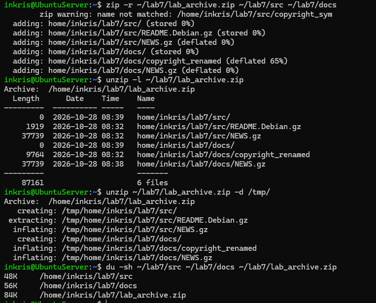

Обсяг архіву менший за обсяг вихідних каталогів завдяки стисненню.
10 Виконав додаткове завдання свого варіанта.
 

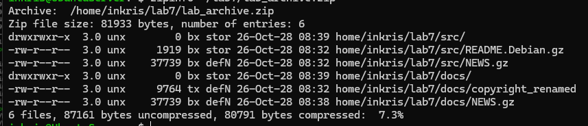

Формат zip потрібен для забезпечення сумісності під час передачі архівів на операційні системи Windows, де він підтримується за замовчуванням без встановлення стороннього ПЗ. Також він корисний, коли потрібно стиснути файли незалежно один від одного (дозволяє швидко витягнути один файл без читання всього архіву) або коли потрібен базовий парольний захист файлів стандартними засобами.

## Відповіді на контрольні питання
   
1 Поясніть, які переваги для адміністрування дає єдине дерево каталогів із монтуванням, і наведіть сценарій, неможливий у моделі з літерами дисків.
Єдине дерево каталогів створює абстрактне середовище, де фізичне розташування дисків приховане від користувача та програм. Це дозволяє прозоро розширювати дисковий простір, підключати мережеві файлові системи та переносити окремі каталоги на інші фізичні носії без зміни абсолютних шляхів до файлів. Сценарій, неможливий у моделі з літерами дисків: Перенесення каталогу заповненої бази даних /var/lib/mysql на новий окремий швидкий SSD-диск без зупинки та перевизначення шляхів у додатках. У моделі з літерами дисків шлях обов'язково змінився б (наприклад, з C:\mysql на D:\mysql), що вимагає редагування конфігурацій, тоді як у Linux новий диск просто монтується в існуючий каталог /var/lib/mysql.
2 Каталог із журналами заповнив увесь розділ. Опишіть послідовність дій із зазначенням команд на кожному кроці й поясніть, чому просте видалення файлу відкритим процесом не звільняє місце.
Просте видалення файлу командою rm вилучає тільки запис із каталогу та зменшує лічильник посилань inode. Якщо файл залишається відкритим працюючим процесом, дескриптор зберігає доступ до блоків даних на диску, і простір не вивільняється до моменту закриття дескриптора або перезапуску процесу.
Послідовність дій:
Знайти відкриті процесами видалені файли, що утримують дисковий простір:

sudo lsof +L1
Обнулити вміст заповненого лог-файлу «на льоту» без його видалення для негайного вивільнення місця:

sudo truncate -s 0 /var/log/syslog
Перезапустити службу логування для перестворення файлових дескрипторів:

sudo systemctl restart rsyslog
Безпечно видалити застарілі ротовані архіви логів, які не утримуються процесами:

sudo find /var/log -type f -name "*.gz" -mtime +30 -delete

3 Запропонуйте схему резервного копіювання домашнього каталогу з кількома поколіннями копій. Обґрунтуйте вибір формату архіву та періодичність.
Для резервного копіювання домашнього каталогу доцільно застосувати схему ротації за принципом Grandfather-Father-Son із трьома поколіннями копій. Вона включає щоденні інкрементальні копії змінених за 24 години файлів із терміном зберігання 7 днів, тижневі повні архіви кожного вихідного із збереженням на 4 тижні та щомісячні повні копії, які зберігаються протягом року. Формат .tar.gz є оптимальним для Linux, оскільки tar повністю зберігає всі права доступу, власників та посилання POSIX, а gzip швидко стискає дані без високого навантаження на процесор. Така періодичність та формат гарантують швидке відновлення поточних даних і надійний захист від пошкоджень.
4 Сформулюйте критерії вибору між жорстким посиланням, символічним посиланням і копією файлу. Проілюструйте кожен критерій прикладом із цієї роботи.
Жорстке посилання обирають, коли потрібно мати декілька рівноправних імен для одного файлу в межах однієї файлової системи із захистом від випадкового видалення оригіналу, як у випадку з ln ~/lab7/src/copyright ~/lab7/src/copyright_hard, де після видалення файлу copyright дані залишилися доступними через жорстке посилання. Символічне посилання використовують як ярлик-вказівник на файл чи каталог навіть між різними розділами дисків, про що свідчить команда ln -s ~/lab7/src/copyright ~/lab7/src/copyright_sym, яке після вилучення оригіналу стало битим із помилкою відсутності файлу. Звичайне ж копіювання потрібне для створення незалежної дубльованої версії файлу з власним inode і дисковим місцем, як при виконанні cp -p ~/lab7/src/NEWS.gz ~/lab7/bak/, де збережені атрибути оригіналу, але зміни у новому файлі ніяк не впливають на вихідний.

## Висновок
навчитився працювати з файловою системою Linux засобами командного рядка: орієнтуватися в структурі FHS, виконувати повний цикл файлових операцій, шукати файли за різними критеріями, розрізняти жорсткі й символічні посилання, монтувати та відмонтовувати носії, аналізував використання дискового простору й архівувати дані.
