<!--
  Файлова система та управління даними в Linux
  Варіант 8: `/etc/security` — файли, змінені за тиждень — `tar.gz` — Знайти файли, доступні на запис усім користувачам

  Тему, мету й обладнання писати не треба — конвеєр візьме їх із лабораторної.
  Знімки екрана кладіть у assets/, вихідний код — у src/.
  Контрольні питання — лише одного рівня, того, на який захищаєте роботу:
  заголовок «### Достатній рівень», далі «1 Текст питання?» і відповідь.
  Покрокова інструкція — reports/README.md
-->

## Хід роботи

1 Отримав в викладача номер індивідуального варіанта

2 Створив в домашньому каталозі структуру ~/lab7 з підкаталогами src, docs, bak, mnt. Скопіював в src три файли з каталогу, зазначеного у варіанті.

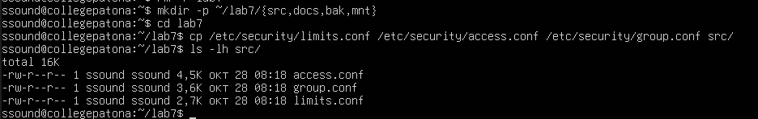

3 Вивів метадані одного з файлів командою stat і пояснив призначення полів Inode, Links, Access. Визначив реальний тип трьох файлів командою file.

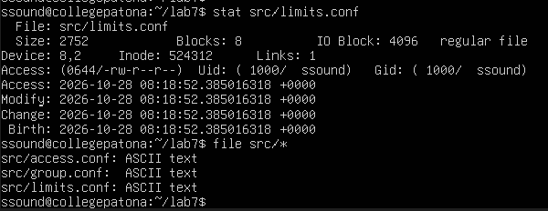

Пояснення: 

Inode — унікальний номер запису файлу у файловій системі. За ним система знаходить дані, а ім'я файлу є лише міткою в каталозі, що вказує на цей номер.

Links — кількість імен (жорстких посилань), які вказують на цей inode. Зараз там буде 1, а після створення жорсткого посилання в пункті 5 стане 2.

Access — права доступу. Число 0644 і запис -rw-r--r-- означають одне й те саме: власник читає й пише, група та інші лише читають.

4 Виконав чотири різні пошуки: за іменем, за розміром, за часом зміни та за вмістом. Критерій пошуку за розміром узяв з варіанта. Навів використані команди з ключами.

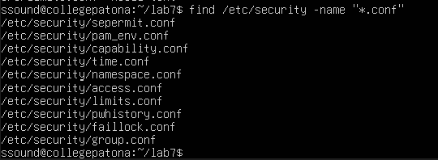

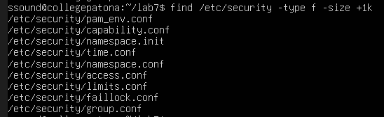

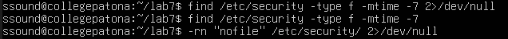

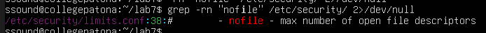

5 Створив жорстке й символічне посилання на один файл. Порівняв номери inode. Видалив оригінал і показав, що сталося з кожним посиланням. Пояснив результат.

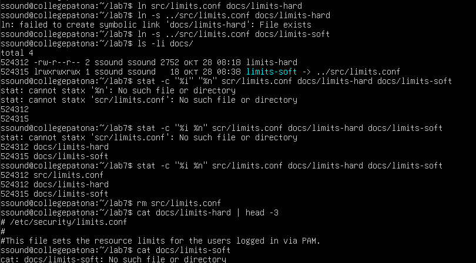

Порівняння номерів inode:

Для жорсткого посилання (docs/limits-hard) використовується команда створення ln src/limits.conf docs/limits-hard. Воно має номер inode 524312, який є таким самим, як і в оригіналу. Зберігає другий запис у каталозі, що вказує на ті самі дані. У результаті виконання ls -l відображається як звичайний файл із числом 2 у колонці links. Після виконання rm src/limits.conf команда cat показує вміст, оскільки дані збереглися. 

Для символічного посилання (docs/limits-soft) використовується команда створення ln -s ../src/limits.conf docs/limits-soft. Воно має 524315, що є окремим inode. Зберігає текст із шляхом до цілі (../src/limits.conf). У результаті виконання ls -l має тип l та стрілку -> ../src/limits.conf. Після виконання rm src/limits.conf команда cat дає «No such file or directory», а посилання «висить».

Пояснення: Жорстке посилання і оригінал — два рівноправні імені одного inode, а файл зникає лише після видалення останнього імені. Тому після rm src/limits.conf лічильник links зменшився з 2 до 1, але дані лишилися доступними через limits-hard. Символічне посилання зберігало лише шлях до src/limits.conf, і коли цей файл зник, шлях став вказувати в нікуди.

6 Виконав операції копіювання, переміщення та перейменування згідно з варіантом. Показав, чим cp -p відрізняється від звичайного cp.

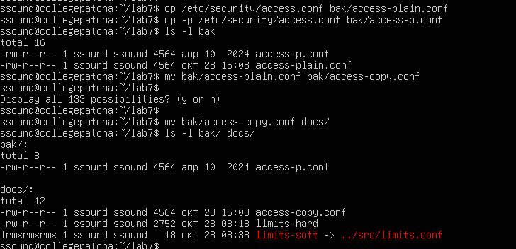

Звичайний cp ставить поточний час зміни й власником робить тебе. cp -p зберігає час зміни та права оригіналу (а власника лише тоді, коли виконується від root), і різницю видно в ls -l. Перша команда mv перейменовує файл, друга переміщує його в інший каталог.

7 Змонтував носій, зазначений викладачем, у каталог ~/lab7/mnt (для vfat і exFAT — з опціями uid і gid). Визначив тип файлової системи, UUID і обсяг вільного місця. Скопіював на носій файл, після чого коректно відмонтував й підтвердив це командою findmnt.

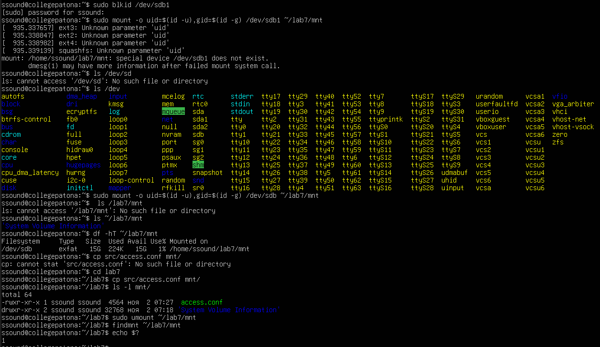

8 Проаналізував дисковий простір: знайшов п’ять найбільших підкаталогів каталогу, зазначеного у варіанті. Пояснив різницю між df -h і df -i.

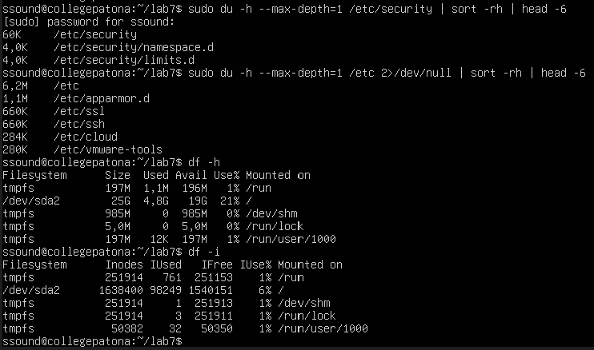

Пояснення: df -h показує, скільки місця на диску зайнято й вільно в байтах. df -i показує те саме, але в inode, тобто в записах для файлів і каталогів. Кожен файл або каталог займає один inode, а їх кількість визначається під час створення файлової системи й потім не змінюється. 

Тобто df -h відповідає на питання «скільки даних ще вміщається», а df -i відповідає на питання «скільки ще файлів можна створити».

9 Створив архів каталогів src і docs у форматі свого варіанта, переглянув вміст архіву без розпакування та розпакував його до /tmp. Порівняв обсяг архіву й вихідних даних.

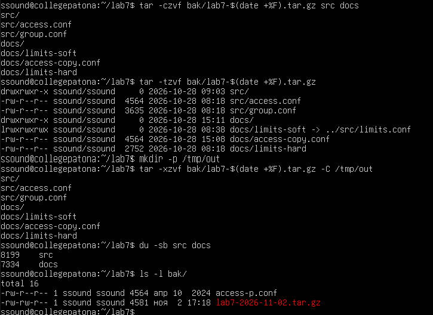

Пояснення: Ці команди виводять відомості про версію ядра, процесор і середнє навантаження системи. Каталог /proc є віртуальною файловою системою: його вміст формується ядром під час звернення, тому ці дані не зберігаються як звичайні файли на диску.

10 Виконав додаткове завдання свого варіанту: Знайти файли, доступні на запис усім користувачам

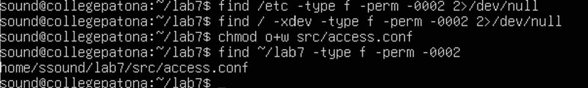

## Відповіді на контрольні питання

1 Поясніть, які переваги для адміністрування дає єдине дерево каталогів із монтуванням, і наведіть сценарій, неможливий у моделі з літерами дисків.

Єдине дерево з монтуванням відокремлює шлях до даних від фізичного пристрою. Адміністратор може винести /var, /home чи /var/log на окремий диск або мережевий ресурс, і програми, які звертаються до цих шляхів, нічого не помітять. Можна монтувати носій у режимі «лише читання», збільшувати місце, примонтувавши новий диск у потрібний каталог, або підключати образ ISO. Сценарій, неможливий у моделі з літерами: перенести базу даних із /var/lib/mysql на швидший диск, не змінюючи жодного шляху в конфігураціях. З літерами шлях змінився б (з C:\ на D:\), і довелося б переналаштовувати всі програми.

2 Каталог із журналами заповнив увесь розділ. Опишіть послідовність дій із зазначенням команд на кожному кроці й поясніть, чому просте видалення файлу відкритим процесом не звільняє місце.

Послідовність дій така. Спершу з'ясовую, який розділ заповнений:

df -h

Потім шукаю найбільші каталоги й файли:

sudo du -h --max-depth=1 /var | sort -h

sudo find /var/log -type f -size +100M

Перевіряю, чи є видалені, але відкриті файли:

sudo lsof +L1

Місце звільняю без видалення файлу, обнуляючи його:

sudo truncate -s 0 /var/log/big.log

Або перезапускаю службу, яка тримає файл, і потім перевіряю df -h. Просте видалення не звільняє місце, бо rm лише прибирає ім'я з каталогу. Inode і дані звільняються, коли лічильник посилань дорівнює нулю і жоден процес не тримає файл відкритим. Поки процес його не закрив, дані лишаються на диску, а процес може і далі в них писати.

3 Запропонуйте схему резервного копіювання домашнього каталогу з кількома поколіннями копій. Обґрунтуйте вибір формату архіву та періодичність.

Пропоную щоденну копію о 2:00 ночі з правилом зберігання «7 щоденних, 4 тижневих, 12 місячних». Копіювати в окремий диск, примонтований у /backup:

tar -czf /backup/home-$(date +%F).tar.gz ~

Запуск через cron (рядок 0 2 * * *), а старі щоденні копії видаляються командою:

	find /backup -name "home-*.tar.gz" -mtime +7 -delete

Щонеділі одну копію зберігають як тижневу, першу копію місяця як місячну, і ці дві групи чистять рідше. Формат tar.gz обрано тому, що tar зберігає права, власників і символічні посилання (чого zip не вміє), а gzip швидкий і є всюди. Для рідкісних архівів, де важливий максимальний ступінь стиснення, можна взяти tar.xz, але він значно повільніший. Щоденна періодичність обмежує втрату даних одним днем, а кілька поколінь дозволяють відновитися, якщо пошкодження помітили не одразу.

4 Сформулюйте критерії вибору між жорстким посиланням, символічним посиланням і копією файлу. Проілюструйте кожен критерій прикладом із цієї роботи.

Жорстке посилання обирають, коли потрібне друге рівноправне ім'я того самого файлу на тій самій файловій системі, і дані мають пережити видалення одного з імен: у роботі limits-hard лишився робочим після rm оригіналу. Символічне посилання обирають, коли ціль на іншій файловій системі, це каталог або посилання має вказувати на актуальне розташування цілі й допускається, що воно «повисне»: limits-soft після видалення оригіналу перестав працювати. Копію обирають, коли потрібна повна незалежність (зміни в одному файлі не мають зачіпати інший) або посилання неможливі: так було з файлом, скопійованим на флешку у ~/lab7/mnt, де файлова система vfat не підтримує жорстких посилань, і так само діє резервна копія в bak.

## Висновок

Під час лабораторної роботи я навчився працювати з файловою системою Linux у командному рядку: виконувати файлові операції, шукати файли, створювати жорсткі й символічні посилання, монтувати носії, аналізувати дисковий простір і архівувати дані. Головна перевага єдиного дерева каталогів Linux порівняно з літерами дисків у Windows у тому, що шлях до даних не залежить від фізичного пристрою: будь-який носій приєднується до загального дерева в довільній точці монтування (у роботі це ~/lab7/mnt), тому адміністратор може перенести каталог на інший диск або додати місце новим розділом, не змінюючи шляхів у програмах, тоді як з літерами дисків така заміна змінює й шлях. Крім того, команди df, findmnt і lsblk дають централізований контроль над тим, що де змонтовано, а опції монтування дозволяють гнучко налаштовувати доступ до кожного носія.
