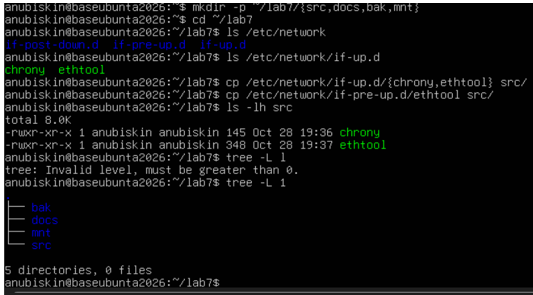
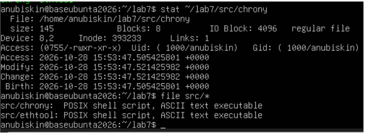
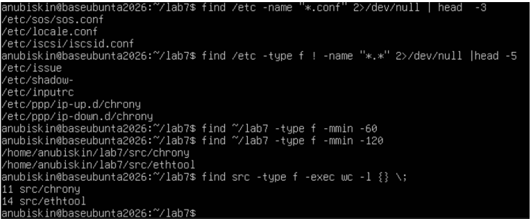
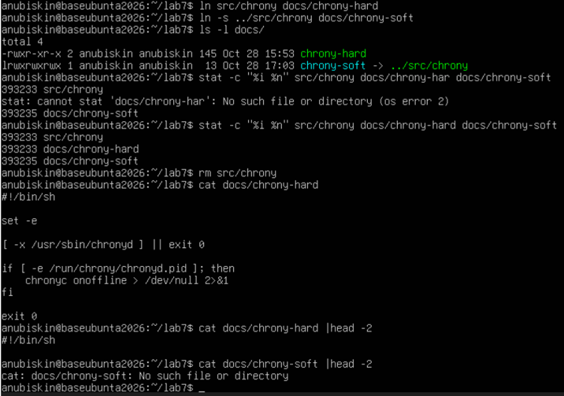
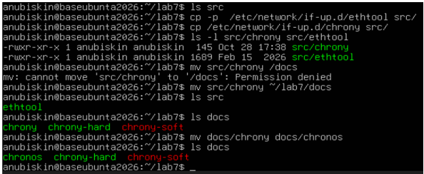
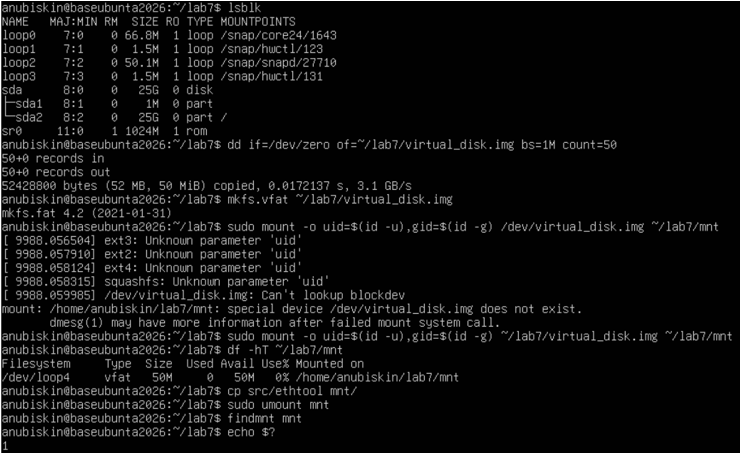
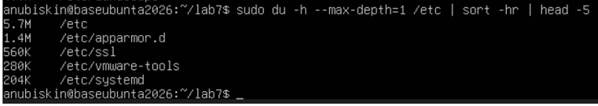
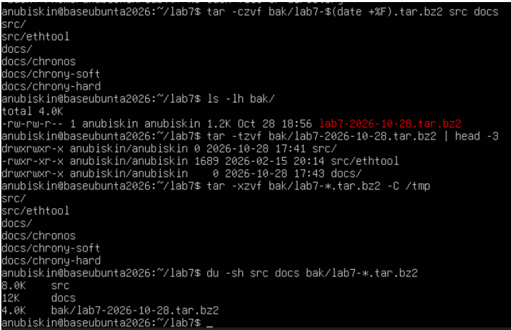

<!--
  Файлова система та управління даними в Linux
  Варіант 9: `/etc/network` — файли без розширення — `tar.bz2` — Пояснити, навіщо в `/etc/fstab` використовують UUID

  Тему, мету й обладнання писати не треба — конвеєр візьме їх із лабораторної.
  Знімки екрана кладіть у assets/, вихідний код — у src/.
  Контрольні питання — лише одного рівня, того, на який захищаєте роботу:
  заголовок «### Достатній рівень», далі «1 Текст питання?» і відповідь.
  Покрокова інструкція — reports/README.md
-->

## Хід роботи

### **1. Умова індивідуального завдання (Варіант 9)**

| Варіант | Шлях до каталогу | Критерій пошуку файлів | Формат архіву | Індивідуальне питання |
| :---: | :--- | :--- | :---: | :--- |
| **9** | `/etc/network` | файли без розширення | `tar.bz2` | Пояснити, навіщо в `/etc/fstab` використовують UUID |

  

---

### **2. Створення структури каталогів та копіювання файлів**
В домашньому каталозі створено структуру `~/lab7` з підкаталогами `src`, `docs`, `bak`, `mnt`. У каталог `src` скопійовано два файли з `/etc/network/if-up.d/`:

```bash
mkdir -p ~/lab7/{src,docs,bak,mnt}
cd ~/lab7
cp /etc/network/if-up.d/{chrony,ethtool} src/
ls -lh src
tree -L 1
```

  

---

### **3. Аналіз метаданих та визначення типу файлів**
Виведено метадані файлу `chrony` за допомогою `stat` та визначено реальний тип файлів командою `file`:

```bash
stat ~/lab7/src/chrony
file src/*
```

  

**Опис полів результату `stat`:**
* **Inode** — унікальний номер індексу файлу у файловій системі, що містить метадані (права, власника, розмір, розташування блоків).
* **Links** — кількість жорстких посилань, які вказують на даний inode.
* **Access** — права доступу у вісімковому та символьному форматі (наприклад, `0755/-rwxr-xr-x` означає повні права для власника та читання/виконання для групи й інших).

---

### **4. Пошук файлів у файловій системі**
Виконано чотири варіанти пошуку за допомогою `find`: за іменем, за розміром/розширенням (файли без розширення згідно з варіантом), за часом зміни та за вмістом:

```bash
find /etc -name "*.conf" 2>/dev/null | head -3
find /etc -type f ! -name "*.*" 2>/dev/null | head -5
find ~/lab7 -type f -mmin -120
find src -type f -exec wc -l {} \;
```

  

---

### **5. Робота з жорсткими та символічними посиланнями**
Створено жорстке (`docs/chrony-hard`) та символічне (`docs/chrony-soft`) посилання на файл `src/chrony`. Проаналізовано їхні inode, після чого вилучено оригінальний файл.

```bash
ln src/chrony docs/chrony-hard
ln -s ../src/chrony docs/chrony-soft
ls -l docs/
stat -c "%i %n" src/chrony docs/chrony-hard docs/chrony-soft
rm src/chrony
cat docs/chrony-hard
cat docs/chrony-soft
```

  

**Порівняння посилань:**

| Критерій порівняння | Жорстке посилання (`Hard link`) | Символічне посилання (`Soft link`) |
| :--- | :--- | :--- |
| **Що це таке** | Пряме посилання на той самий inode (блок даних). | Окремий файл-«ярлик», що містить шлях до оригіналу. |
| **Номер Inode** | <u>Однаковий</u> з оригінальним файлом. | <u>Унікальний</u> власний inode. |
| **Поведінка при видаленні оригіналу** | Дані <u>зберігаються</u> і доступні, поки існує хоча б одне посилання. | Посилання <u>втрачає чинність</u> («бите» посилання). |

---

### **6. Копіювання, переміщення та перейменування**
Проведено операції маніпуляції файлами та перевірено вплив прапорця `-p` при копіюванні:

```bash
cp -p /etc/network/if-up.d/ethtool src/
cp /etc/network/if-up.d/chrony src/
mv src/chrony ~/lab7/docs
mv docs/chrony docs/chronos
```

  

> **Примітка:** Ключ `cp -p` (preserve) зберігає оригінальні атрибути файлу (час останньої зміни, права доступу, власника), тоді як звичайний `cp` створює файл із поточним часом системи.

---

### **7. Створення, монтування та демонтаж образу диску**
Створено та ініціалізовано віртуальний диск розміром 50 МБ з файловою системою VFAT, змонтовано його у каталог `~/lab7/mnt`, скопійовано файл і виконано безпечне відмонтування:

```bash
dd if=/dev/zero of=~/lab7/virtual_disk.img bs=1M count=50
mkfs.vfat ~/lab7/virtual_disk.img
sudo mount -o uid=$(id -u),gid=$(id -g) ~/lab7/virtual_disk.img ~/lab7/mnt
df -hT ~/lab7/mnt
cp src/ethtool mnt/
sudo umount mnt
findmnt mnt
```

  

---

### **8. Аналіз використання дискового простору**
Знайдено 5 найбільших підкаталогів у каталозі `/etc`:

```bash
sudo du -h --max-depth=1 /etc | sort -hr | head -5
```

  

**Різниця між `df -h` та `df -i`:**
* `df -h` — показує інформацію про загальний, використаний та вільний дисковий простір у людиночитабельному форматі (КБ, МБ, ГБ).
* `df -i` — показує статистику використання індексних дескрипторів (inode), що дозволяє виявити брак inodes навіть при наявності вільного місця на диску.

---

### **9. Архівування даних**
Створено архів у форматі `tar.bz2` (згідно з варіантом 9), переглянуто його вміст без розпакування та видобуто дані у каталог `/tmp`:

```bash
tar -czvf bak/lab7-$(date +%F).tar.bz2 src docs
ls -lh bak/
tar -tzvf bak/lab7-2026-10-28.tar.bz2 | head -3
tar -xzvf bak/lab7-*.tar.bz2 -C /tmp
du -sh src docs bak/lab7-*.tar.bz2
```

**Розрахунок коефіцієнта стиснення:**
$$\text{Коефіцієнт стиснення} = \frac{8\,\text{КБ} + 12\,\text{КБ}}{1.2\,\text{КБ}} \approx 16.6$$

---

### **10. Відповідь на індивідуальне питання**
**Запитання:** *Пояснити, навіщо в `/etc/fstab` використовують UUID.*

**Відповідь:**  
**UUID (Universally Unique Identifier)** — це 128-бітний унікальний ідентифікатор файлової системи. Використання UUID у файлі `/etc/fstab` є стандартом адміністрування, оскільки класичні імена пристроїв (наприклад, `/dev/sda1`, `/dev/sdb2`) є динамічними та можуть змінюватися при додаванні нових дисків, зміні портів SATA/NVMe або перезавантаженні системи. Використання UUID гарантує, що операційна система завжди примонтує саме той розділ у відповідну точку монтування, незалежно від апаратного порядку ініціалізації дисків.

---

## Відповіді на контрольні питання

1. **Пояснити переваги єдиного дерева каталогів із монтуванням та навести сценарій, неможливий у моделі з літерами дисків.**  
   *Відповідь:* Єдина ієрархія (корінь `/`) дозволяє прозоро розширювати файлову систему, підключаючи нові накопичувачі в будь-які точки (наприклад, `/var/log` або `/home`), не змінюючи конфігураційні шляхи додатків.  
   *Сценарій:* Винесення каталогу каталогів журналів `/var/log` на окремий швидкісний SSD-диск без зміни шляхів доступів для системних служб у Windows (де це вимагало б зміни літери диска `C:\` на `D:\` або створення складних точок монтування NTFS).

2. **Каталог із журналами заповнив увесь розділ. Послідовність дій та пояснення щодо відкритих файлів.**  
   *Відповідь:* 
   1) Аналіз вільного місця: `df -h`.  
   2) Пошук великих файлів: `du -ah /var/log | sort -hr | head -10`.  
   3) Пошук видалених файлів, утримуваних процесами: `lsof +L1` або `lsof | grep deleted`.  
   4) Очищення вмісту файлу без видалення: `> /var/log/syslog` або перезапуск відповідного сервісу (`systemctl restart <service>`).  
   *Пояснення:* Просте видалення (`rm`) відкритого файлу вилучає лише запис із каталогу, але inode та блоки даних залишаються заблокованими, поки процес тримає файловий дескриптор.

3. **Схема резервного копіювання домашнього каталогу з кількома поколіннями копій.**  
   *Відповідь:* Схема «Дід-Батько-Син» (Grandfather-Father-Son):  
   * Щоденні ротаційні копії (інкрементні) — зберігаються 7 днів.  
   * Щотижневі копії (повні) — зберігаються 4 тижні.  
   * Щомісячні копії (повні) — зберігаються 6 місяців.  
   *Команда:* `tar -czf /bak/home_$(date +%Y%m%d).tar.gz /home/user`  
   *Обґрунтування:* Формат `.tar.gz` забезпечує високу швидкість архівування та чудове співвідношення стиснення для текстових файлів і вихідного коду.

4. **Критерії вибору між жорстким посиланням, символічним посиланням і копією файлу.**  
   * **Жорстке посилання:** Використовується для створення декількох імен одного файлу в межах однієї ФС без витрат пам'яті (наприклад, `docs/chrony-hard`).
   * **Символічне посилання:** Використовується для створення ярликів між різними файловими системами або каталогами (наприклад, `docs/chrony-soft`).
   * **Копія файлу:** Використовується, коли потрібна повністю незалежна версія даних, зміни в якій не повинні впливати на оригінал (наприклад, `cp /etc/... src/`).

---

## Висновок
Під час виконання лабораторної роботи №7 було опановано базові та поглиблені навички роботи з файловою системою Linux у командному рядку. Здійснено навігацію по структурі FHS, виконано пошук файлів за різними критеріями (`find`), досліджено відмінності між жорсткими та символічними посиланнями, проведено створення, монтування та демонтаж файлової системи VFAT. Також було проаналізовано використання дискового простору (`df`, `du`), засвоєно процедуру архівування даних (`tar`) та опрацьовано принципи ідентифікації розділів за допомогою UUID.
