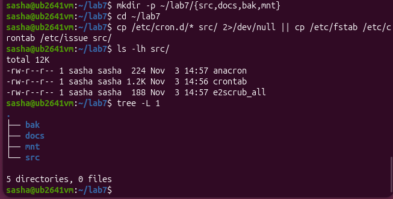
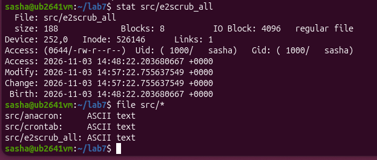
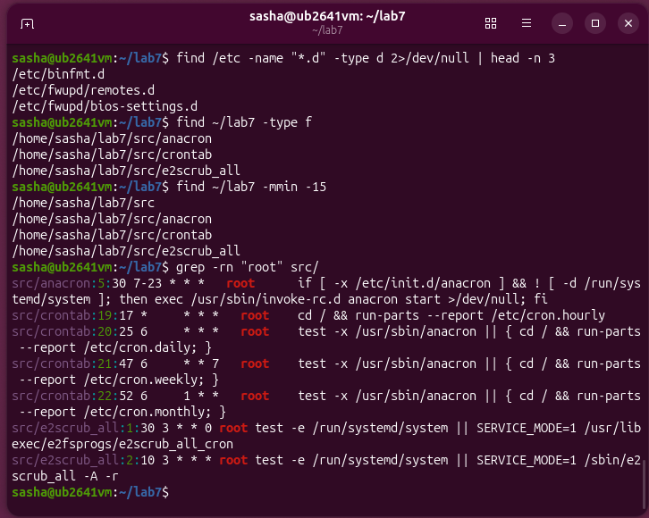
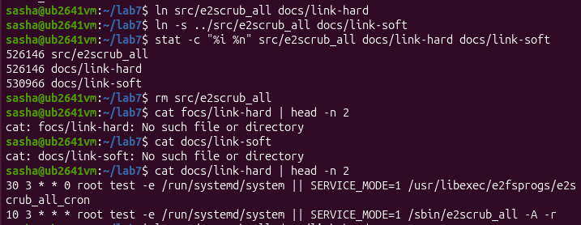
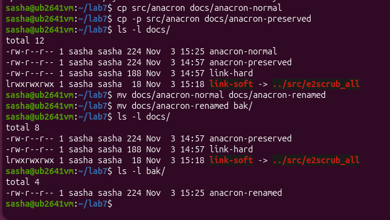
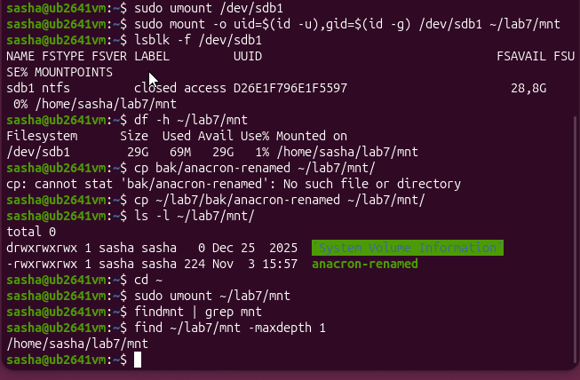
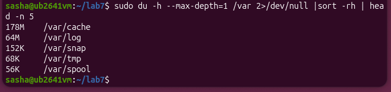
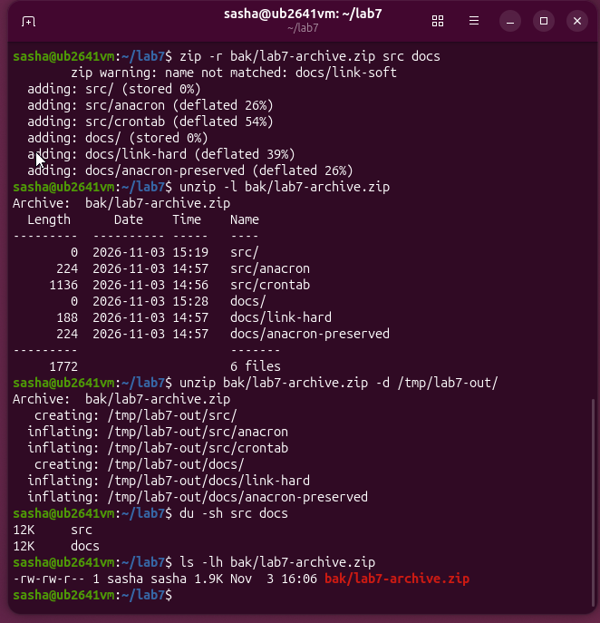

<!--
  Файлова система та управління даними в Linux
  Варіант 11: `/etc/cron.d` — усі звичайні файли — `zip` — Показати вміст архіву без розпакування та пояснити ключі

  Тему, мету й обладнання писати не треба — конвеєр візьме їх із лабораторної.
  Знімки екрана кладіть у assets/, вихідний код — у src/.
  Контрольні питання — лише одного рівня, того, на який захищаєте роботу:
  заголовок «### Достатній рівень», далі «1 Текст питання?» і відповідь.
  Покрокова інструкція — reports/README.md
-->

## Хід роботи

1 Отримав в викладача номер індивідуального варіанта.

2 Створив в домашньому каталозі структуру ~/lab7 з підкаталогами src, docs, bak, mnt. Скопіював в src три файли з каталогу, зазначеного у варіанті.

3 Вивів метадані одного з файлів командою stat і пояснив призначення полів Inode, Links, Access. Визначив реальний тип трьох файлів командою file.

У виводі команди stat поле Inode (наприклад, 526146) є унікальним номером запису у таблиці метаданих файлової системи, де безпосередньо зберігаються права доступу, інформація про власника, розмір файлу та вказівники на блоки з даними. Поле Links (у нашому випадку 1) показує кількість жорстких посилань або імен у каталогах, які вказують на цей самий inode. Своєю чергою, поле Access (0644/-rw-r--r--) визначає права доступу до файлу у вісімковому та символьному форматах, згідно з якими власник може читати та змінювати файл, тоді як група та інші користувачі мають лише права на читання.

4 Виконав чотири різні пошуки: за іменем, за розміром, за часом зміни та за вмістом. Критерій пошуку за розміром взяв з варіанта. Навів використані команди з ключами.

Команда find слугує для пошуку файлів і каталогів у реальному часі за заданими критеріями, де ключ -name задає шаблон імені файлу, -type визначає тип об’єкта (d — каталог, f — звичайний файл), -mmin шукає файли за часом зміни у хвилинах, а конструкція 2>/dev/null перенаправляє та приховує системні помилки доступу. Команда head з ключем -n обмежує вивід до зазначеної кількості перших рядків. Команда grep здійснює пошук текстових шаблонів усередині файлів, де ключ -r вмикає рекурсивний обхід каталогів, а -n виводить номери рядків із знайженими збігами.

5 Створив жорстке й символічне посилання на один файл. Порівняв номери inode. Видалив оригінал і показав, що сталося з кожним посиланням. Пояснив результат.

Жорстке посилання (link-hard) має той самий inode, що й оригінал, оскільки воно є повноцінним додатковим записом про файл, тому після видалення файлу лічильник посилань зменшився, а самі дані залишилися повністю доступними. Водночас символічне посилання (link-soft) має власний унікальний inode та містить лише текстовий шлях до цільового файлу, через що після видалення оригіналу таке посилання «повисає» і стає недоступним, оскільки вказує на неіснуючий шлях.

6 Виконав операції копіювання, переміщення та перейменування згідно з варіантом. Показав, чим cp -p відрізняється від звичайного cp.

Звичайне cp створює новий файл, де час зміни відповідає моменту копіювання, а поточний користувач стає новим власником. Прапорець cp -p (preserve) зберігає оригінальний час останньої модифікації, права доступу та власника.

7 Змонтував носій, зазначений викладачем, у каталог ~/lab7/mnt (для vfat і exFAT — з опціями uid і gid). Визначив тип файлової системи, UUID і обсяг вільного місця. Скопіював на носій файл, після чого коректно відмонтував й підтвердив це командою findmnt. Якщо носій уже змонтовано автоматично в /media/&lt;користувач&gt;/, спершу відмонтував його.

У пункті 7 виконано повний цикл роботи з USB-накопичувачем. Спочатку за допомогою sudo umount /dev/sdb1 відмонтовано флешку, автоматично підключену системою, де sudo надає привілеї адміністратора, а umount відповідає за розмонтування. Далі виконано ручне монтування у каталог ~/lab7/mnt командою sudo mount -o uid=(id-u),gid=(id -g) /dev/sdb1 ~/lab7/mnt, де опція -o з параметрами uid та gid призначає права власності на файли поточному користувачеві. За допомогою lsblk -f /dev/sdb1 з прапором -f визначено тип файлової системи (ntfs) та її UUID, а утиліта df -h ~/lab7/mnt з ключем -h (human-readable) показала обсяг вільного місця. Після цього команда cp ~/lab7/bak/anacron-renamed ~/lab7/mnt/ скопіювала файл на носій, а ls -l ~/lab7/mnt/ з прапором -l підтвердила його наявність детальним списком. Наприкінці виконали перехід у домашній каталог командою cd ~ та розмонтували носій через sudo umount ~/lab7/mnt. Фінальна перевірка виконана за допомогою findmnt | grep mnt, яка шукає активні монти, та find ~/lab7/mnt -maxdepth 1, яка з обмеженням глибини -maxdepth 1 підтвердила, що точка монтування знову стала порожнім каталогом.

8 Проаналізував дисковий простір: знайшов п’ять найбільших підкаталогів каталогу, зазначеного у варіанті. Пояснив різницю між df -h і df -i.

Основна різниця між командами df -h та df -i полягає в об'єктах, які вони вимірюють. Команда df -h показує обсяг використаного та вільного дискового простору в байтах (КБ, МБ, ГБ) у зручному для читання форматі. Натомість команда df -i відображає кількість використаних та вільних індексних дескрипторів (inode). Важливо зазначити, що якщо inode повністю вичерпаються, створення нових файлів стане неможливим, навіть якщо на диску залишатимуться десятки гігабайтів вільного місця.

9 Створив архів каталогів src і docs у форматі свого варіанта, переглянув вміст архіву без розпакування та розпакував його до /tmp. Порівняв обсяг архіву й вихідних даних. Та виконав додаткове завдання.

У пункті 9 я виконав і пункт 10 тому що це робота з архівами я  створив рекурсивний архів src та docs за допомогою zip -r (де ключ -r обходить каталог рекурсивно). Переглянув вміст командою unzip -l, де ключ -l виводить список файлів без розпакування. Також архів успішно розпаковано у /tmp/lab7-out/, а розміри перевірено через du -sh та ls -lh.

## Відповіді на контрольні питання

1 Поясніть, які переваги для адміністрування дає єдине дерево каталогів із монтуванням, і наведіть сценарій, неможливий у моделі з літерами дисків.

Єдине ієрархічне дерево каталогів у Linux надає значні переваги для адміністрування завдяки прозорому монтуванню, де будь-який фізичний носій, мережевий ресурс або віртуальна файлова система інтегруються в загальний простір без зміни шляхів до доступу та без прив'язки до літер на кшталт C: чи D:. Це спрощує керування дисковим простором, дозволяє "на льоту" підключати або відключати накопичувачі без перезавантаження системи та забезпечує єдину структуру прав доступу. Сценарієм, неможливим у моделі з літерами дисків, є прозоре розширення розділу або перенесення зайнятої підсистеми (наприклад, бази даних у /var/lib/mysql або домашніх каталогів у /home) на окремий швидший чи більший диск без зупинки роботи сервісів і без зміни шляхів для програм, оскільки для програм і користувачів шлях залишається незмінним, тоді як фізично дані обробляються зовсім іншим носієм.

2 Каталог із журналами заповнив увесь розділ. Опишіть послідовність дій із зазначенням команд на кожному кроці й поясніть, чому просте видалення файлу відкритим процесом не звільняє місце.

Коли каталог із журналами заповнює весь розділ, спершу слід знайти заблоковані або відкриті файли, які продовжують утримувати простір, за допомогою команди lsof +L1 або sudo lsof /var/log, де утиліта виводить список відкритих файлів. Якщо процес продовжує писати у файл, який був видалений через rm, операційна система не видаляє його фізично з диска, оскільки файловий дескриптор усе ще відкритий у пам'яті запущенного процесу, і вільні блокові індекси не звільняються до завершення або перезапуску цього процесу. Правильна послідовність дій передбачає зупинку відповідного сервісу чи процесу (наприклад, через sudo systemctl stop rsyslog), очищення самого файлу журналів без його видалення шляхом перезапису порожнім рядком за допомогою команди sudo truncate -s 0 /var/log/syslog або sudo cat /dev/null > /var/log/syslog, після чого можна безпечно запустити службу назад за допомогою sudo systemctl start rsyslog і перевірити стан диска через df -h.

3 Запропонуйте схему резервного копіювання домашнього каталогу з кількома поколіннями копій. Обґрунтуйте вибір формату архіву та періодичність.

Для надійного захисту домашнього каталогу з кількома поколіннями копій оптимальною є комбінована схема резервного копіювання за принципом "дід-батько-син", яка передбачає створення щоденних інкрементних копій (син), щотижневих повних копій (батько) та щомісячних архівних копій (дід) із ротацією і збереженням фіксованої кількості поколінь. Як базовий формат архіву доцільно обирати архіватори на кшталт tar із компресією gzip або zstd (формати .tar.gz або .tar.zst), оскільки вони коректно зберігають усі метадані файлів Linux, права доступу (chmod), власників (uid/gid), символічні та жорсткі посилання, що є критично важливим для відновлення робочого середовища. Періодичність обґрунтовується балансом між безпекою даних і наявним дисковим простором: щоденні інкрементні копії захищають від випадкового видалення файлів протягом тижня, щотижневі повні копії мінімізують час відновлення системи, а щомісячні архівні копії дозволяють зберігати довгострокову історію змін.

4 Сформулюйте критерії вибору між жорстким посиланням, символічним посиланням і копією файлу. Проілюструйте кожен критерій прикладом із цієї роботи.

Вибір між жорстким посиланням, символічним посиланням і повною копією файлу базується на критеріях залежності від оригіналу, можливості перетину меж файлових систем та необхідності збереження працездатності при переміщенні або видаленні вихідного об'єкта. Жорстке посилання (hard link) обирається тоді, коли потрібно створити абсолютно рівноправну точку доступу до тих самих даних на тому ж диску, яка не зламається навіть при повному видаленні чи перейменуванні оригінального файлу (наприклад, у лабораторній роботі створення docs/anacron-preserved як жорсткого посилання на файл у каталозі src). Символічне посилання (symlink) застосовується у випадках, коли необхідно створити легковаговий ярлик на файл чи каталог, зокрема між різними файловими системами або з можливістю вказувати на ще не створені об'єкти, проте воно стає непрацездатним, якщо оригінал видаляється або переміщується (як у випадку з посиланням docs/link-soft, яке вказувало на файл усередині структури сховища). Повна копія файлу створюється тоді, коли потрібна повністю незалежна автономна версія даних, зміни в якій жодним чином не повинні впливати на оригінальний файл (наприклад, копіювання файлу конфігурації у резервну папку bak/ за допомогою утиліти cp).

## Висновок

на цій лабораторній роботі я навчився працювати з файловою системою Linux за допомогою командного рядка, впевнено орієнтуватися в структурі FHS та виконувати повний цикл файлових операцій. Зокрема, я навчився шукати файли за різними критеріями, створювати й розрізняти жорсткі та символічні посилання, а також самостійно монтувати й відмонтовувати знімні USB-носії з коректним налаштуванням прав доступу. Крім того, я опанував інструменти для аналізу використання дискового простору, дослідив відмінності між вільним простором та індексними дескрипторами (inode) і навчився ефективно архівувати дані за допомогою утиліт zip та unzip. Окремим важливим висновком для мене стало розуміння переваг єдиного дерева каталогів у Linux порівняно з моделлю літер дисководів у Windows. У Linux усі фізичні носії, мережеві ресурси та віртуальні файлові системи прозоро інтегруються в єдину ієрархічну структуру без прив'язки до літер на кшталт C: чи D:. Це дає величезну перевагу в адмініструванні, оскільки дозволяє підключати нові накопичувачі «на льоту» в будь-яку точку існуючого дерева, а також переносити цілі підсистеми (наприклад, каталоги користувачів чи бази даних) на інші диски абсолютно непомітно для користувачів та програм, адже шляхи до файлів залишаються незмінними
