<!--
  Файлова система та управління даними в Linux
  Варіант 1: `/etc/ssh` — `файли більші за 4 КБ` — `tar.gz` —  Пояснити, чому find бачить нові файли, а locate — ні
  
  Тему, мету й обладнання писати не треба — конвеєр візьме їх із лабораторної.
  Знімки екрана кладіть у assets/, вихідний код — у src/.
  Контрольні питання — лише одного рівня, того, на який захищаєте роботу:
  заголовок «### Достатній рівень», далі «1 Текст питання?» і відповідь.
  Покрокова інструкція — reports/README.md
-->

## Хід роботи

1 Умова індивідуального завдання 

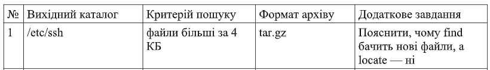

2 Створила в домашньому каталозі структуру ~/lab7 з підкаталогами src, docs, bak, mnt. Скопіювала в src три файли з каталогу, зазначеного у варіанті №1.

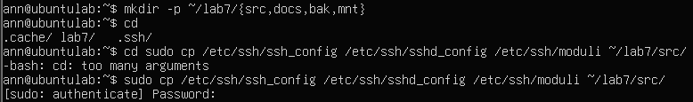

3 Вивела метадані одного з файлів командою stat і пояснила призначення полів Inode, Links, Access. Визначила реальний тип трьох файлів командою file.

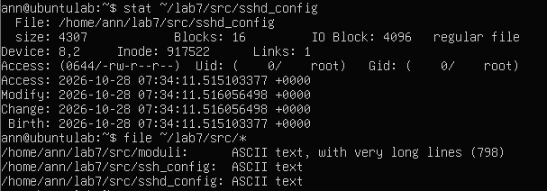

Inode — це унікальний числовий ідентифікатор у файловій системі, який зберігає всю службову інформацію про файл (метадані, права, розмір), окрім його імені та вмісту. Links показує кількість жорстких посилань, що вказують на цей ідентифікатор. Access визначає тип файлу та права доступу до нього у символьному й вісімковому форматах для власника, групи та інших користувачів. Ці поля дозволяють операційній системі ефективно керувати безпекою, структурами даних і доступом до файлів.

4 Виконала чотири різні пошуки: за іменем, за розміром, за часом зміни та за вмістом. Критерій пошуку за розміром узяла з варіанта.

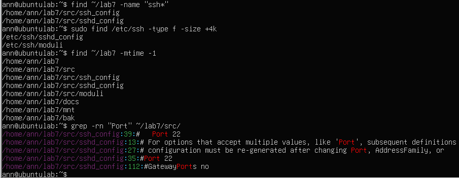

5 Створила жорстке й символічне посилання на один файл. Порівняла номери inode. Видалила оригінал і показала, що сталося з кожним посиланням. Пояснила результат.

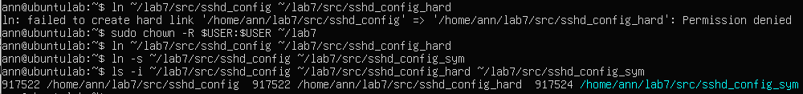

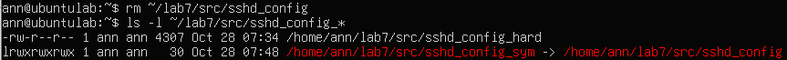

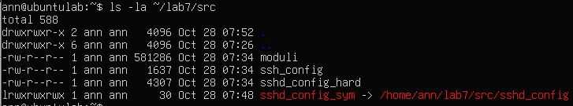

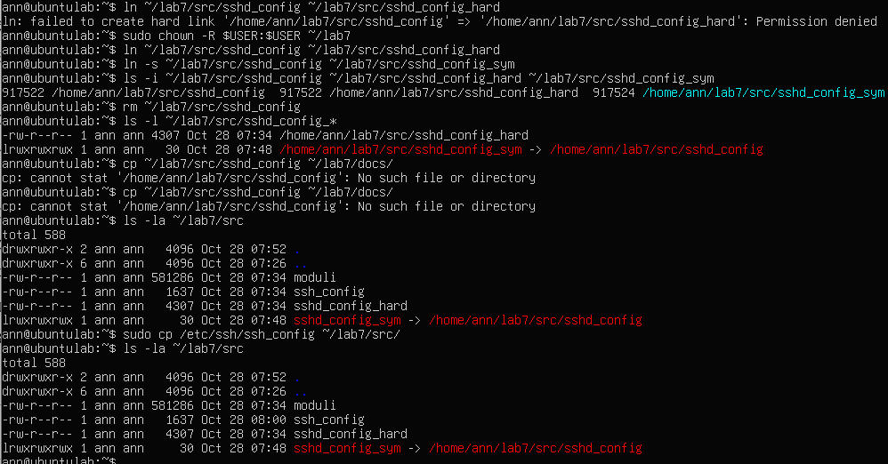

Порівняння за допомогою ls -i показало, що жорстке посилання має однаковий номер inode з оригіналом, а символічне — власний новий inode. Після видалення оригінального файлу (rm) жорстке посилання sshd_config_hard зберегло доступ до даних, оскільки лічильник посилань на inode зменшився, але не дорівнював нулю. Символічне посилання sshd_config_sym стало недійсним, бо воно вказувало лише на шлях до вже неіснуючого файлу.

6 Виконала операції копіювання, переміщення та перейменування згідно з варіантом №1. Показала, чим cp -p відрізняється від звичайного cp.

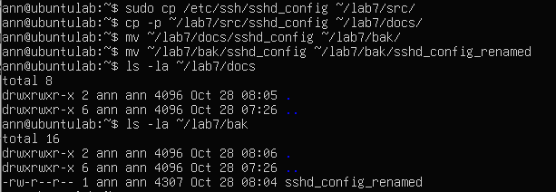

7 Змонтувала носій, зазначений викладачем, у каталог ~/lab7/mnt (для vfat і exFAT — з опціями uid і gid). Визначила тип файлової системи, UUID і обсяг вільного місця. Скопіювала на носій файл, після чого коректно відмонтувала й підтвердила це командою findmnt.

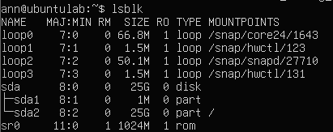

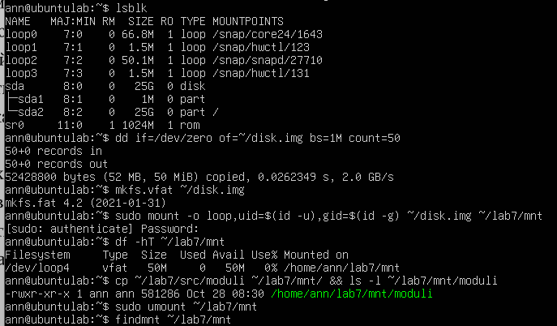

8 Проаналізувала дисковий простір: знайшла п’ять найбільших підкаталогів каталогу, зазначеного у варіанті №1. Пояснила різницю між
df -h і df -i.

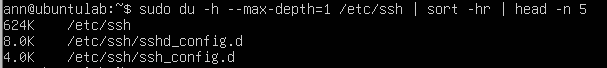

df -h виводить інформацію про використання фізичного дискового простору в байтах, мегабайтах чи гігабайтах у зручному для читання форматі. df -i показує кількість використаних та вільних індексних дескрипторів (inode), у яких зберігаються метадані файлів. Різниця в тому, що пам'ять на диску може вичерпатися через ліміт inode навіть тоді, калі за даними df -h ще є вільні гігабайти.

9 Створила архів каталогів src і docs у форматі варіанта №1, переглянула вміст архіву без розпакування та розпакувала його до /tmp. Порівняла обсяг архіву й вихідних даних.

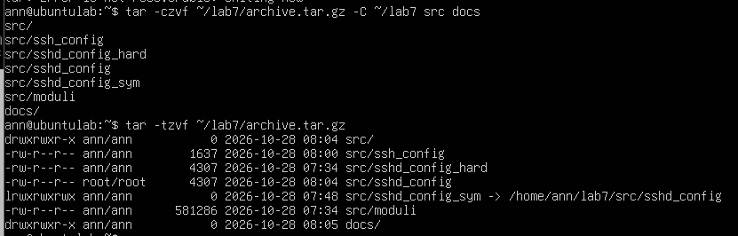

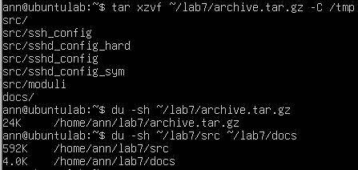

Обсяг створеного архіву archive.tar.gz становить лише 24 КБ, що свідчить про високий ступінь стиснення порівняно з вихідними каталогами src (592 КБ) та docs (4 КБ).

Додаткове завдання варіанта №1: команда find шукає файли безпосередньо на диску в реальному часі, тому одразу бачить нові об'єкти, а locate звертається до спеціальної бази даних, яка оновлюється за розкладом, через що нещодавно створені файли в ній ще відсутні..

## Відповіді на контрольні питання

1 Поясніть, які переваги для адміністрування дає єдине дерево каталогів із монтуванням, і наведіть сценарій, неможливий у моделі з літерами дисків.

Єдине дерево каталогів об'єднує всі накопичувачі в єдину структуру без поділу на букви, що робить роботу з файлами прозорою для користувача. Сценарій, неможливий із літерами дисків — це прозоре монтування нового диску прямо всередину існуючої робочої папки програми, коли додаток продовжує записувати туди дані, не змінюючи шляхів і не знаючи про новий фізичний носій.

2 Каталог із журналами заповнив увесь розділ. Опишіть послідовність дій із зазначенням команд на кожному кроці й поясніть, чому просте видалення файлу відкритим процесом не звільняє місце.

Просте видалення файлу не звільняє місце на диску, доки фоновий процес продовжує тримати його відкритим і записувати туди дані (ОС видаляє лише назву, але зберігає блоки). Послідовність дій: знайти процес через lsof +L1, зупинити його або очистити файл командою truncate -s 0 /path/to/file, після чого вільне місце одразу повернеться.

3 Запропонуйте схему резервного копіювання домашнього каталогу з кількома поколіннями копій. Обґрунтуйте вибір формату архіву та періодичність.

Для домашнього каталогу оптимально використовувати формат tar.gz, оскільки він ефективно стискає дані та повністю зберігає права доступу й структуру. Рекомендується налаштувати щоденні інкрементні копії та щотижневі повні архівні копії з ротацією кількох поколінь (наприклад - зберігати копії за останні 3 тижні).

4 Сформулюйте критерії вибору між жорстким посиланням, символічним посиланням і копією файлу. Проілюструйте кожен критерій прикладом із цієї роботи.

Жорстке посилання (приклад - sshd_config_hard) використовується в межах однієї файлової системи, коли потрібно зберегти дані навіть при видаленні оригіналу. Символічне посилання (приклад - sshd_config_sym) слугує текстовим ярликом-шляхом до файлу, а звичайна копія (приклад - дублювання конфігів у ~/lab7/src/) створює повністю незалежний дублікат для безпечного редагування.

## Висновок
навчилася працювати з файловою системою Linux засобами командного рядка: орієнтуватися в структурі FHS, виконувати повний цикл файлових операцій, шукати файли за різними критеріями, розрізняти жорсткі й символічні посилання, монтувати та відмонтовувати носії, аналізувати використання дискового простору й архівувати дані

