<!--
  Облікові записи та права доступу до файлів
  Варіант 9: `admins` / adm1, adm2 — `750` — `027` — другого користувача: виконання — Показати, як надати користувачу право sudo

  Тему, мету й обладнання писати не треба — конвеєр візьме їх із лабораторної.
  Знімки екрана кладіть у assets/, вихідний код — у src/.
  Контрольні питання — лише одного рівня, того, на який захищаєте роботу:
  заголовок «### Достатній рівень», далі «1 Текст питання?» і відповідь.
  Покрокова інструкція — reports/README.md
-->

## Хід роботи

1 Умова індивідуального завдання:

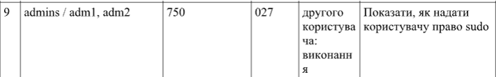

2 Дослідив структуру /etc/passwd, Вивів окремо системні облікові записи (UID < 1000) і записи людей.

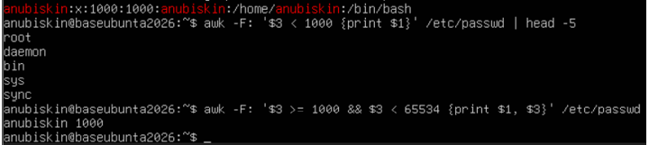

Пояснення полів: anubiskin — Ім'я користувача та логін облікового запису для входу в систему; x — Пароль: заглушка, яка вказує, що зашифрований хеш пароля зберігається у захищеному файлі /etc/shadow. 1000 — UID (User ID): унікальний числовий ідентифікатор користувача (починаючи з 1000 ідуть звичайні користувачі); GID (Group ID): ідентифікатор основної первинної групи; anubiskin — GECOS (Інформація про користувача): додаткові дані або повне ім'я користувача; /home/anubiskin — Домашній каталог: шлях до особистої папки в системі; /bin/bash — Командна оболонка (Shell): Програма-консоль, яка автоматично запускається під час входу в систему.

3 Створив групу admins та двох навчальних користувачів adm1 та adm2. Додав їх обох до створеної групию. Показав результат командами id і Getent group.

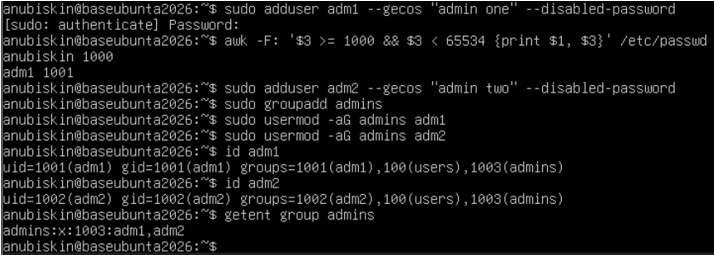

4 Вивів відомості про терміни дії пароля adm1 і заблокував другий обліковий запис (adm2). Показав, як блокування відображається в /etc/shadow.

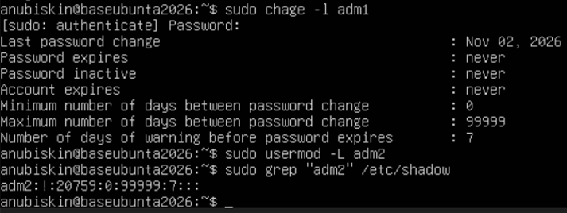

5 Створив каталог ~/lab8 з файлами та скриптом. Встановив права символьним способом, потім ті самі права — числовим. Показав, що результат однаковий.

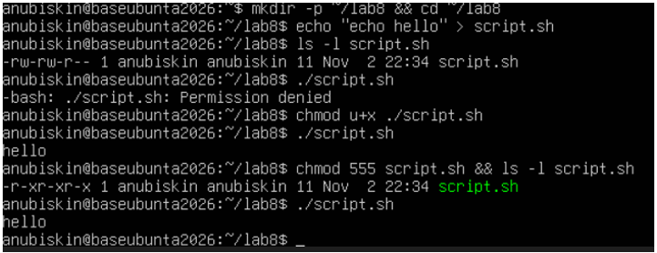

6 Продемонстрував різницю прав для каталогу: зняв біт x, спробував прочитати файл усередині. Якщо не надати всі права власнику (7), то не можна буде переглянути файл.

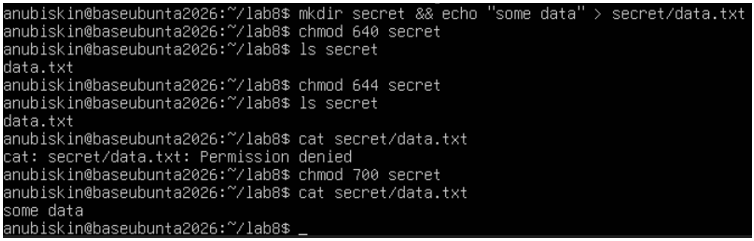

7 Дослідив маску umask: створив файл і каталог за поточної маски, далі змінив значення маски на 027 та повторив процес.

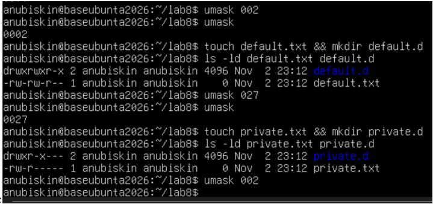

У першому випадку (umask 002) Власник та групи мають всі права, а інші користувачі тільки права читати та запускати. В другому випадку, коли umask має значенння 027 отримуємо 777 - 027 = 750, що означає: власник має всі права, групи тільки читати та запускати, а інші користувачі взагалі не мають жодних прав.

8 Налаштував спільний каталог команди /srv/team з бітами SGID і sticky. Від імені обох користувачів створив файли, потім спробував видалити чужий файл.

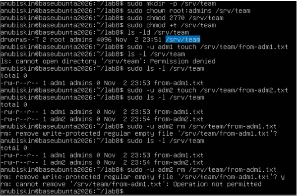

sudo mkdir -p /srv/team — створення спільного каталогу;
sudo chown root:admins /srv/team — призначення власником root, а групою — admins;
sudo chmod 2770 /srv/team — налаштування прав 770 та біта SGID (перша цифра 2), щоб усі нові файли автоматично отримували групу admins;
sudo chmod +t /srv/team — увімкнення Sticky bit (T), щоб користувачі могли видаляти лише власні файли;
ls -ld /srv/team — перевірка прав каталогу
sudo -u adm1 touch /srv/team/from-adm1.txt - — створення файлу від імені користувача adm1;
sudo -u adm2 rm /srv/team/from-adm1.txt — спроба користувача adm2 видалити чужий файл (from-adm1.txt), але система видала помилку Operation not permitted через активний Sticky bit.

9 Надав доступ виконання до файлу конкретному користувачеві через ACL (для adm2). Показав вивід getfacl.

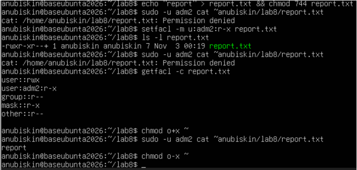

Для батьківських каталогів також знадобилось надати права на виконання, тому що для проходження скрізь весь шлях по директоріях до потрібного файлу, за допомогою команди cat, користувач має мати права виконання для кожної директорії (хоча б --x).

10 Виконав додаткове завдання.

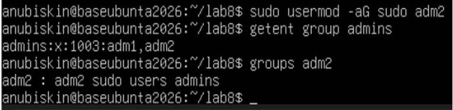

11 Прибрав за собою: повернув права домашнього каталогу (chmod o-x ~), видалив навчальних користувачів (sudo deluser --remove-home dev1) і групу (sudo groupdel developers), зафіксував результат.

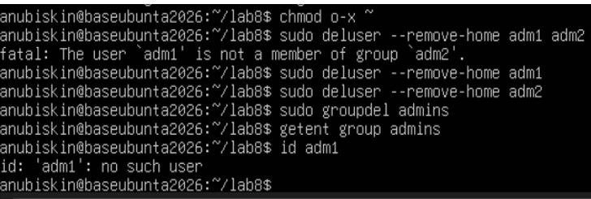

## Відповіді на контрольні питання

1 Спроєктуйте права для каталогу проєкту, у якому працюють дві групи: одна редагує файли, друга лише читає. Опишіть команди й обґрунтуйте кожне рішення.

Для цього потрібно створити дві групи: editors (редагування) та readers (читання). Каталог проєкту належатиме групі editors. (sudo groupadd editors; sudo groupadd readers). Створюємо каталог і призначаємо йому власника та групу: sudo mkdir /project; sudo chown root:editors /project; sudo chmod 2770 /project. Біт SGID (2) забезпечує успадкування групи editors новими файлами та каталогами. Права 770 дозволяють власнику та групі редагувати вміст. Для групи readers можна надати доступ лише для читання за допомогою ACL: sudo setfacl -m g:readers:rx /project; sudo setfacl -d -m g:readers:rx /project. Таким чином, перша група зможе працювати з файлами, а друга — переглядати каталог і читати файли.

2 Поясніть, навіщо програмі passwd потрібен біт SUID, які ризики це створює і як система їх обмежує.

Програма passwd використовує біт SUID, оскільки для зміни пароля потрібно редагувати системний файл /etc/shadow, який недоступний звичайним користувачам. Завдяки SUID програма тимчасово отримує права власника файлу, зазвичай root. Це створює ризик, оскільки помилки в програмі можуть дозволити отримати підвищені привілеї. Система обмежує ці ризики за допомогою перевірки прав доступу, контролю введених даних та обмеження можливостей програми. Також виконувані файли з SUID повинні належати довіреним користувачам.

3 Користувача видалено, а його файли залишилися. Опишіть, що станеться з цими файлами і чому, та запропонуйте коректний порядок видалення облікового запису.

Після видалення користувача його файли не зникають автоматично, оскільки файлова система зберігає власника за числовим UID, а не за іменем користувача. Тому замість імені власника може відображатися числовий ідентифікатор.
Коректний порядок видалення:
1) Знайти файли, які належать користувачу: sudo find / -uid UID 2>/dev/null;
2) Перевірити потрібні файли та перенести їх іншому власнику або видалити;
3) Видалити обліковий запис: sudo userdel -r ім'я_користувача.

4 Сформулюйте принцип найменших привілеїв і покажіть на трьох прикладах із цієї роботи, як він реалізується засобами прав доступу Linux.

Принцип найменших привілеїв полягає в тому, що кожен користувач повинен отримувати лише ті права доступу, які необхідні для виконання його завдань. Це дозволяє зменшити ризик випадкового пошкодження файлів і несанкціонованого доступу.
Приклади реалізації:
1) Розмежування прав груп. За допомогою chmod та ACL можна надати одній групі право редагувати файли, а іншій — лише читати їх. Таким чином, користувачі не отримують зайвих дозволів.
2) Використання SUID для passwd. Програма passwd отримує права власника root під час виконання, щоб користувач міг змінити власний пароль без отримання повних прав адміністратора.
3) Обмеження доступу до особистих файлів. Команда chmod 700 дозволяє надати власнику повний доступ до каталогу, одночасно заборонивши іншим користувачам переглядати або змінювати його вміст.

## Висновок

Навчився адмініструвати облікові записи в Linux: створювати й налаштовувати користувачів і групи, керувати правами доступу до файлів символьним і числовим способом, застосовувати спеціальні біти та маску umask, налаштовувати спільний каталог для групи й розмежовувати доступ списками ACL.
