<!--
  Облікові записи та права доступу до файлів
  Варіант 11: `auditors` / au1, au2 — `400` — `077` — другого користувача: читання — Знайти файли, доступні на запис усім користувачам

  Тему, мету й обладнання писати не треба — конвеєр візьме їх із лабораторної.
  Знімки екрана кладіть у assets/, вихідний код — у src/.
  Контрольні питання — лише одного рівня, того, на який захищаєте роботу:
  заголовок «### Достатній рівень», далі «1 Текст питання?» і відповідь.
  Покрокова інструкція — reports/README.md
-->

## Хід роботи

1 Отримав в викладача номер індивідуального варіанта та імена навчальних облікових записів.

2 Дослідив структуру /etc/passwd: пояснив призначення кожного поля на прикладі власного запису. Вивів окремо системні облікові записи (UID &lt; 1000) і записав людей.

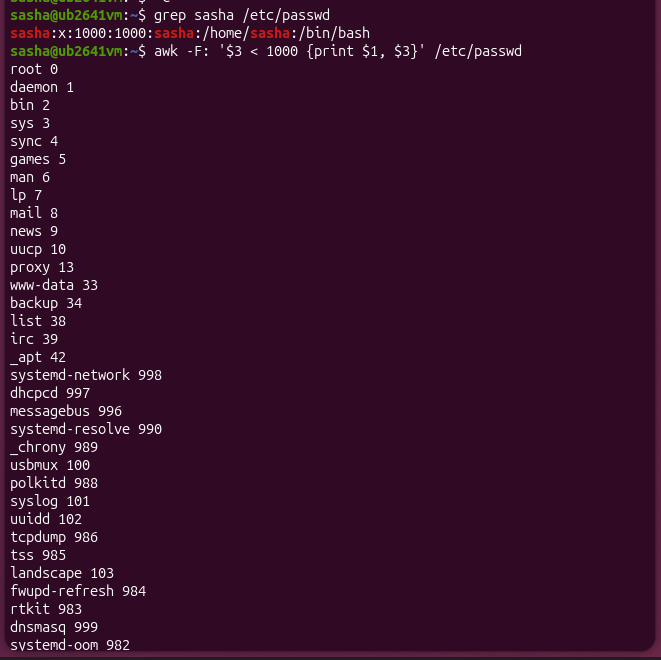

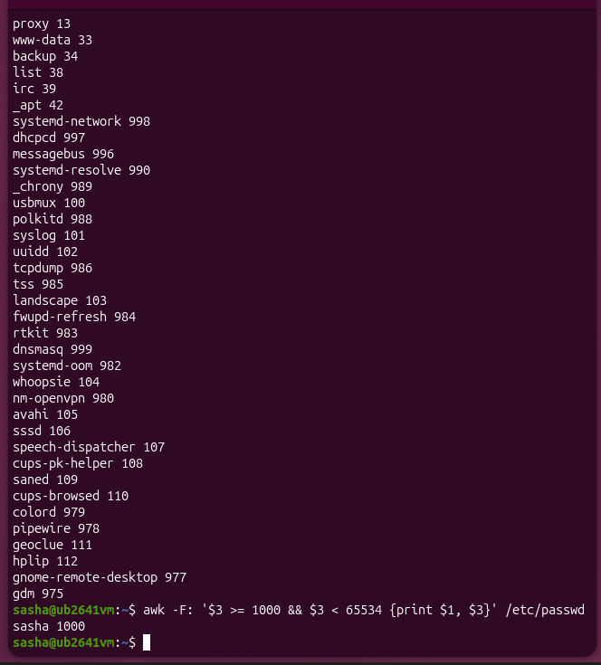

Для дослідження /etc/passwd виконано команду grep sasha /etc/passwd, яка повернула sasha:x:1000:1000:sasha:/home/sasha:/bin/bash. Тут sasha — логін, x — хеш у /etc/shadow, 1000 — UID, 1000 — GID, sasha — опис, /home/sasha — домашній каталог, /bin/bash — оболонка. За допомогою awk -F: '$3 < 1000 {print $1, $3}' /etc/passwd виведено системні записи (UID < 1000: root 0, daemon 1, ..., gdm 975). Команда awk -F: '$3 >= 1000 && $3 < 65534 {print $1, $3}' /etc/passwd вивела єдиного звичайного користувача — sasha 1000.

3 Створив групу та двох навчальних користувачів згідно з варіантом. Додав обох до створеної групи. Показав результат командами id і getent group.

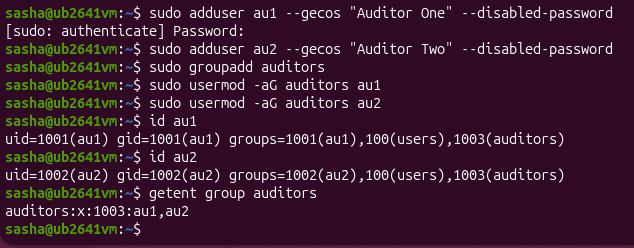

4 Вивів відомості про терміни дії пароля одного з користувачів (chage -l) і заблокував другий обліковий запис. Показав, як блокування відображається в /etc/shadow.

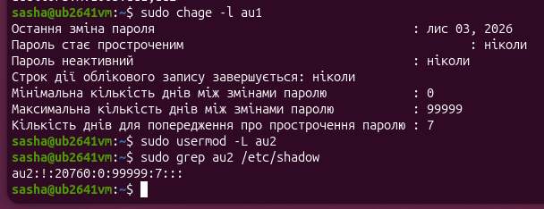

За допомогою команди sudo chage -l au1 перевірено відомості про терміни дії пароля користувача au1. Обліковий запис au2 заблоковано командою sudo usermod -L au2. У результаті перевірки файлу /etc/shadow командою sudo grep au2 /etc/shadow отримано рядок au2:!:20760:0:99999:7:::, де знак оклику ! на початку другого поля означає блокування пароля.

5 Створив каталог ~/lab8 з файлами та скриптом. Встановив права символьним способом, потім ті самі права — числовим. Показав, що результат однаковий.

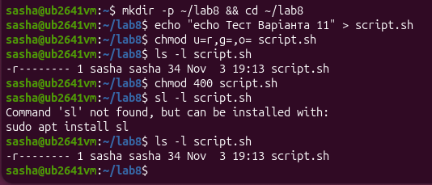

У каталозі ~/lab8 створено скрипт script.sh. Символьним способом chmod u=r,g=,o= script.sh встановлено права 400 (-r--------). Потім ті самі права встановлено числовим способом chmod 400 script.sh. Команда ls -l script.sh підтвердила, що обидва способи дають ідентичний результат (-r--------).

6 Продемонстрував різницю прав для каталогу: зняв біт x, спробував прочитати файл усередині, пояснив результат.

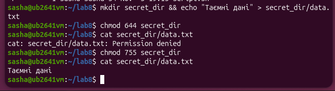

У каталозі ~/lab8 створено підкаталог secret_dir із файлом data.txt. Після зміни прав доступу до каталогу на 644 (зняття біта виконання x), спроба прочитати файл за допомогою cat secret_dir/data.txt видала помилку Permission denied. Це пояснюється тим, що для доступу до вмісту файлу обов'язково потрібен біт виконання на його батьківському каталозі. Після відновлення прав до каталогу (755) файл успішно прочитався.

7 Дослідив маску umask: створив файл і каталог за поточної маски, змінив маску на значення свого варіанта, повторив й пояснив різницю.

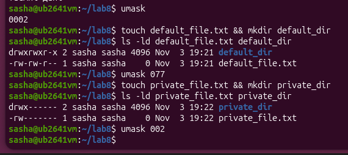

Досліджено роботу маски umask. За поточної маски 0002 створено файл default_file.txt (664) та каталог default_dir (775). Після зміни маски на значення з Варіанта 11 (umask 077), створені файли та каталоги отримали приватні права 600 (-rw-------) та 700 (drwx------), оскільки маска побітово заборонила будь-які права для групи та інших користувачів. Наприкінці маску повернено до початкового стану 0002.

8 Налаштував спільний каталог команди /srv/team з бітами SGID і sticky. Від імені обох користувачів створив файли, потім спробував видалити чужий файл. Пояснив результат кожної операції.

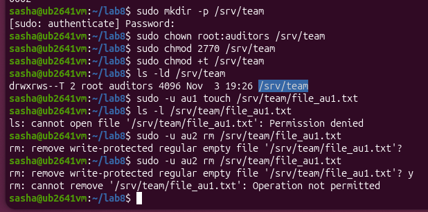

У системі створено спільний каталог /srv/team для групи auditors. За допомогою команд sudo chmod 2770 /srv/team та sudo chmod +t /srv/team встановлено біт SGID та Sticky bit (drwxrws--T). Від імені користувача au1 створено файл, який автоматично успадкував групу каталогу (SGID). Спроба користувача au2 видалити цей файл завершилася помилкою Operation not permitted, що підтверджує захисну дію Sticky bit.

9 Надав доступ до файлу конкретному користувачеві через ACL згідно з варіантом. Показав вивід getfacl і пояснив, чому знадобилися права на батьківські каталоги.

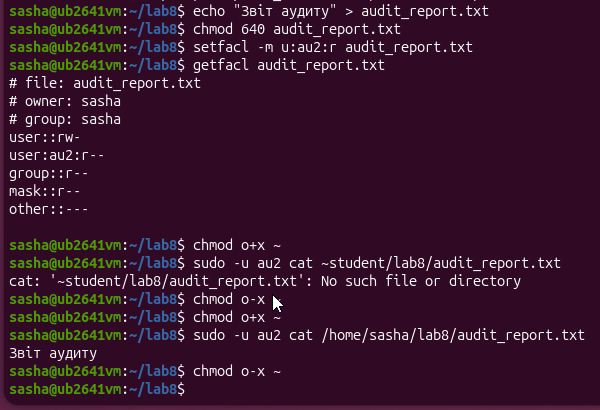

У каталозі ~/lab8 створено файл audit_report.txt з правами 640. За допомогою команди setfacl -m u:au2:r audit_report.txt надано право читання для користувача au2 згідно з Варіантом 11, що підтверджено виводом getfacl. Для успішного читання файлу від імені au2 тимчасово відкрито виконання на домашній каталог (chmod o+x ~), після чого вказано абсолютний шлях до файлу (/home/sasha/lab8/audit_report.txt), що дозволило успішно отримати вміст «Звіт аудиту». Наприкінці права домашнього каталогу повернуто у початковий стан (chmod o-x ~)

10 Виконав додаткове завдання свого варіанта.

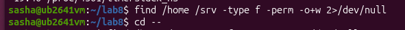

Виконана команда: find /home /srv -type f -perm -o+w 2>/dev/null . Вивід відсутній (порожній рядок), оскільки в сканованих каталогах відсутні файли з правами запису для категорії others.

11 Прибрав за собою: повернув права домашнього каталогу (chmod o-x ~), видалив навчальних користувачів (sudo deluser --remove-home dev1) і групу (sudo groupdel developers), якщо це передбачено варіантом, і зафіксував результат.

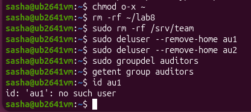

Виконано очищення системи згідно з вимогами. Повернуто права доступу до домашнього каталогу (chmod o-x ~). Видалено створені робочі файли та каталог ~/lab8, а також спільний каталог /srv/team (sudo rm -rf). За допомогою команд sudo deluser --remove-home та sudo groupdel повністю видалено навчальних користувачів au1, au2 та групу auditors. Перевірка командами getent group та id підтвердила успішне видалення облікових записів.

## Відповіді на контрольні питання

1 Спроєктуйте права для каталогу проєкту, у якому працюють дві групи: одна редагує файли, друга лише читає. Опишіть команди й обґрунтуйте кожне рішення.

Для реалізації цієї вимоги необхідно створити спільний каталог, призначити йому відповідну групу власників та скористатися можливостями списків контролю доступу (ACL). Спочатку створюється каталог, наприклад /srv/project, після чого власністю групи за замовчуванням призначається група редакторів за допомогою команди sudo chown root:editors /srv/project. Для того щоб усі нові файли та підкаталоги всередині автоматично успадковували права та належність до цієї групи, на каталог встановлюється спеціальний біт SGID за допомогою команди sudo chmod 2770 /srv/project. Оскільки стандартна модель прав Linux (ugo/rwx) підтримує лише одну групу, для другої групи, яка повинна лише читати файли, застосовуються розширені ACL-права. Команда sudo setfacl -R -m g:readers:r-x /srv/project надає групі читачів права на перегляд і читання, а команда sudo setfacl -d -m g:readers:r-x /srv/project задає правила успадкування (default ACL), щоб усі майбутні файли автоматично були доступні для читання цією групою. Таке рішення обґрунтоване тим, що поєднання біта SGID та розширених ACL дозволяє гнучко розділити права між двома різними групами користувачів без порушення загальної безпеки системи.

2 Поясніть, навіщо програмі passwd потрібен біт SUID, які ризики це створює і як система їх обмежує.

Програмі passwd біт SUID (Set User ID) потрібен тому, що звичайний користувач під час зміни власного пароля повинен мати можливість оновити системний файл /etc/shadow, куди не мають права запису сторонні користувачі. Коли виконаний біт SUID активний для виконуваного файлу, процес запускається з правами власника цього файлу — у даному випадку з привилегіями суперкористувача root, що дозволяє звичайному юзеру тимчасово отримати необхідні повноваження лише на час виконання цієї конкретної програми. Головний ризик такого підходу полягає в тому, що будь-яка потенційна вразливість (наприклад, переповнення буфера чи логічна помилка в коді програми) потенційна відкрити зловмиснику повний контроль над системою з правами root. Для мінімізації цих ризиків сучасні операційні системи суворо обмежують кількість програм із бітом SUID, ретельно перевіряють їхній вихідний код, використовують захисні механізми на рівні ядрі й компілятора (як-от Address Space Layout Randomization та пісочниці), а самі утиліти проєктуються максимально мінімалістичними, щоб виконувати лише одну вузькоспеціалізовану задачу і відразу скидати підвищені привілеї.

3 Користувача видалено, а його файли залишилися. Опишіть, що станеться з цими файлами і чому, та запропонуйте коректний порядок видалення облікового запису.

Якщо видалити лише самого користувача (наприклад, командою userdel без додаткових ключів), його особисті файли залишаться на файловій системі, проте у їхніх атрибутах замість текстового імені власника відображатиметься числовий ідентифікатор (UID). Це відбувається тому, що файлова система прив'язує права до унікального числового UID користувача, а не до його символьного логіна в системі; після видалення запису з файлу /etc/passwd операційна система втрачає зв'язок між цим цифровим UID та ім'ям, залишаючи файлі «сиротами». Якщо згодом у системі буде створено нового користувача, якому ядро призначить той самий числовий UID, він автоматично стане повноправним власником усіх залишених старих файлів попереднього користувача, що створює загрозу безпеці та конфіденційності даних. Щоб уникнути цього, коректний порядок видалення облікового запису передбачає використання спеціального параметра --remove-home (або виконання пошуку та видалення всіх файлів цього користувача на диску перед видаленням самого запису), що гарантує повне очищення системи від залишкових даних. 

4 Сформулюйте принцип найменших привілеїв і покажіть на трьох прикладах із цієї роботи, як він реалізується засобами прав доступу Linux.

Принцип найменших привілеїв (Principle of Least Privilege) полягає в тому, що кожен користувач, процес чи програма повинні мати лише ті мінімальні права доступу, які необхідні для виконання їхніх прямих обов'язків, і нічого зайвого. Першим прикладом реалізації цього принципу є встановлення заборонної маски за замовчуванням umask 077 для нових створюваних об'єктів, яка автоматично відсікає будь-які права доступу для групи та інших користувачів, залишаючи повний доступ виключно власнику. Другим прикладом слугує використання розширених списків доступу (ACL) за допомогою команди setfacl, що дозволяє надати конкретному користувачеві au2 лише право читання (r) до окремого файлу звітів, не відкриваючи при цьому загального доступу для решти системи. Третім прикладом є налаштування спільного каталогу з використанням бітів SGID та Sticky bit, де звичайні користувачі можуть створювати та редагувати файли в межах своєї групи, але позбавлені можливості видаляти чи змінювати чужі файли завдяки обмеженням захисного механізму каталогу.

## Висновок

на цій лабораторній роботі я навчився адмініструвати облікові записи в ОС Linux: створювати й налаштовувати користувачів і групи, керувати правами доступу до файлів символьним і числовим способом, застосовувати спеціальні біти (SGID, Sticky bit) та маску umask, налаштовувати спільний каталог для групи й розмежовувати доступ за допомогою списків ACL. Класична модель прав доступу Linux («власник — група — інші», або owner — group — others) є дуже простою, прозорою та ефективною для базового захисту файлів, проте вона має суттєве обмеження: дозволяє призначити чіткі права лише для одного конкретного користувача та однієї конкретної групи. У реальних корпоративних системах або під час роботи над спільними проєктами часто виникає потреба надати індивідуальні права декільком різним користувачам або кільком групам із різними рівнями доступу (наприклад, одна група редагує вміст, а інша — лише читає). Саме для вирішення таких задач класичну модель доповнюють списками контролю доступу (ACL). Вони дозволяють гнучко та точково призначати специфічні привілеї читання, запису чи виконання для будь-якого додаткового користувача чи групи, не змінюючи при цьому основну власність файлу та не порушуючи загальну структуру безпеки системи
