<!--
  Облікові записи та права доступу до файлів
  Варіант 1: `developers` / dev1, dev2 — `640` — `077` — другого користувача: читання — Пояснити, чому 'chmod 777' вважають грубою помилкою

  Тему, мету й обладнання писати не треба — конвеєр візьме їх із лабораторної.
  Знімки екрана кладіть у assets/, вихідний код — у src/.
  Контрольні питання — лише одного рівня, того, на який захищаєте роботу:
  заголовок «### Достатній рівень», далі «1 Текст питання?» і відповідь.
  Покрокова інструкція — reports/README.md
-->

## Хід роботи

1 Умова індивідуального завдання варіанту №1

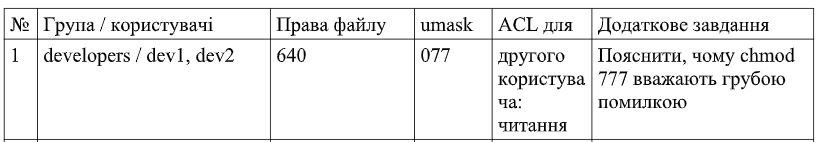

2 Дослідила структуру /etc/passwd: пояснила призначення кожного поля на прикладі власного запису. Вивела окремо системні облікові записи (UID<1000) і записи людей.

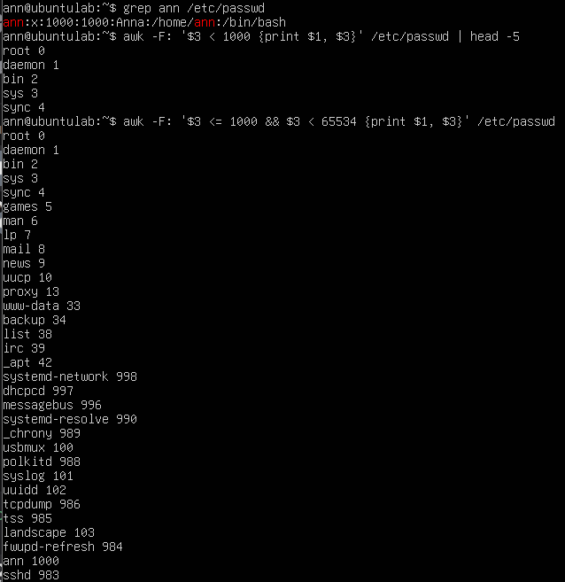

ann — Ім'я користувача, x — Зашифрований пароль (самі хеші паролів зберігаються у /etc/shadow з міркувань безпеки), 1000 — UID (User ID): унікальний ідентифікатор користувача, 1000 — GID (Group ID): ідентифікатор основної групи користувача, Anna — GECOS / Коментар: повне ім'я,   /home/ann — Домашній каталог: шлях до домашньої директорії, /bin/bash — Командна оболонка (Shell): програма, яка запускається під час входу в систему.  

3 Створила групу та двох навчальних користувачів згідно з варіантом. Додала обох до створеної групи. Показала результат командами id і getent group.

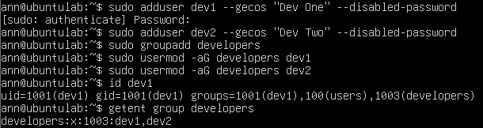

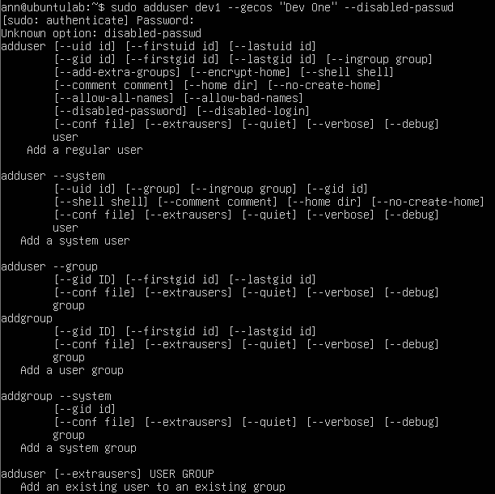

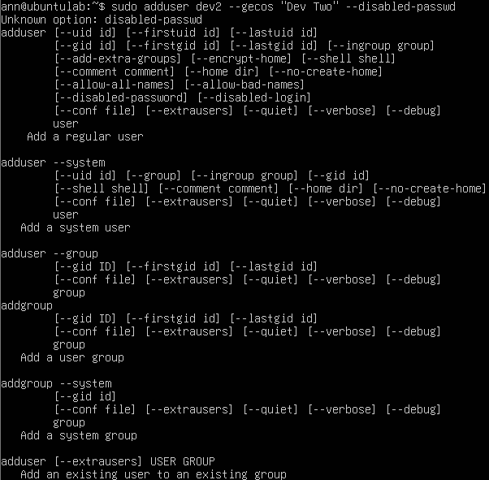

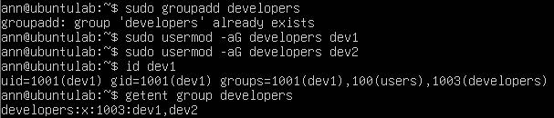

4 Вивела відомості про терміни дії пароля одного з користувачів (chage -l) і заблокувала другий обліковий запис. Показала, як блокування відображається в /etc/shadow.

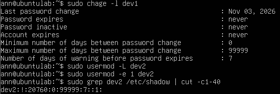

5 Створила каталог ~/lab8 з файлами та скриптом. Встановила права символьним способом, потім ті самі права — числовим. Показала, що результат однаковий.

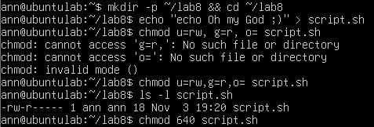

6 Продемонструвала різницю прав для каталогу: зняла біт x, спробувала прочитати файл усередині, пояснила результат.

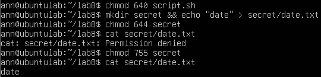

Результат однаковий (-rw-r-----), оскільки обидва методи модифікують однакові біти атрибутів файлу.

7 Дослідила маску umask: створила файл і каталог за поточної маски, змінила маску на значення варіанта №1, повторила й пояснила різницю.

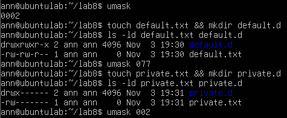

umask визначає права, які маскуються під час створення нових об'єктів. Маска 077 повністю забирає будь-які права на читання, запис та виконання для групи й інших користувачів, роблячи створені файли суворо приватними.

8 Налаштувала спільний каталог команди /srv/team з бітами SGID і sticky. Від імені обох користувачів створила файли, потім спробувала видалити чужий файл. Пояснила результат кожної операції.

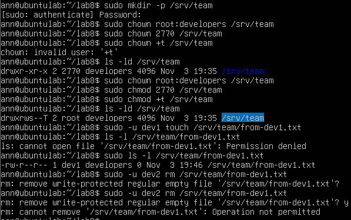

+t - гарантує, що у спільному каталозі з правами на запис видаляти або перейменовувати файл може тільки його власник або root, навіть якщо інші учасники групи мають права запису в сам каталог.

9 Надала доступ до файлу конкретному користувачеві через ACL згідно з варіантом №1. Показала вивід getfacl і пояснила, чому знадобилися права на батьківські каталоги.

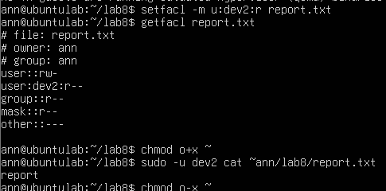

Щоб інші користувачі могли дістатися до файлу в чужій домашній папці, їм потрібно мати право на виконання (x) для цієї папки. Воно працює як дозвіл «пройти крізь» неї. Якщо цього біта немає, система заблокує доступ ще на вході в папку - навіть якщо на самий файл налаштовані всі дозволи через ACL.

10 Прибрала за собою: повернула права домашнього каталогу (chmod o-x ~), видалила навчальних користувачів (sudo deluser --remove-home dev1) і групу (sudo groupdel developers), якщо це передбачено варіантом, і зафіксувала результат.

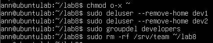

Додаткове завдання варіанта №1: Права 777 дають абсолютно всім користувачам повний доступ (читання, запис і виконання) до файлу чи каталогу. Це повністю руйнує безпеку в Linux і дозволяє зловмисникам змінювати, видаляти дані або впроваджувати шкідливий код.

## Відповіді на контрольні питання

1 Спроєктуйте права для каталогу проєкту, у якому працюють дві групи: одна редагує файли, друга лише читає. Опишіть команди й обґрунтуйте кожне рішення.

Для спільного каталогу створюють групу редакторів і групу читачів, налаштовують базові права через chmod та додають правила ACL, щоб редагувати могли обидві групи або тільки перша, а читати — обидві.

2 Поясніть, навіщо програмі passwd потрібен біт SUID, які ризики це створює і як система їх обмежує.

Біт SUID дозволяє програмі passwd виконуватися від імені її власника (root), щоб звичайний користувач міг безпечно змінити свій пароль у захищеному системному файлі.

3 Користувача видалено, а його файли залишилися. Опишіть, що станеться з цими файлами і чому, та запропонуйте коректний порядок видалення облікового запису.

Після видалення користувача його файли залишаються в системі без власника (замість імені відображається числовий UID), тому перед видаленням запису бажано видалити або архівувати його файли за допомогою команди deluser --remove-home.

4 Сформулюйте принцип найменших привілеїв і покажіть на трьох прикладах із цієї роботи, як він реалізується засобами прав доступу Linux.

Принцип найменших привілеїв означає надання користувачам лише мінімально необхідних прав для роботи, що в цій лабі реалізувалося обмеженням прав через umask 077, наданням точкового доступу через ACL та забороною зайвих прав на системні каталоги й файли.

## Висновок

навчилася адмініструвати облікові записи в Linux: створювати й налаштовувати користувачів і групи, керувати правами доступу до файлів символьним і числовим способом, застосовувати спеціальні біти та маску umask, налаштовувати спільний каталог для групи й розмежовувати доступ
списками ACL
