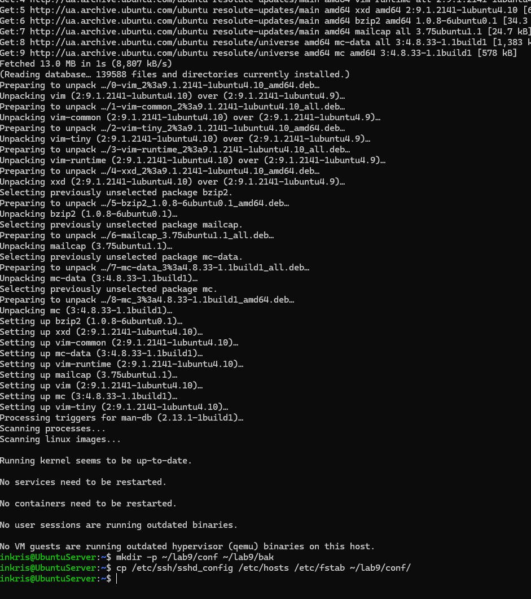
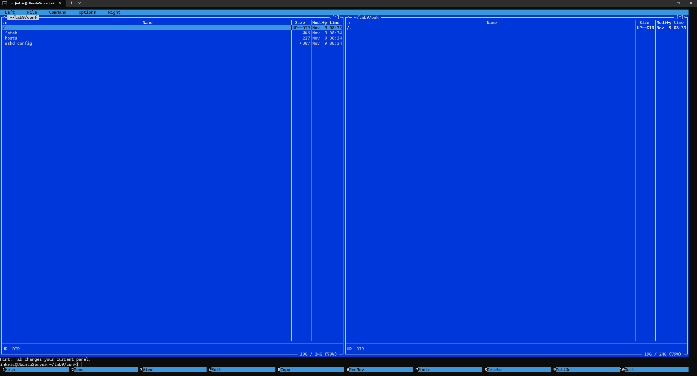
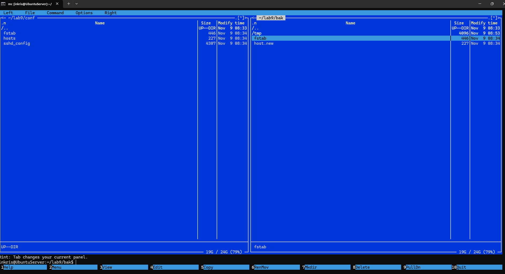
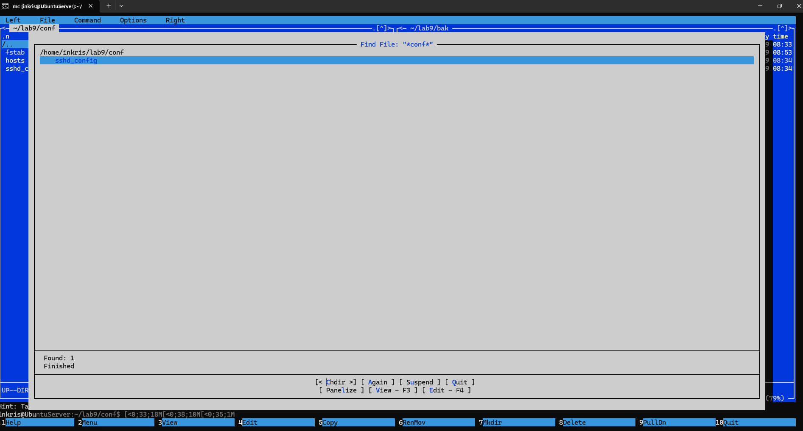
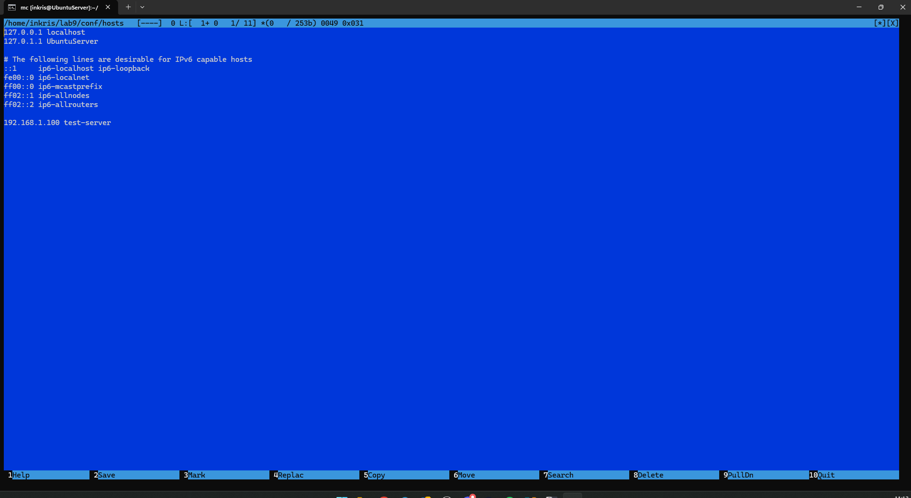
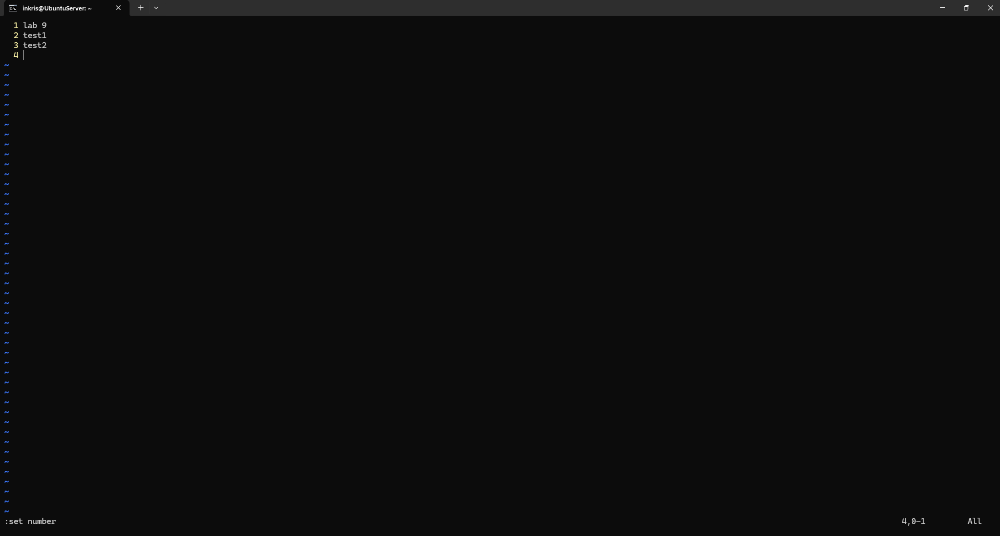
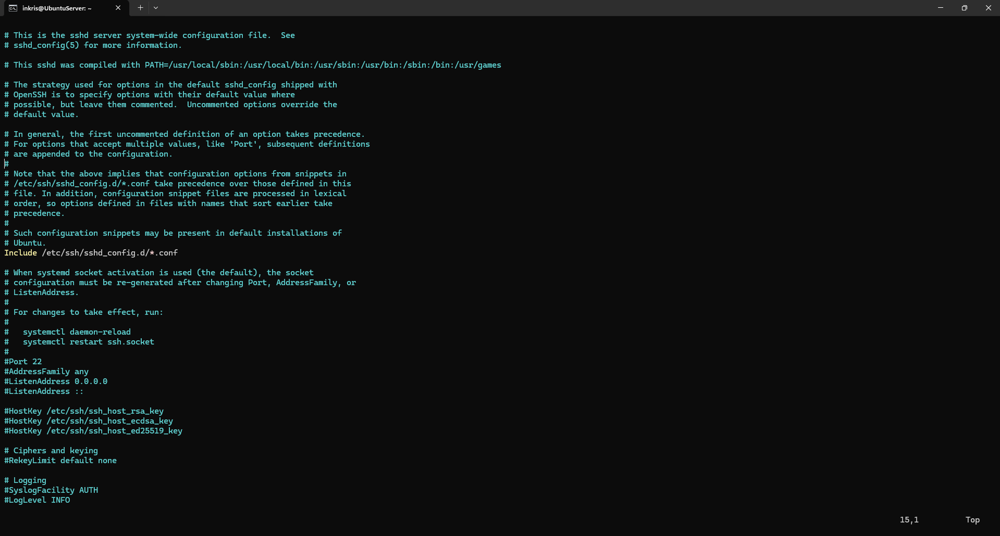
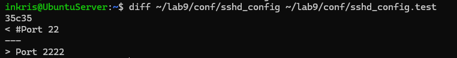

<!--
  Оболонка mc та редактор vi
  Варіант 3: `sysctl.conf`, `hosts`, `resolv.conf` — `*.conf` — `#net.ipv4.ip_forward=1` → без `#` — Пояснити призначення `Ctrl+O` у mc

  Тему, мету й обладнання писати не треба — конвеєр візьме їх із лабораторної.
  Знімки екрана кладіть у assets/, вихідний код — у src/.
  Контрольні питання — лише одного рівня, того, на який захищаєте роботу:
  заголовок «### Достатній рівень», далі «1 Текст питання?» і відповідь.
  Покрокова інструкція — reports/README.md
-->

## Хід роботи

1 Отримав в викладача номер індивідуального варіанта(3).

2 Встановив пакети mc і vim. Створив структуру ~/lab9 з підкаталогами conf і bak, скопіював в conf три конфігураційні файли, зазначені у варіанті (шляхи відносно /etc). Файли, які звичайний користувач прочитати не може (sudoers), копіював командою sudo cp і передавав собі: sudo chown $USER ~/lab9/conf/sudoers.

3 Запустив mc. Описав у звіті призначення обох панелей, рядка функціональних клавіш і меню F9.

Ліва і права панелі призначені для навігації по файловій системі та відображення вмісту двох різних каталогів одночасно (у моєму випадку conf та bak). Нижня панель показує підказки для функціональних клавіш F1-F10. Меню (F9) містить розширені команди управління панелями, пошуку та налаштувань mc.

4 Виконав в mc такі операції: позначив два файли клавішею Insert і скопіював їх на протилежну панель, перейменував один файл, створити каталог, переглянути файл клавішею F3. Кожну дію підтвердити знімком екрана.

5 Скористався можливостями меню F9: порівняв каталоги conf і bak, виконав пошук файлу за маскою свого варіанта. Описав результат.

6 Відредагував файл вбудованим редактором mc (F4): додав рядок, зазначений у варіанті, зберіг клавішею F2.

7 Створив у vi файл notes.txt із трьома рядками тексту. Продемонстрував перехід між режимами, увімкнути нумерацію рядків, зберегти файл.

8 Виконав у vi на копії конфігураційного файлу: перехід до кінця й початку файлу, пошук параметра свого варіанта, видалення рядка, скасування видалення, перехід до заданого рядка. Вийшов без збереження.

9 Виконав заміну параметра згідно з варіантом командою :%s, зберіг файл під новим іменем і підтвердив зміну командою diff.

10 Виконав додаткове завдання свого варіанта.

Клавіша F3 відкриває файл у режимі виключно для перегляду (View), що унеможливлює випадкову зміну важливих конфігурацій. Клавіша F4 відкриває файл у вбудованому редакторі (Edit), дозволяючи вносити та зберігати зміни.

## Відповіді на контрольні питання

1 Сервер доступний лише через SSH, графічної оболонки немає, потрібно терміново виправити помилку в конфігурації служби. Опишіть повний порядок дій із зазначенням інструментів і поясніть, чому обрали саме їх.

Підключення здійснюється через термінал по SSH, після чого конфігураційний файл обов'язково резервується командою cp для можливості швидкого відновлення. Далі файл відкривається в редакторі vi, оскільки він гарантовано присутній у будь-якій системі згідно зі стандартом POSIX, навіть при збоях інших пакетів. Після внесення та збереження змін служба перезапускається системною командою для застосування нових параметрів.

2 Поясніть, чому модальність vi, яка спершу здається незручною, у роботі досвідченого адміністратора дає виграш у швидкості. Проілюструйте прикладом із цієї роботи.

Модальність дозволяє керувати текстом без відриву рук від основного буквеного ряду клавіатури, використовуючи короткі літерні команди замість миші чи складних меню. Коли команди переходять у м'язову пам'ять, адміністратор редагує файли практично миттєво. Наприклад, під час виконання цієї роботи для видалення цілого рядка конфігурації достатньо було двічі натиснути клавішу d у командному режимі, замість того, щоб тягнутися за мишею і виділяти текст.

3 Сформулюйте правила безпечного редагування системних конфігураційних файлів і обґрунтуйте кожне з них наслідками помилки.

Головне правило вимагає завжди створювати резервну копію файлу перед змінами, оскільки пошкодження оригіналу без бекапу може повністю зупинити роботу сервера. Друге правило — використання безпечних інструментів на кшталт sudoedit замість запуску самого редактора з правами root, що захищає систему від перехоплення вищих привілеїв через вразливості редактора. Третє правило полягає в обов'язковій перевірці внесених змін командою diff перед перезапуском служби, адже непомітна випадкова зміна навіть одного символу призведе до помилки конфігурації.

4 Порівняйте роботу з файлами в mc і в чистому командному рядку за трьома критеріями: швидкість, надійність, можливість автоматизації. Для яких задач ви оберете кожен варіант?

Midnight Commander перевершує у швидкості візуальної навігації та ручного масового виділення файлів, тоді як чистий командний рядок забезпечує вищу надійність для виконання точних, одиничних системних інструкцій. У питанні автоматизації командний рядок має абсолютну перевагу, оскільки дозволяє створювати скрипти, тоді як mc призначений виключно для ручної взаємодії. Тому mc я оберу для огляду каталогів та швидкого копіювання груп файлів, а чистий термінал — для написання автоматизованих сценаріїв і складного адміністрування.

## Висновок
Опанував роботу в текстовому режимі без графічного середовища: навчився виконувати файлові операції у двопанельному менеджері Midnight Commander, користуватися його вбудованими переглядачем і редактором, а також редагувати файли в редакторі vi — перемикати режими, переміщатися текстом, виконувати пошук і заміну, зберігати зміни.
