<!--
  Оболонка mc та редактор vi
  Варіант 9: `nsswitch.conf`, `resolv.conf` — `*.conf` — `nameserver 127.0.0.53` → `8.8.8.8` — Показати, як у vi замінити з підтвердженням

  Тему, мету й обладнання писати не треба — конвеєр візьме їх із лабораторної.
  Знімки екрана кладіть у assets/, вихідний код — у src/.
  Контрольні питання — лише одного рівня, того, на який захищаєте роботу:
  заголовок «### Достатній рівень», далі «1 Текст питання?» і відповідь.
  Покрокова інструкція — reports/README.md
-->

## Хід роботи

1 Умова індивідуального завдання:

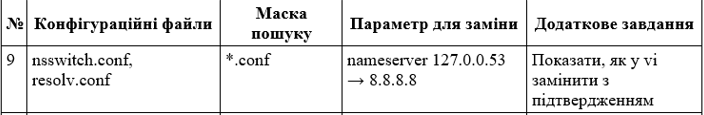

2 Встановив пакети mc і vim. Створив структуру ~/lab9 з підкаталогами conf і bak, скопіював в conf два конфігураційні файли, зазначені у варіанті (nsswitch.conf, resolv.conf).

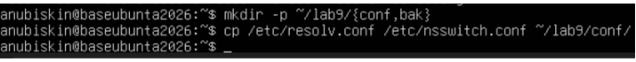

3 Запустив mc. 

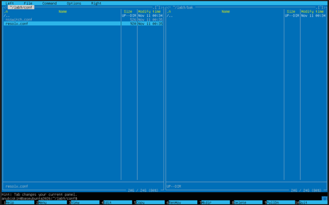

У лівій панелі знаходиться вміст каталогу ~/lab9/conf/, а в правій - вміст ~/lab9/bak/.
Призначення клавіш функціонального рядка:
F1 - Довідка;
F2 - користувацьке меню;
F3 - Перегляд вмісту файлу;
F4 - Редагування файлу;
F5 - Копіювання файлу/папки з однієї панелі на іншу;
F6 - Переміщення або перейменування;
F7 - створити каталог;
F8 - видалити (без підтвердження повернення);
F9 - Виклик верхнього меню;
F10 - Вихід з програми.
Можливості меню F9: порівняння каталогів (Команда → Порівняти каталоги), пошук файлів (Команда → Пошук файлу), а також панель із деревом каталогів для швидкої навігації.

4 Виконав в mc такі операції: позначив два файли клавішею Insert і скопіював їх на протилежну панель, перейменував один файл, створив каталог, переглянув файл клавішею F3.

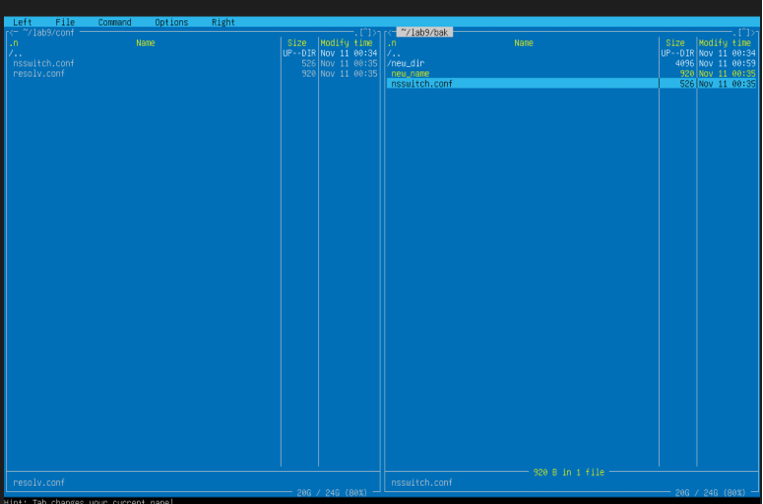

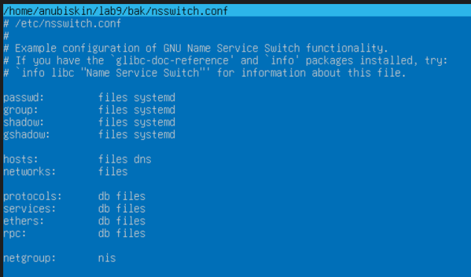

5 Скористався можливостями меню F9: порівняв каталоги conf і bak, виконав пошук файлу за маскою свого варіанта (*.conf) для директорії ~/lab9/bak.

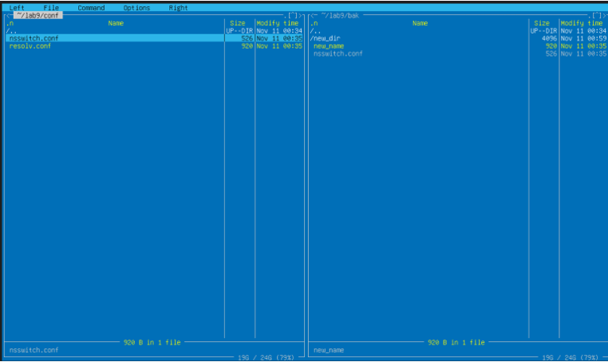

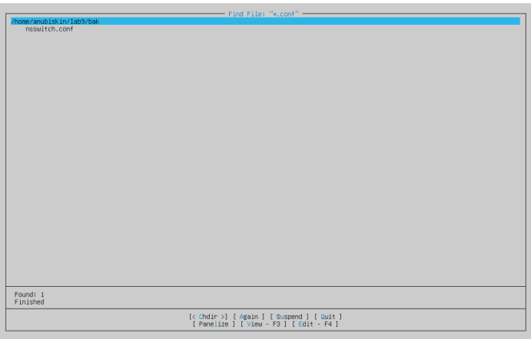

Після виконання команди порівняння директорій у нижній частині інтерфейсу вивелись розміри двох файлів: один з директорії conf, інший з директорії bak.
Після виконання команди пошуку файлу за маскою на екран вивілось вікно зі знайденими файлами (у моєму випадку тільки 1 файл було знайдено).

6 Відредагував файл resolv.conf вбудованим редактором mc (F4): додав рядок, зазначений у варіанті (nameserver 127.0.0.53 → 8.8.8.8), зберіг клавішею F2.

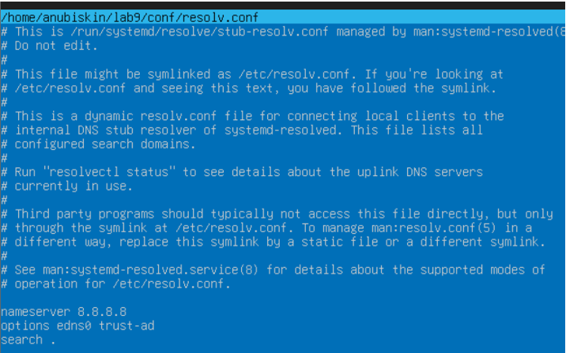

7 Створив у vi файл notes.txt із трьома рядками тексту. Продемонстрував перехід між режимами, увімкнув нумерацію рядків, зберіг файл.

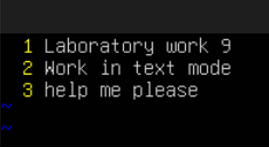

8 Виконав у vi на копії конфігураційного файлу resolv.conf (new_name у директорії bak): перехід до кінця й початку файлу, пошук параметра свого варіанта (nameserver 8.8.8.8), видалення рядка, скасування видалення, перехід до заданого рядка. Вийшов без збереження командою :q!.

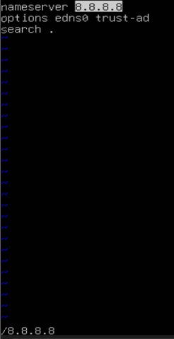

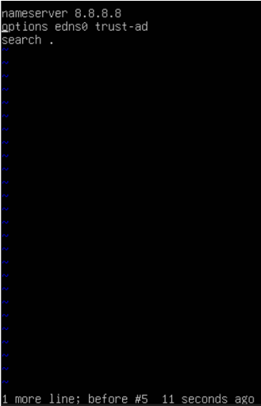

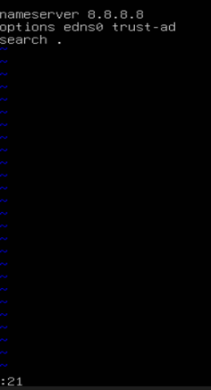

9 Виконав заміну параметра згідно з варіантом (nameserver 8.8.8.8 → 127.0.0.53) командою :%s, зберегти файл під новим іменем і підтвердити зміну командою diff.

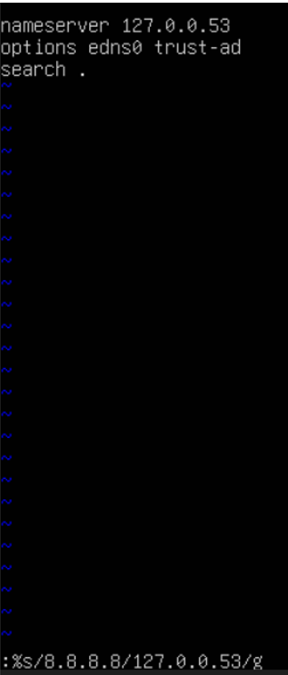

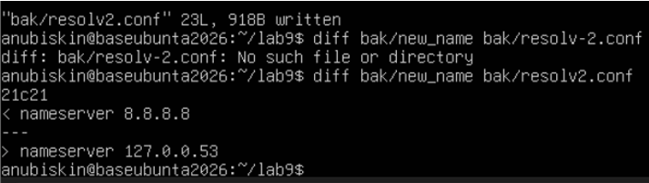

10 Виконав додаткове завдання свого варіанта: Щоб замінити рядок з підтвердженням заміни потрібно в кінці команди :%s замість /g написати /gc.

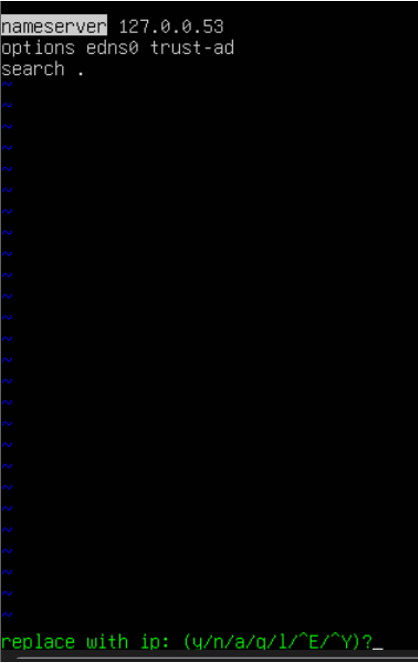

## Відповіді на контрольні питання
1 Сервер доступний лише через SSH, графічної оболонки немає, потрібно терміново виправити помилку в конфігурації служби. Опишіть повний порядок дій із зазначенням інструментів і поясніть, чому обрали саме їх.
Спочатку потрібно підключитися до сервера за допомогою SSH (ssh user@server). Далі знайти потрібний конфігураційний файл за допомогою команд cd, ls або find. Перед редагуванням варто створити резервну копію файлу командою cp.
Для виправлення помилки можна використати текстовий редактор vi або nano. Наприклад, у vi відкрити файл командою vi /etc/service.conf, внести зміни та зберегти їх. Після цього перевірити правильність конфігурації та перезапустити службу за допомогою systemctl restart назва_служби. Завершальним кроком буде перевірка її стану командою systemctl status назва_служби.
Ці інструменти обрані тому, що вони працюють без графічної оболонки, доступні через термінал і дозволяють швидко виправити помилку.

2 Поясніть, чому модальність vi, яка спершу здається незручною, у роботі досвідченого адміністратора дає виграш у швидкості. Проілюструйте прикладом із цієї роботи.
Редактор vi має різні режими роботи: режим команд і режим введення тексту. Спочатку це може здаватися незручним, але з часом така система дозволяє швидко редагувати файли, не використовуючи мишу та не перемикаючись між інструментами.
Наприклад, адміністратор може відкрити конфігураційний файл, знайти потрібний параметр командою /назва_параметра, перейти до нього, натиснути i для редагування, а потім використати Esc і :wq для збереження змін та виходу. Завдяки комбінаціям клавіш редагування відбувається швидше.

3 Сформулюйте правила безпечного редагування системних конфігураційних файлів і обґрунтуйте кожне з них наслідками помилки.
1) Створювати резервну копію перед редагуванням. Це дозволить відновити початковий файл, якщо зміни виявляться неправильними.
2) Перевіряти шлях і назву файлу. Редагування не того файлу може порушити роботу іншої служби або всієї системи.
3) Уважно перевіряти синтаксис. Помилки в параметрах можуть призвести до того, що служба не запуститься.
4) Не змінювати зайві налаштування. Непотрібні зміни можуть спричинити додаткові помилки або порушити безпеку системи.
5) Перевіряти роботу служби після редагування. Це допоможе вчасно виявити проблему та виправити її до того, як вона вплине на користувачів.

4 Порівняйте роботу з файлами в mc і в чистому командному рядку за трьома критеріями: швидкість, надійність, можливість автоматизації. Для яких задач ви оберете кожен варіант?
1) Midnight Commander (mc):
Швидкість: Висока для ручних операцій. Завдяки двопанельному інтерфейсу та гарячим клавішам ви бачите все на екрані та виконуєте базові дії в рази швидше, ніж набираючи довгі шляхи вручну.
Надійність: Середня. Інтерфейс наочний, але через людський фактор можна випадково перетягнути не туди або захопити зайвий файл. Проте програми виводять діалогові вікна підтвердження.
Автоматизація: Низька. mc — це інтерактивний інструмент для роботи людиною за екраном, його неможливо закинути в автоматичний скрипт чи налаштувати на виконання за розкладом.
Для яких задач обрати: Для ручного сортування й аудиту файлів, візуального порівняння вмісту папок, швидкого відбору файлів та редагування конфігів на льоту за допомогою вбудованого редактора (F4).
2) Командний рядок:
Швидкість: Низька для новачків (потребує пам'ятати синтаксис і вручну прописувати шляхи), але максимальна для професіоналів, які володіють автодоповненням та історією команд.
Надійність: Висока. Ви чітко знаєте, що робите. Однак помилка в один символ (наприклад, зайвий пробіл у небезпечній команді на кшталт видалення) робить командний рядок більш ризикованим для новачків.
Автоматизація: Максимальна. Будь-які дії можна об'єднати у скрипти, налаштувати виконання за розкладом чи запустити масову обробку тисяч файлів однією командою.
Для яких задач обрати: Для масових операцій за шаблоном (наприклад, перейменування чи пошук тисяч файлів), написання скриптів автоматизації, налаштування резервних копій та роботи на віддалених серверах із нестабільним інтернетом, де графічні інтерфейси гальмують.

## Висновок

Опанував роботу в текстовому режимі без графічного середовища: навчився виконувати файлові операції у двопанельному менеджері Midnight Commander, користуватися його вбудованими переглядачем і редактором, а також редагувати файли в редакторі vi — перемикати режими, переміщатися текстом, виконувати пошук і заміну, зберігати зміни.
