<!--
  Оболонка mc та редактор vi
  Варіант 11: `sshd_config`, `ssh_config` — `ssh*` — `#MaxAuthTries 6` → `MaxAuthTries 3` — Пояснити призначення клавіші `Insert` у mc

  Тему, мету й обладнання писати не треба — конвеєр візьме їх із лабораторної.
  Знімки екрана кладіть у assets/, вихідний код — у src/.
  Контрольні питання — лише одного рівня, того, на який захищаєте роботу:
  заголовок «### Достатній рівень», далі «1 Текст питання?» і відповідь.
  Покрокова інструкція — reports/README.md
-->

## Хід роботи

1 Отримав в викладача номер індивідуального варіанта.

2 Встановив (за потреби) пакети mc і vim. Створив структуру ~/lab9 з підкаталогами conf і bak, скопіював в conf три конфігураційні файли, зазначені у варіанті (шляхи відносно /etc). Файли, які звичайний користувач прочитати не може (sudoers), скопіював командою sudo cp і передавати собі: sudo chown $USER ~/lab9/conf/sudoers.

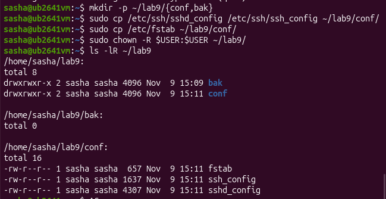

Команда mkdir -p ~/lab9/{conf,bak} створює робочий каталог lab9 з підкаталогами conf і bak. За допомогою sudo cp у каталог conf скопійовано конфігураційні файли з системної директорії /etc. Оскільки вони захищені від звичайного користувача, застосовано привілеї sudo, а команда sudo chown -R USER:USER ~/lab9/ змінила власника цих файлів на поточного користувача для подальшої зручної роботи. Наприкінці команда ls -R ~/lab9 виводить ієрархію каталогу для перевірки успішності виконання.

3 Запустив mc. Описав у звіті призначення обох панелей, рядка функціональних клавіш і меню F9.

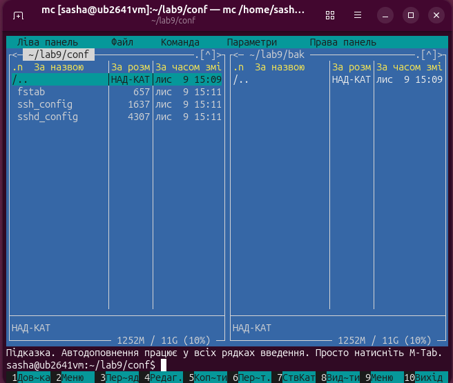

Команда mc ~/lab9/conf ~/lab9/bak запускає двопанельний файловий менеджер Midnight Commander, одразу відкриваючи каталог conf у лівій панелі та каталог bak у правій для зручної роботи з ними. Призначення обох панелей полягає в одночасному відображенні різних каталогів для зручного керування файлами, рядок функціональних клавіш унизу служить для швидкого виклику основних дій від F1 до F10, а верхнє меню за клавішею F9 відкриває доступ до додаткових інструментів та налаштувань.

4 Виконав в mc такі операції: позначив два файли клавішею Insert і скопіював їх на протилежну панель, перейменував один файл, створив каталог, переглянув файл клавішею F3. Кожну дію підтвердив знімком екрана.

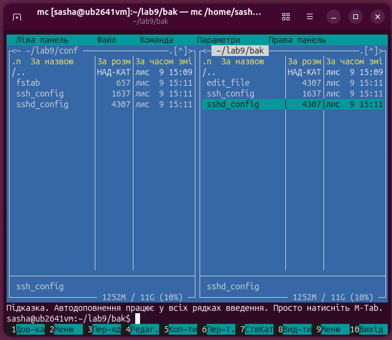

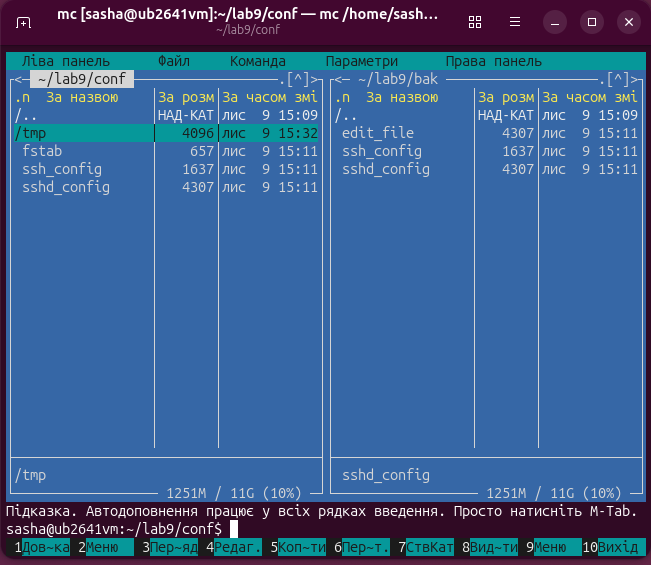

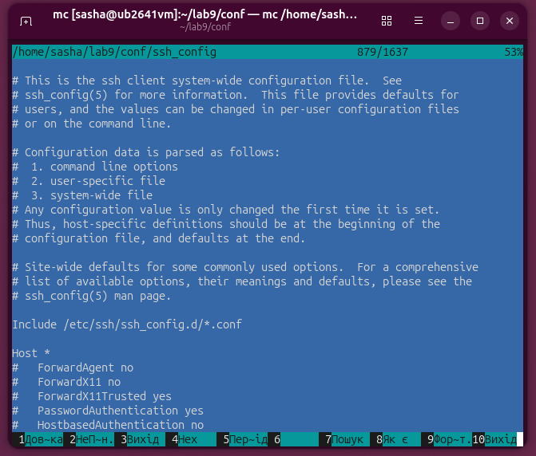

5 Скористався можливостями меню F9: порівняв каталоги conf і bak, виконав пошук файлу за маскою свого варіанта. Описав результат.

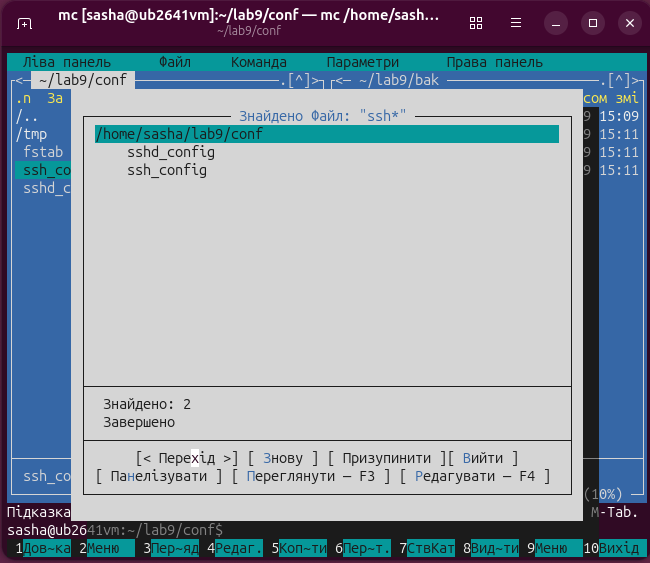

Успішний пошук за маскою ssh* через меню команд дозволив знайти у робочому каталозі два відповідних файли конфігурації (sshd_config та ssh_config), після чого їх можна одразу переглянути або редагувати.

6 Відредагував файл вбудованим редактором mc (F4): додав рядок, зазначений у варіанті, зберіг клавішею F2.

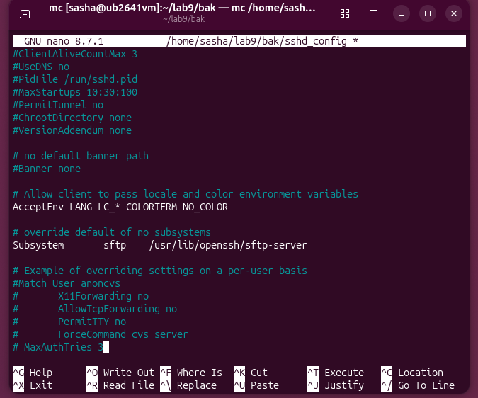

7 Створив у vi файл notes.txt із трьома рядками тексту. Продемонстрував перехід між режимами, увімкнув нумерацію рядків, зберіг файл.

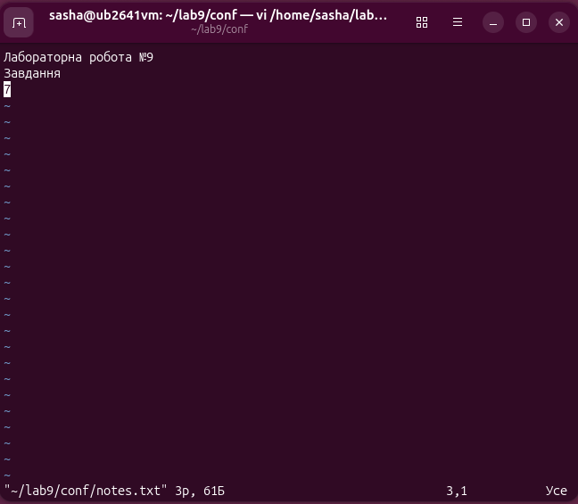

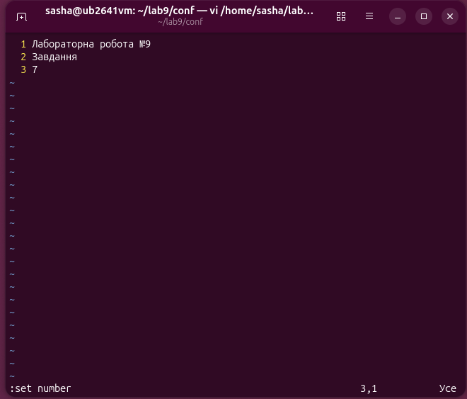

8 Виконав у vi на копії конфігураційного файлу: перехійшов до кінця й початку файлу, пошук параметра свого варіанта, видалення рядка, скасування видалення, перехід до заданого рядка. Вийшов без збереження.

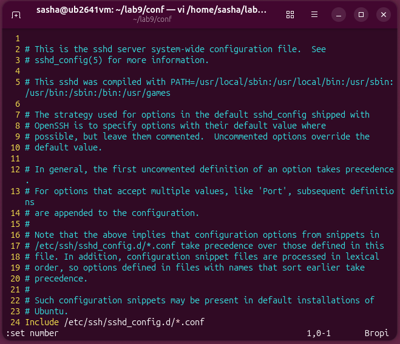

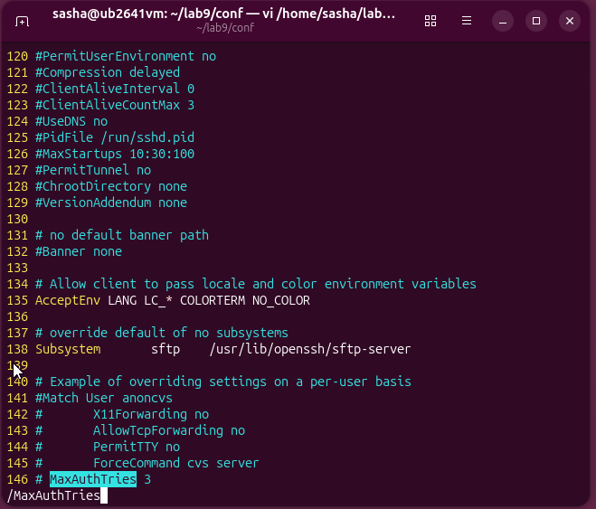

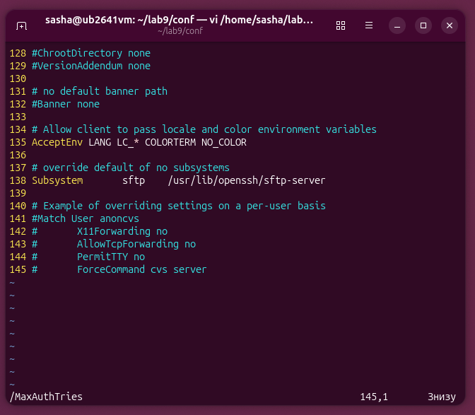

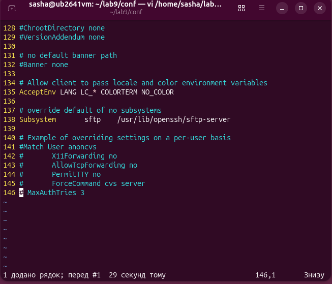

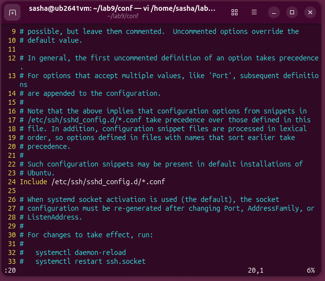

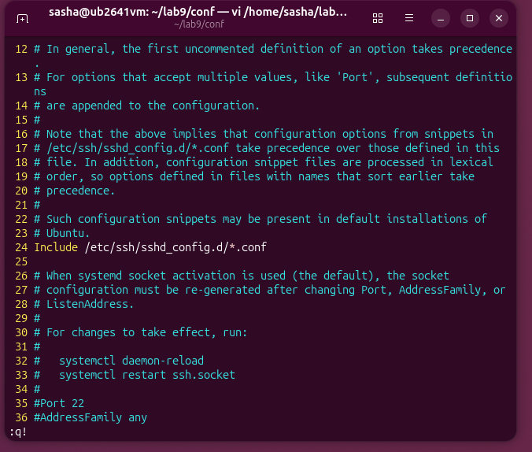

9 Виконав заміну параметра згідно з варіантом командою :%s, зберіг файл під новим іменем і підтвердив зміну командою diff.

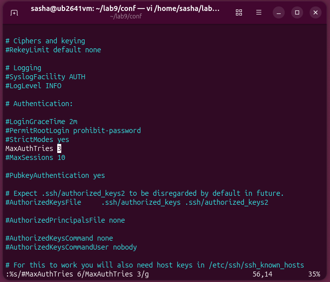

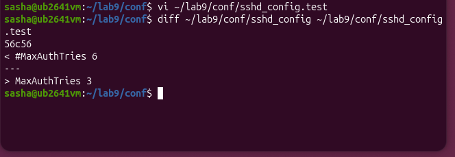

Команда diff ~/lab9/conf/sshd_config ~/lab9/conf/sshd_config.test порівнює два зазначені файли рядок за рядком і виводить їхні відмінності. Вивід 56c56 вказує, що у 56-му рядку першого файлу відбулася зміна (c) порівняно з 56-м рядком другого файлу, де рядок зі знаком < (#MaxAuthTries 6) наявний у першому файлі, а рядок зі знаком > (MaxAuthTries 3) з'явився у другому файлі.

10 Виконав додаткове завдання свого варіанта.

Клавіша Insert у файловому менеджері Midnight Commander (mc) використовується для позначення (виділення) окремих файлів або каталогів для подальшого виконання масових (групових) операцій над ними. Позначені файли підсвічуються іншим кольором. Після цього одноразове натискання клавіші дії (наприклад, F5 для копіювання, F8 для видалення або F6 для переміщення) застосує цю операцію одразу до всього списку виділених елементів, що значно прискорює роботу в порівнянні з пофайловою обробкою.

## Відповіді на контрольні питання

1 Сервер доступний лише через SSH, графічної оболонки немає, потрібно терміново виправити помилку в конфігурації служби. Опишіть повний порядок дій із зазначенням інструментів і поясніть, чому обрали саме їх.

Для вирішення цього завдання спершу підключаються до сервера за допомогою захищеного протоколу SSH, який є стандартним і найбезпечнішим засобом віддаленого адміністрування в умовах відсутності графічного інтерфейсу. Перед внесенням будь-яких змін створюють резервну копію конфігураційного файлу за допомогою команди cp, що гарантує можливість швидкого відкату на робочу конфігурацію в разі помилки. Для редагування обирають текстовий редактор із підтримкою термінала (наприклад, mcedit або vi), оскільки вони працюють безпосередньо у консолі без потреби в графічній оболонці. Після виправлення помилки обов'язково перевіряють синтаксис файлу та перезапускають відповідну службу для застосування нових параметрів.

2 Поясніть, чому модальність vi, яка спершу здається незручною, у роботі досвідченого адміністратора дає виграш у швидкості. Проілюструйте прикладом із цієї роботи.

Розподіл на режими в редакторі vi (командний і режим вставки) дозволяє виконувати навігацію, видалення, копіювання та пошук за допомогою коротких комбінацій клавіш без використання миші чи перемикання розкладки, що суттєво пришвидшує роботу. Адміністратор не заважає введенню тексту випадковими кліками, а керує процесом виключно з клавіатури. Яскравим прикладом із цієї роботи є глобальна заміна рядка конфігурації за допомогою команди пошуку та підстановки у командному режимі (:%s/#MaxAuthTries 6/MaxAuthTries 3/g), яка виконує складну операцію модифікації миттєво одним рядком замість ручного гортання всього файлу.

3 Сформулюйте правила безпечного редагування системних конфігураційних файлів і обґрунтуйте кожне з них наслідками помилки.

Першим і найважливішим правилом є обов'язкове створення резервної копії файлу перед початком будь-яких правок, адже помилка у конфігурації може призвести до повної втрати віддаленого доступу до сервера чи падіння критично важливих служб. Другим правилом є внесення змін поступово, що дозволяє чітко локалізувати проблему в разі некоректної поведінки системи, а не намагатися шукати збій серед десятків змінених параметрів одночасно. Третім правилом є перевірка синтаксису файлу перед перезапуском служби (наприклад, спеціальними вбудованими перевірками на кшталт sshd -t), щоб уникнути простою через банальну опечатку.

4 Порівняйте роботу з файлами в mc і в чистому командному рядку за трьома критеріями: швидкість, надійність, можливість автоматизації. Для яких задач ви оберете кожен варіант?

За критерієм швидкості візуальний менеджер mc виграє для наочного пошуку, порівняння каталогів і швидкого копіювання кількох файлів людиною, тоді як чистий командний рядок набагато швидший для точкових команд досвідченого користувача без зайвих візуальних ефектів. За надійністю обидва інструменти однакові за умови розуміння користувачем своїх дій, але mc мінімізує ризик помилки у написанні довгих шляхів завдяки двопанельному інтерфейсу. Водночас чистий командний рядок має абсолютну перевагу в можливості автоматизації через написання скриптів (bash), тоді як mc є виключно інтерактивним інструментом для ручної роботи. Відповідно, mc обирається для ручного аудиту, порівняння вмісту течок та швидкого візуального керування файлами, а чистий командний рядок — для щоденного адміністрування, написання скриптів резервного копіювання та віддаленої роботи з мінімальним споживанням ресурсів.

## Висновок

на цій лабораторній роботі, я навчився працювати в текстовому режимі без використання графічного середовища. Зокрема, я опанував виконання базових файлових операцій у двопанельному менеджері Midnight Commander, навчився користуватися його вбудованим переглядачем і редактором, а також розібрався з редагуванням конфігураційних файлів у редакторі vi. Я зрозумів принципи перемикання між його режимами, навчився швидко переміщатися текстом, виконувати пошук, здійснювати заміну рядків та зберігати внесені зміни. У ході роботи я переконався, що вміння працювати в консолі є життєво необхідним для адміністратора, оскільки реальні сервери часто доступні лише віддалено через командний рядок без жодної графічної оболонки. Саме тому володіння таким інструментом, як vi, стає базовою і незамінною навичкою, яка дозволяє оперативно та ефективно вносити критичні виправлення в системні файли за будь-яких умов
