<!--
  Оболонка mc та редактор vi
  Варіант 1: `skel/.bashrc`, `profile` — `*rc*` — `HISTSIZE=1000` → `HISTSIZE=5000` (у `.bashrc`) — Пояснити, як зберегти файл під іншим іменем у vi

  Тему, мету й обладнання писати не треба — конвеєр візьме їх із лабораторної.
  Знімки екрана кладіть у assets/, вихідний код — у src/.
  Контрольні питання — лише одного рівня, того, на який захищаєте роботу:
  заголовок «### Достатній рівень», далі «1 Текст питання?» і відповідь.
  Покрокова інструкція — reports/README.md
-->

## Хід роботи

1 Умова індивідуального завдання варіанта №1

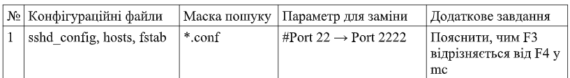

2 Встановила пакети mc і vim. Створила структуру ~/lab9 з підкаталогами conf і bak, скопіювала в conf три конфігураційні файли, зазначені у варіанті (шляхи відносно /etc). Файли, які звичайний користувач прочитати не може (sudoers), скопіювала командою sudo cp і передавала собі: sudo chown $USER ~/lab9/conf/sudoers.

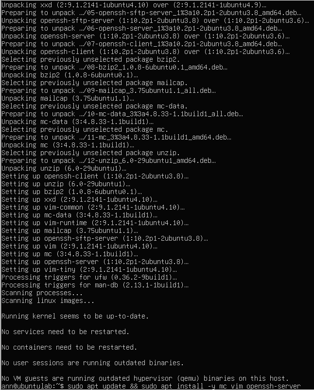

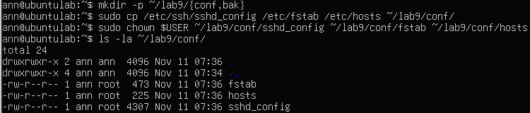

3 Запустила mc. Описала у звіті призначення обох панелей, рядка функціональних клавіш і меню F9.

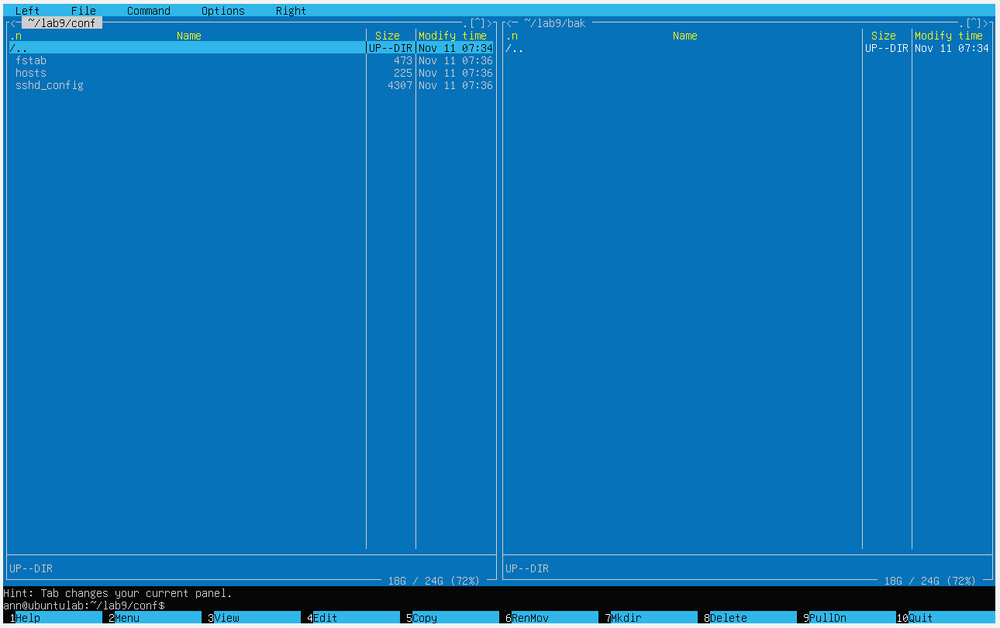

Дві незалежні панелі (ліва та права) призначені для зручного порівняння вмісту каталогів, швидкого переміщення, копіювання чи видалення файлів між ними без складних команд у консолі. Активна панель виділена кольором. Рядок функціональних клавіш (вниз екрана, F1–F10): Відображає швидкі команди управління: F1 (Допомога), F3 (Перегляд файлу), F4 (Редагування), F5 (Копіювання), F6 (Перенесення/Перейменування), F7 (Створення каталогу), F8 (Видалення), F10 (Вихід). Меню F9: Відкриває верхнє випадаюче меню (Left, File, Command, Options, Right), що містить усі розширені налаштування та інструменти програми (пошук, порівняння каталогу тощо).

4 Виконала в mc такі операції: позначила два файли клавішею Insert і скопіювала їх на протилежну панель, перейменувала один файл, створила каталог, переглянула файл клавішею F3. 

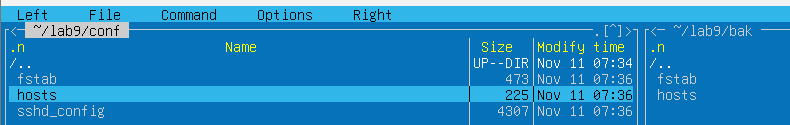

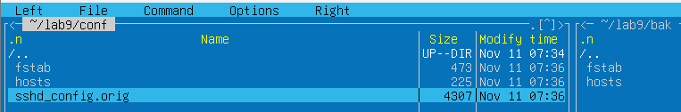

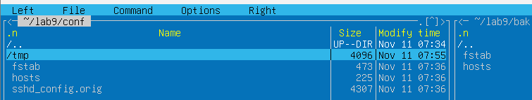

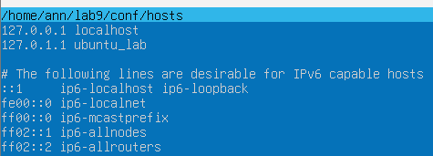

5 Скористалася можливостями меню F9: порівняла каталоги conf і bak,
виконала пошук файлу за маскою варіанта №1. Описала результат.

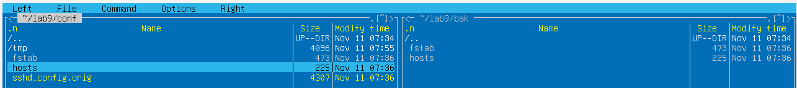

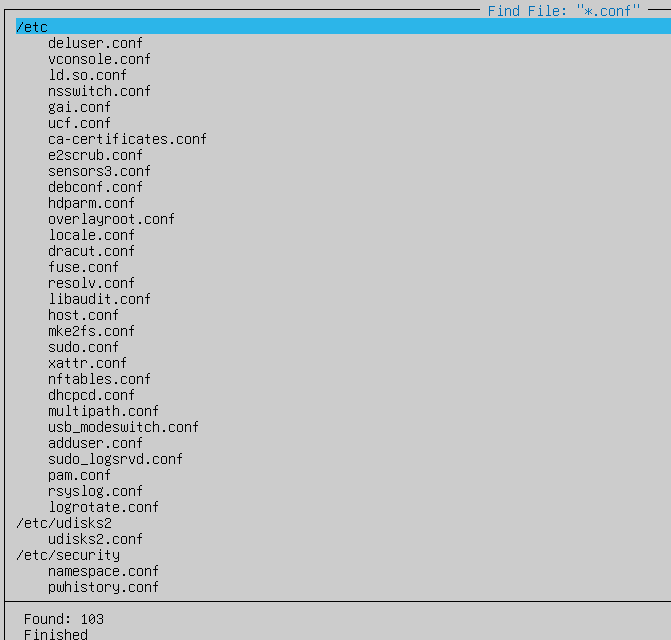

Програма знайде всі файли за заданою маскою та виведе їх список із можливістю швидкого переходу до них.

6 Відредагувала файл вбудованим редактором mc (F4): додала рядок, зазначений у варіанті, зберегла клавішею F2.

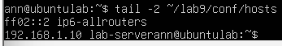

7 Створила у vi файл notes.txt із трьома рядками тексту. Продемонструвала перехід між режимами, увімкнула нумерацію рядків, зберегла файл.

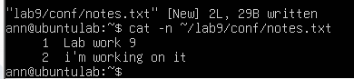

8 Виконала у vi на копії конфігураційного файлу: перехід до кінця й початку файлу, пошук параметра свого варіанта, видалення рядка, скасування видалення, перехід до заданого рядка. Вийшла без збереження.

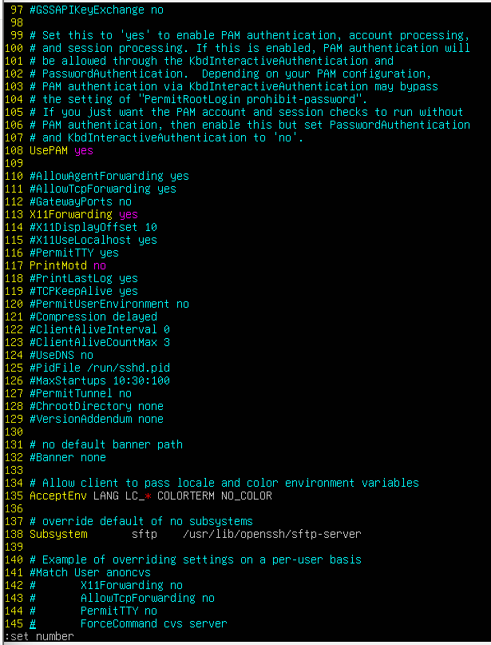

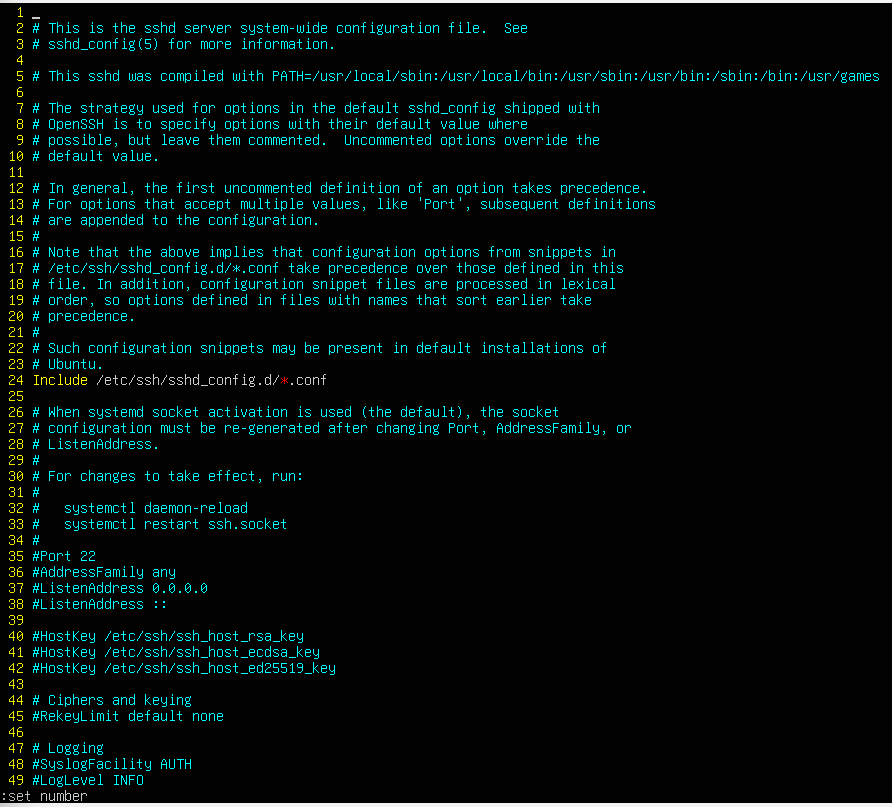

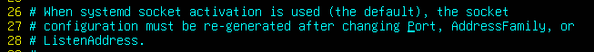

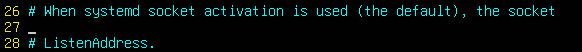

9 Виконала заміну параметра згідно з варіантом командою :%s, зберегла
файл під новим іменем і підтвердила зміну командою diff.

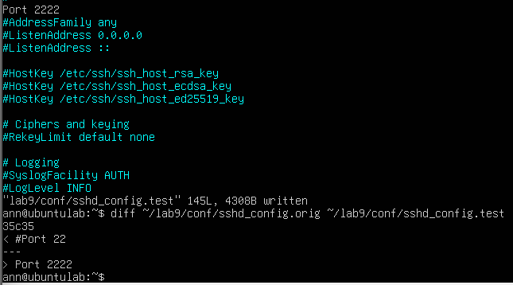

Додаткове завдання: F3 (View/Перегляд): Відкриває вибраний файл у режимі тільки для читання (використовує вбудований переглядач mcliew). У цьому режимі неможливо випадково змінити чи пошкодити вміст файлу, він призначений виключно для швидкого ознайомлення з текстом.
F4 (Edit/Редагування): Відкриває файл у вбудованому текстовому редакторі (mcedit) у режимі редагування. Ця функція дозволяє вносити зміни, дописувати чи видаляти текст, додавати нові рядки та зберігати їх (F2).

## Відповіді на контрольні питання

1 Сервер доступний лише через SSH, графічної оболонки немає, потрібно терміново виправити помилку в конфігурації служби.
Опишіть повний порядок дій із зазначенням інструментів і поясніть, чому обрали саме їх.

Використовується текстовий редактор vi для швидкого внесення правок через SSH-з'єднання та утиліта diff для перевірки змін. Їх обрано через відсутність графічного інтерфейсу, надійність та мінімальне споживання системних ресурсів віддаленого сервера.

2 Поясніть, чому модальність vi, яка спершу здається незручною, у роботі досвідченого адміністратора дає виграш у швидкості. Проілюструйте прикладом із цієї роботи.

Розподіл на командний режим і режим вставки дозволяє керувати файлом та навігувати по ньому виключно з клавіатури без використання миші. Наприклад: глобальна заміна рядка налаштувань порту за допомогою команди :%s/#Port 22/Port 2222/g виконується миттєво порівняно з ручним пошуком.

3 Сформулюйте правила безпечного редагування системних конфігураційних файлів і обґрунтуйте кожне з них наслідками помилки.

Перше правило — обов'язкове створення резервної копії, щоб мати змогу швидко відновити роботу служби в разі фатальної помилки. Друге правило — перевірка конфігурації перед перезапуском (через diff), що запобігає аварійній зупинці сервісів через синтаксичні опечатки.

4 Порівняйте роботу з файлами в mc і в чистому командному рядку за трьома критеріями: швидкість, надійність, можливість автоматизації. Для яких задач ви оберете кожен варіант?

mc швидший і зручніший для візуального пошуку та ручного переміщення файлів, тоді як чистий командний рядок надійніший у мінімальних середовищах і єдиний можливий варіант для автоматизації (скриптів). mc обирають для інтерактивної роботи з файловою системою, а CLI — для адміністрування, швидких правок та написання скриптів.

## Висновок

опанувала роботу в текстовому режимі без графічного середовища: навчилася виконувати файлові операції у двопанельному менеджері Midnight Commander, користуватися його вбудованими переглядачем і редактором, а
також редагувати файли в редакторі vi — перемикати режими, переміщатися текстом, виконувати пошук і заміну, зберігати зміни

