 
<!--
  Командні файли в середовищі Linux
  Варіант 9: Пошук великих файлів у домашньому каталозі — щодня о 20:00 — Показати, як обробити імена файлів із пробілами

  Тему, мету й обладнання писати не треба — конвеєр візьме їх із лабораторної.
  Знімки екрана кладіть у assets/, вихідний код — у src/.
  Контрольні питання — лише одного рівня, того, на який захищаєте роботу:
  заголовок «### Достатній рівень», далі «1 Текст питання?» і відповідь.
  Покрокова інструкція — reports/README.md
-->

## Хід роботи

1 Умова індивідуальних завдань варіанту 9:

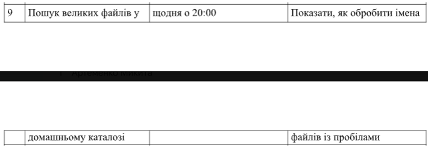

2 Створив структуру ~/lab10 з підкаталогами src, bak, logs. Наповнив src п’ятьма файлами, зокрема одним текстовим файлом із даними, розділеними символом «;».

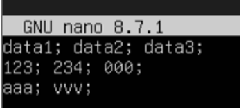

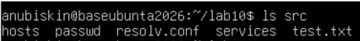

3 Написав скрипт hello.sh, який виводить своє ім’я, кількість переданих параметрів, ім’я користувача, поточний каталог і PID. Продемонстрував, що без права виконання скрипт не запускається, і надав це право.

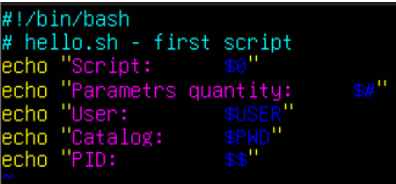

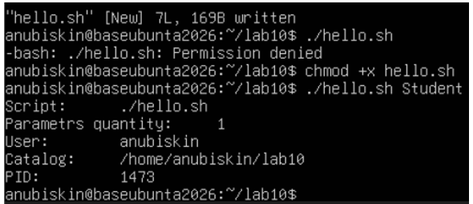

4 ./script.sh — запускає скрипт як окрему програму. Для цього файл повинен мати дозвіл на виконання (chmod +x script.sh) та вказаний інтерпретатор у першому рядку (наприклад, #!/bin/bash). Скрипт виконується в окремому процесі.
bash script.sh — запускає скрипт через інтерпретатор Bash. Дозвіл на виконання файлу не потрібен, оскільки Bash просто читає його вміст. Скрипт також виконується в окремому процесі.
source script.sh — виконує команди скрипта безпосередньо в поточній оболонці. Зміни змінних середовища, поточного каталогу та інших параметрів оболонки зберігаються після завершення скрипта.

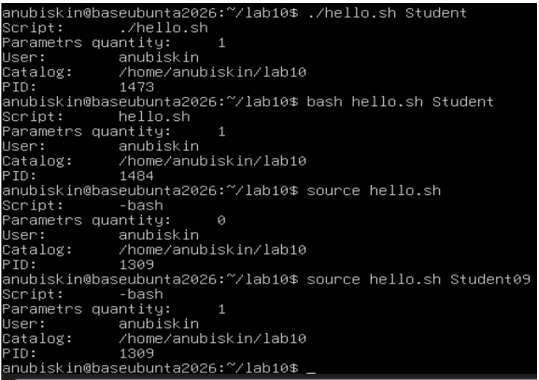

5 Написав скрипт info.sh, який приймає шлях параметром, перевіряє його існування й тип та виводить відомості згідно з варіантом (Пошук великих файлів у домашньому каталозі). Передбачив різні коди повернення для різних причин відмови й показав значення $? у кожному випадку.

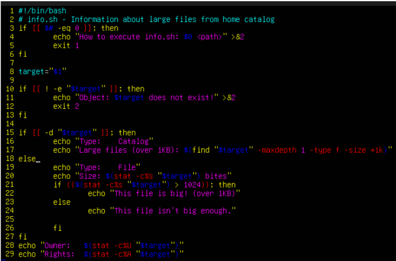

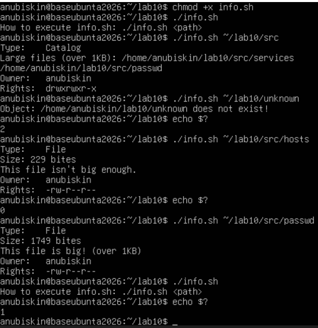

6 Написав скрипт із циклом, який обробляє всі файли каталогу src: рахує їх кількість, сумарний і середній обсяг. Використати підстановку команд і арифметику.

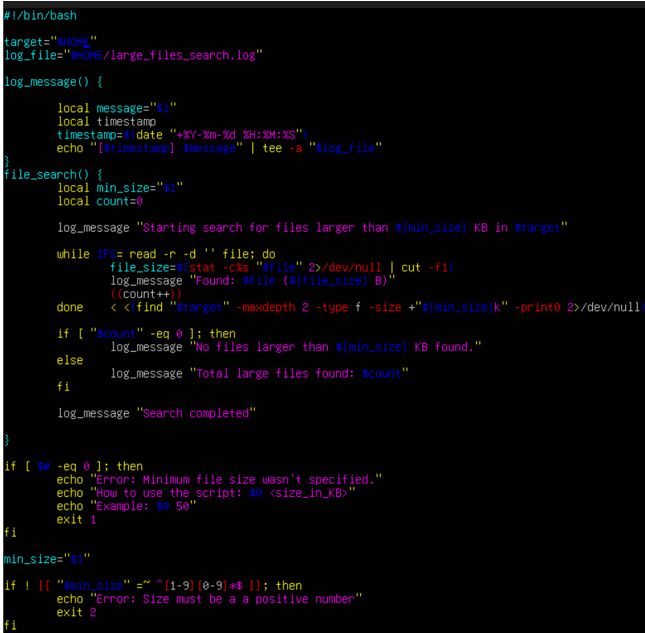

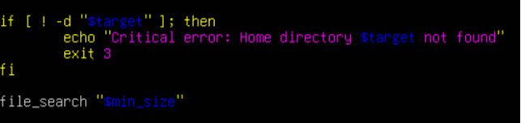

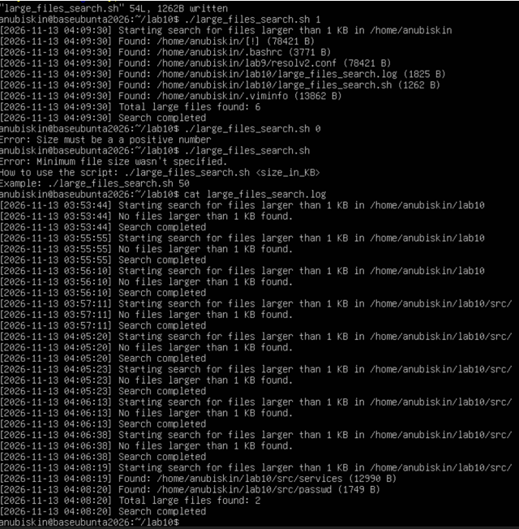

7 Додав до скрипта рядок set -euo pipefail:

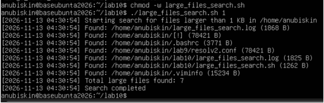

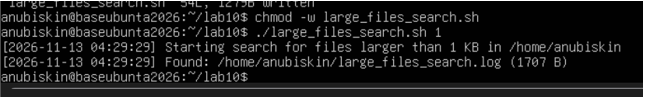

Після додавання set -euo pipefail скрипт перестав ігнорувати помилки та почав миттєво переривати роботу при першому ж збої замість того, щоб виконуватися далі до кінця. Тепер він одразу аварійно зупиняється, якщо будь-яка команда завершується з ненульовим кодом (-e), якщо в коді зустрічається неоголошена змінна (-u) або якщо помилка виникає на будь-якому етапі конвеєра команд (-o pipefail).
9 Написав скрипт, який читає текстовий файл рядок за рядком, розбирає поля за роздільником і виводить підсумок за числовим полем.

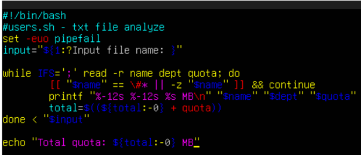

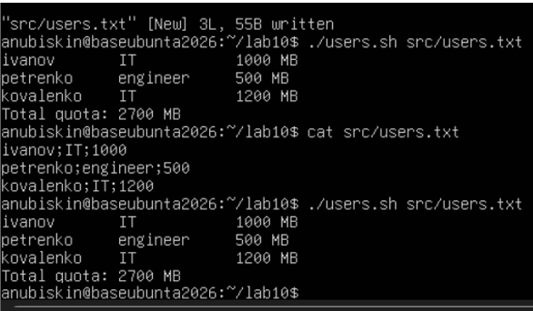

10 Налаштував запуск основного скрипта за розкладом через cron з періодичністю свого варіанта (щодня о 20:00). Підтвердив спрацювання записом у журналі. Після перевірки прибрав завдання з розкладу.

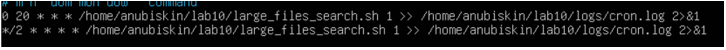

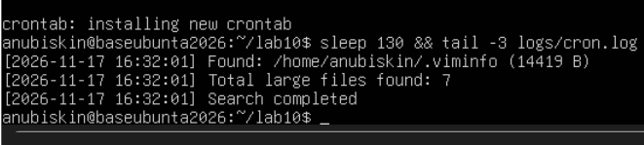

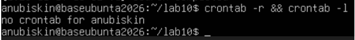

11 Продемонстрував, як обробити імена файлів з пробілами: У Bash для коректної обробки пробілів у назвах файлів використовуються три базові правила:
1) Завжди брати змінні з іменами файлів у подвійні лапки: cp "$file" /backup/
2) Використовувати find -print0 + while IFS= read -r -d '' для перебору файлів:
find . -type f -print0 | while IFS= read -r -d '' file; do
    echo "Файл: $file"
done
3) Передавати список аргументів скрипту через "$@" замість $* чи $@ без лапок:
for file in "$@"; do
    cat "$file"
done

## Відповіді на контрольні питання

1 Опишіть структуру скрипта резервного копіювання, що зберігає сім останніх копій і видаляє старіші. Які перевірки, цикли й коди повернення потрібні?
Скрипт резервного копіювання повинен спочатку перевіряти наявність вихідної папки та доступність місця для збереження копій. Далі він створює резервну копію з поточною датою та часом у назві файлу. Після створення копії скрипт перевіряє, чи операція завершилася успішно. Якщо копій більше семи, за допомогою циклу видаляються найстаріші, поки не залишиться сім останніх. Для обробки помилок використовуються коди повернення: 0 означає успішне виконання, а ненульове значення — помилку.

2 Поясніть, чому конструкція rm -rf "$dir"/ небезпечна, і запропонуйте три різні способи захисту від помилки в змінній.*
Команда rm -rf "$dir"/* небезпечна тим, що у разі неправильної або порожньої змінної dir можна випадково видалити важливі файли з іншої папки. Параметр -r дозволяє видаляти папки разом із вмістом, а -f примусово виконує видалення без додаткового підтвердження.
Для захисту можна використовувати три способи: Перевіряти, чи змінна dir не порожня, перед виконанням команди; Перевіряти, чи існує вказана папка та чи є вона саме тією папкою, вміст якої потрібно видалити; Використовувати абсолютний шлях і додаткову перевірку, щоб заборонити видалення системних або кореневих каталогів.

3 Порівняйте bash і PowerShell як засоби автоматизації за трьома критеріями. У яких задачах ви оберете кожен?
Bash і PowerShell використовуються для автоматизації завдань, але мають певні відмінності:
1) Сумісність: Bash переважно використовується в Linux та Unix, а PowerShell працює у Windows, Linux і macOS.
2) Робота з даними: Bash переважно працює з текстом і командами, а PowerShell використовує об'єкти, що спрощує обробку інформації.
3) Застосування: Bash зручний для роботи з файлами, системними командами та серверами Linux. PowerShell краще підходить для адміністрування Windows, керування службами та користувачами.
Я б обрав Bash для автоматизації завдань у Linux, а PowerShell — для адміністрування Windows.

4 Сформулюйте критерії, за якими адміністративну задачу варто автоматизувати скриптом, а коли доцільніше застосувати готовий інструмент. Проілюструйте прикладом із цієї роботи.
Адміністративну задачу доцільно автоматизувати власним скриптом у випадках, коли вона має повторюваний характер і вимагає нестандартної логіки, якої немає в одній окремій утиліті. Зокрема, скрипт виправданий, якщо потрібно перевірити вхідні аргументи, об'єднати кілька різних команд у єдиний конвеєр, виконати власні обчислення чи сформувати специфічний звіт із мітками часу та журналюванням. 
Натомість готовий системний інструмент варто застосовувати тоді, коли задача є типовою, стандартизованою і вже надійно реалізована розробниками ОС, або коли дію потрібно виконати одноразово. Готові утиліти оптимізовані за швидкістю, безпечно обробляють виняткові ситуації (права доступу, помилки вводу-виводу) і не потребують витрат часу на написання та підтримку коду.
У межах цієї лабораторної роботи створення власного скрипта large_files_search.sh є доцільним для організації регулярного моніторингу: він перевіряє наявність параметра розміру, веде підрахунок знайдених файлів і формує структурований запис у журналі cron.log. Водночас сам рекурсивний пошук файлів за розміром у ньому покладено на готову утиліту find, а запуск за розкладом — на системний планувальник cron, замість того щоб писати власний цикл очікування в коді. Аналогічно, для підрахунку загальної квоти у файлі users.csv скрипт users.sh доречний як регулярний інструмент із валідацією та форматованим виводом, але для одноразового підрахунку суми стовпця в терміналі раціональніше використати готову команду awk. 

## Висновок

Навчився автоматизувати адміністративні задачі засобами оболонки bash: писати скрипти з параметрами, перевіряти вхідні дані умовними конструкціями, обробляти групи файлів циклами, виносити повторювані дії у функції, вести журнал виконання та коректно повертати коди завершення.
