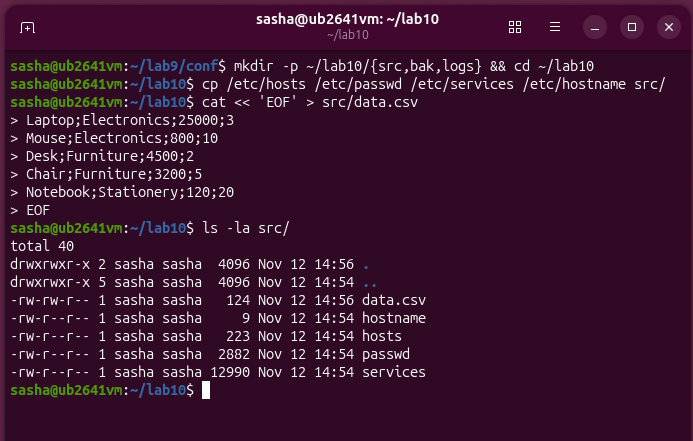
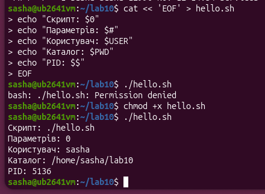
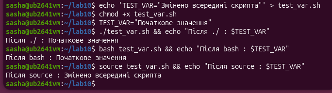
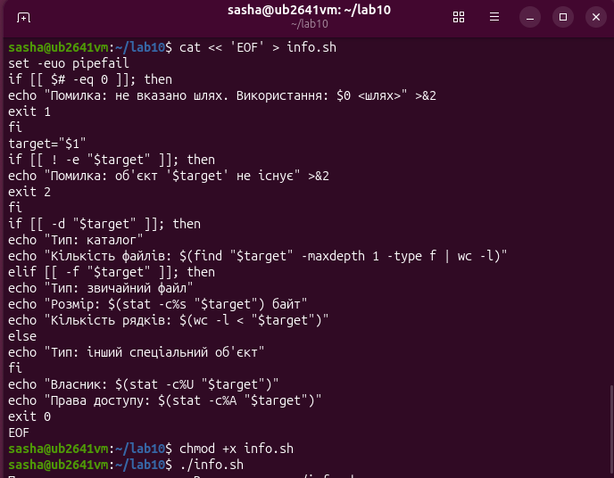
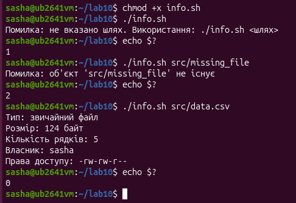
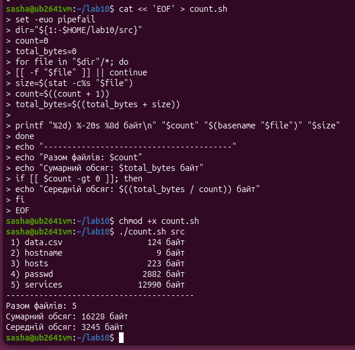
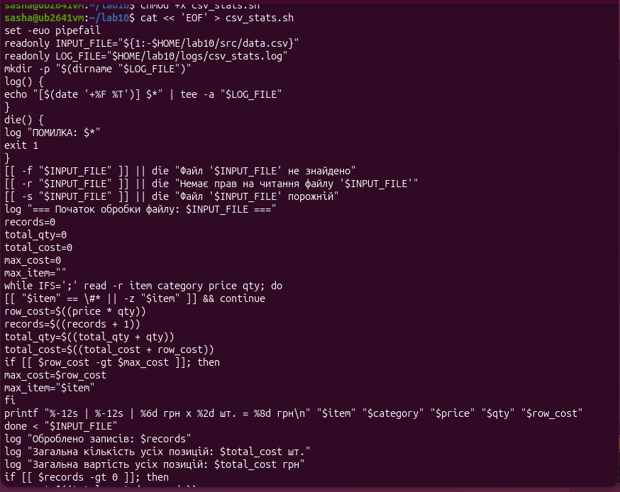
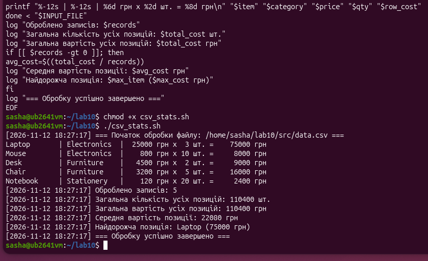
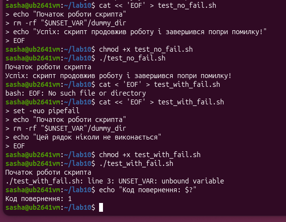
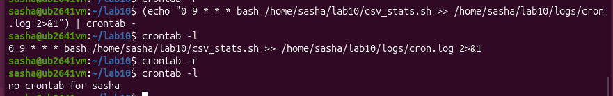

<!--
  Командні файли в середовищі Linux
  Варіант 11: Підрахунок статистики за CSV-файлом — щодня о 9:00 — Пояснити призначення `IFS` у циклі read

  Тему, мету й обладнання писати не треба — конвеєр візьме їх із лабораторної.
  Знімки екрана кладіть у assets/, вихідний код — у src/.
  Контрольні питання — лише одного рівня, того, на який захищаєте роботу:
  заголовок «### Достатній рівень», далі «1 Текст питання?» і відповідь.
  Покрокова інструкція — reports/README.md
-->

## Хід роботи

1 Отримав в викладача номер індивідуального варіанта.

2 Створив структуру ~/lab10 з підкаталогами src, bak, logs. Наповнив src щонайменше п’ятьма файлами, зокрема одним текстовим файлом із даними, розділеними символом;

3 Написав скрипт hello.sh, який виводить своє ім’я, кількість переданих параметрів, ім’я користувача, поточний каталог і PID. Показав, що без права виконання скрипт не запускається, і надав це право.

4 Пояснив у звіті різницю між запусками ./script.sh, bash script.sh і source script.sh. Підтвердив висновок експериментом зі змінною.

Для аналізу різниці між різними способами запуску сценаріїв було проведено практичний експеримент у каталозі ~/lab10. Під час запуску скрипта як окремої програми через ./test_var.sh або явного виклику інтерпретатора за допомогою bash test_var.sh, операційна система створює новий дочірній процес оболонки. Це підтверджується тим, що після виконання скрипта змінні середовища, встановлені всередині нього (наприклад, TEST_VAR="Змінено всередині скрипта"), зникають і не впливають на поточну сесію — у виводі команд для обох випадків значення залишається незмінним («Після ./ : Початкове значення» та «Після bash : Початкове значення»). Натомість команда source test_var.sh виконує всі інструкції безпосередньо в поточній оболонці без створення дочірнього процесу, внаслідок чого внесені зміни успішно зберігаються в активній сесії термінала, що чітко демонструє рядок виводу «Після source : Змінено всередині скрипта».

5 Написав скрипт info.sh, який приймає шлях параметром, перевіряє його існування й тип та виводить відомості згідно з варіантом. Передбачив різні коди повернення для різних причин відмови й показав значення $? у кожному випадку.

Для реалізації цього завдання було розроблено та протестовано скрипт info.sh, який призначений для детального аналізу переданого в якості аргументу об'єкта та перевірки наявності помилок під час його виклику. На початку роботи скрипт використовує директиву безпеки set -euo pipefail та за допомогою умовної конструкції перевіряє, чи було передано аргумент; у разі його відсутності він виводить відповідне повідомлення у стандартний потік помилок та завершує роботу з кодом 1. Далі скрипт перевіряє існування вказаного об'єкта на диск і, якщо він не знайдений, виводить сповіщення про помилку та виходить із кодом 2. Якщо об'єкт існує, за допомогою розгалуженої умовної конструкції визначається його тип: для каталогів підраховується кількість файлів за допомогою утиліт find та wc, для звичайних файлів визначається їхній розмір у байтах та кількість рядків через wc -l, а для інших об'єктів виводиться відповідна інформація. На завершення роботи скрипт виводить ім'я власника та права доступу до об'єкта, отримані за допомогою утиліти stat, після чого успішно завершується з кодом 0, що повністю підтверджується результатами виконання в терміналі.

6 Написав скрипт із циклом, який обробляє всі файли каталогу src: рахує їх кількість, сумарний і середній обсяг. Використав підстановку команд і арифметику.

Для реалізації завдання підрахунку статистики файлів було розроблено та запущено скрипт count.sh, який призначений для аналізу вмісту вказаного каталогу. На початку роботи скрипт використовує захисний режим set -euo pipefail та визначає цільовий каталог за допомогою параметра з можливістю задати значення за замовчуванням. За допомогою циклу for скрипт перебирає всі об'єкти у вказаному каталозі, відсіюючи за допомогою перевірки [[ -f "$file" ]] усе, що не є звичайними файлами. Для кожного знайденого файлу за допомогою утиліти stat визначається його розмір у байтах, після чого за допомогою арифметичних розширень оновлюються лічильники загальної кількості файлів та сумарного обсягу. За допомогою команди форматованого виводу printf скрипт виводить порядковий номер, ім'я файлу (отримане через basename) та його розмір. На завершення роботи скрипт виводить загальну кількість файлів, їхній сумарний обсяг, а також через умовну конструкцію if обчислює та виводить середній розмір файлу, що наочно підтверджується успішним виконанням у терміналі.

7 Реалізував основне завдання свого варіанта. Скрипт містить: перевірку вхідних даних, цикл, щонайменше одну функцію та запис у журнал, та реалізував дев’яте завдання а саме зробив так щоб скрипт міг читати текстовий файл рядок за рядком розбирав поля за роздільником і виводив підсумок за числовим полем.

Для реалізації основного завдання Варіанта 11 було розроблено та запущено скрипт csv_stats.sh, який автоматично зчитує дані з CSV-файлу, обробляє їх за допомогою циклу та виводить детальну статистику з паралельним записом до журналу. На початку скрипта директива set -euo pipefail забезпечує надійність виконання, зупиняючи процес у разі непередбачуваних помилок. Далі за допомогою функцій log та die реалізовано ведення журналу подій у файл csv_stats.log через команду tee -a, а також коректну обробку критичних помилок із виходом із кодом 1. Перед початком обчислень скрипт за допомогою умовних конструкцій перевіряє вхідний файл на існування, наявність прав на читання та те, що він не порожній. Усередині циклу while IFS=';' read рядок за рядком зчитується файл із використанням роздільника у вигляді крапки з комою, при цьому за допомогою перевірок пропускаються службові рядки та коментарі, що починаються з символу #. На кожній ітерації за допомогою арифметичних операцій обчислюється вартість поточного товару, оновлюється загальна кількість записів, сумарна кількість і загальна вартість позицій, а також визначається найдорожчий товар. Відформатований вивід по кожному рядку та підсумкові результати, включно із середньою вартістю позиції, виводяться на екран та одночасно записуються в лог-файл, що наочно підтверджується успішним виконанням скрипта в терміналі.

8 Додав до скрипта рядок set -euo pipefail і пояснив, як змінилася поведінка в разі помилки. Навів приклад до і після.

На основі проведеного експерименту можна чітко простежити відмінність у поведінці скрипта до та після додавання директиви безпеки set -euo pipefail. Під час виконання першого скрипта ./test_no_fail.sh, який не містить цієї директиви, звернення до неініціалізованої змінної UNSET_VAR сприймається оболонкою як порожній рядок, через що скрипт не зупиняється, ігнорує потенційну проблему та мовчки продовжує роботу, завершуючись із повідомленням про «успіх». Натомість у другому скрипті ./test_with_fail.sh, де активовано параметр set -euo pipefail, поведінка кардинально змінюється: при спробі звернутися до неоголошеної змінної спрацьовує захисний механізм nounset (-u), який миттєво перериває виконання на третьому рядку з виведенням системної помилки unbound variable. Усі подальші інструкції блокуються, а перевірка за допомогою команди echo "Код повернення: $?" показує значення 1, що підтверджує аварійне завершення роботи скрипта та надійно запобігає виконанню небезпечних операцій.

9 Налаштував запуск основного скрипта за розкладом через cron з періодичністю свого варіанта. Підтвердив спрацювання записом у журналі. Після перевірки прибрав завдання з розкладу.

На наданому скріншоті зображено процес налаштування та перевірки виконання скрипта за розкладом за допомогою планувальника завдань cron. Спочатку за допомогою команди crontab -r було повністю очищено поточний розклад завдань користувача. Потім за допомогою конструкції з командою echo та конвеєра (| crontab -) до планувальника було додано нове завдання, яке запускає скрипт csv_stats.sh через інтерпретатор bash щодня о 9:00 ранку з перенаправленням стандартного виводу та помилок у лог-файл. На завершення за допомогою команди crontab -l було виведено поточний список активних завдань планувальника, що підтверджує успішне додавання та коректність запису розкладу.

10 Виконав додаткове завдання свого варіанта.

Змінна середовища IFS (Internal Field Separator) у Bash слугує для визначення символів-роздільників полів, оскільки за замовчуванням цю роль відводиться пробілу, табуляції та символу нового рядка. Під час обробки даних за допомогою команди read, яка зчитує вхідний рядок та ділить його на окремі змінні, застосування IFS=';' дозволяє коректно працювати з CSV-файлами. Оскільки в таких файлах поля розділені крапкою з комою, а всередині самих значень можуть траплятися пробіли (наприклад, у назвах товарів), стандартні налаштування розділили б один елемент на кілька частин, тоді як явне вказання розділювача змушує команду ігнорувати пробіли та орієнтуватися виключно на заданий символ. При цьому запис IFS=';' безпосередньо перед командою read забезпечує локальність зміни, поширюючи її дію лише на цю конкретну операцію та запобігаючи пошкодженню розбиття аргументів в інших частинах скрипта. Обов'язковим доповненням до цього є використання ключа -r, який гарантує, що зворотний слеш сприйматиметься як звичайний символ, а не як засіб екранування чи перенесення рядка.

## Відповіді на контрольні питання

1 Опишіть структуру скрипта резервного копіювання, що зберігає сім останніх копій і видаляє старіші. Які перевірки, цикли й коди повернення потрібні?

Скрипт резервного копіювання зазвичай починається з ініціалізації директорій та використання директиви безпеки set -euo pipefail для зупинки виконання в разі помилок. У ньому обов'язково передбачаються перевірки наявності вихідного каталогу для копіювання та прав доступу до нього. Основна логіка передбачає створення архіпу з унікальною міткою часу за допомогою утиліт на зразок tar та перевірку коду повернення ($?), що гарантує успішність операції. Для керування ротацією копій використовується сортування наявних архівів за часом створення та циклічне видалення або відсіювання всіх файлів, окрім семи найсвіжіших, з фіксацією всіх подій у системному лог-файлі та завершенням роботи з відповідним кодом статусу.

2 Поясніть, чому конструкція rm -rf "$dir"/*  небезпечна, і запропонуйте три різні способи захисту від помилки в змінній.

Конструкція rm -rf "$dir"/* є вкрай небезпечною через те, що у випадку непередбачуваного збою, коли змінна dir залишиться порожньою або неініціалізованою, шлях перетвориться на вид /*, через що команда рекурсивно та безповоротно видалить усі системні файли в кореневому каталозі ОС. Для захисту від такої помилки можна застосовувати кілька надійних способів. Перший спосіб полягає у використанні захисної конструкції розширення параметра на кшталт ${dir:?Помилка: змінна порожня}, яка примусово зупиняє скрипт, якщо значення не задане. Другий спосіб передбачає попередню перевірку шляху за допомогою умовної конструкції, яка підтверджує, що шлях існує та є каталогом, перш ніж передавати його в команду видалення. Третій спосіб базується на використанні директиви set -u (nounset), яка робить будь-яке звернення до неоголошеної змінної критичною помилкою оболонки, що запобігає виконанню небезпечної операції.

3 Порівняйте bash і PowerShell як засоби автоматизації за трьома критеріями. У яких задачах ви оберете кожен?

кросплатформністю та підходом до обробки даних. За критерієм типізації даних Bash працює виключно з текстовими рядками, передаючи інформацію між утилітами у вигляді потоків тексту, тоді як PowerShell оперує об'єктами .NET, що дозволяє передавати по конвеєру повноцінні структуровані дані з властивостями та методами. За критерієм середовища виконання та сумісності Bash є стандартним і вбудованим інструментом в усіх дистрибутивах Linux та Unix-подібних систем, тоді як PowerShell спочатку створювався для платформи Windows, хоча наразі й доступний кросплатформно, але вимагає додаткового встановлення. За критерієм синтаксичної складності Bash має короткий, але іноді неочевидний синтаксис із безліччю спеціальних символів, тоді як PowerShell використовує зрозуміліші командлети у форматі "Дія-Об'єкт" (наприклад, Get-Process), проте вимагає більшого обсягу коду. Bash обирається для легких щоденних завдань адміністрування, швидкого написання простих скриптів автоматизації та роботи безпосередньо в середовищі Linux-серверів. PowerShell є оптимальним вибором для глибокого адміністрування складних гетерогенних корпоративних мереж, взаємодії з хмарними службами на базі Windows Server та обробки великих обсягів структурованих даних.

4 Сформулюйте критерії, за якими адміністративну задачу варто автоматизувати скриптом, а коли доцільніше застосувати готовий інструмент. Проілюструйте прикладом із цієї роботи.

Адміністративну задачу доцільно автоматизувати за допомогою власного скрипта тоді, коли вона є специфічною для конкретної інфраструктури, вимагає нестандартної логіки обробки даних, виконується регулярно за унікальним сценарієм або коли потрібно мінімізувати залежність від сторонніх важких пакетів. Натомість готовий інструмент краще застосовувати у випадках, коли існує стандартизоване, добре протестоване рішення для вирішення поширених завдань забезпечення безпеки, моніторингу чи оркестрації, оскільки написання власного коду в таких ситуаціях призведе до зайвих витрат часу на розробку та потенційних уразливостей. Ілюстрацією цього з виконаної лабораторної роботи є створення скрипта csv_stats.sh для підрахунку унікальної статистики з CSV-файлу та його планування через cron, що є прикладом специфічної задачі обробки локальних бізнес-даних, яку найефективніше вирішити невеликим кастомним скриптом на Bash, тоді як для загального моніторингу всієї операційної системи в реальному часі доцільніше використовувати готові системні утиліти чи систем.

## Висновок

на цій лабораторній роботі я на практиці переконався у потужності та гнучкості скриптів Bash, які мають значні переваги порівняно з традиційними пакетними файлами Windows завдяки багатому арсеналу утиліт, зручній роботі з потоками даних, потужній системі перевірок та надійним механізмам керування процесами. Зокрема, я навчився самостійно автоматизувати різноманітні адміністративні задачі за допомогою оболонки Bash: писати скрипти з підтримкою передачі параметрів, грамотно перевіряти вхідні дані за допомогою умовних конструкцій, обробляти групи файлів за допомогою
