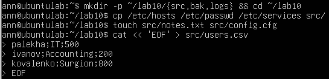
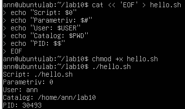

<!--
  Командні файли в середовищі Linux
  Варіант 14: Контроль кількості процесів користувача — кожні 5 хвилин — Пояснити, як скрипт дізнається власний PID і PID батька

  Тему, мету й обладнання писати не треба — конвеєр візьме їх із лабораторної.
  Знімки екрана кладіть у assets/, вихідний код — у src/.
  Контрольні питання — лише одного рівня, того, на який захищаєте роботу:
  заголовок «### Достатній рівень», далі «1 Текст питання?» і відповідь.
  Покрокова інструкція — reports/README.md
-->

## Хід роботи

1 Умова індивідуального завдання варіанта №1

2 Створила структуру ~/lab10 з підкаталогами src, bak, logs. Наповнила src щонайменше п’ятьма файлами, зокрема одним текстовим файлом із даними, розділеними символом (;).

3 Написала скрипт hello.sh, який виводить своє ім’я, кількість переданих параметрів, ім’я користувача, поточний каталог і PID. Показала, що без права виконання скрипт не запускається, і надала це
право. Пояснила у звіті різницю між запусками ./script.sh, bash script.sh і
source script.sh. 

## Відповіді на контрольні питання

1 

## Висновок

