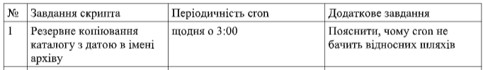
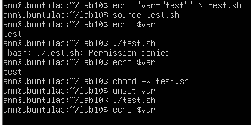
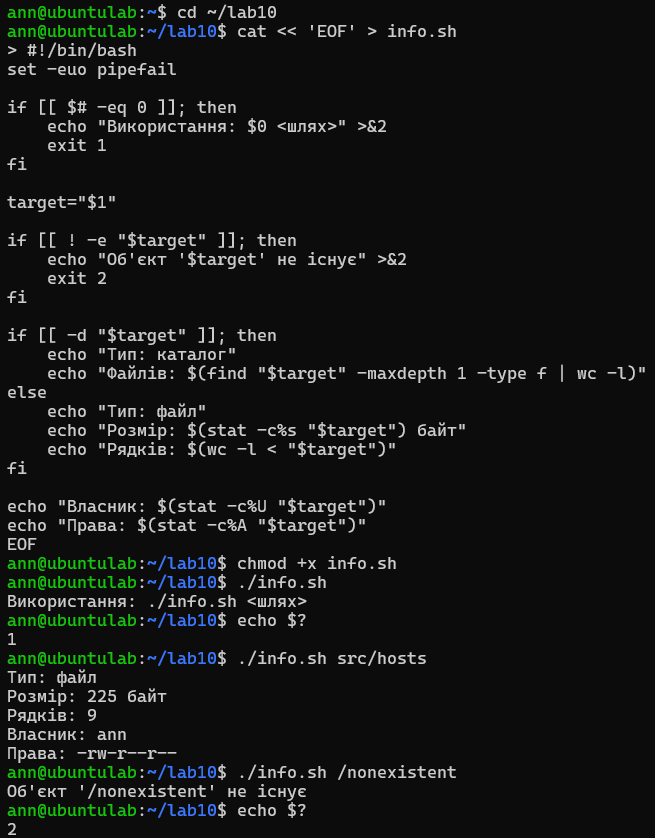
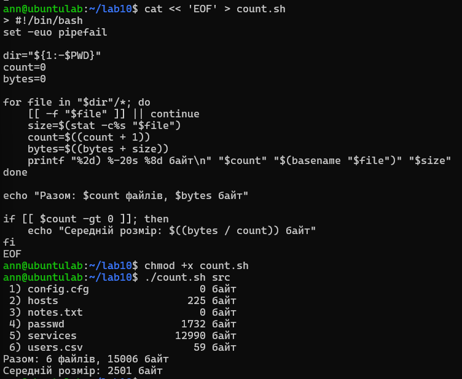
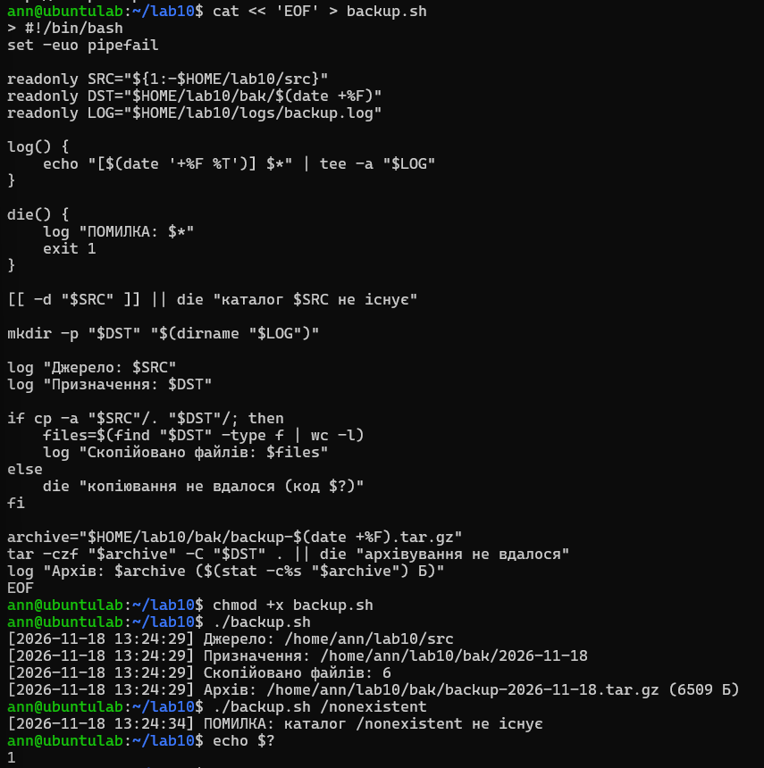
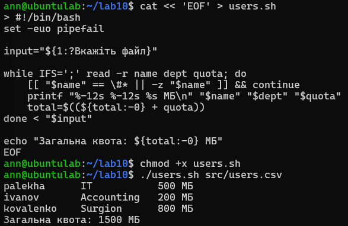
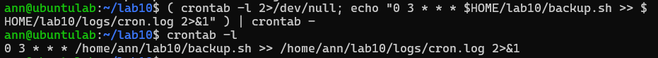
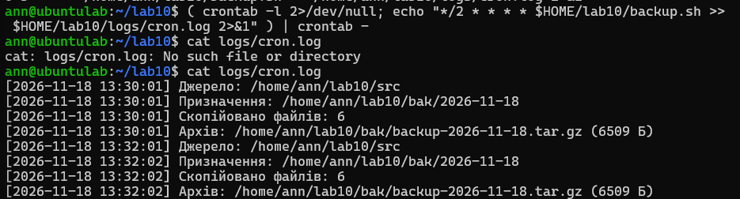

<!--
  Командні файли в середовищі Linux
  Варіант 14: Контроль кількості процесів користувача — кожні 5 хвилин — Пояснити, як скрипт дізнається власний PID і PID батька

  Тему, мету й обладнання писати не треба — конвеєр візьме їх із лабораторної.
  Знімки екрана кладіть у assets/, вихідний код — у src/.
  Контрольні питання — лише одного рівня, того, на який захищаєте роботу:
  заголовок «### Достатній рівень», далі «1 Текст питання?» і відповідь.
  Покрокова інструкція — reports/README.md
-->

## Хід роботи

1 Умова індивідуального завдання варіанта №1

2 Створила структуру ~/lab10 з підкаталогами src, bak, logs. Наповнила src щонайменше п’ятьма файлами, зокрема одним текстовим файлом із даними, розділеними символом (;).

3 Написала скрипт hello.sh, який виводить своє ім’я, кількість переданих параметрів, ім’я користувача, поточний каталог і PID. Показала, що без права виконання скрипт не запускається, і надала це право. Пояснила у звіті різницю між запусками ./script.sh, bash script.sh і source script.sh. 

./script.sh - запускає файл як окрему програму у новій дочірній оболонці (subshell) через інтерпретатор із shebang; вимагає права на виконання (+x).
bash script.sh - запускає скрипт у новій дочірній оболонці, явно викликаючи bash (навіть без +x).
source script.sh - виконує команди скрипта у поточній оболонці, тому змінні, створені чи змінені у скрипті, залишаються доступними після його завершення (що підтверджено експериментом зі змінною var).

4 Написала скрипт info.sh, який приймає шлях параметром, перевіряє його існування й тип та виводить відомості згідно з варіантом. Передбачилати різні коди повернення для різних причин відмови й показати значення $? у кожному випадку.

5 Написала скрипт із циклом, який обробляє всі файли каталогу src: рахує їх кількість, сумарний і середній обсяг. Використала підстановку команд і арифметику.

6 Реалізувала основне завдання варіанта №1. Скрипт містить: перевірку вхідних даних, цикл, щонайменше одну функцію та запис у журнал. Додала до скрипта рядок set -euo pipefail і пояснила, як змінилася поведінка в разі помилки.

Як змінилася поведінка після додавання set -euo pipefail:-e — зупиняє скрипт при першій помилці команди (крім винятків на кшталт умов if чи ланцюжків || / &&).   -u — робить помилкою звернення до неоголошеної змінної (без цього прапора скрипт підставив би порожній рядок і продовжив роботу).   -o pipefail — повертає код помилки конвеєра, якщо впала будь-яка команда в ланцюжку |, а не лише остання. 

7 Написала скрипт, який читає текстовий файл рядок за рядком, розбирає поля за роздільником і виводить підсумок за числовим полем.

8 Налаштувала запуск основного скрипта за розкладом через cron з періодичністю варіанта №1. Підтвердила спрацювання записом у журналі. Після перевірки прибрала завдання з розкладу.

Додаткове завдання варіанта №1: cron запускає завдання з мінімальним середовищем і початковим робочим каталогом (зазвичай домашнім каталогом користувача), тому відносні шляхи (наприклад, logs/cron.log) шукаються не там, де очікує скрипт, і завдання може не виконатися або не записати журнал; тому використовують абсолютні шляхи..

## Відповіді на контрольні питання

1 Опишіть структуру скрипта резервного копіювання, що зберігає сім останніх копій і видаляє старіші. Які перевірки, цикли й коди повернення потрібні?

Скрипт має перевіряти існування каталогу копій і успіх створення нового архіву, а в циклі по відсортованих копіях видаляти ті, що виходять за межі останніх семи. Ненульові коди повернення (exit 1, exit 2) варто повертати у разі помилки створення архіву чи видалення старих копій.

2 Поясніть, чому конструкція rm -rf &quot;$dir&quot;/* небезпечна, і запропонуйте три різні способи захисту від помилки в змінній.

Якщо змінна dir виявиться порожньою, команда перетвориться на rm -rf /* і спробує видалити файли з кореня системи. Захиститися можна через set -u, перевірку [[ -n "$dir" && -d "$dir" ]] перед видаленням або конструкцію ${dir:?порожній шлях}.

3 Порівняйте bash і PowerShell як засоби автоматизації за трьома критеріями. У яких задачах ви оберете кожен?

За середовищем та об’єктами Bash працює з текстом і потоками в Linux/Unix, тоді як PowerShell оперує .NET-об’єктами та краще інтегрований у Windows. Bash обирають для адміністрування Linux-серверів і скриптів оболонки, а PowerShell — для керування Windows-інфраструктурою та складних об’єктних задач.

4 Сформулюйте критерії, за якими адміністративну задачу варто автоматизувати скриптом, а коли доцільніше застосувати готовий інструмент. Проілюструйте прикладом із цієї роботи.

Скрипт доцільний для специфічної регулярної дії з простою логікою (наприклад, запуск backup.sh за розкладом у цій роботі), а готовий інструмент — коли потрібна гнучка ротація, журналювання, відновлення чи моніторинг без підтримки власного коду. Наприклад, ротацію та архівування краще довірити спеціалізованим утилітам резервного копіювання замість ручного дописування складної логіки в скрипт..

## Висновок

навчилася автоматизовувати адміністративні задачі засобами оболонки bash: писати скрипти з параметрами, перевіряти вхідні дані умовними конструкціями, обробляти групи файлів циклами, виносити повторювані дії у функції, вести журнал виконання та коректно повертати коди завершення
