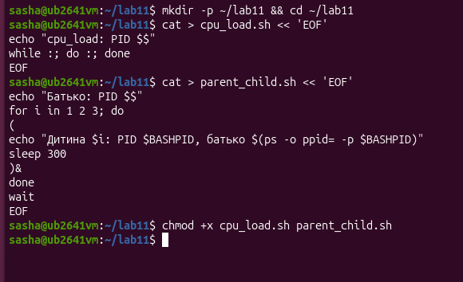
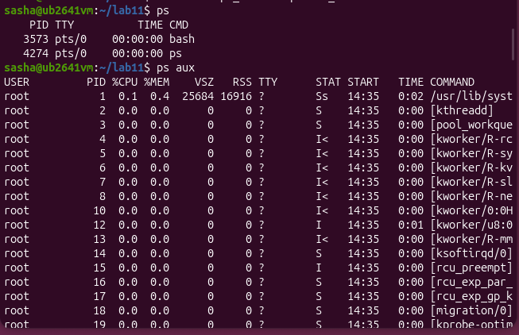
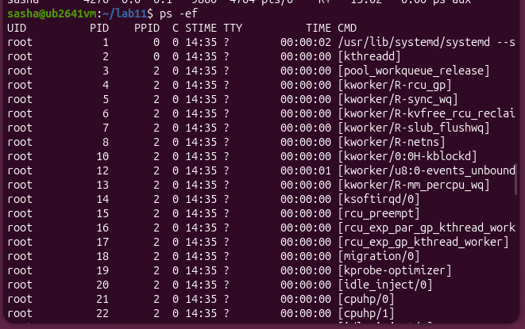
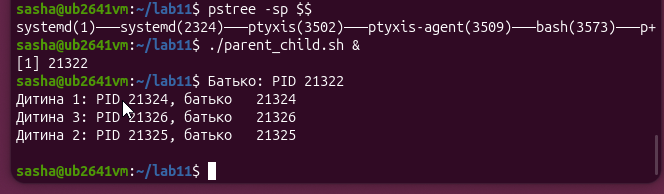
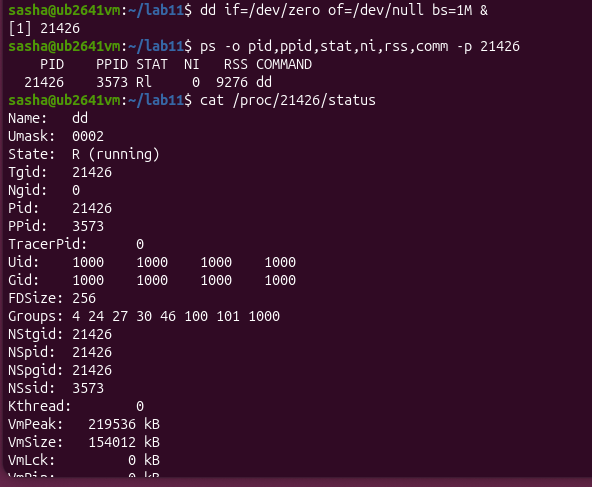
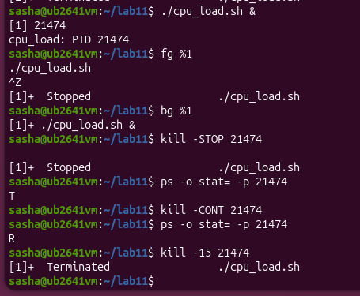
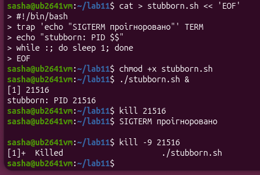
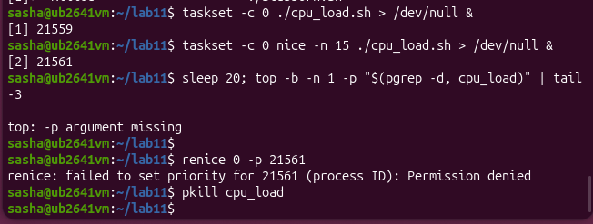
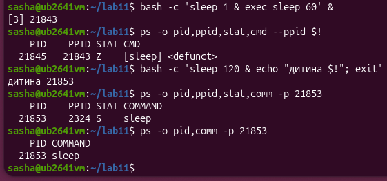
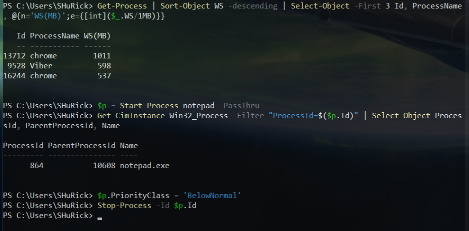

<!--
  Управління процесами
  Варіант 11: `dd` — SIGTERM — 15 — Оцінити вплив nice на процес, що активно працює з диском

  Тему, мету й обладнання писати не треба — конвеєр візьме їх із лабораторної.
  Знімки екрана кладіть у assets/, вихідний код — у src/.
  Контрольні питання — лише одного рівня, того, на який захищаєте роботу:
  заголовок «### Достатній рівень», далі «1 Текст питання?» і відповідь.
  Покрокова інструкція — reports/README.md
-->

## Хід роботи

1 Отримав в викладача номер індивідуального варіанта.

2 Підготував середовище: встановив утиліти htop, pstree, stress-ng, створив каталог ~/lab11 і навчальні скрипти згідно з кроком 1.

Для підготовки робочого середовища спочатку виконується оновлення списків пакетів та встановлення необхідних утиліт (htop, pstree, stress-ng, psmisc), після чого створюється робочий каталог ~/lab11 і здійснюється перехід до нього за допомогою команди mkdir -p ~/lab11 && cd ~/lab11, де ключ -p гарантує створення проміжних директорій за потреби, а && зв'язує команди для послідовного виконання. Конструкція cat > назва_файлу << 'EOF' дозволяє записати багаторядковий текст у файл безпосередньо з термінала аж до маркера кінця EOF. Перший створений скрипт cpu_load.sh запускає нескінченний цикл для навантаження центрального процесора, а другий скрипт parent_child.sh моделює роботу батьківського процесу з трьома дочірніми під оболонками й очікує їх завершення за допомогою команди wait. На завершення утиліта chmod +x додає права на виконання для обох файлів скриптів.

3 Отримав перелік процесів трьома способами — ps, ps aux, ps -ef — і пояснив різницю у складі колонок.

Базова команда ps без ключів виводить лише активні процеси поточного користувача, прив’язані до поточного сеансу термінала, відображаючи базові колонки PID (ідентифікатор процесу), TTY (термінал), TIME (використаний процесорний час) та CMD (ім'я команди). На відміну від неї, команда ps aux відображає абсолютно всі запущені процеси всіх користувачів у системі (включно з фоновими демонами без термінала, позначеними як ?) у форматі BSD, додаючи детальну інформацію про споживання ресурсів та стан: USER (власник), %CPU (частка процесора), %MEM (частка оперативної пам'яті), VSZ (віртуальна пам'ять), RSS (фізична пам'ять), STAT (стан процесу, наприклад S, R, I) та START (час запуску). Своєю чергою, команда ps -ef також виводить усі системні процеси, але використовує стандартний формат System V з повним лістингом, де замість показників споживання пам'яті та детального стану з’являється важлива колонка PPID (ідентифікатор батьківського процесу) для відстеження ієрархії, а також UID (користувач), C (коефіцієнт завантаження CPU) та STIME (час старту).

4 Побудував дерево процесів командою pstree і визначив, який процес породив ваш термінал. Запустив parent_child.sh і пояснив, чому для PID дитини використано $BASHPID, а не $$.

За допомогою команди pstree -sp $$ було побудовано гілку дерева процесів, з якої видно, що оболонку поточного термінала (bash з PID 3573) безпосередньо породив процес ptyxis-agent (PID 3509), запущений емулятором термінала ptyxis (PID 3502). Після запуску у фоновому режимі скрипта ./parent_child.sh & головний батьківський процес отримав PID 21322 та створив три дочірні підоболонки з власними ідентифікаторами 21324, 21325 та 21326. Використання змінної $BASHPID замість $$ у тілі підоболонки ( ... ) є необхідним, оскільки за стандартом POSIX змінна $$ у підоболонці завжди зберігає PID головного батьківського скрипта (21322), тоді як власний реальний ідентифікатор створеного дочірнього процесу в оболонці Bash міститься саме у змінній $BASHPID.

5 Знайшов процес, зазначений у варіанті, визначив його PID, PPID, стан, пріоритет та обсяг зайнятої пам’яті (з ps і з /proc/PID/status).

Команда dd if=/dev/zero of=/dev/null bs=1M & безперервно копіює нулі з віртуального пристрою /dev/zero до віртуального «приймача» /dev/null блоками розміром 1 МБ (bs=1M), створюючи значне навантаження без заповнення фізичного диска. Команда ps -o pid,ppid,stat,ni,rss,comm -p 21426 відображає детальну статистику у вигляді знімка (snapshot) для конкретного процесу за його PID, показуючи ідентифікатор процесу, батьківський PID, поточний стан, значення пріоритету (nice), обсяг фізичної пам’яті (RSS) та назву команди. Команда cat /proc/21426/status виводить вміст службового файлу віртуальної файлової системи ядра Linux, який містить повну системну інформацію про стан процесу, його унікальні ідентифікатори, налаштування та використання ресурсів.

6 Запустив навчальний скрипт у фоновому режимі, перевів його на передній план і назад, зупинив й продовжив сигналами SIGSTOP/SIGCONT, після чого завершив сигналом, зазначеним у варіанті.

Для керування фоновими завданнями та сигналами спочатку було запущено навчальний скрипт ./cpu_load.sh & у фоновому режимі, після чого за допомогою команди fg %1 його було переведено на передній план, а комбінацією клавіш Ctrl+Z (^Z) — призупинено з надсиланням сигналу SIGTSTP. Для повернення призупиненого завдання назад у фоновий режим використано команду bg %1. Щоб перевірити дію окремих керуючих сигналів, за допомогою команди kill -STOP 21474 процес було примусово зупинено, а за допомогою перевірки статусу через ps -o stat= -p 21474 зафіксовано індикатор T (Stopped). Згодом виконання процесу було успішно відновлено командою kill -CONT 21474, що повернуло його статус до R (Running), а остаточне коректне завершення виконання було здійснено за допомогою сигналу SIGTERM через команду kill -15 21474.

7 Порівняв дію сигналів SIGTERM і SIGKILL на процесі, що перехоплює SIGTERM. Зафіксував, у чому полягає різниця.

Для порівняння дії сигналів SIGTERM та SIGKILL було створено та запущено у фоновому режимі скрипт stubborn.sh (PID 21516), у якому за допомогою вбудованої команди trap налаштовано власний обробник для перехоплення сигналу SIGTERM. Під час надсилання стандартного запиту на коректне завершення командою kill 21516 програма перехопила сигнал, вивела в термінал повідомлення «SIGTERM проігноровано» та продовжила своє виконання. Натомість після виконання команди kill -9 21516, яка надсилає сигнал SIGKILL, процес був миттєво та примусово завершений зі статусом Killed, оскільки цей сигнал обробляється безпосередньо ядром операційної системи і не може бути перехоплений чи проігнорований самою програмою. 

8 Запустив на одному ядрі (taskset -c 0) два процеси навантаження, один із пріоритетом свого варіанта, і порівняв їхні частки CPU. Змінив пріоритет уже запущеного процесу командою renice і пояснив, чому зменшення значення потребує прав root.

За допомогою утиліти taskset я запустив два процеси навантаження на одному процесорному ядрі: перший зі стандартним пріоритетом, а другий — зі зміненим значенням пріоритету nice = 15. Під час спроби змінити пріоритет фонового процесу назад до нуля за допомогою команди renice 0 -p 21561 система очікувано видала помилку «Permission denied», що наочно демонструє обмеження прав у Linux, згідно з яким звичайний користувач може лише збільшувати значення nice (поступатися процесорним часом), але не має прав на його самовільне підвищення без привілеїв суперкористувача root. На завершення обидва процеси навантаження були успішно зупинені за допомогою команди pkill cpu_load.

9 Відтворив зомбі- та осиротілий процес за кроком 6. Зафіксував стан процесу у виводі ps і визначив, який процес став батьком сироти у вашій системі.

Для демонстрації та фіксації процесів-зомбі та процесів-сиріт було виконано дві послідовні команди. У першому випадку за допомогою команди bash -c 'sleep 1 & exec sleep 60' & та подальшого перегляду виводу ps -o pid,ppid,stat,cmd --ppid$! успішно зафіксовано процес-зомбі зі статусом Z та міткою <defunct>, що виникає через те, що дочірній процес завершився, але його батьківський процес ще не зчитав його статус за допомогою системного виклику. У другому випадку для відтворення процесу-сироти було запущено команду bash -c 'sleep 120 & echo "дитина $!"; exit', після чого за допомогою утиліти ps -o pid,ppid,stat,comm -p 21853 перевірено його стан — дочірній процес продовжив своє виконання після миттєвого завершення свого оригінального батьківського процесу, при цьому його батьківський ідентифікатор PPID змінився на інший системний процес, який автоматично взяв його під своє управління.

10 Виконав в Windows перегляд процесів, визначення батьківського процесу, зміну класу пріоритету й завершення процесу за кроком 7.

за допомогою оболонки PowerShell було виконано серію команд для моніторингу та контролю ресурсів. Спочатку за допомогою конвеєра командлетів Get-Process | Sort-Object WS -descending | Select-Object -First 3 було визначено три процеси, які споживають найбільше фізичної оперативної пам'яті (Working Set), із перерахунком обсягу пам'яті в мегабайти. Далі командою $p = Start-Process notepad -PassThru було запущено процес текстового редактора та збережено посилання на його об'єкт у змінну, після чого через запит до класу Win32_Process командлетом Get-CimInstance було отримано точний ідентифікатор процесу (ProcessId) та ідентифікатор його батьківського процесу (ParentProcessId). На завершення було змінено базовий пріоритет запущеного процесу шляхом присвоєння властивості $p.PriorityClass значення 'BelowNormal', а сам процес було коректно завершено за його ідентифікатором за допомогою команди Stop-Process -Id $p.Id. Порівнюючи засоби керування процесами в Linux та Windows, варто зазначити, що хоча обидві системи надають потужні інструменти командної стрічки (Bash/PowerShell) для моніторингу, зміни пріоритетів та завершення завдань, Linux спирається на роботу з текстовими утилітами (ps, top, htop, kill), де пріоритети задаються шкалою nice (від -20 до 19), а управління базується на сигналах, тоді як Windows використовує об'єктно-орієнтований підхід PowerShell, де процеси керуються як .NET-об'єкти з багатими класами управління, а пріоритети регулюються через дискретні класи на кшталт Idle, BelowNormal, Normal, AboveNormal, High чи RealTime.

11 Виконав індивідуальне завдання свого варіанта.

Аналізуючи вплив параметра nice на процес, який активно працює з диском, слід зазначити, що функція nice та однойменний системний виклик впливають тільки на пріоритет процесу щодо розподілу часу центрального процесора, але абсолютно не впливають на пріоритет введення-виведення та швидкість використання дискової підсистеми. Збільшення значення nice (що відповідає зниженню пріоритету процесу) призводить до того, що процесу виділяється менше квантів часу процесора для виконання його інструкцій. Однак якщо процес більшу частину часу чекає завершення операцій читання чи запису з/на диск (тобто знаходиться в стані очікування введення-виведення або блокування D), то зниження процесорного пріоритету майже не вплине на швидкість виконання таких операцій, оскільки вузьким місцем тут є швидкість самого диска або пропускна здатність контролера, а не навантаження на процесор.

## Відповіді на контрольні питання

1 Процес не реагує ні на SIGTERM, ні на SIGKILL. Назвіть можливі причини та порядок дій адміністратора.

Коли процес не реагує ані на стандартний сигнал завершення SIGTERM, ані на примусовий SIGKILL, найімовірнішою причиною є те, що він застряг у стані непереривного очікування ядра (uninterruptible sleep, стан D), зазвичай в очікуванні відповіді від дискової підсистеми, мережевого ресурсу чи пошкодженого драйвера пристрою, де ядро навмисно ігнорує будь-які сигнали до завершення поточної системної операції. Іншою можливою причиною може бути те, що процес перебуває в стані зупинки відладчика (traced/stopped), або ядро самої операційної системи настільки перевантажене, що не встигає обробити запити на переривання, а іноді процес може повністю заблокувати свій простір через критичні збої апаратного забезпечення. У такій ситуації порядок дій адміністратора полягає у першочерговому з'ясуванні причини зависання та стану процесу через утиліти на кшталт ps aux чи top, перевірці логів системи за допомогою dmesg або /var/log/syslog на наявність помилок диска чи обладнання, спробі розблокувати ресурс, який чекає процес (наприклад, відмонтувати завислий мережевий диск через umount -f), і лише у крайньому разі, якщо нічого іншого не допомагає, виконанні перезавантаження операційної системи чи апаратного перезапуску сервера, оскільки процеси у стані D технічно неможливо завершити програмно, поки ядро не виведе їх із цього стану.

2 Сервер періодично «підвисає» під навантаженням. Опишіть, які показники процесів ви перевірите й у якій послідовності.

Коли сервер періодично «підвисає» під навантаженням, для діагностики проблеми системний адміністратор у першу чергу перевіряє показники завантаження процесора та чергу виконання за допомогою утиліт uptime або top, щоб оцінити середнє навантаження системи та відсоток використання CPU користувацькими програмами, системними процесами та станом очікування введення-виведення. На другому етапі обов'язково аналізується стан оперативної пам'яті та використання простору підкачки (swap) через команди free -h і vmstat, що дозволяє виявити дефіцит пам'яті та руйнівне для продуктивності «молоткове» перемикання сторінок. На третьому етапі перевіряється навантаження на дискову підсистему за допомогою iostat та показник часу очікування введення-виведення (iowait у top), адже повільні накопичувачі часто стають головною причиною загальних зависань сервера. На завершальному етапі адміністратор досліджує мережеву активність і кількість активних з'єднань через ss або netstat, а також перевіряє системні журнали на наявність витоків ресурсів, критичних помилок чи атак, які могли спричинити дестабілізацію роботи сервера.

3 Поясніть, чому кількість zombie-процесів, що зростає, є ознакою помилки в програмі, а не в ядрі.

Зростання кількості zombie-процесів у системі є однозначною ознакою логічної помилки в програмі-батьку, а не в ядрі операційної системи, оскільки ядро коректно виконує свою функцію і зберігає інформацію про завершення дочірнього процесу в таблиці процесів доти, доки батьківський процес не забере ці дані за допомогою спеціального системного виклику wait(). Коли програма написана з помилкою і розробник забув передбачити або коректно реалізувати обробку завершення дочірніх завдань, батьківський процес продовжує виконуватися чию завгодно роботу, але ігнорує зчитування статусів своїх нащадків, у результаті чого записи про них назавжди залишаються в таблиці процесів у вигляді зомбі-процесів, споживаючи ідентифікатори процесів (PID) без навантаження на пам'ять чи процесор. Ядро тут виступає лише сумлінним сховищем цих даних, тоді як джерелом проблеми завжди є недолугий програмний код самого розробника, який не очищає за собою таблицю процесів після завершення дочірніх гілок.

4 Сформулюйте критерій, за яким адміністратор обирає між зміною пріоритету процесу та його завершенням. Проілюструйте прикладом.

Критерій, за яким системний адміністратор обирає між зміною пріоритету процесу та його завершенням, ґрунтується на оцінці критичності виконуваного завдання для бізнесу та ступеня його деструктивного впливу на інші ресурси системи: якщо процес є важливою фоновою службою (наприклад, завданням резервного копіювання чи тривалим процесом обробки даних), яка просто споживає забагато процесорного часу і заважає роботі інтерактивних додатків, адміністратор обирає зміну пріоритету за допомогою команд nice або renice, щоб зменшити апетит процесу без переривання його роботи. Натомість, якщо процес повністю втратив керування, зациклився, має витік пам'яті, аварійно завис або критично паралізує роботу всієї системи, роблячи її недоступною для користувачів, пріоритет змінювати немає сенсу, і адміністратор приймає рішення про примусове завершення такого процесу за допомогою сигналів SIGTERM або SIGKILL. Класичним прикладом першого випадку є ситуація, коли важкий компілятор чи процес архівації забирає весь CPU — йому знижують пріоритет (nice -n 19), дозволяючи допрацювати у фоновому режимі, тоді як прикладом другого випадку є вебсервер або база даних, що через помилку забили всю оперативну пам'ять і не відповідають на запити — їх негайно завершують (kill), щоб врятувати стабільність усього сервера.

## Висновок

Протягом цієї лабораторної роботи я опанував на практиці, як системний адміністратор діагностує та вирішує проблеми з процесами в операційних системах Linux та Windows. Для діагностики стану системи використовуються спеціальні діагностичні утиліти в режимі реального часу, такі як top, htop, vmstat, iostat, Get-Process та Get-CimInstance, що дозволяє виявляти ресурсоємні процеси, аналізувати використання процесора та оперативної пам'яті, а також відстежувати ієрархію процесів. Керування життєвим циклом завдань здійснюється шляхом їх запуску, зміни пріоритетів за допомогою команд nice, renice або властивостей об'єктів PowerShell, а також зупинки завислих чи неконтрольованих процесів за допомогою сигналів SIGTERM, SIGKILL та спеціальних команд kill, pkill, Stop-Process 
