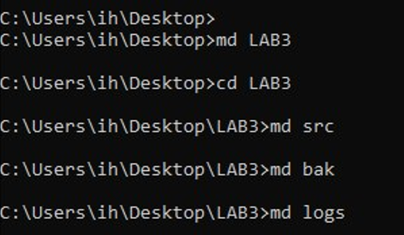
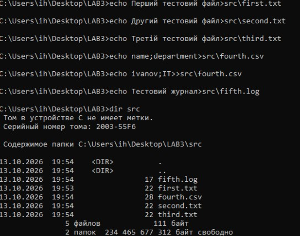
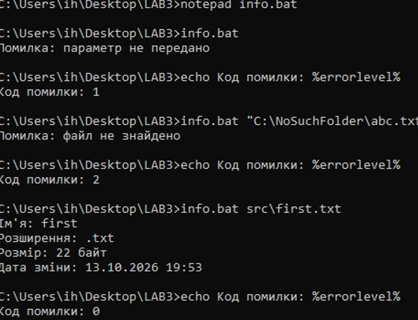
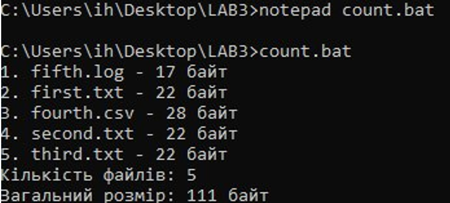
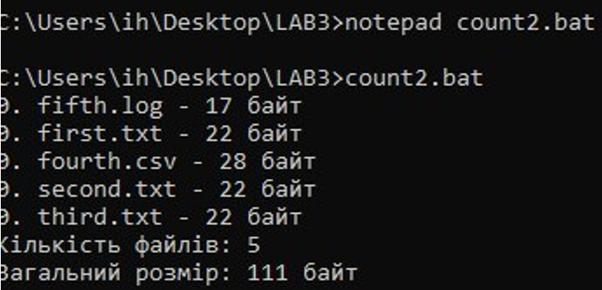
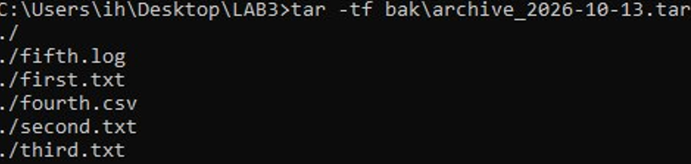
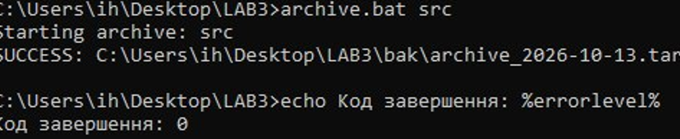
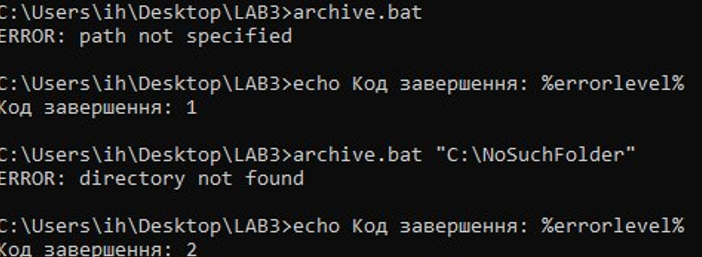
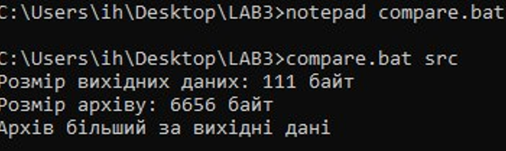

<!--
  Командні файли в ОС Windows
  Варіант 5: Архівування вмісту каталогу засобами `tar` — шлях до каталогу — Порівняти розмір архіву й вихідних даних

  Тему, мету й обладнання писати не треба — конвеєр візьме їх із лабораторної.
  Знімки екрана кладіть у assets/, вихідний код — у src/.
  Контрольні питання — лише одного рівня, того, на який захищаєте роботу:
  заголовок «### Достатній рівень», далі «1 Текст питання?» і відповідь.
  Покрокова інструкція — reports/README.md
-->

## Хід роботи

1 Номер індивідуального варіанта – 5.


2 На робочому столі було створено каталог LAB3 та підкаталоги src, bak і logs. Для створення каталогів використано команди: `cd %USERPROFILE%\Desktop`; `md LAB3`; `cd LAB3`; `md src`; `md bak`; `md logs`; `dir`. У каталозі src було створено п’ять тестових файлів різних типів: first.txt, second.txt, third.txt, fourth.csv і fifth.log. Файл fourth.csv містить дані у стовпцях. Для перевірки вмісту каталогу виконано команду: `dir src`. У результаті було отримано п’ять файлів загальним розміром 111 байт.






3 Було створено командний файл info.bat, який приймає шлях до файла як параметр, перевіряє його існування та виводить ім’я, розширення, розмір і дату останньої зміни. Для перевірки роботи скрипту було виконано три команди: `info.bat`; `info.bat "C:\NoSuchFolder\abc.txt"`; `info.bat src\first.txt`. Якщо параметр не передано, скрипт виводить повідомлення про помилку та повертає код 1. Якщо файл не знайдено, повертається код 2. Якщо файл існує, скрипт виводить його характеристики та повертає код 0. Для перевірки кодів завершення використовувалася змінна `%errorlevel%`. Під час перевірки файла first.txt отримано такі дані.

Скрипт:

```cmd
@echo off
chcp 65001 >nul
setlocal
if "%~1"=="" (
    echo Помилка: параметр не передано
    exit /b 1
)
if not exist "%~1" (
    echo Помилка: файл не знайдено
    exit /b 2
)
echo Ім'я: %~n1
echo Розширення: %~x1
echo Розмір: %~z1 байт
echo Дата зміни: %~t1
endlocal
exit /b 0
```



4 Було створено скрипт count.bat, який за допомогою циклу for обходить файли каталогу src, виводить їх нумерований перелік, підраховує кількість файлів і визначає їхній сумарний розмір. Для оновлення значень змінних під час кожної ітерації використано відкладене розгортання змінних за допомогою команди `setlocal enabledelayedexpansion`. Після запуску count.bat отримано такі результати.

Скрипт:

```cmd
@echo off
chcp 65001 >nul
setlocal enabledelayedexpansion

set n=0
set total=0

for %%F in ("%~dp0src\*") do (
    if exist "%%~fF" if not exist "%%~fF\" (
        set /a n+=1
        set /a total+=%%~zF
        echo !n!. %%~nxF - %%~zF байт
    )
)

echo Кількість файлів: !n!
echo Загальний розмір: !total! байт

endlocal
```



5 Для порівняння було створено скрипт count2.bat, у якому не використовується відкладене розгортання змінних. Після запуску скрипту в нумерованому переліку кожен файл отримав номер 0, хоча загальна кількість файлів і сумарний розмір були визначені правильно. Це відбувається тому, що змінні виду `%n%` усередині блоку циклу розгортаються до виконання циклу. Тому команда виведення використовує початкове значення лічильника. У скрипті count.bat використання `!n!` дає змогу отримувати актуальне значення змінної під час кожної ітерації.

Скрипт:

```cmd
@echo off
chcp 65001 >nul
setlocal

set n=0
set total=0

for %%F in ("%~dp0src\*") do (
    if exist "%%~fF" if not exist "%%~fF\" (
        set /a n+=1
        set /a total+=%%~zF
        echo %n%. %%~nxF - %%~zF байт
    )
)

echo Кількість файлів: %n%
echo Загальний розмір: %total% байт

endlocal
```



6 Відповідно до індивідуального варіанта № 5 було створено скрипт archive.bat, який архівує вміст заданого каталогу за допомогою утиліти tar. Скрипт приймає шлях до каталогу як параметр, перевіряє наявність параметра та існування каталогу. Після успішної перевірки створюється архів у каталозі bak. До назви архіву додається поточна дата. Для запису інформації про виконання використовується журнал logs\\archive.log. Повторюване записування повідомлень винесено в підпрограму `:log`, яку викликають за допомогою команди `call :log`. Основна команда архівування: `tar -cf "%ARCHIVE%" -C "%~1" .`. Після виконання команди перевіряється код повернення утиліти. Якщо виникає помилка, виконується перехід до підпрограми `:tar_error`, яка записує повідомлення про помилку в журнал. Для перевірки було виконано команду: `archive.bat src`. Архів успішно створено за шляхом: `C:\Users\ih\Desktop\LAB3\bak\archive_2026-10-13.tar`. Код завершення скрипту дорівнював 0, що свідчить про успішне виконання.

Скрипт:

```cmd
@echo off
chcp 65001 >nul
setlocal

set "LOG=%~dp0logs\archive.log"
set "DEST=%~dp0bak"

rem Перевірка параметра
if "%~1"=="" (
    call :log "ERROR: path not specified"
    exit /b 1
)

rem Перевірка каталогу
if not exist "%~1\" (
    call :log "ERROR: directory not found"
    exit /b 2
)

rem Створення каталогу для архівів
if not exist "%DEST%" md "%DEST%"

rem Формування дати
for /f %%D in ('powershell -NoProfile -Command "Get-Date -Format yyyy-MM-dd"') do set "STAMP=%%D"

rem Шлях до архіву
set "ARCHIVE=%DEST%\archive_%STAMP%.tar"

rem Запис початку операції до журналу
call :log "Starting archive: %~1"

rem Створення архіву
tar -cf "%ARCHIVE%" -C "%~1" .

rem Перевірка результату tar
if errorlevel 1 goto tar_error

call :log "SUCCESS: %ARCHIVE%"
endlocal
exit /b 0

:tar_error
call :log "ERROR: tar failed"
endlocal
exit /b 3

:log
>>"%LOG%" echo [%date% %time%] %~1
echo %~1
exit /b 0
```



7 Для перегляду журналу використано команду: `type logs\archive.log`. У журналі містяться записи про початок архівування та успішне завершення операції. Також було перевірено обробку неправильних вхідних даних. Під час запуску без параметра скрипт вивів повідомлення `ERROR: path not specified` та повернув код 1. Під час запуску з неіснуючим каталогом скрипт вивів повідомлення `ERROR: directory not found` та повернув код 2. Обидві помилки було записано до журналу.






8 Для виконання додаткового завдання було створено скрипт compare.bat. Він визначає сумарний розмір вихідних файлів, знаходить останній створений TAR-архів і порівнює їхні розміри. Для запуску використано команду: `compare.bat src`. Результат виконання: Розмір вихідних даних: 111 байт; Розмір архіву: 6656 байт; Архів більший за вихідні дані. Отриманий результат пояснюється тим, що формат TAR додає службові заголовки та іншу інформацію про файли. Сам по собі TAR об’єднує файли в один архів, але не стискає їх.

Скрипт:

```cmd
@echo off
chcp 65001 >nul
setlocal enabledelayedexpansion

rem Перевірка вхідних даних
if "%~1"=="" (
    echo Помилка: не вказано шлях до каталогу
    exit /b 1
)
if not exist "%~1" (
    echo Помилка: каталог не знайдено
    exit /b 2
)

rem Пошук найновішого архіву
set "ARCHIVE="
for /f "delims=" %%A in ('dir /b /a-d /o-d "%~dp0bak\*.tar" 2^>nul') do (
    if not defined ARCHIVE set "ARCHIVE=%~dp0bak\%%A"
)
if not defined ARCHIVE (
    echo Архів не знайдено. Спочатку запусти archive.bat
    exit /b 3
)

rem Підрахунок розміру вихідних файлів
set /a SOURCE=0
for /r "%~1" %%F in (*) do (
    if exist "%%F" if not exist "%%F\" (
        set /a SOURCE+=%%~zF
    )
)

rem Визначення розміру архіву
for %%A in ("!ARCHIVE!") do set "ARCHIVESIZE=%%~zA"

echo Розмір вихідних даних: !SOURCE! байт
echo Розмір архіву: !ARCHIVESIZE! байт

if !ARCHIVESIZE! lss !SOURCE! (
    echo Архів менший за вихідні дані
) else if !ARCHIVESIZE! gtr !SOURCE! (
    echo Архів більший за вихідні дані
) else (
    echo Розміри однакові
)

endlocal
exit /b 0
```



Таблиця 1 – Таблиця використаних команд

| Команда / ключ | Призначення | Команда / ключ | Призначення |
| ----- | ----- | ----- | ----- |
| cd | Перехід до іншого каталогу | md | Створення каталогу |
| cd /d | Перехід до каталогу з можливістю зміни диска | dir | Виведення списку файлів і каталогів |
| echo | Виведення тексту або запис тексту у файл | \> | Запис у файл із перезаписом його вмісту |
| \>> | Додавання тексту в кінець файла | if | Перевірка умови |
| if errorlevel 1 | Перевірка коду завершення команди | for | Організація циклу |
| set /a | Арифметичні обчислення | enabledelayedexpansion | Увімкнення відкладеного розгортання змінних |
| setlocal | Локальна область дії змінних | %n% | Звичайне розгортання змінної |
| !n! | Відкладене розгортання змінної | %\~1 | Перший параметр без зовнішніх лапок |
| %\~n1 | Ім’я файла без розширення | %\~x1 | Розширення файла |
| %\~z1 | Розмір файла в байтах | %\~t1 | Дата й час останньої зміни файла |
| %\~dp0 | Диск і шлях до каталогу, у якому розташований BAT-файл | call :log | Виклик підпрограми журналювання |
| exit /b | Завершення пакетного файлу з кодом повернення | errorlevel | Код завершення попередньої команди або скрипту |
| chcp | Перегляд або зміна кодової сторінки консолі | tar -cf | Створення TAR-архіву |
| tar -tf | Перегляд вмісту TAR-архіву | \-C | Перехід до вказаного каталогу перед архівуванням |
| powershell -NoProfile | Запуск PowerShell без завантаження профілю користувача | Get-Date -Format yyyy-MM-dd | Отримання поточної дати в заданому форматі |
| type | Виведення вмісту текстового файла | rem | Коментар у пакетному файлі |

### Коли доцільно використовувати BAT-файли та PowerShell

BAT-файли зручно використовувати для автоматизації простих повторюваних дій у Windows: створення каталогів, копіювання файлів, запуску програм, перевірки параметрів і виконання послідовності команд. Вони прості у створенні та виконуються через командний процесор cmd.exe.

PowerShell доцільно використовувати для складніших завдань, коли потрібно обробляти великі обсяги даних, працювати з об’єктами, системними налаштуваннями, службами Windows або створювати складні сценарії автоматизації. Він має ширші можливості для обробки даних і взаємодії з операційною системою. У цій лабораторній роботі основні дії реалізовано за допомогою BAT-файлів, а PowerShell використано для отримання поточної дати в потрібному форматі.

## Відповіді на контрольні питання

### Достатній рівень

1 Скрипт правильно обробляє файли в циклі for, але нумерація у виводі всередині циклу показує самі нулі, а підсумок після циклу правильний. Поясніть обидва факти через порядок розбору блоку й запропонуйте два різні способи виправлення.

У командних файлах Windows змінні виду `%n%` усередині блоку команд розгортаються ще до виконання циклу. Тому команда виведення використовує початкове значення лічильника — 0. Водночас команда `set /a n+=1` змінює значення змінної під час кожної ітерації, тому після завершення циклу підсумкова кількість файлів правильна. Перший спосіб виправлення — увімкнути відкладене розгортання за допомогою `setlocal enabledelayedexpansion` і використовувати `!n!` замість `%n%`. Другий спосіб — винести виведення номера в окрему підпрограму та викликати її через `call`, щоб значення змінної обчислювалося під час виконання підпрограми.

2 Потрібно щоночі копіювати робочий каталог, зберігати п’ять останніх копій і видаляти старіші. Опишіть структуру скрипта: які перевірки, який цикл, які коди повернення.

Спочатку скрипт повинен перевірити, чи існує вихідний каталог і чи доступний каталог для збереження резервних копій. Далі потрібно створити копію з унікальною назвою, наприклад із датою та часом. Після успішного копіювання слід отримати список резервних копій, упорядкувати їх за датою та за допомогою циклу for видалити всі копії, крім п’яти найновіших. Запуск скрипта щоночі можна налаштувати через Планувальник завдань Windows. Для позначення результату роботи можна використати такі коди завершення: 0 — успіх, 1 — не вказано шлях до вихідного каталогу, 2 — каталог не знайдено, 3 — помилка копіювання, 4 — помилка видалення старих копій.

3 Скрипт працює, коли його запускають подвійним клацанням, і не працює, коли він викликається з планувальника завдань. Назвіть щонайменше три ймовірні причини й спосіб перевірки кожної.

Можливими причинами є:

- Інший робочий каталог. Під час запуску з Планувальника завдань поточний каталог може відрізнятися від каталогу скрипта. Потрібно перевірити робочий каталог у налаштуваннях завдання та за потреби використовувати повні шляхи або `%~dp0`.

- Недостатні права доступу. Користувач, від імені якого запускається завдання, може не мати дозволу на читання, запис або видалення файлів. Потрібно перевірити обліковий запис завдання та права доступу до потрібних каталогів.

- Інший обліковий запис користувача. Завдання може виконуватися від імені іншого користувача, у якого немає доступу до потрібних файлів або мережевих ресурсів. Потрібно перевірити параметри облікового запису в Планувальнику завдань.

- Відсутність потрібних змінних середовища або програм у PATH. У середовищі планувальника команда може не знаходитися. Потрібно перевірити журнал виконання та за потреби вказати повний шлях до програми. Для діагностики також варто записувати повідомлення про помилки й код завершення скрипта до журналу.

4 Сформулюйте критерій, за яким задачу варто розв’язувати пакетним файлом, а коли переходити на PowerShell. Обґрунтуйте прикладом із цієї роботи.

BAT-файли доцільно використовувати для простих послідовностей команд, створення каталогів, перевірки параметрів, перебору файлів і запуску програм. PowerShell краще підходить для складнішої автоматизації, обробки структурованих даних, роботи з системними об’єктами та ситуацій, коли потрібні розширені засоби керування помилками. У цій лабораторній роботі пакетні файли використано для підрахунку файлів, перевірки вхідних даних, архівування каталогу й ведення журналу. PowerShell застосовано для отримання поточної дати в потрібному форматі. Це показує, що BAT-файлів достатньо для простих операцій, а PowerShell можна залучати для окремих завдань, які зручніше виконувати його засобами.

## Висновок

Під час виконання лабораторної роботи я навчився створювати командні файли Windows, передавати параметри, використовувати цикли та умовні оператори, а також перевіряти правильність вхідних даних. Було створено скрипти для отримання інформації про файли, підрахунку їх кількості й сумарного розміру та архівування каталогу за допомогою утиліти tar. Я навчився використовувати коди завершення, обробляти помилки та вести журнал виконання. У додатковому завданні було порівняно розмір вихідних даних із розміром архіву. У результаті закріплено навички автоматизації роботи з файлами та каталогами засобами командного процесора Windows.

