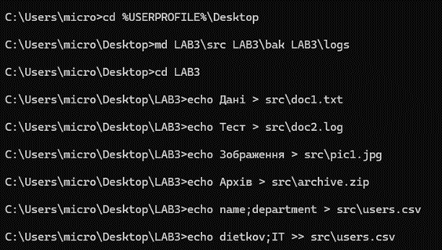
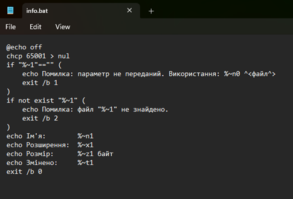
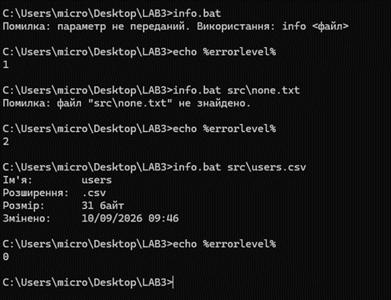
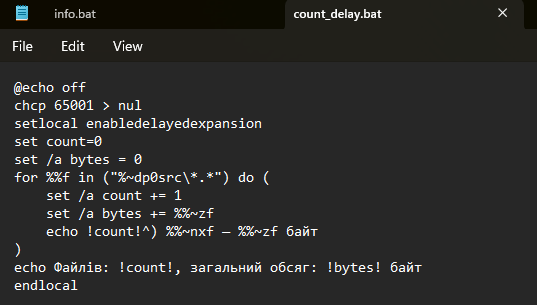
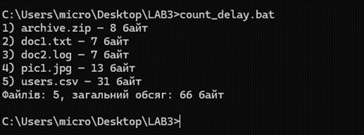
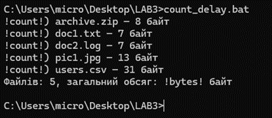
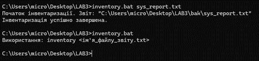

<!--
  Командні файли в ОС Windows
  Варіант 6: Інвентаризація системи у текстовий файл — ім'я звіту — Додати до звіту перелік дисків і вільне місце

  Тему, мету й обладнання писати не треба — конвеєр візьме їх із лабораторної.
  Знімки екрана кладіть у assets/, вихідний код — у src/.
  Контрольні питання — лише одного рівня, того, на який захищаєте роботу:
  заголовок «### Достатній рівень», далі «1 Текст питання?» і відповідь.
  Покрокова інструкція — reports/README.md
-->

## Хід роботи
 
2 Підготовлено робоче середовище: у профілі користувача створено каталог `LAB3` з підкаталогами `src` (вхідні файли), `bak` (звіти) та `logs` (журнали). У `src` командою `echo` створено тестові файли `doc1.txt`, `doc2.log`, `pic1.jpg`, `archive.zip` і `users.csv`; до `users.csv` другий рядок дописано оператором `>>`, щоб не перезаписати заголовок.
 

 
3 Створено `info.bat`, який приймає ім'я файлу як параметр. Скрипт перевіряє вхідні дані: без параметра завершується з кодом 1, для неіснуючого файлу — з кодом 2, а для наявного виводить ім'я (`%~n1`), розширення (`%~x1`), розмір (`%~z1`) і дату зміни (`%~t1`) та повертає код 0.
 

 
Скрипт запущено без параметра, з неіснуючим файлом і з `src\users.csv`; після кожного запуску коди повернення перевірено командою `echo %errorlevel%`.
 

 
Таблиця 1 – Коди повернення info.bat
 
| Виклик | Код повернення | Результат |
|--------|----------------|-----------|
| `info.bat` | 1 | Помилка: параметр не передано |
| `info.bat src\none.txt` | 2 | Помилка: файл не знайдено |
| `info.bat src\users.csv` | 0 | Виведено ім'я, розширення, розмір і дату зміни |
 
4 Створено `count_delay.bat`: цикл `for` обходить усі файли каталогу `src`, лічильник `count` і сума розмірів `bytes` обчислюються командою `set /a`. Щоб значення змінних підставлялися під час виконання тіла циклу, увімкнено `setlocal enabledelayedexpansion`, а до лічильника звернення записано як `!count!`.
 

 
Скрипт опрацював 5 файлів із загальним обсягом 66 байт.
 

 
5 Скрипт `count_delay.bat` запущено без `enabledelayedexpansion`.
 

 
Усередині блоку в дужках командний процесор підставляє значення змінних до початку виконання блоку. Блок розбирається один раз, коли count ще дорівнює нулю. Команда set /a рахує правильно, оскільки звертається до імені в момент виконання, тому підсумок після циклу виводиться коректно, але echo %count% виводить старе значення.
 
6-8 Створено скрипт `inventory.bat`, який приймає ім'я файлу звіту, перевіряє параметр, формує заголовок звіту, збирає результати команд `ver`, `whoami`, змінної `PROCESSOR_IDENTIFIER`, перелік дисків з вільним місцем (через PowerShell замість `wmic`) і список процесів `tasklist`, перевіряє код повернення зовнішньої утиліти та веде журнал через підпрограму `:log`.
 
```bat
@echo off
chcp 65001 > nul
setlocal
:: Перевірка вхідного параметра
if "%~1"=="" (
    echo Використання: %~n0 ^<ім'я_файлу_звіту.txt^>
    exit /b 1
)
set "report=%~dp0bak\%~1"
set "logfile=%~dp0logs\inventory.log"
call :log Початок інвентаризації. Звіт: "%report%"
:: Створення заголовка звіту
echo Інвентаризація системи ПК: %COMPUTERNAME% > "%report%"
echo Дата створення: %date% %time% >> "%report%"
echo ========================================= >> "%report%"
:: Змінено wmic на вивід системної змінної PROCESSOR_IDENTIFIER
for %%c in ("ver" "whoami" "echo %PROCESSOR_IDENTIFIER%") do (
    echo. >> "%report%"
    echo --- Команда: %%~c --- >> "%report%"
    %%~c >> "%report%" 2>nul
)
:: Додаткове завдання (Варіант 6): Перелік дисків і вільне місце
:: Замість wmic використовуємо PowerShell
echo. >> "%report%"
echo --- Диски та вільне місце --- >> "%report%"
powershell -NoProfile -Command "Get-CimInstance Win32_LogicalDisk | Format-Table DeviceID, FreeSpace, Size -AutoSize" >> "%report%"
:: Виклик зовнішньої утиліти tasklist та перевірка errorlevel
echo. >> "%report%"
echo --- Перелік процесів --- >> "%report%"
tasklist >> "%report%"
if %errorlevel% geq 1 (
    call :log ПОМИЛКА: tasklist завершився з кодом %errorlevel%
    endlocal
    exit /b %errorlevel%
)
call :log Інвентаризація успішно завершена.
endlocal
exit /b 0
:: Підпрограма журналу
:log
echo [%date% %time%] %* >> "%~dp0logs\inventory.log"
echo %*
goto :eof
```
 
Скрипт 1 – Виконання роботи з 6-8 кроку
 
9 Перевірено роботу скрипту: запуск із параметром створює звіт у каталозі `bak`, а запуск без параметра виводить підказку про використання. У журналі `logs\inventory.log` зафіксовано початок і успішне завершення інвентаризації.
 

 

 
10 Результат роботи скрипту записано у файл `sys_report.txt`.
 
```text
Інвентаризація системи ПК: NEK
Дата створення: Fri 10/09/2026 10:01:32.43
=========================================
 
--- Команда: ver ---
Microsoft Windows [Version 10.0.26300.9457]
 
--- Команда: whoami ---
nek\micro
 
--- Команда: echo Intel64 Family 6 Model 165 Stepping 3, GenuineIntel ---
Intel64 Family 6 Model 165 Stepping 3, GenuineIntel
 
--- Диски та вільне місце ---
DeviceID     FreeSpace          Size
--------     ---------          ----
C:         13207875584  254945521664
D:       1502609797120 2000381014016
 
--- Перелік процесів ---
Image Name                     PID Session Name        Session#    Mem Usage
========================= ======== ================ =========== ============
System Idle Process              0 Services                   0          8 K
System                           4 Services                   0         12 K
Secure System                  140 Services                   0     63,640 K
Registry                       184 Services                   0     55,792 K
smss.exe                       756 Services                   0        752 K
csrss.exe                      980 Services                   0      3,164 K
wininit.exe                    916 Services                   0      5,096 K
services.exe                  1088 Services                   0      8,036 K
LsaIso.exe                    1132 Services                   0      1,760 K
lsass.exe                     1144 Services                   0     23,952 K
svchost.exe                   1276 Services                   0     34,524 K
fontdrvhost.exe               1308 Services                   0      1,000 K
svchost.exe                   1416 Services                   0     18,908 K
svchost.exe                   1472 Services                   0      7,572 K
svchost.exe                   1640 Services                   0      4,932 K
svchost.exe                   1648 Services                   0      1,520 K
svchost.exe                   1784 Services                   0      7,344 K
svchost.exe                   1792 Services                   0      6,420 K
svchost.exe                   1896 Services                   0      2,720 K
svchost.exe                   1988 Services                   0      9,656 K
svchost.exe                   1204 Services                   0     23,220 K
svchost.exe                   1436 Services                   0      2,748 K
svchost.exe                   2128 Services                   0      7,488 K
svchost.exe                   2280 Services                   0      5,384 K
svchost.exe                   2380 Services                   0      6,092 K
svchost.exe                   2472 Services                   0     10,672 K
svchost.exe                   2500 Services                   0      7,944 K
NVDisplay.Container.exe       2512 Services                   0     21,576 K
svchost.exe                   2580 Services                   0     17,988 K
svchost.exe                   2628 Services                   0     15,204 K
AsusCertService.exe           2636 Services                   0      2,004 K
svchost.exe                   2760 Services                   0      8,884 K
svchost.exe                   2768 Services                   0      2,008 K
svchost.exe                   2776 Services                   0      5,524 K
Memory Compression            2892 Services                   0    735,252 K
svchost.exe                   2940 Services                   0      6,812 K
svchost.exe                   2960 Services                   0     14,396 K
svchost.exe                   3012 Services                   0      6,740 K
svchost.exe                   3020 Services                   0      5,984 K
svchost.exe                   3104 Services                   0     15,668 K
svchost.exe                   3176 Services                   0      4,376 K
svchost.exe                   3248 Services                   0      7,556 K
svchost.exe                   3256 Services                   0      3,336 K
svchost.exe                   3308 Services                   0     29,600 K
svchost.exe                   3320 Services                   0     10,664 K
spoolsv.exe                   3540 Services                   0      7,764 K
svchost.exe                   3592 Services                   0     19,588 K
svchost.exe                   3868 Services                   0      3,392 K
svchost.exe                   3936 Services                   0      4,844 K
svchost.exe                   3948 Services                   0     16,052 K
svchost.exe                   3968 Services                   0     38,112 K
bdvpnservice.exe              3976 Services                   0     37,640 K
ArmouryCrate.Service.exe      3984 Services                   0     21,224 K
svchost.exe                   3992 Services                   0     33,492 K
svchost.exe                   4060 Services                   0      1,624 K
svchost.exe                   4068 Services                   0      3,396 K
OfficeClickToRun.exe          4092 Services                   0     37,656 K
svchost.exe                   3520 Services                   0     14,708 K
jhi_service.exe               4120 Services                   0      1,300 K
nvcontainer.exe               4196 Services                   0     24,840 K
MpDefenderCoreService.exe     4244 Services                   0     13,592 K
ROGLiveService.exe            4280 Services                   0     14,196 K
svchost.exe                   4344 Services                   0      4,068 K
svchost.exe                   4376 Services                   0      2,544 K
thx_hator_hyperpunk3_svc.     4392 Services                   0     11,568 K
svchost.exe                   4428 Services                   0     15,084 K
MsMpEng.exe                   4440 Services                   0    330,948 K
WMIRegistrationService.ex     4564 Services                   0      2,148 K
svchost.exe                   4636 Services                   0      2,488 K
svchost.exe                   4692 Services                   0      4,836 K
svchost.exe                   5396 Services                   0      2,996 K
svchost.exe                   5484 Services                   0      6,808 K
AggregatorHost.exe            6708 Services                   0      8,696 K
svchost.exe                   6948 Services                   0      3,548 K
svchost.exe                   7576 Services                   0      6,476 K
svchost.exe                   7436 Services                   0      2,472 K
svchost.exe                   7308 Services                   0     14,348 K
svchost.exe                   7668 Services                   0      2,544 K
svchost.exe                   8560 Services                   0      9,992 K
unsecapp.exe                  5676 Services                   0      4,292 K
svchost.exe                   5376 Services                   0     17,924 K
SearchIndexer.exe             8988 Services                   0     34,748 K
svchost.exe                   9308 Services                   0      7,556 K
svchost.exe                   9476 Services                   0      5,304 K
svchost.exe                   9516 Services                   0     15,932 K
svchost.exe                   9772 Services                   0      3,896 K
svchost.exe                   9912 Services                   0     28,440 K
svchost.exe                  10032 Services                   0      5,968 K
NgcIso.exe                   10196 Services                   0      1,204 K
svchost.exe                  11772 Services                   0     24,208 K
NisSrv.exe                   16804 Services                   0      6,764 K
svchost.exe                   7444 Services                   0     26,160 K
svchost.exe                  10404 Services                   0     15,040 K
svchost.exe                  18204 Services                   0     10,212 K
svchost.exe                  19268 Services                   0     17,028 K
svchost.exe                  18604 Services                   0      7,052 K
svchost.exe                  16380 Services                   0     19,724 K
svchost.exe                   7616 Services                   0      2,508 K
svchost.exe                   7396 Services                   0      6,280 K
SecurityHealthService.exe    16540 Services                   0     13,332 K
svchost.exe                   6728 Services                   0     13,740 K
svchost.exe                  18328 Services                   0      3,312 K
svchost.exe                   3392 Services                   0      3,740 K
bdredline.exe                 5716 Services                   0      4,612 K
ProductAgentService.exe      20904 Services                   0     18,992 K
audiodg.exe                   1972 Services                   0     36,748 K
MidiSrv.exe                  23460 Services                   0      6,160 K
RvControlSvc.exe             12980 Services                   0     11,644 K
svchost.exe                   2120 Services                   0      2,592 K
csrss.exe                     8976 Console                   10      8,992 K
winlogon.exe                 12492 Console                   10     15,664 K
fontdrvhost.exe               4904 Console                   10     12,156 K
dwm.exe                      23628 Console                   10    123,336 K
NVDisplay.Container.exe      10192 Console                   10     45,848 K
nvcontainer.exe               8084 Console                   10     40,244 K
svchost.exe                   8628 Services                   0      7,848 K
ArmouryCrate.UserSessionH     2324 Console                   10     38,900 K
conhost.exe                  17864 Console                   10      6,976 K
nvcontainer.exe               7344 Console                   10     33,876 K
sihost.exe                    5392 Console                   10     61,368 K
svchost.exe                  13488 Console                   10     33,136 K
nvcontainer.exe              25492 Console                   10     80,308 K
svchost.exe                  13368 Console                   10      8,088 K
svchost.exe                  16564 Console                   10     42,836 K
taskhostw.exe                21796 Console                   10     23,296 K
NVIDIA RTX Voice.exe         17440 Console                   10     24,232 K
DiscoverySrv.exe              8236 Services                   0     15,340 K
explorer.exe                  2308 Console                   10    404,732 K
ShellHost.exe                15728 Console                   10     56,640 K
CrossDeviceResume.exe        23612 Console                   10     53,112 K
svchost.exe                  22540 Services                   0     12,116 K
svchost.exe                   6984 Console                   10     53,716 K
DefenderSessionHelper.exe    21428 Console                   10      7,192 K
PowerToys.exe                15292 Console                   10     37,968 K
SearchHost.exe               13396 Console                   10    125,864 K
StartMenuExperienceHost.e    16500 Console                   10    128,756 K
WidgetBoard.exe              20716 Console                   10     30,464 K
RuntimeBroker.exe            13388 Console                   10     49,772 K
svchost.exe                  11744 Console                   10     17,336 K
PowerToys.QuickAccess.exe     4460 Console                   10     20,336 K
nvsphelper64.exe             15932 Console                   10     17,752 K
NVIDIA Overlay.exe           19600 Console                   10    173,556 K
msedgewebview2.exe           21612 Console                   10    109,616 K
ctfmon.exe                   13876 Console                   10     56,916 K
msedgewebview2.exe           15448 Console                   10     12,784 K
msedgewebview2.exe           20980 Console                   10     56,160 K
msedgewebview2.exe           12012 Console                   10     39,028 K
msedgewebview2.exe           18852 Console                   10     68,200 K
msedgewebview2.exe           19464 Console                   10     19,396 K
WidgetService.exe            23372 Console                   10     25,980 K
svchost.exe                   9364 Console                   10     27,304 K
NVIDIA Overlay.exe           24360 Console                   10     80,756 K
NVIDIA Overlay.exe           18308 Console                   10     37,800 K
NVIDIA Overlay.exe           16140 Console                   10     23,696 K
NVIDIA Overlay.exe           22532 Console                   10     96,044 K
thx_hator_hyperpunk3_surr    23668 Console                   10     12,696 K
nvfvsdksvc_x64.exe           16340 Services                   0     14,184 K
FvContainer.System.exe         348 Services                   0     32,348 K
FvContainer.exe               7932 Console                   10     24,012 K
PresentMon_x64.exe           22556 Services                   0     21,208 K
nvrla.exe                     9424 Console                   10     12,188 K
TextInputHost.exe            18140 Console                   10    242,372 K
svchost.exe                  15384 Console                   10     32,620 K
PowerToys.AlwaysOnTop.exe    10128 Console                   10      2,612 K
PowerToys.Awake.exe           1944 Console                   10     16,684 K
PowerToys.ColorPickerUI.e     6536 Console                   10     27,104 K
PowerToys.FancyZones.exe     16348 Console                   10      8,424 K
Microsoft.CmdPal.UI.exe       5680 Console                   10    133,760 K
PowerToys.Peek.UI.exe         8956 Console                   10     10,992 K
WindowsPackageManagerServ     4784 Console                   10     35,476 K
Microsoft.CmdPal.Ext.Powe     8360 Console                   10     48,912 K
Discord.exe                  23800 Console                   10    135,604 K
Discord.exe                   5740 Console                   10     34,184 K
Discord.exe                   6412 Console                   10    133,784 K
Discord.exe                  14156 Console                   10     62,156 K
Discord.exe                   3080 Console                   10    406,552 K
Discord.exe                  12948 Console                   10     94,252 K
DiscordSystemHelper.exe       2756 Console                   10     13,868 K
DiscordSystemHelper.exe      11632 Console                   10     14,376 K
steam.exe                    11196 Console                   10    101,920 K
MicrosoftStartFeedProvide    23392 Console                   10     48,984 K
chrome.exe                   20064 Console                   10    322,128 K
chrome.exe                   13176 Console                   10      9,856 K
chrome.exe                   19052 Console                   10    212,112 K
chrome.exe                    3556 Console                   10     61,612 K
chrome.exe                   15936 Console                   10     19,580 K
chrome.exe                   11516 Console                   10    103,760 K
chrome.exe                    8816 Console                   10    150,232 K
chrome.exe                   13468 Console                   10     79,400 K
Telegram.exe                 18972 Console                   10    204,376 K
steamwebhelper.exe           22328 Console                   10    154,148 K
steamservice.exe             13528 Services                   0     13,576 K
steamwebhelper.exe           13192 Console                   10     14,732 K
steamwebhelper.exe           20556 Console                   10     72,672 K
steamwebhelper.exe            4024 Console                   10     33,820 K
steamwebhelper.exe            6520 Console                   10     20,720 K
steamwebhelper.exe           10724 Console                   10    415,400 K
steamwebhelper.exe            4684 Console                   10    103,084 K
chrome.exe                   24272 Console                   10     69,468 K
chrome.exe                   18744 Console                   10     33,868 K
chrome.exe                   10396 Console                   10     54,216 K
chrome.exe                   17448 Console                   10     60,452 K
chrome.exe                   17256 Console                   10    420,416 K
chrome.exe                   15544 Console                   10     60,544 K
ApplicationFrameHost.exe     11660 Console                   10     62,564 K
SystemSettings.exe           24236 Console                   10      3,516 K
UserOOBEBroker.exe           14004 Console                   10     11,920 K
ShellExperienceHost.exe      12236 Console                   10     77,020 K
RuntimeBroker.exe            21592 Console                   10     27,388 K
chrome.exe                   24988 Console                   10     97,360 K
chrome.exe                   21656 Console                   10    413,516 K
chrome.exe                   15732 Console                   10    151,736 K
chrome.exe                   21560 Console                   10     84,700 K
chrome.exe                   25352 Console                   10    327,956 K
chrome.exe                    9960 Console                   10    111,244 K
chrome.exe                   22472 Console                   10     97,456 K
WINWORD.EXE                  19040 Console                   10    244,524 K
ai.exe                       20872 Console                   10     40,628 K
chrome.exe                   17956 Console                   10    629,884 K
chrome.exe                    8268 Console                   10     33,864 K
cmd.exe                      10832 Console                   10      9,888 K
conhost.exe                  21120 Console                   10     10,660 K
OpenConsole.exe              16436 Console                   10     15,464 K
WindowsTerminal.exe           3060 Console                   10    104,896 K
Notepad.exe                   8496 Console                   10     19,104 K
Notepad.exe                  21920 Console                   10    127,508 K
svchost.exe                   2016 Services                   0     16,916 K
Notepad.exe                  14752 Console                   10     18,384 K
SearchProtocolHost.exe       21516 Services                   0     21,664 K
SearchFilterHost.exe         24208 Services                   0     13,292 K
WmiPrvSE.exe                 18756 Services                   0     17,532 K
smartscreen.exe              22416 Console                   10     13,452 K
chrome.exe                   17012 Console                   10     45,428 K
tasklist.exe                  2068 Console                   10     12,352 K
```
 
## Відповіді на контрольні питання
 
### Середній рівень (репродуктивний)
 
1 Що таке пакетний файл і який процес його виконує?
 
Пакетний файл - це звичайний текстовий файл з розширенням .bat або .cmd, який виконує командний процесор cmd.exe.
 
2 Для чого на початку скрипта пишуть @echo off і що робить символ @?
 
Команда echo off вимикає дублювання команд на екран, щоб вікно не засмічувалося текстом сценарію, а символ @ приховує саму цю команду.
 
3 Якими двома способами записують коментарі в batch-файлі?
 
Рядки коментують командою rem або скороченням ::.
 
4 Як звернутися до першого та другого аргументів командного рядка?
 
Аргументи доступні як %1 та %2 відповідно.
 
5 Що повертають модифікатори %~n1, %~x1 і %~dp0?
 
Запис %~n1 повертає тільки ім’я файлу, %~x1 - тільки розширення, а %~dp0 - каталог самого скрипта.
 
6 Яким ключем команди set вмикають арифметику?
 
Цілочислову арифметику вмикають ключем /a.
 
7 Назвіть три форми оператора if.
 
До основних форм належать: порівняння значень, перевірка існування файлу та перевірка коду повернення попередньої команди.
 
8 Чим змінна циклу %%i у скрипті відрізняється від %i у командному рядку?
 
У скрипті змінна записується двома відсотками (%%i), а в командному рядку - одним (%i).
 
### Достатній рівень
 
1 Запишіть команду, яка виведе імена всіх файлів .log у поточному каталозі та всіх його підкаталогах.
 
`for /r %%f in (*.log) do echo %%f`
 
2 Чому значення в умові беруть у лапки: `if "%mode%"=="full"`? Що станеться без них, якщо змінна порожня?
 
Лапки роблять порівняння коректним за будь-якого значення. Якщо змінна порожня, запис без лапок перетворюється на синтаксично хибний рядок if ==full, що призводить до аварійної зупинки скрипта.
 
3 Що означає if errorlevel 1 і чому перевірки кодів записують від більшого до меншого?
 
Ця умова істинна, коли код повернення більший або рівний одиниці. Перевірки записують від більшого коду до меншого, щоб уникнути хибних спрацьовувань, оскільки умова перевіряє значення "більше або дорівнює".
 
4 Побудуйте цикл for /f, який прочитає перший і третій стовпці файлу з роздільником «крапка з комою».
 
`for /f "tokens=1,3 delims=;" %%a in (файл) do echo %%a - %%b`
 
5 Чим call :мітка відрізняється від goto :мітка?
 
Команда goto передає керування на мітку, тоді як call :мітка викликає ділянку коду як підпрограму, після якої виконання повертається в точку виклику командою goto :eof.
 
6 Для чого потрібні setlocal і endlocal? Що станеться зі змінними після завершення скрипта без них?
 
Ця пара обмежує область дії змінних: усе, що встановлено між ними, після завершення скрипта зникає. Без них змінна залишається у вікні, з якого запустили скрипт, і може зіпсувати роботу наступних команд чи скриптів.
 
7 Запишіть рядок, який дописує в журнал поточний час і текст повідомлення.
 
`echo [%time%] текст повідомлення >> "log.txt"`
 
8 Чим exit /b 1 відрізняється від exit 1 під час запуску скрипта з відкритого вікна cmd?
 
Команда exit /b 1 завершує скрипт із заданим кодом повернення, який батьківський процес може перевірити через errorlevel.
 
### Високий рівень (творчий)
 
1 Скрипт правильно обробляє файли в циклі for, але нумерація у виводі середині циклу показує самі нулі, а підсумок після циклу правильний. Поясніть обидва факти через порядок розбору блоку й запропонуйте два різні способи виправлення.
 
Усередині блоку в дужках командний процесор підставляє значення змінних ще до початку виконання блоку, тому нуль вписується в рядок під час розбору. Підсумок після циклу правильний, бо команда set /a звертається до змінної за іменем у момент виконання. Для виправлення використовують режим відкладеного розгортання змінних за допомогою команди setlocal enabledelayedexpansion та звертаються до лічильника як !count!. Альтернативним архітектурним виправленням є винесення тіла циклу в окрему підпрограму та її виклик через call :мітка.
 
2 Потрібно щоночі копіювати робочий каталог, зберігати п’ять останніх копій і видаляти старіші. Опишіть структуру скрипта: які перевірки, який цикл, які коди повернення.
 
Скрипт має розпочинатися з ініціалізації через @echo off та setlocal. Далі потрібна перевірка наявності вихідного каталогу (if not exist) та створення цільового каталогу з використанням підстановки дати (set "dst=...\%date:~6,4%..."). Копіювання здійснюється зовнішньою утилітою (наприклад, robocopy) з перевіркою коду повернення (if %errorlevel% geq 8). Очищення від старих файлів можна реалізувати інструментами на кшталт forfiles. Усі дії та можливі помилки записуються в журнал через перенаправлення >>.
 
3 Скрипт працює, коли його запускають подвійним клацанням, і не працює, коли він викликається з планувальника завдань. Назвіть щонайменше три ймовірні причини й спосіб перевірки кожної.
 
(1) Планувальник може запускати скрипт з іншого робочого каталогу, тому для надійності необхідно використовувати модифікатор %~dp0, щоб скрипт працював відносно власного розташування. (2) Виконання може відбуватися від імені іншого профілю користувача, що змінить значення системних змінних, таких як %USERPROFILE%. (3) Скрипт може містити інтерактивні команди (наприклад, choice), які очікують вводу від користувача і зупиняють виконання фонового процесу. Для діагностики таких проблем обов'язково ведуть журнал виконання з перенаправленням >>.
 
4 Сформулюйте критерій, за яким задачу варто розв’язувати пакетним файлом, а коли переходити на PowerShell. Обґрунтуйте прикладом із цієї роботи.
 
Пакетні файли доцільно використовувати для автоматизації базових рутинних дій засобами командного процесора, оскільки інтерпретатор уже входить до складу системи і не потребує жодного компілятора. На PowerShell варто переходити, коли необхідні обчислення з дробовими числами (які cmd взагалі не підтримує), або коли потрібно отримати надійний, незалежний від локалі формат дати чи розширені системні дані.
 
## Висновок
 
Задачі з базового керування файлами, перевірки кодів повернення утиліт, ведення простих журналів та обходу каталогів доцільно автоматизувати пакетними файлами, оскільки їхній інтерпретатор завжди вбудований у систему та готовий до роботи без додаткових налаштувань. Проте, якщо задача вимагає підтримки дробових чисел, точного форматування дат незалежно від системної локалі або складної взаємодії з об'єктами операційної системи, необхідний перехід на PowerShell.