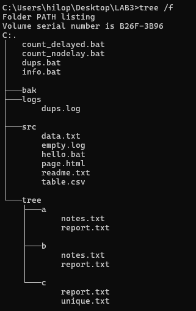

<!--
  Командні файли в ОС Windows
  Варіант 11: Пошук дублікатів імен файлів у дереві каталогів — шлях — Пояснити, чому однакові імена не означають однакового вмісту

  Тему, мету й обладнання писати не треба — конвеєр візьме їх із лабораторної.
  Знімки екрана кладіть у assets/, вихідний код — у src/.
  Контрольні питання — лише одного рівня, того, на який захищаєте роботу:
  заголовок «### Достатній рівень», далі «1 Текст питання?» і відповідь.
  Покрокова інструкція — reports/README.md
-->

## Хід роботи

1 Перша дія з поясненням, що і навіщо робилося.

2 Друга дія.

Таблиця 1 – Результати виконання

| Команда | Результат |
|---------|-----------|
| dir     | 5 файлів  |

## Відповіді на контрольні питання

### Достатній рівень

1 Текст питання?

Відповідь.

## Висновок

Що саме опановано за роботу.
