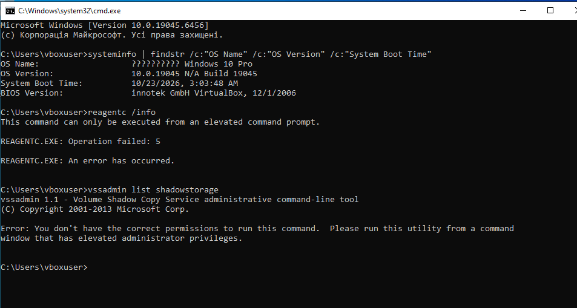
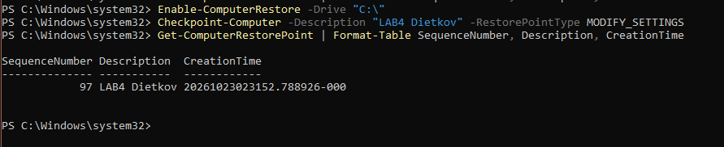
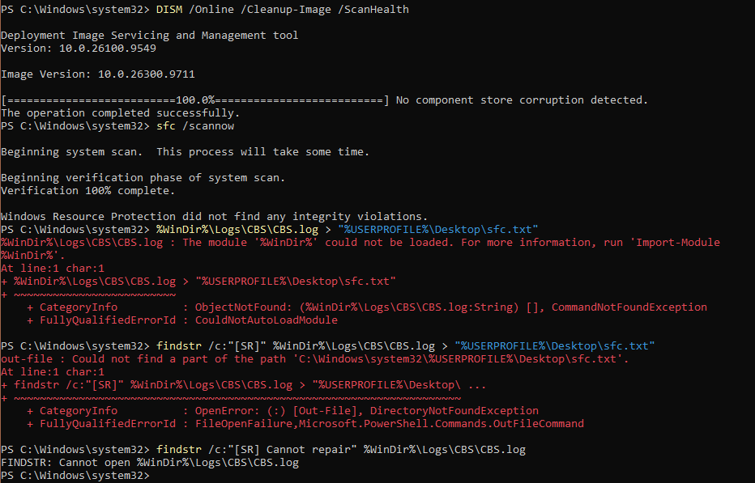
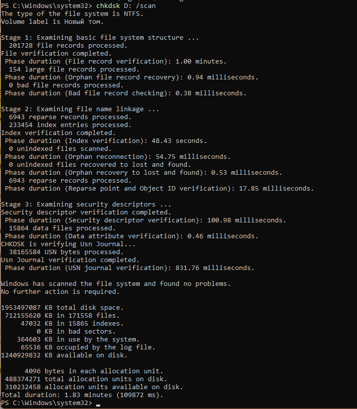
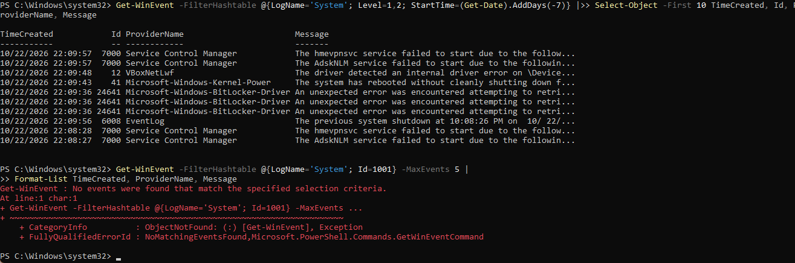
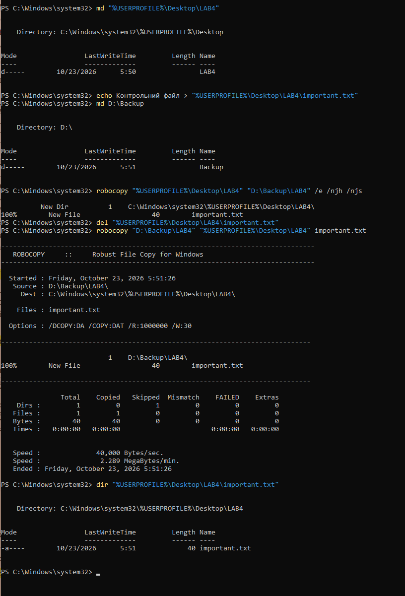
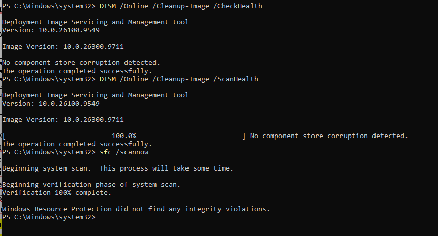
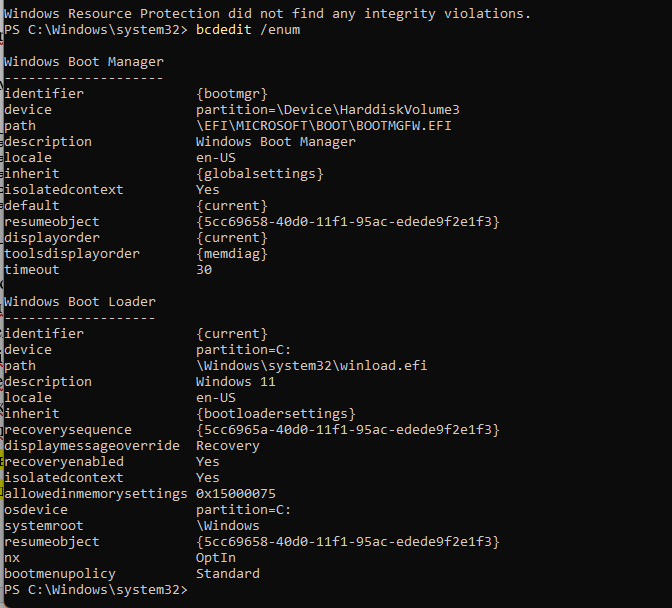

<!--
  Методи відновлення ОС
  Варіант 7: Пошкоджене сховище компонентів — `/scan` — 1001 — Пояснити, чому `sfc` без `DISM` не допомагає

  Тему, мету й обладнання писати не треба — конвеєр візьме їх із лабораторної.
  Знімки екрана кладіть у assets/, вихідний код — у src/.
  Контрольні питання — лише одного рівня, того, на який захищаєте роботу:
  заголовок «### Достатній рівень», далі «1 Текст питання?» і відповідь.
  Покрокова інструкція — reports/README.md
-->

## Хід роботи

2 Зібрано відомості про систему та перевірено доступність засобів відновлення. Командою `systeminfo` з фільтром `findstr` виведено назву й версію ОС та час останнього завантаження (Windows 10 Pro, версія 10.0.19045, віртуальна машина VirtualBox). Команди `reagentc /info` (стан середовища відновлення WinRE) і `vssadmin list shadowstorage` (сховище тіньових копій, на якому тримаються точки відновлення) завершилися помилками доступу: для них потрібен командний рядок з правами адміністратора. Тому подальші дії виконувалися в PowerShell, запущеному від імені адміністратора.

3 Перед будь-якими змінами створено точку відновлення, щоб мати можливість повернути систему до вихідного стану. Спершу командою `Enable-ComputerRestore -Drive "C:\"` увімкнено захист системи для диска C:, потім `Checkpoint-Computer` створено точку з описом «LAB4 Dietkov» і типом `MODIFY_SETTINGS`. Командою `Get-ComputerRestorePoint` перевірено результат: точка з номером 97 з'явилася у списку.

4 Перевірено цілісність сховища компонентів та системних файлів. Команда `DISM /Online /Cleanup-Image /ScanHealth` повністю просканувала сховище й повідомила «No component store corruption detected». Після неї `sfc /scannow` звірила захищені системні файли з еталонними копіями: «Windows Resource Protection did not find any integrity violations». Спроба зберегти рядки з `CBS.log` у файл на робочому столі не вдалася: у PowerShell змінні `%WinDir%` та `%USERPROFILE%` у стилі cmd не розкриваються (для PowerShell потрібні `$env:WinDir` та `$env:USERPROFILE`). Відсутність пошкоджень підтверджує вивід самої `sfc`.

5 Діагностовано файлову систему диска D: командою `chkdsk D: /scan`. Режим `/scan` виконує перевірку без відключення тому, тож диск залишається доступним під час роботи. Перевірено три етапи (структура файлової системи, зв'язки імен файлів, дескриптори безпеки) і журнал USN. Підсумок: «Windows has scanned the file system and found no problems», дефектних секторів немає (0 KB in bad sectors), файлова система NTFS, загальний обсяг 1 953 497 087 KB, вільно 1 240 929 832 KB, тривалість перевірки 1,83 хв.

6 Проаналізовано журнал подій. Командою `Get-WinEvent` з фільтром за журналом System, рівнями 1 і 2 (критичні та помилки) та періодом 7 діб відібрано 10 останніх подій. Найпомітніші: 7000 (Service Control Manager: не запустилися служби hmevpnsvc та AdskNLM), 12 (помилка драйвера VBoxNetLwf), 41 (Kernel-Power: система перезавантажилась без коректного завершення роботи), 24641 (помилки драйвера BitLocker) та 6008 (попереднє завершення роботи було несподіваним, 22.10.2026 о 22:08:26). Поєднання подій 41 і 6008 свідчить про аварійне вимкнення системи. Окремий запит за подією 1001 (BugCheck) не знайшов жодного запису, тобто синього екрана за цей період не було.

7 Створено резервну копію каталогу та перевірено її відновленням. Створено каталог `LAB4` з контрольним файлом `important.txt` і каталог `D:\Backup`. Командою `robocopy ... /e /njh /njs` каталог скопійовано на диск D:. Потім файл навмисно видалено (`del`) і відновлено з резервної копії командою `robocopy` для одного файлу: Copied = 1, FAILED = 0. Команда `dir` підтвердила, що `important.txt` (40 байт) знову на місці. Так перевірено, що резервна копія придатна для відновлення, а не лише існує.

8 Повторно перевірено систему у правильній послідовності від швидких перевірок до глибоких: `DISM /Online /Cleanup-Image /CheckHealth` (швидка перевірка позначки пошкодження), `DISM ... /ScanHealth` (повне сканування сховища компонентів) і `sfc /scannow` (перевірка системних файлів). Усі три засоби пошкоджень не виявили.

9 Переглянуто конфігурацію завантаження командою `bcdedit /enum`. Диспетчер завантаження (`{bootmgr}`) розташований на розділі `HarddiskVolume3`, шлях `\EFI\MICROSOFT\BOOT\BOOTMGFW.EFI` (завантаження в режимі UEFI), завантаження за замовчуванням - `{current}`, таймаут 30 с. Завантажувач Windows (`{current}`) використовує `\Windows\system32\winload.efi` на розділі C:, опис «Windows 11», середовище відновлення увімкнене (`recoveryenabled` - Yes) з визначеною послідовністю `recoverysequence`. Саме ці записи відновлюють `bootrec` і `bcdboot` у WinRE, якщо завантажувач пошкоджено.

10 Завдання варіанта 7: чому `sfc /scannow` не допомагає, якщо пошкоджено сховище компонентів, і який засіб потрібен.

Команда `sfc /scannow` звіряє захищені системні файли з еталонними копіями та замінює пошкоджені файли копіями з локального сховища компонентів WinSxS. Тобто WinSxS для `sfc` - єдине джерело «правильних» файлів.

Якщо пошкоджено саме сховище, то еталонна копія файлу теж пошкоджена або відсутня. Тоді `sfc` або не знаходить справжньої копії і повідомляє «found corrupt files but was unable to fix some of them», або, гірше, замінює пошкоджений файл так само пошкодженим. Тож повторні запуски `sfc` нічого не змінюють: він не вміє лікувати своє ж джерело.

`DISM /RestoreHealth` працює на рівні сховища: знаходить пошкоджені компоненти й завантажує справні версії з Windows Update або з указаного джерела (`/Source:` `install.wim` чи ESD). Після цього `sfc` вже має справжні еталони й може відновити системні файли. Тому порядок такий: `DISM /ScanHealth` → `DISM /RestoreHealth` → `sfc /scannow`.

Таблиця 1 – Результати виконання діагностики

| Засіб | Команда | Результат |
|-------|---------|-----------|
| Точка відновлення | `Checkpoint-Computer` | створено точку №97 «LAB4 Dietkov» |
| Сховище компонентів | `DISM /ScanHealth` | пошкоджень не виявлено |
| Системні файли | `sfc /scannow` | порушень цілісності не виявлено |
| Файлова система | `chkdsk D: /scan` | проблем немає, дефектних секторів 0 KB |
| Журнал подій | `Get-WinEvent` | події 7000, 12, 41, 24641, 6008; подію 1001 (BugCheck) не знайдено |
| Резервна копія | `robocopy` | файл `important.txt` відновлено, FAILED = 0 |
| Конфігурація завантаження | `bcdedit /enum` | завантажувач `winload.efi`, середовище відновлення увімкнене |

## Відповіді на контрольні питання

### Високий рівень (творчий)

1 Після оновлення драйвера відеокарти система показує синій екран одразу після входу. Опишіть повний порядок відновлення із зазначенням засобу на кожному кроці й поясніть, чому саме в такій послідовності.

Для відновлення роботи необхідно завантажити систему в безпечному режимі (Safe Mode) через середовище відновлення WinRE, щоб заблокувати завантаження стороннього графічного драйвера, після чого в Диспетчері пристроїв або за допомогою утиліти DDU видалити проблемний драйвер відеокарти, перезавантажити ПК у звичайному режимі та встановити стабільну версію з офіційного сайту. Така послідовність пояснюється принципом від найменш деструктивних дій до повного усунення проблеми: спочатку ми відновлюємо доступ до інтерфейсу ОС без падіння в BSOD, потім ізолюємо та точково видаляємо першопричину збою, і лише після цього повертаємо повноцінну функціональність системи.

2 Користувач вимагає «щоб усе відновлювалося автоматично». Запропонуйте комбінацію засобів (точки відновлення, образ системи, файлові копії) і обґрунтуйте, від яких саме ризиків захищає кожен з них.

Для автоматичного захисту застосовують комбінацію з точок відновлення Windows (створюються за розкладом для захисту від невдалих оновлень, збоїв реєстру та драйверів), щотижневого резервного копіювання образу системи на зовнішній носій або NAS (захищає від фізичного виходу з ладу SSD/HDD, пошкодження завантажувача та важких вірусів) і постійного копіювання файлової історії чи синхронізації з хмарою (захищає особисті документи користувача від випадкового видалення, пошкодження чи дій програм-шифрувальників).

3 Точка відновлення створена, але відкат не усуває проблему. Назвіть щонайменше три причини, чому так буває, і спосіб перевірити кожну.

Відкат не допомагає, якщо проблема викликана апаратним збоєм чи фізичними дефектами накопичувача (перевіряється утилітами діагностики диска та пам'яті, такими як CrystalDiskInfo та mdsched), якщо системні файли чи самі тіньові копії пошкоджені або знищені вірусом (перевіряється командами `sfc /scannow` та автономним антивірусним скануванням), або якщо збій лежить поза зоною відповідальності точок відновлення, наприклад у конфігурації профілю чи завантажувальному секторі BCD (перевіряється створенням нового тестового користувача або утилітою `bootrec`).

4 Сформулюйте критерій, за яким адміністратор обирає між відновленням системи і переустановленням з нуля. Оцініть обидва варіанти за часом, ризиком і збереженням даних.

Головним критерієм вибору є співвідношення часу, необхідного на пошук і усунення каскадних помилок, до гарантії подальшої стабільності та безпеки системи: якщо діагностика займає понад 1,5-2 години або є підозра на критичне ураження вірусами, обирають переустановлення. Відновлення системи виграє за часом виконання та автоматичним збереженням усіх даних, але має високий ризик залишити приховані помилки, тоді як переустановлення з нуля потребує більше часу на повторне налаштування ПЗ та обов'язкового попереднього бекапу даних, проте гарантує мінімальний ризик і максимальну стабільність чистим середовищем.

## Висновок

У ході роботи опановано штатні засоби діагностики та відновлення Windows: створено точку відновлення, перевірено сховище компонентів (DISM) і системні файли (sfc), виконано онлайн-перевірку файлової системи (`chkdsk /scan`), проаналізовано журнал подій (виявлено помилки служб і драйверів, події 41 та 6008 про аварійне вимкнення; подію 1001 BugCheck не знайдено), створено резервну копію каталогу засобом `robocopy` та відновлено з неї видалений файл, переглянуто конфігурацію завантаження (`bcdedit /enum`). Збої системних файлів та сховища компонентів лікуються DISM і sfc; після невдалого встановлення програми чи драйвера допомагає точка відновлення; помилки файлової системи виправляє chkdsk; пошкоджений завантажувач відновлюється засобами WinRE (bootrec, bcdboot). Утрачені або зіпсовані користувацькі документи не повертає жоден із цих засобів - їх захищає лише резервна копія, яку обов'язково слід перевіряти відновленням. Для варіанта 7 правильним засобом є `DISM /RestoreHealth` із наступним `sfc /scannow`.
