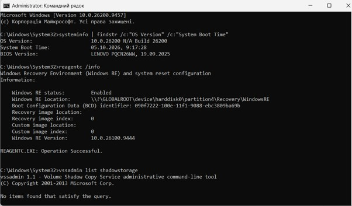
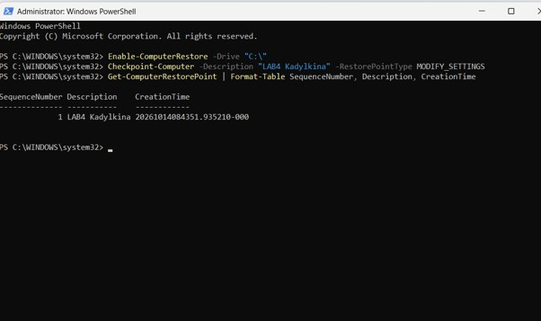
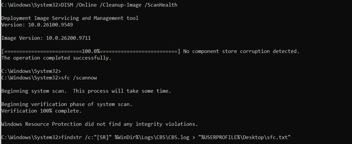
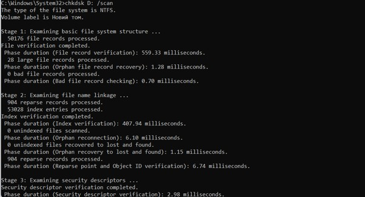
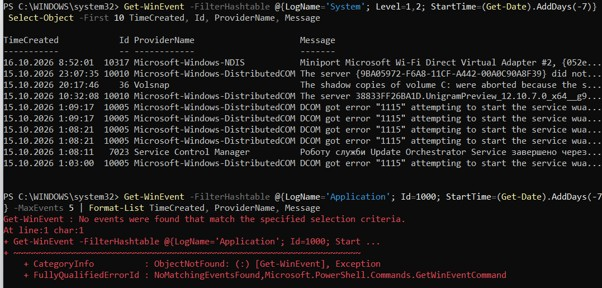
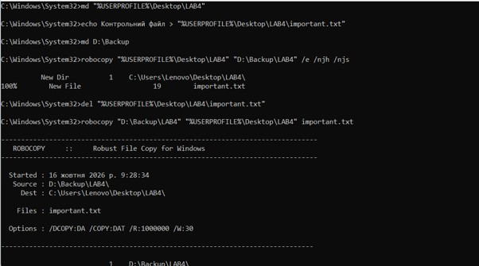
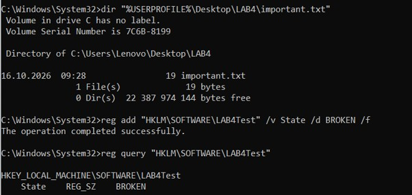
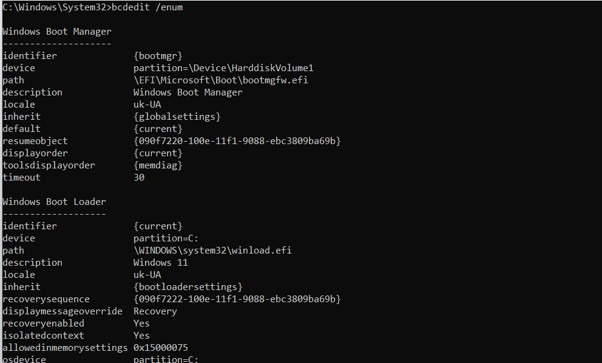
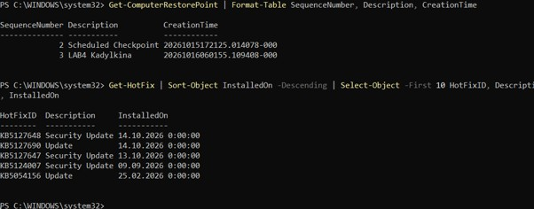

<!--
  Методи відновлення ОС
  Варіант 11: Програма не стартує після оновлення Windows — `/scan` — 1000 — Показати, як переглянути історію оновлень

  Тему, мету й обладнання писати не треба — конвеєр візьме їх із лабораторної.
  Знімки екрана кладіть у assets/, вихідний код — у src/.
  Контрольні питання — лише одного рівня, того, на який захищаєте роботу:
  заголовок «### Достатній рівень», далі «1 Текст питання?» і відповідь.
  Покрокова інструкція — reports/README.md
-->

## Хід роботи

1 Отримала в викладача номер індивідуального варіанта 11.

2 Зафіксувала початковий стан системи в командному рядку, запущеному від імені адміністратора. Командою systeminfo з фільтром findstr визначила версію ОС: Windows 10.0.26200, збірка 26200 (Windows 11), а також час останнього завантаження системи: 05.10.2026, 9:17:28. Командою reagentc /info перевірила стан середовища відновлення: Windows RE має статус Enabled, розташоване на прихованому розділі \?\GLOBALROOT\device\harddisk0\partition4\Recovery\WindowsRE, версія Windows RE 10.0.26100.9444, тому відновлення системи із середовища WinRE можливе. Командою vssadmin list shadowstorage перевірила стан захисту системи: відповідь «No items found that satisfy the query» означає, що області зберігання тіньових копій не налаштовано, тобто захист системи для диска C: вимкнено, і перед створенням точки відновлення його потрібно ввімкнути.

3 Увімкнула захист системи для диска C: командою Enable-ComputerRestore -Drive “C:” та створила точку відновлення командою Checkpoint-Computer з описом “LAB4 Kadylkina” і типом MODIFY_SETTINGS. Перелік точок відновлення вивела командою Get-ComputerRestorePoint з форматуванням у таблицю: створена точка має SequenceNumber 1, час створення 14.10.2026, 08:43:51 (UTC). 

4 Виконала перевірку сховища компонентів командою DISM /Online /Cleanup-Image /ScanHealth у командному рядку від імені адміністратора. Утиліта повідомила «No component store corruption detected» та завершила операцію успішно, тобто сховище компонентів WinSxS не пошкоджене. Тому відновлення сховища командою DISM /Online /Cleanup-Image /RestoreHealth не виконувала. Після цього запустила перевірку цілісності системних файлів командою sfc /scannow.

5 Виконала перевірку несистемного тому D: (мітка «Новий том», файлова система NTFS) командою chkdsk D: /scan у командному рядку від імені адміністратора. Перевірка пройшла три етапи: базової структури файлової системи, зв'язків імен файлів та дескрипторів безпеки, а також журналу USN. Утиліта повідомила «Windows has scanned the file system and found no problems. No further action is required»: пошкоджених записів файлів і секторів не виявлено (0 KB in bad sectors), загальний обсяг тому становить близько 340 771 839 KB, з яких вільно близько 142 954 016 KB. Ключ /scan виконує фонову онлайн-перевірку NTFS без блокування тому, тому вона не потребує перезавантаження. Для системного тому C: перевірка з ключем /f відкладається до наступного завантаження, оскільки цей том постійно використовується операційною системою, і для виправлення помилок chkdsk потрібен монопольний доступ до нього: утиліта не може заблокувати том, поки на ньому працює система, тому пропонує запланувати перевірку на момент перезавантаження, коли том ще не зайнятий. Результат зафіксувала знімком екрана. 

6 Отримала перелік помилкових і критичних подій системного журналу за останній тиждень командою Get-WinEvent з фільтром LogName='System', Level=1,2 та StartTime за останні 7 діб. Серед них: помилки DCOM (подія 10005 — не вдалося запустити службу wuauserv, код помилки 1115; подія 10010 — сервер не зареєстрував потрібний об'єкт у встановлений час), подія 7023 (аварійне завершення служби Update Orchestrator Service), подія 10317 від NDIS (віртуальний адаптер Wi-Fi Direct) та подія 36 від Volsnap: тіньові копії тому C: було скасовано. Остання подія пояснює, чому створена першою точка відновлення зникла: обсяг, виділений під тіньові копії, був замалий (2,10 ГБ), і система скасувала копії. Подію 1000 шукала в журналі Application, а не System, командою Get-WinEvent -FilterHashtable @{LogName='Application'; Id=1000; ...}. За останні 7 діб такої події на комп'ютері немає: утиліта повідомила «No events were found that match the specified selection criteria». Подія 1000 (джерело Application Error) записується в разі аварійного завершення програми: у ній вказано назву програми, що завершилася аварійно (Faulting application name), модуль, у якому виникла помилка (Faulting module name), та код виключення (Exception code). Це саме та подія, яка з'явилася б у сценарії варіанта, якщо після оновлення програма перестала б запускатися й аварійно завершувалася. Результат зафіксувала знімком екрана. 

7 Створила на робочому столі навчальний каталог LAB4 і розмістила в ньому контрольний файл important.txt. Резервну копію каталогу зробила на інший том командою robocopy “%USERPROFILE%\Desktop\LAB4” “D:\Backup\LAB4” /e /njh /njs: утиліта створила каталог і скопіювала 1 файл розміром 19 байт. Копію зробила на диск D:, а не на той самий том, що й оригінал, оскільки копія на тому самому диску захищає лише від помилкового видалення, але не від відмови диска. Потім видалила оригінал командою del і відновила його з резервної копії командою robocopy “D:\Backup\LAB4” “%USERPROFILE%\Desktop\LAB4” important.txt: у підсумковій таблиці Copied = 1, FAILED = 0. Командою dir підтвердила, що файл important.txt (19 байт) знову присутній у каталозі LAB4. Це контрольне відновлення підтверджує, що резервна копія придатна до використання, а не лише створена. 

8 Сценарій відмови варіанта 11: програма не стартує після оновлення. За таблицею 1 симптом «збої почалися після встановлення програми чи драйвера» усувається відкатом до точки відновлення, оскільки вона зберігає стан реєстру, драйверів і системних файлів на момент створення. Точку відновлення “LAB4 Kadylkina” (SequenceNumber 3) було створено в пункті 3 до початку моделювання, і командою Get-ComputerRestorePoint підтвердила її наявність перед змінами. Пошкодження, внесене оновленням, змоделювала зміною в реєстрі: командою reg add “HKLM\SOFTWARE\LAB4Test” /v State /d BROKEN /f створила розділ зі значенням BROKEN, якого на момент точки не існувало, і підтвердила це командою reg query. Командою rstrui відкривається вікно «Відновлення системи», у ньому обирається точка “LAB4 Kadylkina”, кнопкою «Пошук постраждалих програм» переглядається перелік програм і драйверів, які буде видалено або відновлено, після чого відкат підтверджується і система перезавантажується, тому що реєстр і системні файли, які використовуються, можна замінити лише під час перезавантаження. Після відкату розділ HKLM\SOFTWARE\LAB4Test зникає, бо його створено вже після точки, і команда reg query повідомляє, що розділ не знайдено. Користувацькі документи, зокрема важливий файл important.txt, залишаються незмінними, адже точка відновлення не зберігає і не змінює особисті файли: саме для них потрібна резервна копія з пункту 7. Альтернативою відкату є видалення проблемного оновлення командою wusa /uninstall /kb:НОМЕР або через «Перегляд установлених оновлень». Створений для моделювання розділ реєстру видалила командою reg delete “HKLM\SOFTWARE\LAB4Test” /f.

9 Перевірила конфігурацію завантаження командою bcdedit /enum у командному рядку від імені адміністратора, нічого не змінюючи. Утиліта вивела два записи. Перший, Windows Boot Manager, є диспетчером завантаження: він розташований на розділі \Device\HarddiskVolume1 (EFI-розділ), шлях \EFI\Microsoft\Boot\bootmgfw.efi вказує на завантаження в режимі UEFI. Поле default {current} означає, що за замовчуванням завантажується поточна система, displayorder {current} задає єдиний пункт меню, toolsdisplayorder {memdiag} підключає засіб діагностики пам'яті, timeout 30 — час очікування вибору в секундах, resumeobject — запис для виходу з гібернації. Другий запис, Windows Boot Loader, описує саму систему (Windows 11): device і osdevice partition=C: показують розділ, де розташована система, path \WINDOWS\system32\winload.efi — завантажувач ядра, systemroot \WINDOWS — каталог системи. Поле recoverysequence {090f7222-100e-11f1-9088-ebc3809ba69b} вказує на запис середовища відновлення WinRE; той самий ідентифікатор виведено командою reagentc /info у пункті 2, а recoveryenabled Yes підтверджує, що відновлення ввімкнено. Параметр nx OptOut означає, що запобігання виконанню даних (DEP) увімкнено для всіх програм, окрім явно виключених, bootmenupolicy Standard — графічне меню завантаження. Рядка safeboot у записі немає, тобто безпечний режим не ввімкнено і система завантажується у звичайному режимі.

10 Показала, як переглянути історію оновлень Windows. Графічно історія доступна в «Параметри → Центр оновлення Windows → Журнал оновлень», а також через appwiz.cpl → «Перегляд установлених оновлень». У PowerShell переглянула встановлені оновлення командою Get-HotFix | Sort-Object InstalledOn -Descending | Select-Object -First 10 HotFixID, Description, InstalledOn. Найновіші записи: KB5127648 (оновлення безпеки) і KB5127690 (оновлення) від 14.10.2026, KB5127647 (оновлення безпеки) від 13.10.2026, далі KB5124007 (оновлення безпеки) від 09.09.2026 та KB5054156 (оновлення) від 25.02.2026. Ця історія важлива для сценарію варіанта: якщо програма перестала запускатися після оновлення, за датою встановлення можна визначити, яке саме оновлення передувало збою, і за потреби видалити його командою wusa /uninstall /kb:НОМЕР. Командлет Get-HotFix показує не всі оновлення (наприклад, не відображає оновлення визначень Defender), тому повну картину дає «Журнал оновлень» у параметрах.

11 Оформила звіт і зробила висновок.

## Відповіді на контрольні питання

### Високий рівень (творчий)

1 Після оновлення драйвера відеокарти система показує синій екран одразу після входу. Опишіть повний порядок відновлення із зазначенням засобу на кожному кроці й поясніть, чому саме в такій послідовності.

Порядок відновлення, від найм'якшого й найменш руйнівного кроку до найрадикальнішого:

1) Зафіксувати код помилки. Синій екран показує стоп-код (наприклад, VIDEO_TDR_FAILURE або SYSTEM_THREAD_EXCEPTION_NOT_HANDLED), а в журналі System залишається подія 1001 (BugCheck) і подія 41. Це робиться першим, бо без нього непевно, що саме ламається, і код підтверджує, що причина в драйвері, а не в живленні чи диску.
2) Увійти в безпечний режим (після двох невдалих запусків Windows сама відкриє WinRE → «Параметри завантаження» → безпечний режим). Він стартує з мінімальним набором драйверів, тому проблемний драйвер не завантажується і система працює.
3) Відкотити або видалити драйвер: «Диспетчер пристроїв» → відеоадаптер → «Відкотити драйвер» (або видалити з позначкою видалення програмного забезпечення). Це найточніший засіб: змінюється лише один компонент, решта системи не зачіпається.
4) Якщо безпечний режим недоступний або відкат драйвера не допоміг — WinRE → «Відновлення системи» (точка, створена перед оновленням). Відкат повертає реєстр, драйвери й системні файли до стану до оновлення. Він ширший за крок 3, тому його ставлять після нього.
5) Якщо точок немає або відкат не допоміг — перевірка цілісності: DISM /ScanHealth → /RestoreHealth → sfc /scannow (у WinRE через командний рядок з параметрами /offbootdir і /offwindir), бо синій екран міг пошкодити системні файли.
6) Якщо система не стартує взагалі — відновлення завантажувача (bootrec /rebuildbcd, bcdboot C:\Windows) у WinRE.
7) Останній варіант — «Скинути цей комп'ютер» або відновлення з образу системи.

Послідовність така, бо кожен наступний засіб змінює більше, ніж попередній, і дає більший ризик побічних наслідків. Спочатку діагностика, потім мінімальне втручання (один драйвер), далі ширше (точка), далі системні файли, і лише наприкінці радикальні заходи. Так зберігаються дані й налаштування користувача та витрачається найменше часу.

2 Користувач вимагає «щоб усе відновлювалося автоматично». Запропонуйте комбінацію засобів (точки відновлення, образ системи,
файлові копії) і обґрунтуйте, від яких саме ризиків захищає кожен з них.

Жоден окремий засіб не закриває всі ризики, тому для автоматичного відновлення потрібна комбінація з трьох рівнів, кожен з яких відповідає за свій тип збою. Перший рівень — точки відновлення, які Windows створює автоматично перед встановленням оновлень і за розкладом. Вони захищають від наслідків невдалих оновлень, драйверів і програм та від помилкових змін реєстру, тобто повертають систему до стану, коли вона ще працювала нормально. Проте точки не зберігають користувацьких документів, не рятують від відмови диска або вірусу-шифрувальника, а через обмежений обсяг живуть лише дні чи тижні.

Другий рівень — образ системи, тобто повна копія розділів, яку створюють за розкладом на зовнішній диск. Він захищає від відмови диска, пошкодженого завантажувача та повного руйнування системи, бо дозволяє швидко повернути робочу систему разом із програмами й налаштуваннями. Його слабке місце в тому, що він зберігає стан лише на момент створення, тому всі зміни після цієї дати втрачаються.

Третій рівень — файлові копії, для яких використовують «Історію файлів» або завдання robocopy у Планувальнику завдань. Вони захищають від помилкового видалення, перезапису й пошкодження документів та зберігають кілька версій файлів, але систему й програми не відновлюють.

Щоб усе це справді працювало автоматично, потрібно ввімкнути захист системи з достатнім лімітом місця (10 ГБ і більше замість мінімального), налаштувати «Історію файлів» або розклад robocopy, а образ системи робити щонайменше раз на тиждень. Копії мають зберігатися на іншому носії (зовнішньому диску або в хмарі), бо копія на тому самому диску не рятує від його відмови, і час від часу їх треба перевіряти контрольним відновленням, а не лише створенням. Слово «усе» тут слід розуміти обмежено: автоматизація знижує ризики, але повністю їх не усуває. Наприклад, автоматичне дзеркало robocopy з ключем /mir поширить на копію і помилкове видалення файлу, тому потрібні кілька поколінь копій.

3 Точка відновлення створена, але відкат не усуває проблему. Назвіть щонайменше три причини, чому так буває, і спосіб перевірити кожну.

1) Проблема виникла до створення точки. Точка зберігає вже несправний стан. Перевірка: порівняти дату створення точки (Get-ComputerRestorePoint) з першою появою збою в журналі подій (Get-WinEvent, події 1000, 41, 1001) і спробувати старішу точку.
2) Проблема не в системних файлах, реєстрі й драйверах, тобто там, куди сягає точка. Це може бути пошкодження користувацьких даних, збій файлової системи, несправне обладнання (диск, ОЗП, живлення) або апаратний дефект. Перевірка: chkdsk D: /scan (для системного тому chkdsk /f з перезавантаженням), перегляд S.M.A.R.T., діагностика пам'яті (mdsched), аналіз подій 41 та 1001 із полем BugcheckCode.
3) Пошкоджено сховище компонентів або системні файли, і відкат бере їх із того самого джерела. Перевірка: DISM /Online /Cleanup-Image /ScanHealth, потім sfc /scannow і аналіз рядків [SR] у CBS.log.
4) Відкат не завершився або був скасований (помилка під час перезавантаження, нестача місця, антивірус заважав). Перевірка: після перезавантаження система показує результат відновлення; також у журналі подій шукають записи джерела System Restore і перевіряють, що змінений параметр справді повернувся (наприклад, reg query для розділу, створеного вже після точки).
5) Причина в шкідливому ПЗ або у файлах користувача, які точка не зачіпає. Перевірка: повне сканування антивірусом (у тому числі автономне сканування Microsoft Defender).

4 Сформулюйте критерій, за яким адміністратор обирає між відновленням системи і переустановленням з нуля. Оцініть обидва варіанти за часом, ризиком і збереженням даних.

Критерій вибору такий: адміністратор обирає відновлення, якщо причину збою вдається локалізувати і шкода зводиться до компонентів, які можна виправити штатними засобами без втрати даних. Тобто якщо збій діагностується, а причину усунуто послідовним застосуванням засобів (відкат драйвера, точка відновлення, DISM і sfc, відновлення завантажувача), то система відновлюється. Якщо ж причину знайти не вдається, штатні засоби не допомагають, пошкодження множинні (особливо після зараження шкідливим ПЗ) або система накопичила стільки збоїв, що їй вже не можна довіряти, обирають переустановлення.

За часом відновлення значно швидше: відкат до точки триває близько 10–20 хвилин, перевірка DISM і sfc — від 5 до 30 хвилин, хоча сама діагностика може затягнутися. Переустановлення потребує приблизно 1–3 годин на встановлення системи і ще кількох годин на драйвери, програми й налаштування. За ризиком відновлення безпечніше для даних і налаштувань, але існує імовірність, що причину не усунуто і збій повториться. Переустановлення дає гарантовано чисту систему без накопичених пошкоджень, проте несе вищий ризик помилок під час самої процедури та втрати налаштувань. За збереженням даних при відновленні користувацькі файли й програми зберігаються (окрім змін, які скасовує відкат), а при чистому встановленні з форматуванням дані зберігаються лише за наявності актуальної резервної копії, а програми й налаштування доводиться встановлювати заново.

Тому адміністратор починає з відновлення, бо воно швидше й безпечніше для даних, а до переустановлення переходить лише тоді, коли штатні засоби вичерпано або коли довіри до системи вже немає. У будь-якому разі перед переустановленням потрібно мати перевірену резервну копію даних.

## Висновок

На цій лабораторній роботі я опанувала штатні засоби діагностики та відновлення Windows: навчитися створювати й застосовувати точки відновлення, перевіряти цілісність системних файлів і сховища компонентів, діагностувати файлову систему, працювати в середовищі відновлення WinRE, створювати резервні копії та знаходити причину збою за журналами подій.
