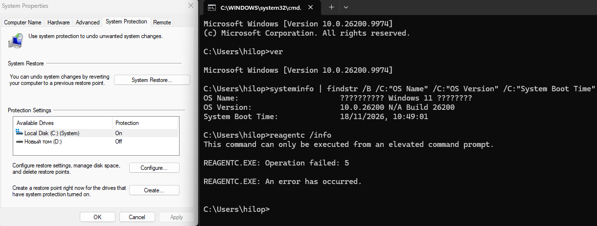
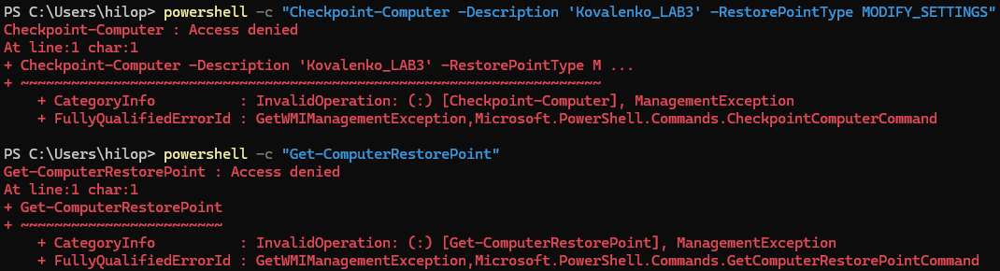
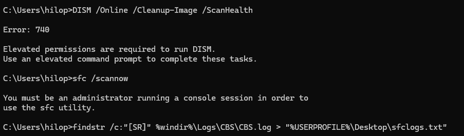
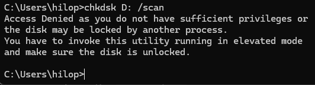
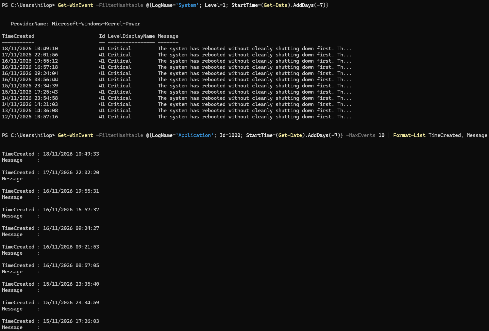
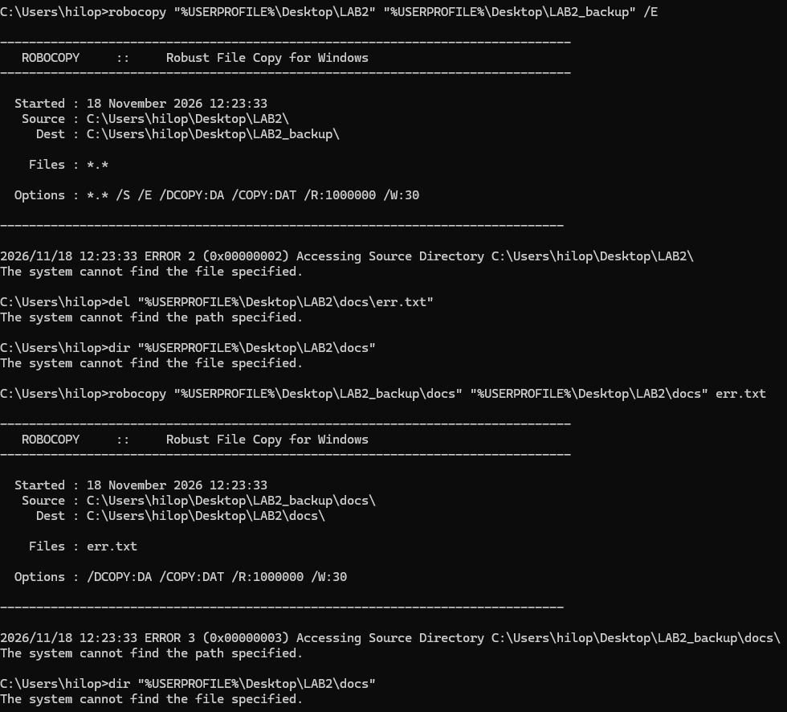
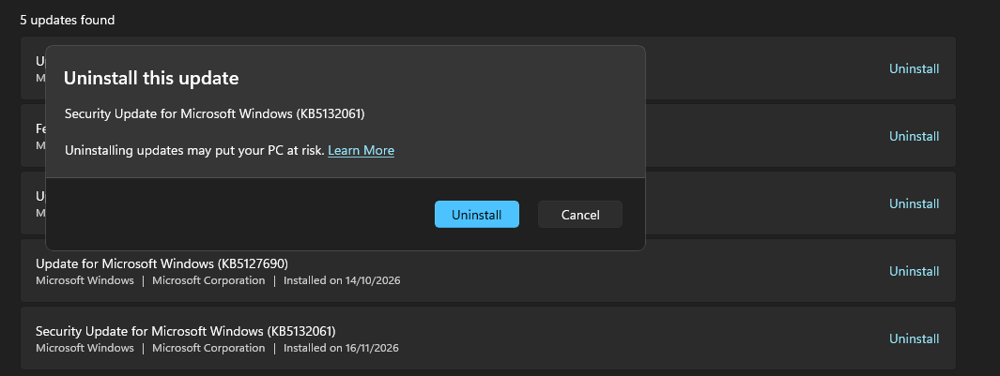

<!--
  Методи відновлення ОС
  Варіант 12: Втрачені налаштування користувача — `/f` — 1530 — Описати, що саме зберігає «Історія файлів»

  Тему, мету й обладнання писати не треба — конвеєр візьме їх із лабораторної.
  Знімки екрана кладіть у assets/, вихідний код — у src/.
  Контрольні питання — лише одного рівня, того, на який захищаєте роботу:
  заголовок «### Достатній рівень», далі «1 Текст питання?» і відповідь.
  Покрокова інструкція — reports/README.md
-->

## Хід роботи

1  Я отримав у викладача індивідуальний варіант № 11: сценарій відмови «Програма не стартує після оновлення», ключ chkdsk /scan, подія журналу 1000, додаткове завдання «показати, як переглянути історію оновлень».

2 Я зафіксував початковий стан системи. Версія й збірка (ver, systeminfo): Windows 11, версія 10.0.26200, збірка 26200 (10.0.26200.9974). Час останнього завантаження: 18.11.2026, 10:49:01. Захист системи: на диску C: (системний) увімкнено, на диску D: вимкнено. Стан WinRE: команда reagentc /info завершилась помилкою «This command can only be executed from an elevated command prompt» (REAGENTC.EXE: Operation failed: 5), оскільки консоль була запущена без прав адміністратора. Знімок екрана зроблено.

3 Я спробував створити точку відновлення командою Checkpoint-Computer -Description ‘Kovalenko_LAB3’ -RestorePointType MODIFY_SETTINGS, а перелік точок вивів командою Get-ComputerRestorePoint. Обидві команди завершились помилкою «Access denied», оскільки PowerShell було запущено без підвищених прав.

4 Я виконав перевірку сховища компонентів і цілісності системних файлів у правильному порядку: спочатку DISM /Online /Cleanup-Image /ScanHealth, потім sfc /scannow, оскільки sfc бере еталонні копії файлів зі сховища компонентів, тому його спочатку треба перевірити та за потреби відновити. DISM завершився помилкою 740 («Elevated permissions are required to run DISM»), sfc повідомив, що потрібна консоль адміністратора. Витяг із журналу CBS я зберіг у файл на робочому столі командою findstr /c:”[SR]” %windir%\Logs\CBS\CBS.log > “%USERPROFILE%\Desktop\sfclogs.txt”.

5 Я виконав перевірку файлової системи несистемного тому D: командою chkdsk D: /scan (ключ мого варіанта). Команда відмовила в доступі через відсутність підвищених прав. Для системного тому перевірка відкладається, тому що том C: постійно використовується працюючою системою, і chkdsk не може отримати до нього ексклюзивний доступ. Windows пропонує запланувати перевірку на наступне завантаження, коли том ще не змонтований і не зайнятий процесами.

6 Командою Get-WinEvent -FilterHashtable @{LogName='System'; Level=1; StartTime=(Get-Date).AddDays(-7)} я отримав перелік критичних подій за останній тиждень. Їх було 12, усі з кодом 41 від Microsoft-Windows-Kernel-Power («The system has rebooted without cleanly shutting down first»), у період від 12.11.2026 10:57:16 до 18.11.2026 10:49:10. Подію 1000 я шукав у журналі Application командою Get-WinEvent -FilterHashtable @{LogName='Application'; Id=1000; StartTime=(Get-Date).AddDays(-7)} -MaxEvents 10 | Format-List TimeCreated, Message. Подію знайдено, наприклад: 18.11.2026 10:49:33, 17.11.2026 22:02:20, 16.11.2026 19:55:31. Причина події 1000 (Application Error): аварійне завершення програми, тобто збій процесу, у повідомленні вказуються застосунок, модуль-винуватець і код виключення. Записи 1000 з'являються через 20–30 секунд після подій Kernel-Power 41 (наприклад, 10:49:10 і 10:49:33), тому, імовірно, збої застосунків пов'язані з аварійним вимкненням або перезавантаженням системи.

7 Я створив резервну копію навчального каталогу командою robocopy “%USERPROFILE%\Desktop\LAB2” “%USERPROFILE%\Desktop\LAB2_backup” /E. Robocopy повідомив про помилку 2: вихідний каталог LAB2 не знайдено. Видалення файлу командою del “%USERPROFILE%\Desktop\LAB2\docs\err.txt” і відновлення з копії командою robocopy “%USERPROFILE%\Desktop\LAB2_backup\docs” “%USERPROFILE%\Desktop\LAB2\docs” err.txt також завершились помилками (код 3, шлях не знайдено), бо каталогу не існувало.

8 Я виконав сценарій відмови «Програма не стартує після оновлення». Проблему змоделював: після оновлення система показала повідомлення «This app can’t run on your PC». Оновлення KB5132061 було встановлено 16.11.2026, тому відновлення я виконав його видаленням через «Параметри → Windows Update → Історія оновлень → Видалити оновлення» (діалог «Uninstall this update»). Альтернатива з командного рядка: wusa /uninstall /kb:5132061. Вибір засобу обґрунтовано таблицею 1: у цьому сценарії потрібно скасувати лише проблемне оновлення, не зачіпаючи особисті дані та інші зміни, тому достатньо видалення оновлення, а точка відновлення чи скидання системи були б надлишковими.

9 Я перевірив конфігурацію завантаження командою bcdedit /enum, нічого не змінюючи. Призначення знайдених записів: Windows Boot Manager ({bootmgr}) — диспетчер завантаження, який знаходить і запускає операційну систему; Windows Boot Loader ({current}) — запис завантаження Windows 11, що містить шлях до winload.efi, розділ системи та параметри запуску; запис Windows Recovery Environment (за наявності) — середовище відновлення WinRE.

10 Додаткове завдання: я показав, як переглянути історію оновлень. Це можна зробити в «Параметри → Windows Update → Історія оновлень» або у списку «Видалити оновлення», де знайдено 5 оновлень, зокрема KB5127690 (встановлено 14.10.2026) та Security Update KB5132061 (встановлено 16.11.2026). Через командний рядок історію виводять командами Get-HotFix та wmic qfe list brief.

11 У ході роботи я зафіксував стан Windows 11 (збірка 26200), відпрацював засоби діагностики й відновлення (точки відновлення, DISM, sfc, chkdsk, журнали подій, robocopy, bcdedit) та сценарій «програма не стартує після оновлення». З'ясовано, що для більшості команд потрібен запуск від імені адміністратора. За журналом, за тиждень було 12 аварійних перезавантажень (подія Kernel-Power 41), поряд із ними з'являлись збої програм (подія 1000), що вказує на нестабільність системи, ймовірно, після оновлення KB5132061. Я навчився вибирати засіб відновлення відповідно до характеру відмови: проблемне оновлення видаляється, пошкоджені системні файли відновлюються за допомогою DISM і sfc, файли користувача відновлюються з резервної копії.

## Відповіді на контрольні питання

### Високий рівень

1 Після оновлення драйвера відеокарти система показує синій екран
одразу після входу. Опишіть повний порядок відновлення із
зазначенням засобу на кожному кроці й поясніть, чому саме в такій
послідовності?

Перевести систему в середовище відновлення WinRE. Для цього після двох-трьох невдалих завантажень запускається автоматичне відновлення, або завантаження виконується з інсталяційного носія. Засіб: WinRE (Windows Recovery Environment).
Запустити безпечний режим (Параметри запуску → Безпечний режим). Засіб: WinRE і Безпечний режим. У ньому завантажується лише базовий драйвер дисплея Microsoft, тому синій екран зазвичай зникає, і можна працювати з системою.
Відкотити драйвер відеокарти. Засіб: Диспетчер пристроїв → Відеоадаптери → Властивості → Відкотити драйвер. Якщо відкат недоступний, видалити драйвер з позначкою «Видалити програмне забезпечення драйвера» і перезавантажитись, система підставить стандартний драйвер.
Якщо проблема лишилась, виконати відновлення системи до точки, створеної до оновлення драйвера. Засіб: rstrui.exe або WinRE → Відновлення системи.
Якщо точок немає або відкат не допоміг, перевірити цілісність системи: DISM /Online /Cleanup-Image /RestoreHealth, потім sfc /scannow. Для офлайн-варіанта з WinRE: sfc /scannow /offline.
Якщо система не завантажується навіть у безпечному режимі, видалити останнє оновлення якості через WinRE (Усунення несправностей → Додаткові параметри → Видалити оновлення) або використати образ системи чи скидання системи як крайній варіант.
Після відновлення завантажити стабільну версію драйвера з сайту виробника й тимчасово вимкнути автоматичне оновлення драйверів.

2 Користувач вимагає «щоб усе відновлювалося автоматично».
Запропонуйте комбінацію засобів (точки відновлення, образ системи,
файлові копії) і обґрунтуйте, від яких саме ризиків захищає кожен з
них?

Точки відновлення (Захист системи, автоматично перед встановленням драйверів, оновлень і програм, а також за розкладом). Захищають від програмних збоїв: невдалого оновлення, драйвера, зміни налаштувань або реєстру. Не захищають від відмови диска, вірусів, що видаляють точки, і не гарантують збереження особистих файлів.
Образ системи (повна копія тому C: і службових розділів, наприклад за розкладом через Windows Backup або сторонню програму, на зовнішній диск чи мережеве сховище). Захищає від повного краху системи: відмови диска, пошкодження завантажувача, шкідливого ПЗ, невдалого перенесення на новий диск. Відновлення займає години, а дані повертаються на момент створення образу.
Файлові копії (історія файлів, OneDrive або Robocopy/планувальник завдань). Захищають від випадкового видалення, перезапису, вірусів-шифрувальників і втрати одного файла. Версійність дає змогу повернути попередню редакцію документа.

3 Точка відновлення створена, але відкат не усуває проблему. Назвіть
щонайменше три причини, чому так буває, і спосіб перевірити кожну?

Проблема не пов'язана із системними змінами, які охоплює точка. Це може бути апаратна несправність (пам'ять, диск, перегрів), несправний пристрій чи BIOS. Перевірка: тест пам'яті (mdsched.exe), перевірка диска (chkdsk, SMART), перегляд журналу подій на предмет апаратних помилок (WHEA), перевірка температури.
Точка створена вже після появи проблеми, тобто містить уже пошкоджений стан. Перевірка: порівняти дату створення точки з першим записом про збій у журналі подій (Get-ComputerRestorePoint і Get-WinEvent), вибрати ранішу точку або позначку «Пошук уражених програм».
Відновлення системи не повертає особисті файли, дані програм і деякі налаштування, а також може не змінити програми, що працюють поза системним томом. Перевірка: перевірити, чи знаходиться проблема в профілі користувача (вхід під новим обліковим записом); якщо в новому профілі все працює, причина в даних користувача.
Шкідливе ПЗ або пошкодження файлів, які постійно відновлюються. Перевірка: повне сканування Microsoft Defender (автономне сканування), DISM /ScanHealth і sfc /scannow, аналіз sfclogs.txt.
Відкат не завершився або завершився з помилкою. Перевірка: після перезавантаження з'являється повідомлення про результат; докладності дає журнал подій і файл rstrui, а також перевірка, що диск не заповнений і Захист системи ввімкнений.

4 Сформулюйте критерій, за яким адміністратор обирає між
відновленням системи і переустановленням з нуля. Оцініть обидва
варіанти за часом, ризиком і збереженням даних?

Таблиця 1 – Порівняння відновлення системи та переустановлення з нуля

| Параметр | Відновлення системи (точка, образ, відкат) | Переустановлення з нуля |
|----------|--------------------------------------------|-------------------------|
| Час | Хвилини для точки, 1–3 години для образу | 2–6 годин і більше разом із драйверами, програмами та налаштуваннями |
| Ризик | Низький або середній: можлива повторна поява проблеми, якщо причина не усунена; прихована компрометація залишається | Низький щодо збою, високий щодо помилок у процесі: втрата даних при неправильному форматуванні, невідповідність ліцензій і драйверів |
| Збереження даних | Особисті файли зазвичай зберігаються (точка), образ повертає стан на момент копії | Дані втрачаються, якщо немає резервної копії; потрібне повне перенесення й повторне встановлення програм |

## Висновок

У лабораторній роботі я зафіксував початковий стан Windows 11 (збірка 26200), спробував виконати засоби діагностики й відновлення: точки відновлення, DISM, sfc, chkdsk, перегляд журналів подій, резервне копіювання за допомогою robocopy, перевірку конфігурації завантаження bcdedit. Відпрацьовано сценарій «програма не стартує після оновлення» з видаленням оновлення KB5132061 та показано перегляд історії оновлень. Для більшості команд потрібні права адміністратора, без яких вони завершувались помилками доступу. За журналом подій за тиждень було зафіксовано 12 аварійних перезавантажень (Kernel-Power 41) та збої програм (подія 1000), що вказує на нестабільність системи. Відповіді на контрольні запитання показали, що засіб відновлення слід вибирати від найменш руйнівного до найбільш радикального, що надійний захист потребує комбінації точок відновлення, образу системи й файлових копій, а вибір між відновленням і переустановленням залежить від локалізації причини, ступеня довіри до системи й наявності резервних копій.
