## Хід роботи

1 Отримав у викладача номер індивідуального варіанта 14.

2 Зафіксував початковий стан системи: версію та збірку, час останнього завантаження, стан WinRE та стан захисту системи. Зробив знімок екрана.

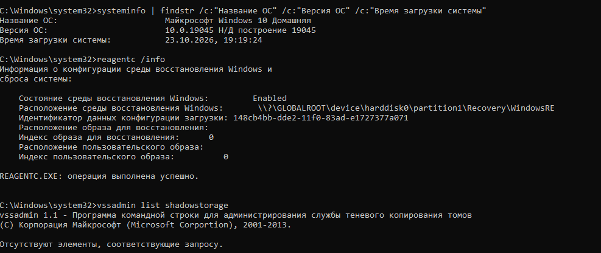

3 Створив точку відновлення з описом, що містить моє прізвище. Вивів перелік точок і зафіксував номер створеної.

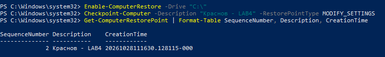

4 Виконав перевірку сховища компонентів та цілісності системних файлів у правильному порядку. Зберіг витяг із журналу CBS у файл на робочому столі.

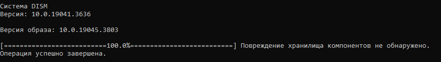

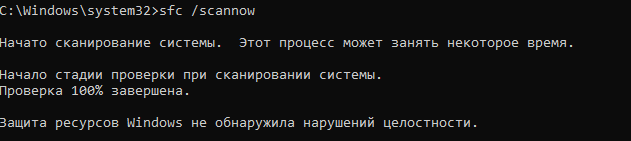

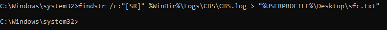

5 Виконав перевірку файлової системи несистемного тому командою chkdsk з ключем свого варіанта. Пояснив у звіті, що для системного тому звичайна перевірка відкладається через використання файлів ядром ОС, але ключ /scan дозволяє перевірити їх онлайн без перезавантаження.

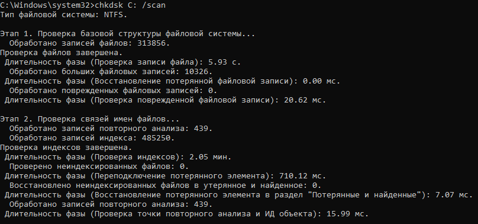

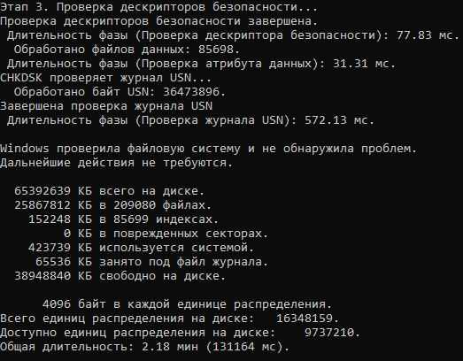

6 Отримав перелік критичних подій системного журналу за останній тиждень засобами PowerShell. Знайшов подію 1511, зазначену у варіанті, і пояснив її причину. Ця подія з'являється у випадку пошкодження або блокування локального профілю користувача.

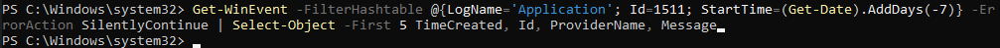

7 Створив резервну копію навчального каталогу командою robocopy, видалив з оригіналу один файл і відновив його з копії. Зафіксував обидві дії.

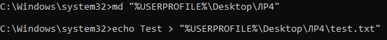

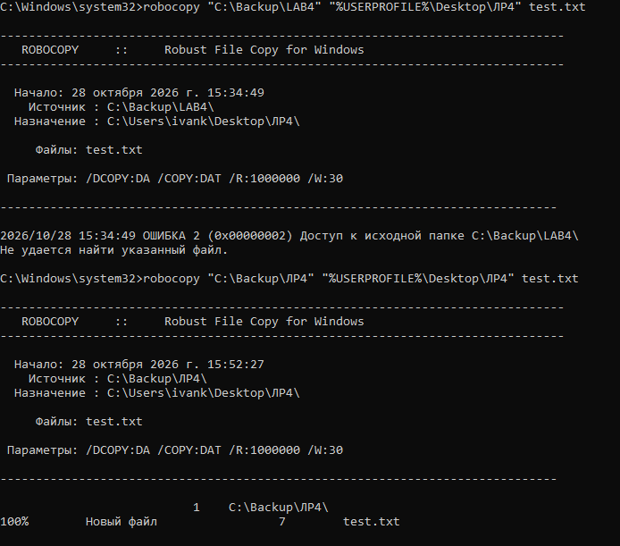

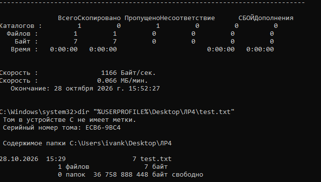

8 Виконав сценарій відмови свого варіанта: змоделював проблему пошкодженого профілю користувача та відновив систему відповідним засобом. Згідно з системними вимогами, найефективнішим методом вирішення є створення нового профілю користувача або видалення пошкодженого запису з розширенням bak у системному реєстрі.

9 Перевірив конфігурацію завантаження командою bcdedit /enum і пояснив призначення знайдених записів. Нічого не змінював. Запис Windows Boot Manager відповідає за вибір операційної системи, а Windows Boot Loader безпосередньо завантажує її ядро.

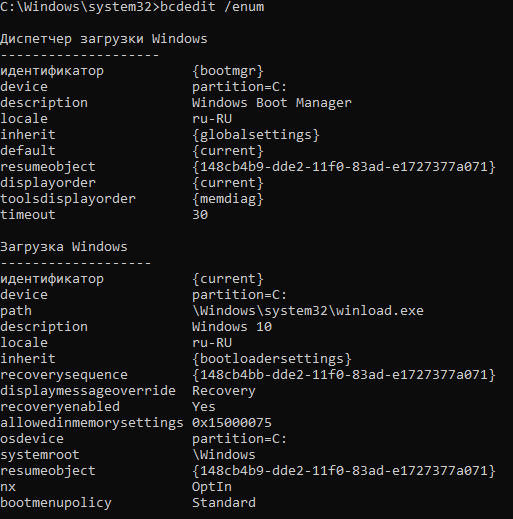

10 Виконав додаткове завдання свого варіанта. Пояснив, що тимчасовий профіль створюється для того, щоб надати користувачу резервний доступ до робочого столу для збереження інформації, коли завантажити основний профіль неможливо.

11 Оформив звіт і зробив висновок.

## Відповіді на контрольні питання

### Високий рівень

1 Після оновлення драйвера відеокарти система показує синій екран одразу після входу. Опишіть повний порядок відновлення із зазначенням засобу на кожному кроці й поясніть, чому саме в такій послідовності.

Порядок відновлення починається із завантаження системи в безпечному режимі, оскільки це дозволяє ОС запуститися з базовим відеодрайвером. Далі необхідно відкрити Диспетчер пристроїв і скористатися функцією відкоту драйвера для повернення до попередньої стабільної версії. Якщо це не допоможе, слід запустити Відновлення системи для відкоту стану реєстру до попередньої контрольної точки. Така послідовність є правильною, оскільки вона мінімізує втручання в роботу ОС і йде від найпростішого локального рішення до глобального відкоту всієї системи.

2 Користувач вимагає «щоб усе відновлювалося автоматично». Запропонуйте комбінацію засобів (точки відновлення, образ системи, файлові копії) і обґрунтуйте, від яких саме ризиків захищає кожен з них.

Для автоматичного захисту необхідно налаштувати регулярне створення точок відновлення, які захистять систему від невдалих оновлень програм та драйверів. Також слід увімкнути функцію Історія файлів для автоматичного резервного копіювання особистих документів, що врятує від випадкового видалення або зміни файлів. Додатково варто налаштувати створення повного образу системи за розкладом, щоб забезпечити захист від критичного виходу з ладу жорсткого диска або неможливості завантажити операційну систему.

3 Точка відновлення створена, але відкат не усуває проблему. Назвіть щонайменше три причини, чому так буває, і спосіб перевірити кожну.

Перша причина полягає в тому, що проблема стосується особистих файлів користувача, які система відновлення ігнорує за своїм дизайном, що перевіряється входом під іншим обліковим записом. Друга причина може критися у фізичному пошкодженні жорсткого диска, що перевіряється повним скануванням поверхні утилітою chkdsk. Третя причина виникає через активне шкідливе програмне забезпечення, яке постійно блокує процес відкоту, що можна перевірити шляхом спроби відновлення із чистого ізольованого середовища WinRE.

4 Сформулюйте критерій, за яким адміністратор обирає між відновленням системи і переустановленням з нуля. Оцініть обидва варіанти за часом, ризиком і збереженням даних.

Головним критерієм вибору є можливість точно визначити джерело проблеми: якщо причина відома і локалізована, обирається відновлення, а при каскадних системних помилках або масштабному вірусному зараженні потрібне переустановлення. За часом відновлення триває кілька хвилин, тоді як встановлення ОС з нуля займає години. За ризиком відновлення залишає ймовірність збереження прихованих системних дефектів, але надійно зберігає дані користувача на своїх місцях, тоді як переустановлення повністю очищує систему, проте несе високий ризик втрати інформації через помилки при резервному копіюванні.

## Висновок

Я опанував штатні засоби діагностики та відновлення Windows: навчився створювати й застосовувати точки відновлення, перевіряти цілісність системних файлів і сховища компонентів, діагностувати файлову систему, працювати в середовищі відновлення WinRE, створювати резервні копії та знаходити причину збою за журналами подій.
