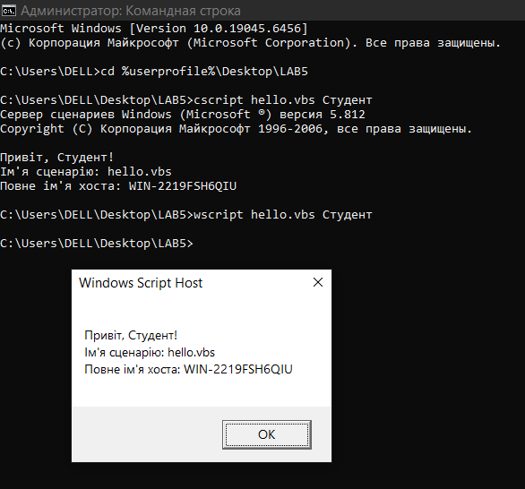
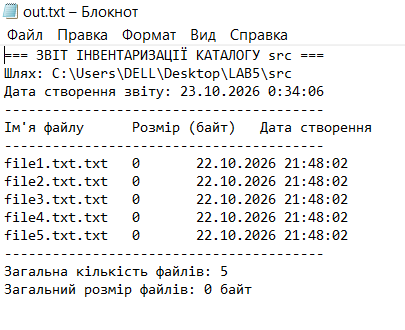
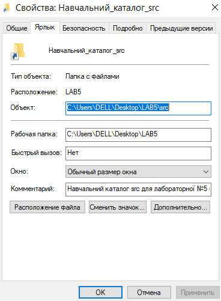
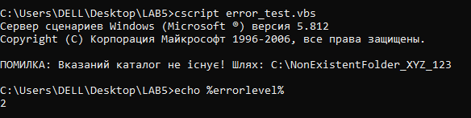
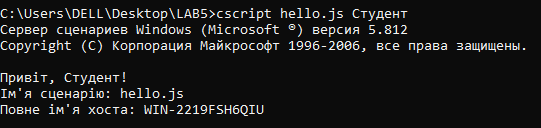
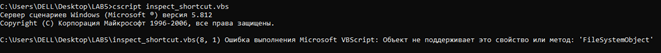

<!--
  Сценарії Windows Script Host
  Варіант 2: Створення ярлика на навчальний каталог із описом — `WScript.Shell` — Показати, які ще властивості має об'єкт ярлика

  Тему, мету й обладнання писати не треба — конвеєр візьме їх із лабораторної.
  Знімки екрана кладіть у assets/, вихідний код — у src/.
  Контрольні питання — лише одного рівня, того, на який захищаєте роботу:
  заголовок «### Достатній рівень», далі «1 Текст питання?» і відповідь.
  Покрокова інструкція — reports/README.md
-->

## Хід роботи

1 Отримала у викладача індивідуальний варіант №2 для виконання лабораторної роботи №5 з дисципліни «Операційні системи». Згідно з таблицею варіантів зафіксувала такі вихідні дані: основним завданням є створення сценарію для формування ярлика на навчальний каталог із додаванням опису, основним інструментальним об'єктом визначено `WScript.Shell`, а додатковим завданням є демонстрація та аналіз інших властивостей, якими володіє об'єкт ярлика.

2 Перейшла на робочий стіл та створила головну папку з назвою `LAB5`. Всередині каталогу `LAB5` створила два підкаталоги: `src` для вихідних файлів та `out` для збереження результатів обробки. Наповнила підкаталог `src` п'ятьма текстовими файлами (`file1.txt`, `file2.txt`, `file3.txt`, `file4.txt`, `file5.txt`) із довільним вмістом для подальшого виконання завдань інвентаризації та перевірки роботи сценаріїв.

3 Написала сценарій `hello.vbs` у текстовому редакторі Блокнот та зберегла його на робочому столі. Сценарій приймає аргумент командного рядка, виводить персональне привітання, ім'я самого сценарію за допомогою властивості `WScript.ScriptName`, а також повне ім'я хоста (комп'ютера), яке отримала через створення об'єкта `WScript.Network` та використання його властивості `ComputerName`. Запустила створений сценарій у командному рядку двома способами: через інтерпретатор графічного інтерфейсу `wscript` (командою `wscript hello.vbs Студентка`) та через консольний інтерпретатор `cscript` (командою `cscript hello.vbs Студентка`).

   Головна відмінність між хостами виконання `wscript.exe` (Windows Script Host) та `cscript.exe` (Console Script Host) полягає у способі взаємодії з користувачем та обробці виводу (функцій `WScript.Echo`). При запуску через `wscript` кожна команда `WScript.Echo` створює окреме графічне діалогове вікно Windows (MessageBox), яке вимагає від користувача натискання кнопки «ОК» для продовження виконання сценарію, що робить його зручним для графічних додатків, але незручним для автоматизованої обробки великих обсягів даних. При запуску через `cscript` весь вивід спрямовується безпосередньо у стандартний потік консолі (командний рядок `cmd`), не перериваючи виконання програми появою вікон, що дає змогу легко перенаправляти результати у текстові файли або конвеєри.

4 Написала сценарій `inventory.vbs`, який виконує інвентаризацію вмісту каталогу `src`. За допомогою об'єкта `Scripting.FileSystemObject` сценарій зчитує всі файли в папці `src`, формує табличний перелік із зазначенням імені кожного файлу, його розміру у байтах та дати останньої модифікації, додає підсумковий рядок із загальною кількістю оброблених файлів та записує результат у файл `out.txt` всередині каталогу `out`.

   Для запису результату використала метод `CreateTextFile(path, overwrite, unicode)` об'єкта `FileSystemObject`, де третій аргумент встановила у значення `True`. Це гарантує збереження текстового файлу `out.txt` у кодуванні Unicode (UTF-16 LE), що забезпечує коректне відображення кириличних символів та відповідність вимогам інструкції.

5 Реалізувала основне завдання свого варіанта №2, створивши сценарій `create_shortcut.vbs` для формування ярлика на навчальний каталог із описом. Для цього використала об'єкт `WScript.Shell` та його метод `CreateShortcut`, за допомогою якого створила файл ярлика з розширенням `.lnk` на робочому столі. Налаштувала властивість `TargetPath` (вказавши шлях до папки `LAB5`) та властивість `Description` (додавши текст опису ярлика «Навчальний каталог лабораторної роботи №5»). Після цього викликала метод `Save()` для збереження об'єкта ярлика на диску та перевірила його появу на робочому столі разом із виведенням опису при наведенні курсора миші.

6 Додала до сценарію блок перевірки та обробки помилок за допомогою об'єкта `Scripting.FileSystemObject`. Перевірила існування затребуваного каталогу через метод `FolderExists`: якщо вказаний шлях не існує, сценарій припиняє виконання, виводить у консоль зрозуміле користувацьке повідомлення про помилку та викликає метод `WScript.Quit(2)` із ненульовим кодом повернення.

   У системному середовищі Windows змінна середовища `%errorlevel%` зберігає код завершення останньої виконаної програми чи сценарію. Стандартне успішне виконання повертає код `0`, тоді як будь-яке ненульове значення (наприклад, `1` або `2`) сигналізує про виникнення помилки. Виконавши сценарій із навмисно вказаним неіснуючим шляхом та ввівши у командному рядку `echo %errorlevel%`, отримала значення `2`, що підтвердило коректність перехоплення помилки та можливість автоматичного контролю збоїв у командних файлах.

7 Переписала сценарій створення ярлика мовою JScript у файлі `shortcut.js` та успішно виконала його через консольний інтерпретатор `cscript shortcut.js`.

   Порівняння реалізацій VBScript та JScript показує:
   * **Обсяг коду:** Обидві реалізації мають приблизно однаковий обсяг (8–10 рядків коду), оскільки вони використовують однакові COM-об'єкти WSH (`WScript.Shell` та `WScript.Network`).
   * **Синтаксис та читабельність:** VBScript є більш декларативним, використовує ключові слова `Set`, `Dim`, `Then`, `End If` та нечутливий до регістру символів, що робить його більш схожим на класичну мову BASIC. JScript використовує C-подібний синтаксис (фігурні дужки `{ }`, оголошення змінних через `var`, крапки з комою `;` в кінці рядків, чутливість до регістру), що є більш звичним для розробників на JavaScript, C++ та Java.
   * **Оцінка:** VBScript є трохи простішим для швидкого написання простих скриптів адміністрування Windows, проте JScript забезпечує більш сувору структуру коду та кращу інтеграцію із сучасними стандартами веб-програмування.

8 Виконала додаткове завдання свого варіанта №2, створивши та запустивши сценарій `shortcut_props.vbs`, який демонструє всі додаткові властивості об'єкта ярлика, створеного за допомогою `WScript.Shell`.

   Пояснення властивостей об'єкта ярлика:
   * `TargetPath` — містить повний шлях до цільового файлу або каталогу, який відкривається при запуску ярлика.
   * `WorkingDirectory` — визначає робочу папку, яка встановлюється як поточна під час запуску цільової програми.
   * `WindowStyle` — задає режим відображення вікна програми при запуску (`1` — звичайне вікно, `3` — розгорнуте на весь екран, `7` — згорнуте у панель завдань).
   * `Hotkey` — дозволяє призначити комбінацію гарячих клавіш клавіатури для швидкого виклику ярлика (наприклад, `Ctrl+Alt+L`).
   * `IconLocation` — вказує шлях до файлу піктограми та індекс іконки всередині цього файлу, яка відображається для ярлика.
   * `Description` — текстовий опис або підказка, яка відображається у вигляді спливаючого вікна при наведенні курсора миші на ярлик.

## Відповіді на контрольні питання

### Високий рівень (творчий)

1 **Організація має сотню робочих станцій і потребує щотижневого звіту про вільне місце на дисках. Опишіть, як розв'язати задачу засобами WSH: які об'єкти, як зібрати результати, які обмеження виникнуть.**

Для розв'язання цієї задачі за допомогою Windows Script Host використовують об'єкт `Scripting.FileSystemObject` для доступу до файлової системи й перевірки вільного місця через властивість `AvailableSpace`, а також об'єкт `WScript.Network` для визначення імені комп'ютера й користувача. Сценарій розгортається на робочих станціях через групові політики чи спільну мережеву папку, під час чого він зчитує дані з диска та записує їх у централізований файл на мережевому сервері у форматах на кшталт CSV. Серед ключових обмежень виникають потреба надання всім станціям прав на запис у спільну папку, відсутність вбудованої багатопоточності (що може викликати затримки або конфлікти запису при паралельному запуску на сотні машин), блокування виконання антивірусами через підозрілість `.vbs` файлів, а також відсутність сучасних засобів віддаленого керування за відсутності доменної інфраструктури.

2 **Сценарій .vbs — класичний носій шкідливого коду. Поясніть, які саме можливості WSH роблять його небезпечним і якими засобами системи цей ризик обмежують.**

Небезпека сценаріїв WSH зумовлена можливістю прямого доступу до операційної системи через потужні COM-об'єкти, де `WScript.Shell` дозволяє запускати довільні команди й маніпулювати реєстром, а `FileSystemObject` дає змогу безперешкодно управляти файлами в системних каталогах. Крім того, скрипти можуть завантажувати шкідливе навантаження з інтернету за допомогою мережевих об'єктів на кшталт `MSXML2.XMLHTTP`, а відсутність обов'язкової компіляції полегшує обфускацію коду та обхід сигнатурного аналізу. Для обмеження цих ризиків сучасна система використовує інтерфейс сканування антивірусів AMSI, зміну стандартних асоціацій файлів, правила AppLocker та політики обмеження використання програм (SRP), а також обмеження прав стандартних користувачів за допомогою контролю облікових записів.

3 **Порівняйте WSH і PowerShell за трьома критеріями: доступ до системи, читабельність коду, наявність у сучасних версіях Windows. У яких випадках вибір WSH сьогодні виправданий?**

Порівнюючи WSH і PowerShell за доступом до системи, читабельністю коду та наявністю в ОС, варто зазначити, що WSH має обмежений доступ через застарілі інтерфейси COM і WMI, багатослівний та громіздкий синтаксис (особливо у VBScript) і є застарілим компонентом, залишеним лише для зворотної сумісності. Натомість PowerShell забезпечує глибокий та універсальний доступ через тисячі вбудованих командлетів, .NET Framework і CIM, вирізняється лаконічним конвеєрним синтаксисом у форматі «Дієслово-Іменник» та є сучасним стандартом адміністрування, вбудованим у всі актуальні версії Windows. Вибір WSH сьогодні виправданий лише у випадках підтримки застарілого корпоративного ПЗ або legacy-систем, за екстремальних обмежень ресурсів на дуже старих ПК, де ініціалізація .NET створює помітне навантаження, або для простих локальних логон-скриптів у застарілих доменах.

4 **Той самий алгоритм реалізовано пакетним файлом і сценарієм WSH. Сформулюйте критерії, за якими ви оберете один із варіантів, і проілюструйте кожен критерій прикладом із цієї роботи.**

Вибір між пакетним файлом і сценарієм WSH ґрунтується на двох критеріях: складності логіки й обробки даних та інтеграції з об'єктами операційної системи. За першим критерієм пакетні файли ефективні лише для лінійного послідовного виклику утиліт, тоді як WSH пропонує повноцінну скриптову мову з підтримкою масивів, циклів і розгалужених умов, що наочно демонструється в лабораторній практиці при перевірці наявності файлу та зчитуванні його характеристик через об'єкт FSO набагато надійніше, ніж за допомогою складних та вразливих конструкцій `FOR /F` у командному рядку. За другим критерієм пакетні файли не вміють напряму працювати з COM-об'єктами, тоді як WSH створений спеціально для цього, що ілюструється прикладом створення програмного ярлика (`.lnk`) з конкретними параметрами та робочою папкою через метод `CreateShortcut` об'єкта `WScript.Shell`, який у пакетному файлі вимагав би використання сторонніх утиліт.

## Висновок

Під час виконання лабораторної роботи №5 я засвоїла базові принципи адміністрування та автоматизації за допомогою серверів сценаріїв Windows Script Host (`cscript.exe` / `wscript.exe`), а також порівняла їхні можливості з іншими інструментами Windows. На основі отриманого досвіду я сформулювала такі критерії доцільності застосування різних засобів автоматизації:

* **Засоби WSH (VBScript / JScript):** Доцільно застосовувати для задач взаємодії з елементами графічного інтерфейсу та управління об'єктами операційної системи на рівні робочого середовища (наприклад, маніпуляції з ярликами через `WScript.Shell`, автоматизація офісних застосунків через COM-об'єкти, гнучка робота з діалоговими вікнами та локальним середовищем користувача). Це чудовий вибір для легких локальних скриптів, які не потребують складних залежностей.
* **Пакетні файли (BAT / CMD):** Доцільно використовувати для простих лінійних послідовностей консольних команд, швидкого запуску кількох утиліт, керування службами та базового резервного копіювання файлів. Вони незамінні там, де потрібна максимальна сумісність «з коробки» без налаштування середовища виконання та мінімальний поріг входження.
* **Windows PowerShell:** Доцільно обирати для складних системних адміністративних задач, глибокого аналізу й фільтрації даних (конвеєри об'єктів), керування мережевими службами, хмарними ресурсами та глибокої автоматизації процесів на рівні всієї операційної системи. Завдяки потужному об'єктному орієнтуванню PowerShell є сучасним стандартом, що витісняє застарілі технології WSH.
