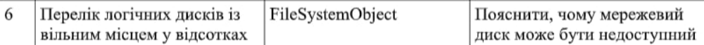
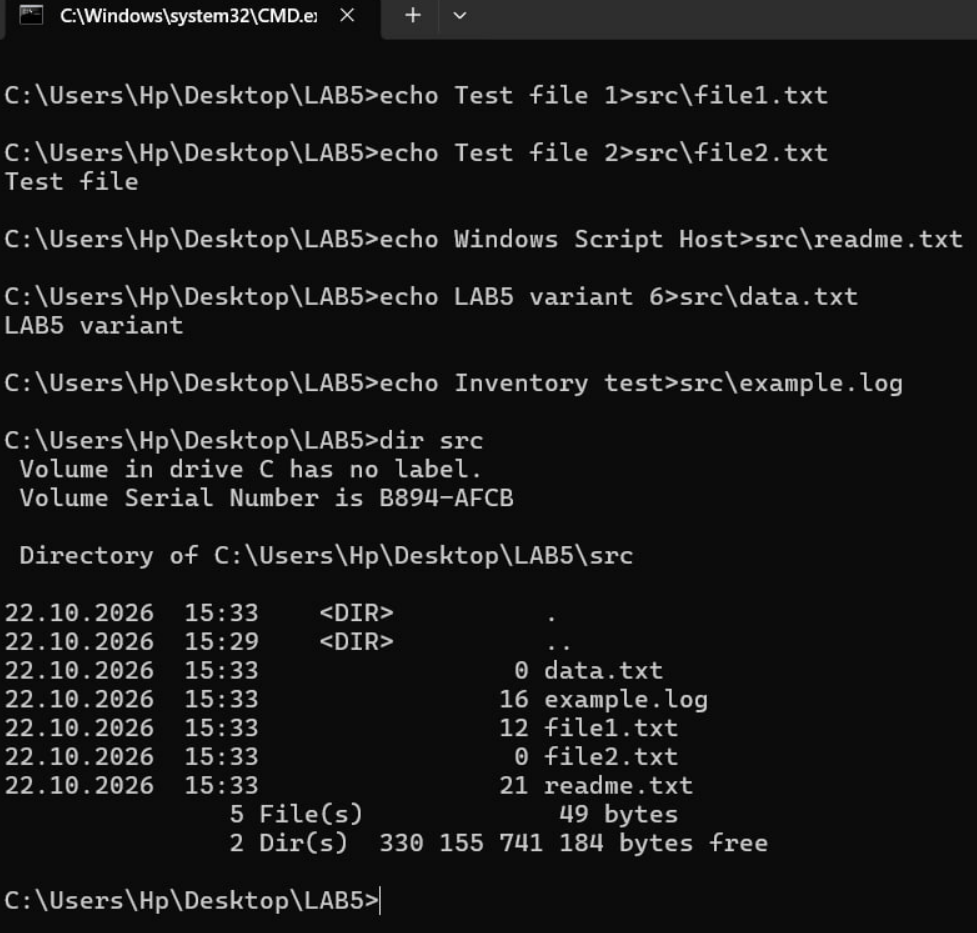
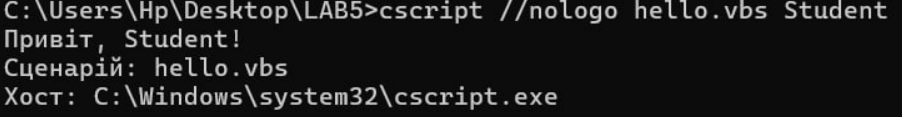
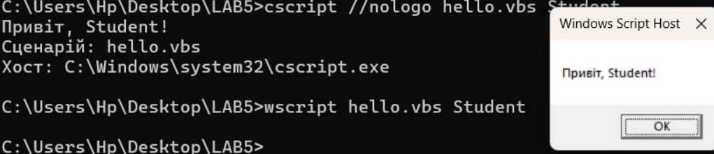
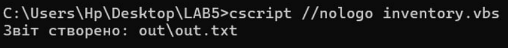
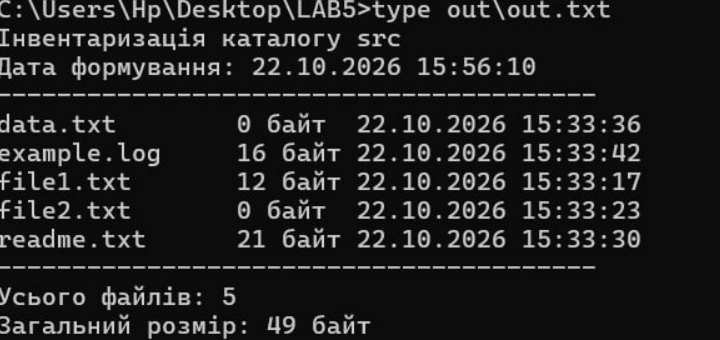
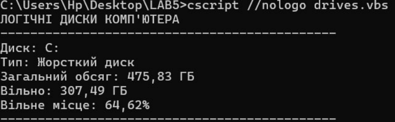
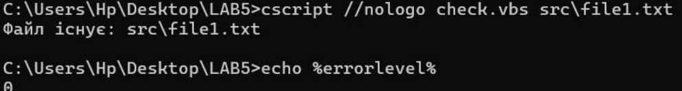
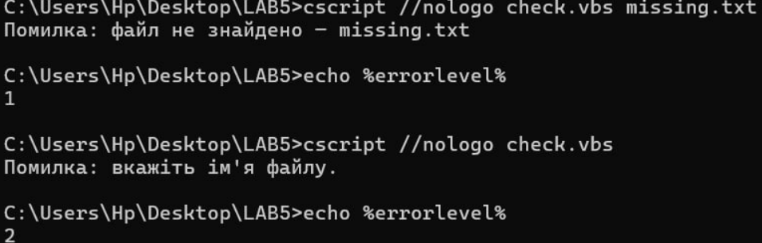
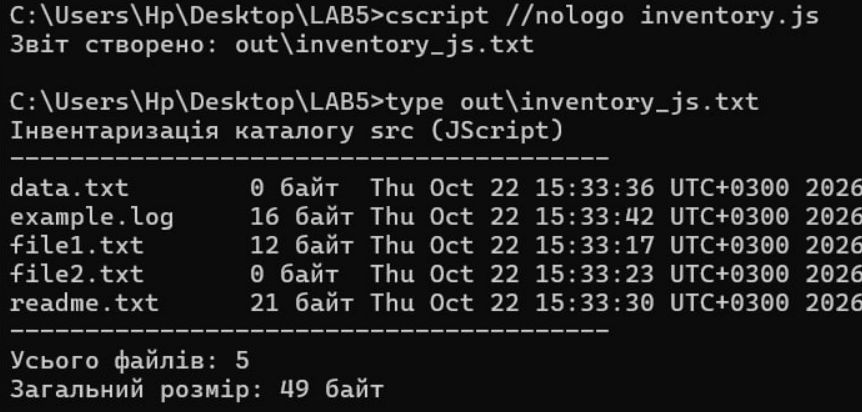

<!--
  Сценарії Windows Script Host
  Варіант 6: Перелік логічних дисків із вільним місцем у відсотках — `FileSystemObject` — Пояснити, чому мережевий диск може бути недоступний

  Тему, мету й обладнання писати не треба — конвеєр візьме їх із лабораторної.
  Знімки екрана кладіть у assets/, вихідний код — у src/.
  Контрольні питання — лише одного рівня, того, на який захищаєте роботу:
  заголовок «### Достатній рівень», далі «1 Текст питання?» і відповідь.
  Покрокова інструкція — reports/README.md
-->

## Хід роботи

1 Номер індивідуального варіанта – 6.

2 Спочатку я відкрила командний рядок CMD і перейшла на робочий стіл. За допомогою команд створила каталог LAB5 та підкаталоги src і out. Використані команди: cd/d "%USERPROFILE%\Desktop", mkdir LAB5, cd LAB5, mkdir src, mkdir out. Після цього до каталогу src було додано п’ять тестових файлів: file1.txt, file2.txt, readme.txt, data.txt та example.log. Для перевірки вмісту каталогу використала команду: dir src. У результаті було виявлено 5 файлів загальним розміром 49 байт.

3 Я створила сценарій hello.vbs мовою VBScript. Він отримує ім’я користувача як аргумент, виводить привітання, назву сценарію та повний шлях до програми-хоста. Для запуску через консоль використала команду: cscript //nologo hello.vbs Student. Результат виконання на рисунку 3. Після цього сценарій було запущено за допомогою команди: wscript hello.vbs Student. Під час запуску через wscript повідомлення відображаються у графічних вікнах, а через cscript — у командному рядку. Отже, обидва хости виконують той самий сценарій, але відрізняються способом виведення результатів.

Скрипт:

' hello.vbs — виведення привітання та інформації про сценарій
Option Explicit

Dim userName

' Перевірка наявності аргументу
If WScript.Arguments.Count > 0 Then
    userName = WScript.Arguments(0)
Else
    userName = "користувач"
End If

WScript.Echo "Привіт, " & userName & "!"
WScript.Echo "Сценарій: " & WScript.ScriptName
WScript.Echo "Хост: " & WScript.FullName

WScript.Quit 0

4 Далі я створила сценарій inventory.vbs, який використовує об’єкт Scripting.FileSystemObject для отримання інформації про файли каталогу src. Сценарій визначає назву кожного файлу, його розмір і дату останньої зміни. Отримані дані записуються у файл out\out.txt у кодуванні Unicode. Для запуску використала команду: cscript //nologo inventory.vbs. Результат: Звіт створено: out\out.txt. Для перегляду сформованого звіту виконала команду: type out\out.txt. У результаті отримано такі дані: кількість файлів — 5; загальний розмір файлів — 49 байт; у звіті наведено назви файлів, їхні розміри та дати останньої зміни. Таким чином, сценарій успішно виконав інвентаризацію навчального каталогу та зберіг результати у файл.

Скрипт:

' inventory.vbs — інвентаризація файлів каталогу src
Option Explicit

Dim fso, base, folder, file, stream, total

Set fso = CreateObject("Scripting.FileSystemObject")

' Визначення каталогу, де розміщений сценарій
base = fso.GetParentFolderName(WScript.ScriptFullName)

' Перевірка наявності каталогу src
If Not fso.FolderExists(base & "\src") Then
    WScript.Echo "Помилка: каталог src не знайдено."
    WScript.Quit 1
End If

Set folder = fso.GetFolder(base & "\src")

' Створення звіту в кодуванні Unicode
Set stream = fso.CreateTextFile(base & "\out\out.txt", True, True)

total = 0

stream.WriteLine "Інвентаризація каталогу src"
stream.WriteLine "Дата формування: " & Now
stream.WriteLine "----------------------------------------"

For Each file In folder.Files
    stream.WriteLine file.Name & vbTab & _
        file.Size & " байт" & vbTab & file.DateLastModified
    total = total + file.Size
Next

stream.WriteLine "----------------------------------------"
stream.WriteLine "Усього файлів: " & folder.Files.Count
stream.WriteLine "Загальний розмір: " & total & " байт"

stream.Close

WScript.Echo "Звіт створено: out\out.txt"
WScript.Quit 0

5 Для виконання основного завдання я створила сценарій drives.vbs, який використовує об’єкт FileSystemObject для отримання інформації про логічні диски комп’ютера. Сценарій визначає тип кожного диска, перевіряє його готовність до роботи, отримує загальний обсяг і вільне місце та обчислює відсоток вільного простору за формулою: Відсоток вільного місця = (вільне місце / загальний обсяг) × 100%. Для запуску сценарію використала команду: cscript //nologo drives.vbs. У результаті виконання було отримано такі показники для диска C: на рисунку 7. Отримані дані свідчать про те, що сценарій правильно визначив характеристики доступного логічного диска та розрахував частку вільного простору.

Скрипт: 

' drives.vbs — перелік логічних дисків і вільного місця
Option Explicit

Dim fso, drives, drive
Dim freePercent, driveType

Set fso = CreateObject("Scripting.FileSystemObject")
Set drives = fso.Drives

WScript.Echo "ЛОГІЧНІ ДИСКИ КОМП'ЮТЕРА"
WScript.Echo "---------------------------------------------"

For Each drive In drives
    Select Case drive.DriveType
        Case 0
            driveType = "Невідомий"
        Case 1
            driveType = "Знімний"
        Case 2
            driveType = "Жорсткий диск"
        Case 3
            driveType = "Мережевий"
        Case 4
            driveType = "CD/DVD"
        Case 5
            driveType = "RAM-диск"
        Case Else
            driveType = "Інший"
    End Select

    WScript.Echo "Диск: " & drive.DriveLetter & ":"
    WScript.Echo "Тип: " & driveType

    If drive.IsReady Then
        WScript.Echo "Загальний обсяг: " & _
            FormatNumber(drive.TotalSize / 1073741824, 2) & " ГБ"

        WScript.Echo "Вільно: " & _
            FormatNumber(drive.FreeSpace / 1073741824, 2) & " ГБ"

        If drive.TotalSize > 0 Then
            freePercent = drive.FreeSpace / drive.TotalSize * 100
            WScript.Echo "Вільне місце: " & _
                FormatNumber(freePercent, 2) & "%"
        Else
            WScript.Echo "Відсоток не визначено: нульовий обсяг."
        End If
    Else
        WScript.Echo "Диск недоступний або не готовий до роботи."
    End If

    WScript.Echo "---------------------------------------------"
Next

WScript.Quit 0

6 Для перевірки обробки помилок я створила сценарій check.vbs. Він перевіряє існування файлу, ім’я якого передається як аргумент під час запуску. Спочатку перевірила наявний файл: cscript //nologo check.vbs src\file1.txt, echo %errorlevel%. Результат: Файл існує: src\file1.txt, 0. Код повернення 0 означає успішне виконання. Далі перевірила неіснуючий файл: cscript //nologo check.vbs missing.txt, echo %errorlevel%. Результат: Помилка: файл не знайдено — missing.txt, 1. Код 1 означає, що файл не знайдено. Також перевірила запуск без передавання аргументу: cscript //nologo check.vbs, echo %errorlevel%. Результат: Помилка: вкажіть ім'я файлу. 2. Отже, сценарій правильно обробляє різні ситуації та повертає відповідні коди завершення. Це дозволяє іншим програмам визначати результат виконання сценарію.

Скрипт:

' check.vbs — перевірка існування файлу
Option Explicit

Dim fso, base, fileName, fullPath

Set fso = CreateObject("Scripting.FileSystemObject")
base = fso.GetParentFolderName(WScript.ScriptFullName)

If WScript.Arguments.Count = 0 Then
    WScript.Echo "Помилка: вкажіть ім'я файлу."
    WScript.Quit 2
End If

fileName = WScript.Arguments(0)
fullPath = fso.BuildPath(base, fileName)

If Not fso.FileExists(fullPath) Then
    WScript.Echo "Помилка: файл не знайдено — " & fileName
    WScript.Quit 1
End If

WScript.Echo "Файл існує: " & fileName
WScript.Quit 0

7 На наступному етапі я створила сценарій inventory.js мовою JScript. Він виконує аналогічне завдання: перебирає файли каталогу src, отримує їхні назви, розміри й дати зміни, а також підраховує кількість файлів і загальний розмір. Для запуску використала команди: cscript //nologo inventory.js, type out\inventory_js.txt. У результаті було створено файл out\inventory_js.txt. У ньому зафіксовано 5 файлів загальним розміром 49 байт. Результат збігається з результатом інвентаризації, виконаної мовою VBScript. Дати в JScript відображаються в іншому форматі, але це не впливає на правильність підрахунків.

Скрипт:

 // inventory.js — інвентаризація каталогу src мовою JScript

var fso = new ActiveXObject("Scripting.FileSystemObject");
var base = fso.GetParentFolderName(WScript.ScriptFullName);
var srcPath = fso.BuildPath(base, "src");
var outPath = fso.BuildPath(base, "out\\inventory_js.txt");

if (!fso.FolderExists(srcPath)) {
    WScript.Echo("Помилка: каталог src не знайдено.");
    WScript.Quit(1);
}

var folder = fso.GetFolder(srcPath);
var stream = fso.CreateTextFile(outPath, true, true);
var files = new Enumerator(folder.Files);
var total = 0;
var count = 0;

stream.WriteLine("Інвентаризація каталогу src (JScript)");
stream.WriteLine("----------------------------------------");

for (; !files.atEnd(); files.moveNext()) {
    var file = files.item();

    stream.WriteLine(
        file.Name + "\t" +
        file.Size + " байт\t" +
        file.DateLastModified
    );

    total += file.Size;
    count++;
}

stream.WriteLine("----------------------------------------");
stream.WriteLine("Усього файлів: " + count);
stream.WriteLine("Загальний розмір: " + total + " байт");
stream.Close();

WScript.Echo("Звіт створено: out\\inventory_js.txt");
WScript.Quit(0);

Таблиця 1 - Порівняння VBScript і JScript

| Критерій | VBScript | JScript |
| --- | --- | --- |
| Створення COM-об’єкта | `CreateObject` | `ActiveXObject` |
| Оголошення змінних | `Dim` | `var` |
| Обхід колекції | `For Each` | `Enumerator` |
| Об’єднання рядків | `Оператор &` | `Оператор +` |
| Виведення | `WScript.Echo` | `WScript.Echo` |
| Робота з файлами | `FileSystemObject` | `FileSystemObject` |

## Додаткове завдання: причини недоступності мережевого диска

Мережевий диск може бути недоступним через відсутність мережевого з’єднання, вимкнення сервера, неправильний шлях до ресурсу, відсутність прав доступу або проблеми з VPN та обліковими даними. За допомогою FileSystemObject можна визначити тип диска через властивість DriveType та перевірити його готовність до роботи за допомогою IsReady. Однак ці властивості не завжди дають змогу встановити точну причину недоступності. Для цього можуть знадобитися додаткові засоби діагностики мережі.

## Відповіді на контрольні питання

## Високий рівень (творчий)

1 Організація має сотню робочих станцій і потребує щотижневого звіту про вільне місце на дисках. Опишіть, як розв’язати задачу засобами WSH: які об’єкти, як зібрати результати, які обмеження виникнуть.

Для цього можна створити сценарій WSH, який на кожному комп’ютері перевірятиме логічні диски за допомогою об’єкта FileSystemObject. Він отримуватиме загальний обсяг диска, кількість вільного місця та обчислюватиме його відсоток. Результати можна записувати у файли CSV, а потім збирати в один спільний звіт на сервері. Запуск сценаріїв щотижня можна організувати за допомогою Планувальника завдань Windows. Основні обмеження: потрібні права доступу до комп’ютерів, стабільне мережеве з’єднання та налаштування запуску на всіх робочих станціях. Якщо комп’ютер вимкнений або диск недоступний, дані про нього можуть не потрапити до звіту.

2 Сценарій .vbs — класичний носій шкідливого коду. Поясніть, які саме можливості WSH роблять його небезпечним і якими засобами системи цей ризик обмежують.

Сценарії VBS можуть бути небезпечними, тому що через WSH вони здатні працювати з файлами, запускати інші програми, змінювати системні налаштування та виконувати команди від імені користувача. Наприклад, шкідливий сценарій може видаляти файли або запускати небажані програми. Щоб зменшити ризик, використовують антивірусний захист, Microsoft Defender, обмеження прав користувачів, політики запуску сценаріїв і блокування небезпечних файлів. Також не варто запускати невідомі .vbs-файли, отримані з ненадійних джерел.

3 Порівняйте WSH і PowerShell за трьома критеріями: доступ до системи, читабельність коду, наявність у сучасних версіях Windows. У яких випадках вибір WSH сьогодні виправданий?

| Критерій | WSH | PowerShell |
| --- | --- | --- |
| Доступ до системи | Працює з файлами, програмами та об’єктами Windows через COM | Має ширші можливості адміністрування, роботи з процесами, службами, мережею та системними об’єктами |
| Читабельність коду | VBScript простий для невеликих сценаріїв, але має обмежені можливості | Має зрозумілі команди та зручні засоби обробки даних |
| Наявність у сучасних Windows | WSH може бути доступним, але його використання обмежують з міркувань безпеки | PowerShell широко використовується в сучасних версіях Windows |

Сьогодні WSH можна використовувати для підтримки старих сценаріїв або виконання нескладних завдань у системах, де він уже застосовується. Для нових адміністративних завдань я б обрала PowerShell, оскільки він має більше можливостей і краще підходить для сучасної автоматизації.

4 Той самий алгоритм реалізовано пакетним файлом і сценарієм WSH. Сформулюйте критерії, за якими ви оберете один із варіантів, і проілюструйте кожен критерій прикладом із цієї роботи.

Під час вибору потрібно враховувати складність завдання, потрібні можливості, зручність написання та обробку помилок.
- Складність завдання. Для простих команд, наприклад створення каталогів LAB5, src і out, достатньо пакетного файлу .bat.
- Робота з файлами та властивостями. Для отримання назв файлів, їхніх розмірів і дат зміни зручно використовувати WSH та FileSystemObject, як у сценарії inventory.vbs.
- Обробка помилок. У сценарії check.vbs можна перевіряти наявність файлу й повертати різні коди завершення: 0 — успіх, 1 — файл не знайдено, 2 — не вказано ім’я файлу.
- Зручність підтримки. Якщо сценарій має багато перевірок і працює з різними системними об’єктами, WSH може бути зручнішим за пакетний файл. Якщо потрібно виконати кілька простих команд послідовно, краще обрати .bat.
Отже, я вважаю, що пакетні файли найкраще підходять для простих послідовностей команд, а WSH — для завдань, де потрібно отримувати властивості об’єктів Windows, обробляти дані та створювати звіти.

## Висновок

На ла бараторній роботі я ознайомилися з підсистемою Windows Script Host, навчилася писати сценарії мовами VBScript і JScript, працювати з файловою системою через об’єктну модель FileSystemObject, керувати оточенням і ярликами через WScript.Shell та отримувати відомості про систему через WMI

