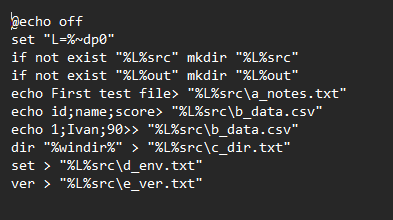
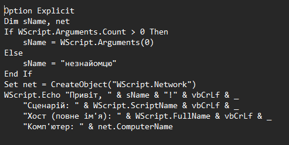
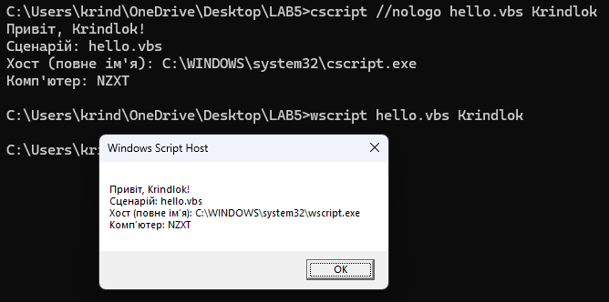
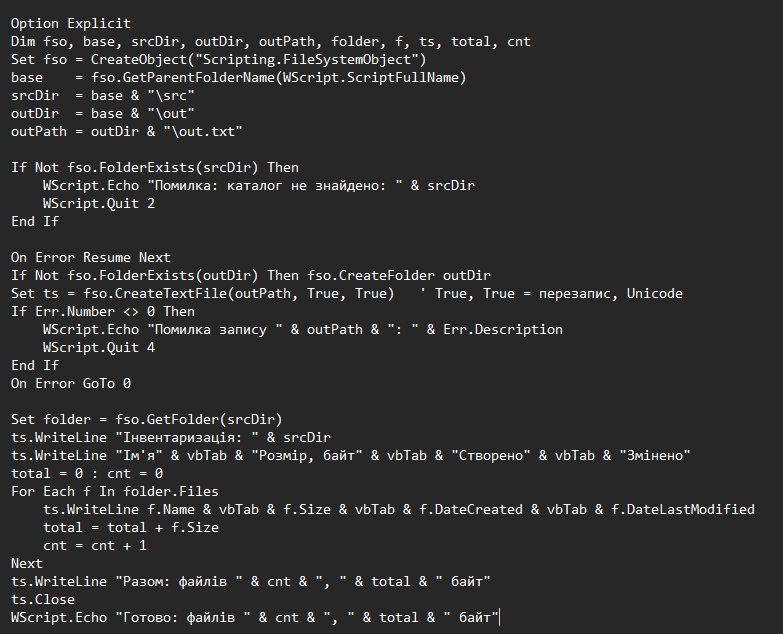
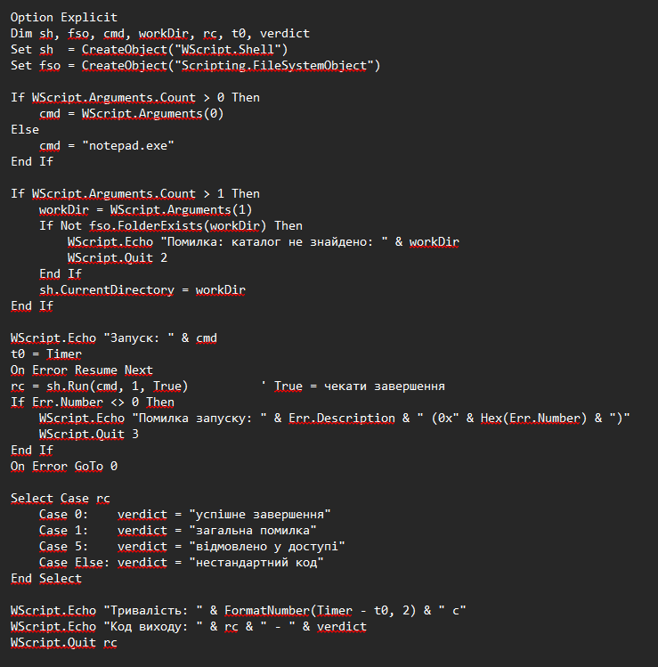
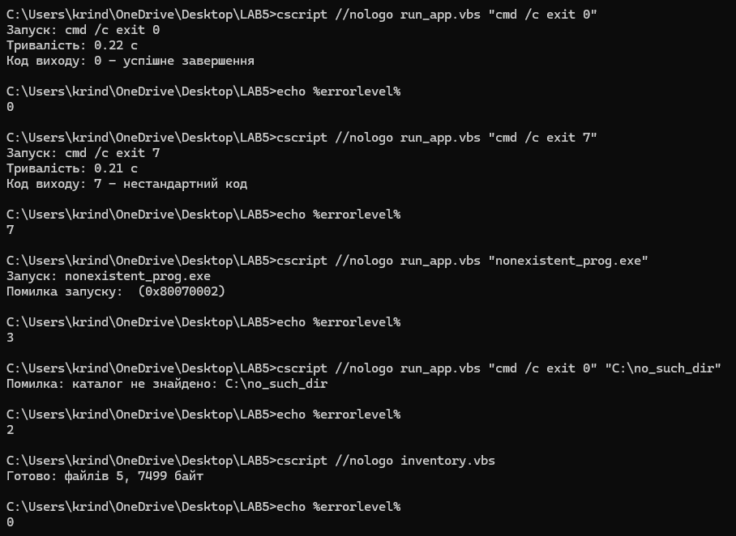
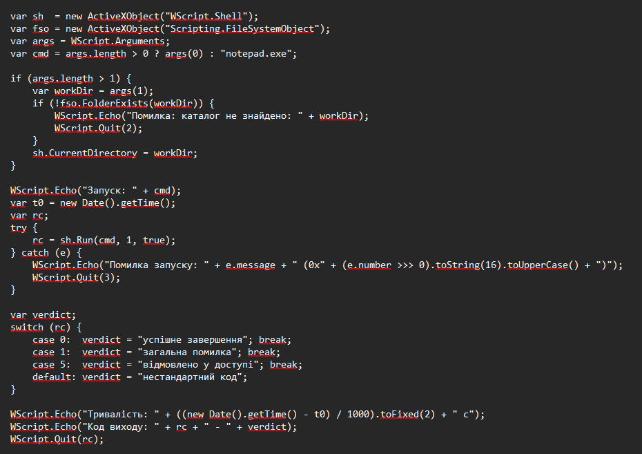
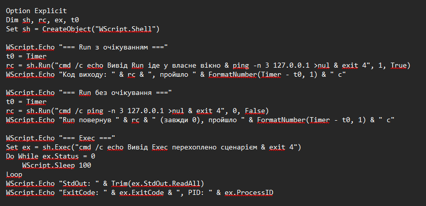
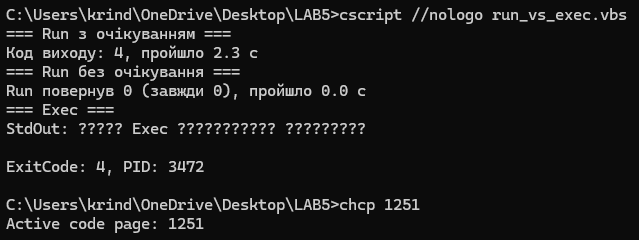

<!--
  Сценарії Windows Script Host
  Варіант 9: Запуск програми з очікуванням і аналізом коду виходу — `WScript.Shell` — Показати, чим `Run` відрізняється від `Exec`

  Тему, мету й обладнання писати не треба — конвеєр візьме їх із лабораторної.
  Знімки екрана кладіть у assets/, вихідний код — у src/.
  Контрольні питання — лише одного рівня, того, на який захищаєте роботу:
  заголовок «### Достатній рівень», далі «1 Текст питання?» і відповідь.
  Покрокова інструкція — reports/README.md
-->

## Хід роботи

1 Створив на робочому столі каталог LAB5 з підкаталогами src і out, наповнив src щонайменше п'ятьма файлами.

2 Написав сценарій hello.vbs, який приймає аргумент, виводить привітання, ім'я сценарію та повне ім'я хоста. Запустив його двома способами - через wscript і через cscript - cscript виводить текст у консоль, його можна перенаправити (> file.txt), і він повертає код у %errorlevel%. wscript показує діалогове вікно з кнопкою OK і чекає натискання. У рядку «Хост» видно ...\cscript.exe або ...\wscript.exe.

3 Написав сценарій інвентаризації каталогу src: перелік файлів з розмірами й датами, підсумковий рядок, запис результату у файл out.txt в кодуванні Unicode.

4 Реалізував основне завдання свого варіанта згідно з таблицею, використавши об'єкт, зазначений у варіанті.

5 Додав до сценарію обробку помилки: звернення до неіснуючого файлу або каталогу дає зрозуміле повідомлення й ненульовий код повернення. Перевірив код через echo%errorlevel%.

6 Переписав один із написаних сценаріїв мовою JScript і порівняв обидві реалізації за обсягом та читабельністю таблицею. JScript трохи коротший, а try/catch читається краще, бо помилка обмежена блоком. On Error Resume Next діє на всі наступні рядки, поки його не скасують. VBScript має зручніші вбудовані функції форматування (FormatNumber, Hex).

Таблиця 1 - Порівняння реалізацій за обсягом та читабельністю

| |VBScript|JScript|
|-|--------|-------|
|Рядків коду (без коментарів і порожніх)|39|31|
|Символів коду|1151|1055|
|Обробка помилок|On Error Resume Next + Err.Number|try / catch|

7 Виконав додаткове завдання свого варіанта. Якщо в Exec програма видає багато виводу, а сценарій його не читає, буфер переповниться і процес зависне. Тому вивід краще читати в циклі, поки процес працює.

Таблиця 2 - Різниця між Run та Exec

| |Run|Exec|
|-|---|----|
|Повертає|число (код виходу, якщо True; інакше 0)|об'єкт WshScriptExec|
|Очікування|параметр bWaitOnReturn|не чекає, треба опитувати Status (0 — працює, 1 — завершено)|
|Вивід програми|сценарій його не бачить|StdOut, StdErr, StdIn|
|Вікно|параметр intWindowStyle|немає такого параметра|
|PID і зупинка|немає|ProcessID, Terminate|

## Відповіді на контрольні питання

### Високий рівень (творчий)

1 Організація має сотню робочих станцій і потребує щотижневого звіту про вільне місце на дисках. Опишіть, як розв’язати задачу засобами WSH: які об’єкти, як зібрати результати, які обмеження виникнуть.

**Об'єкти:**
- WMI: клас `Win32_LogicalDisk` (`DriveType = 3`, поля `Size`, `FreeSpace`), підключення через `GetObject("winmgmts:\\\\ім'я_ПК\\root\\cimv2")`.
- `FileSystemObject` для локальних дисків, `Scripting.Dictionary` або текстовий файл зі списком станцій.

**Збирання результатів:**
- Сценарій читає список імен комп'ютерів і в циклі опитує кожен.
- Для кожного диска обчислюється відсоток вільного місця.
- Рядок `станція; диск; розмір; вільно; %` дописується в CSV/TXT на мережевій папці.
- Запуск за розкладом (`schtasks`) або через GPO.

**Обмеження:**
- Потрібні права адміністратора на віддалених станціях, відкриті DCOM/RPC у брандмауері.
- Вимкнені або недоступні ПК дають помилку та затримку, тому потрібні `On Error` і запис невдач у журнал.
- WSH не вміє паралельність, тож опитування сотні станцій по черзі повільне.
- Мережеві диски можуть бути недоступні.

2 Сценарій .vbs — класичний носій шкідливого коду. Поясніть, які саме можливості WSH роблять його небезпечним і якими засобами системи цей ризик обмежують.

**Чому небезпечний:**
- Сценарій запускається подвійним кліком без компіляції та пісочниці, з правами користувача.
- Через COM-об'єкти він має широкі можливості: `FileSystemObject` (читання, запис, видалення файлів), `WScript.Shell` (запуск програм, реєстр, змінні середовища), WMI (процеси, служби), мережеві об'єкти (завантаження та запуск коду).
- Текст легко обфускувати, а розповсюджується він як вкладення пошти.

**Чим ризик обмежується:**
- Права користувача й UAC (без прав адміністратора системні зміни недоступні).
- Mark-of-the-Web і SmartScreen для завантажених файлів.
- Антивірус та AMSI, який перевіряє скрипти під час виконання.
- Політики: AppLocker/WDAC/SRP забороняють `.vbs`, WSH вимикається в реєстрі (`HKLM\Software\Microsoft\Windows Script Host\Settings`, `Enabled = 0`), у пошті блокуються такі вкладення, також можливий підпис скриптів.

3 Порівняйте WSH і PowerShell за трьома критеріями: доступ до системи, читабельність коду, наявність у сучасних версіях Windows. У яких випадках вибір WSH сьогодні виправданий?

|Критерій|WSH|PowerShell|
|--------|---|----------|
|Доступ до системи|COM-об'єкти, WMI, FSO, Shell; без .NET|те саме + .NET, командлети, провайдер реєстру, віддалене керування (WinRM)|
|Читабельність|багатослівний синтаксис, слабка обробка помилок (`On Error`)|командлети `Дієслово-Іменник`, об'єкти в конвеєрі, `try/catch`, коротші сценарії|
|Наявність у Windows|є, але технологія застаріла: VBScript оголошено застарілим, у новіших Windows 11 це додатковий компонент, який планують вилучити|вбудований (5.1), активно розвивається|

**Коли вибір WSH виправданий сьогодні:**
- Підтримка старих сценаріїв (logon-скрипти, автоматизація Office/COM), які не варто переписувати.
- Старі системи без PowerShell.
- Середовища, де PowerShell заборонений політикою, а WSH дозволений.
- Короткі завдання з COM-об'єктами.

Для нових розробок кращий PowerShell.

4 Той самий алгоритм реалізовано пакетним файлом і сценарієм WSH. Сформулюйте критерії, за якими ви оберете один із варіантів, і проілюструйте кожен критерій прикладом із цієї роботи.

**Критерії вибору:**

1. **Складність логіки.** Прості послідовності команд краще писати в `.bat`, наприклад `setup.bat` (створення `src`, `out` і п'яти файлів займає кілька рядків). Цикли за об'єктами та умови зручніші у WSH.
2. **Доступ до об'єктів системи.** Для властивостей файлів, процесів, дисків потрібні WSH і WMI: `inventory.vbs` бере розмір і дати через `FileSystemObject`, а в `.bat` для цього лише парсинг виводу `dir`.
3. **Обробка помилок і коди повернення.** `run_app.vbs` розрізняє коди (2 — немає каталогу, 3 — програму не запущено, інакше код програми); у `.bat` лише `errorlevel` і складніші перевірки.
4. **Робота з Unicode.** `out.txt` в UTF-16 пише `CreateTextFile(..., True, True)`; у `.bat` кирилиця залежить від `chcp` і кодової сторінки консолі.
5. **Переносимість і залежності.** `.bat` працює скрізь без налаштувань, WSH потребує увімкненого хоста (`cscript` або `wscript`) і правильного кодування файлу (наприклад, UTF-8 у `hello.vbs` дало «кракозябри»).

## Висновок

У роботі створено каталоги LAB5\src і LAB5\out та написано сценарії WSH: привітання з порівнянням хостів wscript і cscript, інвентаризацію каталогу із записом в Unicode-файл і запуск програми з очікуванням та аналізом коду виходу через WScript.Shell.Run (варіант 9). До сценаріїв додано обробку помилок: звернення до неіснуючого файлу чи каталогу дає зрозуміле повідомлення і ненульовий код, який перевіряється через echo %errorlevel% під cscript. Порівняння VBScript і JScript показало, що JScript коротший, а try/catch зручніший за On Error Resume Next. Run підходить для простого запуску з очікуванням і отриманням коду виходу, а Exec потрібен, коли треба перехопити вивід програми, дізнатися PID або зупинити процес.