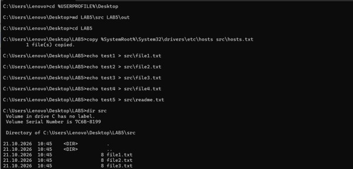
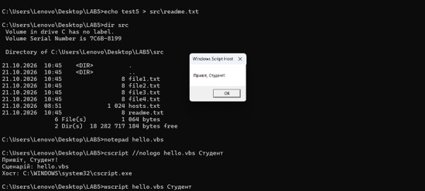
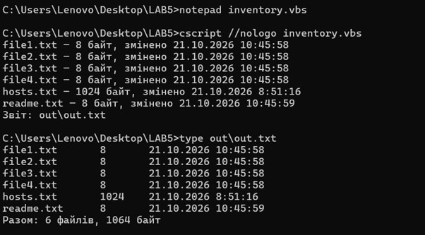
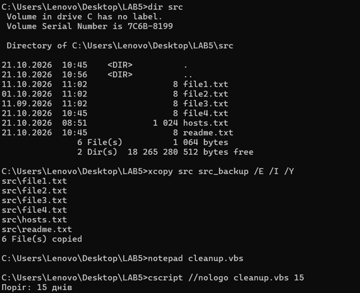
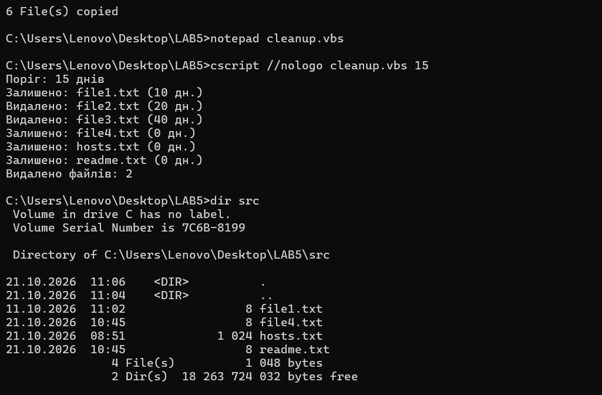
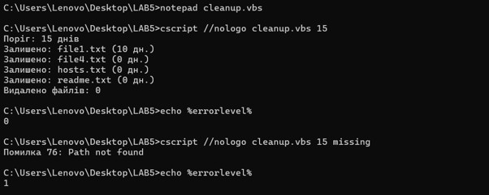
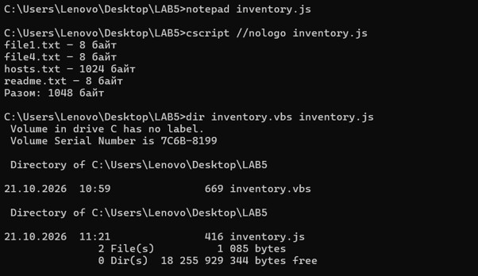
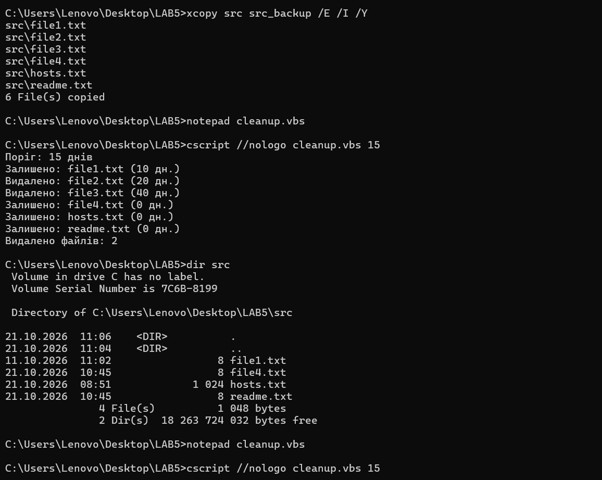

<!--
  Сценарії Windows Script Host
  Варіант 11: Очищення каталогу від файлів, старших за N днів — `FileSystemObject` — Реалізувати режим попереднього перегляду

  Тему, мету й обладнання писати не треба — конвеєр візьме їх із лабораторної.
  Знімки екрана кладіть у assets/, вихідний код — у src/.
  Контрольні питання — лише одного рівня, того, на який захищаєте роботу:
  заголовок «### Достатній рівень», далі «1 Текст питання?» і відповідь.
  Покрокова інструкція — reports/README.md
-->

## Хід роботи

1 Отримала в викладача номер індивідуального варіанта 11.

2 Створила на робочому столі каталог LAB5 з підкаталогами src і out командою md LAB5\src LAB5\out. Командою copy скопіювала в src системний файл hosts під назвою hosts.txt, а командою echo створила ще п'ять текстових файлів: file1.txt, file2.txt, file3.txt, file4.txt і readme.txt. Командою dir src перевірила вміст каталогу: у src міститься 6 файлів загальним розміром 1 064 байти, тобто вимогу щонайменше п'яти файлів виконано. 

3 Написала сценарій hello.vbs, який приймає аргумент, виводить привітання, ім'я сценарію та повне ім'я хоста. Запустила його через cscript командою cscript //nologo hello.vbs Студент: вивід з'явився рядками в консолі («Привіт, Студент!», «Сценарій: hello.vbs», «Хост: C:\WINDOWS\system32\cscript.exe»), ключ //nologo прибрав банер WSH. Потім запустила через wscript командою wscript hello.vbs Студент: кожен виклик WScript.Echo відкрив окреме модальне вікно, яке потрібно закривати клацанням, а в рядку «Хост» вказано wscript.exe. Різниця в тому, що cscript є консольним хостом і виводить результат у вікно cmd, тому підходить для автоматизації та планувальника, а wscript є графічним хостом і показує вивід у вікнах повідомлень, тому підходить для взаємодії з користувачем. 

4 Написала сценарій інвентаризації каталогу src inventory.vbs. За допомогою об'єкта Scripting.FileSystemObject сценарій отримує каталог src відносно розташування самого сценарію, обходить колекцію folder.Files і для кожного файлу виводить ім'я, розмір у байтах та дату останньої зміни, а також підсумовує розміри. Результат записується у файл out\out.txt методом CreateTextFile з третім аргументом True, що вмикає кодування Unicode. Запустила сценарій командою cscript //nologo inventory.vbs і перевірила вміст звіту командою type out\out.txt: у звіті 6 файлів, підсумковий рядок «Разом: 6 файлів, 1064 байт», що збігається з результатом dir src. 

5 Реалізувала основне завдання варіанта №11: очищення каталогу від файлів, старших за N днів. Спершу підготувала тестові дані: командою PowerShell змінила дату останньої зміни трьох файлів (file1.txt на 10 днів, file2.txt на 20 днів, file3.txt на 40 днів раніше), а командою xcopy src src_backup /E /I /Y створила резервну копію каталогу src. Написала сценарій cleanup.vbs, який за допомогою об'єкта Scripting.FileSystemObject отримує каталог src відносно розташування сценарію, обходить колекцію folder.Files, обчислює вік кожного файлу функцією DateDiff від дати останньої зміни DateLastModified і видаляє файл методом file.Delete, якщо вік перевищує поріг N. Значення N передається першим аргументом (за замовчуванням 15). Запустила сценарій командою cscript //nologo cleanup.vbs 15: видалено file2.txt (20 дн.) і file3.txt (40 дн.), залишено file1.txt (10 дн.), file4.txt, hosts.txt і readme.txt (0 дн.). Командою dir src підтвердила результат: у каталозі лишилося 4 файли. 

6 Додала до сценарію cleanup.vbs обробку помилки за схемою з розділу 7 методички. Каталог для очищення задається другим аргументом (за замовчуванням src). Звернення до каталогу виконується між On Error Resume Next та On Error Goto 0: якщо після виклику fso.GetFolder об'єкт Err містить ненульовий номер помилки, сценарій виводить повідомлення з номером і описом помилки, очищує Err методом Err.Clear і завершується командою WScript.Quit 1. Режим On Error Resume Next увімкнено лише на мінімальній ділянці коду й вимкнено одразу після перевірки. Перевірила код повернення: при запуску cscript //nologo cleanup.vbs 15 для існуючого каталогу echo %errorlevel% показала 0, а при зверненні до неіснуючого каталогу missing сценарій вивів «Помилка 76: Path not found», і echo %errorlevel% показала 1. 

7 Переписала мовою JScript сценарій інвентаризації каталогу, створивши inventory.js. Об'єктна модель однакова: використано той самий Scripting.FileSystemObject, але створюється він через new ActiveXObject, а обхід колекції folder.Files виконується за допомогою об'єкта Enumerator (методи atEnd, moveNext, item), тоді як у VBScript достатньо циклу For Each. Запустила сценарій командою cscript //nologo inventory.js: виведено 4 файли з розмірами та підсумок «Разом: 1048 байт», що збігається з результатом VBScript-версії та з dir src. За обсягом JScript-версія менша (416 байт проти 669 байт у inventory.vbs), але частково через те, що вона не записує звіт у файл і не виводить дати. За читабельністю VBScript простіший завдяки циклу For Each і ключовим словам, схожим на звичайну мову, а JScript потребує явного керування переліком і подвійних зворотних скісних рисок у шляхах. 

8 Виконала додаткове завдання варіанта №11: реалізувала режим попереднього перегляду. Спершу командою xcopy src_backup src /E /I /Y відновила з резервної копії видалені файли, і командою dir src підтвердила, що в каталозі знову 6 файлів. Доповнила сценарій cleanup.vbs третім аргументом preview: якщо він указаний, змінна preview набуває значення True, і сценарій замість виклику file.Delete лише виводить повідомлення «Буде видалено» та рахує файли, які підпадають під видалення. Запустила сценарій командою cscript //nologo cleanup.vbs 15 src preview: file2.txt (20 дн.) і file3.txt (40 дн.) позначено як «Буде видалено», підсумок «Буде видалено файлів: 2». Командою dir src підтвердила, що після перегляду в каталозі лишилося всі 6 файлів, тобто нічого не видалено. Після цього запустила сценарій без режиму перегляду командою cscript //nologo cleanup.vbs 15: файли file2.txt і file3.txt видалено, а dir src показала 4 файли, 1048 байт. 

9 Оформила звіт і зробила висновок.

## Відповіді на контрольні питання

### Високий рівень (творчий)

1 Організація має сотню робочих станцій і потребує щотижневого звіту про вільне місце на дисках. Опишіть, як розв’язати задачу засобами WSH: які об’єкти, як зібрати результати, які обмеження виникнуть.

Для розв'язання задачі засобами WSH основним інструментом буде WMI: сценарій підключається до кожної станції через GetObject("winmgmts:\\" & комп'ютер & "\root\cimv2") і виконує запит SELECT DeviceID, Size, FreeSpace FROM Win32_LogicalDisk WHERE DriveType = 3, де умова DriveType = 3 залишає лише локальні жорсткі диски. Перелік комп'ютерів сценарій читає з текстового файлу за допомогою Scripting.FileSystemObject (метод OpenTextFile, рядок за рядком), а результат записує методом CreateTextFile з третім аргументом True, тобто в Unicode, у CSV-файл на мережевій теці. Для відображення імені комп'ютера й користувача додатково можна використати WScript.Network. Зібрати результати можна двома способами. Централізований підхід передбачає один сценарій на сервері, який у циклі обходить усі станції й дописує до спільного файлу рядки «комп'ютер, диск, розмір, вільно, відсоток вільного», а щотижневий запуск забезпечує Планувальник завдань командою cscript //nologo disks.vbs, причому код повернення показує, чи завершився запуск успішно. Розподілений підхід полягає в тому, що той самий сценарій без віддаленого підключення запускається на кожній станції (груповою політикою або сценарієм входу) і записує власний файл з іменем комп'ютера в мережеву теку, що виключає конфлікти одночасного запису. Обмеження при цьому виникають суттєві. Для віддаленого WMI потрібні права адміністратора на станціях, запущена служба WMI та відкриті порти DCOM/RPC у брандмауері. Вимкнені або недоступні комп'ютери спричиняють помилку чи тривалий тайм-аут, тому для кожної станції потрібна окрема обробка помилок (On Error Resume Next на мінімальній ділянці коду та перевірка Err.Number), а недоступні станції слід фіксувати в звіті окремо. WSH обходить станції послідовно, без паралельності, тож сто станцій потребуватимуть помітного часу. Крім того, розміри сучасних дисків можуть виходити за межі цілого типу VBScript, тому під час обчислень слід використовувати CDbl. Нарешті, оскільки VBScript оголошено застарілим, для нового рішення доцільніше обрати PowerShell з Get-CimInstance Win32_LogicalDisk та Invoke-Command, що підтримує паралельне виконання.

2 Сценарій .vbs — класичний носій шкідливого коду. Поясніть, які саме можливості WSH роблять його небезпечним і якими засобами системи цей ризик обмежують.

Чому небезпечний:

-Сценарій виконується з правами користувача, який його запустив, і не просить підтвердження.

-Файли .vbs і .js асоційовані з WSH, тому запускаються подвійним клацанням, а це легко зробити «випадково» (вкладення в листі, завантажений файл).

-Через CreateObject сценарій має доступ до всієї об'єктної моделі COM: файлової системи (FSO), запуску програм (WScript.Shell.Run/Exec), реєстру, WMI, мережі.

-Це простий текстовий файл без компіляції та встановлення, його легко приховати, змінити й заплутати код, а вбудований у Windows хост є на кожному комп'ютері, тобто додаткових програм зловмиснику не треба.

Чим ризик обмежують:

-Попередження SmartScreen і Mark of the Web для файлів, завантажених із мережі, та блокування таких вкладень поштовими шлюзами.

-Антивірус та інтерфейс AMSI, який дає антивірусу переглянути код сценарію під час виконання.

-Вимкнення WSH політикою або реєстром (HKLM\SOFTWARE\Microsoft\Windows Script Host\Settings, параметр Enabled = 0).

-AppLocker, WDAC або політики обмеженого використання програм, що забороняють запуск wscript.exe і cscript.exe або дозволяють лише підписані сценарії.

-Зміна асоціації .vbs на Блокнот, щоб подвійне клацання відкривало файл у редакторі, а не виконувало його (саме цього вимагає застереження на початку лабораторної роботи).

-Принцип найменших привілеїв і UAC.

-Видалення самого VBScript: у Windows 11 24H2 він став компонентом на вимогу, далі його вимкнуть за замовчуванням, а згодом приберуть із системи.

3 Порівняйте WSH і PowerShell за трьома критеріями: доступ до системи, читабельність коду, наявність у сучасних версіях Windows. У яких випадках вибір WSH сьогодні виправданий?

За доступом до системи WSH обмежений COM-об'єктами (FSO, WScript.Shell, WMI): він не має доступу до .NET, готових модулів і вбудованих засобів віддаленого керування. PowerShell працює і з COM, і з повною бібліотекою .NET, має сотні командлетів, постачальників (реєстр, диски як звичайні шляхи) та віддалене виконання через WinRM, тому охоплює значно більше завдань. За читабельністю коду VBScript багатослівний, помилки в ньому обробляються через On Error і Err, а обхід колекцій різниться залежно від мови (For Each у VBScript, Enumerator у JScript), як це було видно при порівнянні inventory.vbs та inventory.js. PowerShell спирається на конвеєр і об'єкти, команди мають передбачувану форму «дієслово-іменник», є повноцінний try/catch, тому запит, який у WSH займає кілька рядків, як у розділі 6 методички, записується одним рядком Get-CimInstance Win32_OperatingSystem. Що стосується наявності у сучасних Windows, WSH присутній у всіх версіях, але VBScript застарілий і поетапно видаляється, тоді як Windows PowerShell 5.1 вбудований у сучасні системи, а PowerShell 7 встановлюється окремо й активно розвивається. Вибір WSH сьогодні виправданий переважно тоді, коли треба підтримувати вже наявні сценарії, які працюють у великій кількості в організації, доки їх не перенесено на PowerShell, коли йдеться про старі чи мінімальні системи, де PowerShell недоступний або заборонений, або коли робота ведеться зі спадковими COM-компонентами та інструментами, що вимагають саме VBScript. Для нових розробок вибір WSH невиправданий.

4 Той самий алгоритм реалізовано пакетним файлом і сценарієм WSH. Сформулюйте критерії, за якими ви оберете один із варіантів, і проілюструйте кожен критерій прикладом із цієї роботи.

1) Складність логіки та типи даних. Для простих послідовностей команд досить пакетного файлу, наприклад md LAB5\src LAB5\out, copy, xcopy у підготовці каталогів. Але в cleanup.vbs потрібні змінні різних типів, умови, цикл по колекції, порівняння дат і лічильник (DateDiff, If age > days), а в пакетному файлі арифметика дат і лічильники незручні.

2) Доступ до об'єктів і властивостей. WSH працює з об'єктами: file.Size, file.DateLastModified, folder.Files.Count в inventory.vbs повертають готові значення. У пакетному файлі довелося б розбирати текстовий вивід dir.

3) Обробка помилок і код повернення. У WSH є Err.Number, Err.Description та WScript.Quit 1. У cleanup.vbs звернення до неіснуючого каталогу missing дає повідомлення «Помилка 76: Path not found» і код 1, який перевіряється через echo %errorlevel%. У пакетному файлі доступний лише errorlevel без опису помилки.

4) Кодування та національні символи. Звіт out\out.txt записано методом CreateTextFile з параметром True у Unicode, і українське «Разом» відображається коректно. Пакетний файл залежить від кодової сторінки консолі, і кирилиця може перетворюватися на нечитабельні символи.

5) Параметризація та режими. cleanup.vbs приймає поріг N, каталог і режим preview і розбирає аргументи через WScript.Arguments. У пакетному файлі це громіздко.
   
6) Простота, швидкість і залежності. Для разової дії або короткої послідовності команд пакетний файл швидший у написанні, не потребує окремого хоста й сумісний з будь-якою версією Windows. Саме так у роботі створено тестові файли та резервну копію.

7) Взаємодія між ними. Вибір не завжди або-або: код повернення WSH-сценарію можна перевірити в пакетному файлі або в Планувальнику, тому WSH вбудовують у пакетний файл і навпаки.

## Висновок

На цій лабораторній роботі я ознайомилася з підсистемою Windows Script Host, навчилася писати сценарії мовами VBScript і JScript, працювати з файловою системою через об’єктну модель FileSystemObject, керувати оточенням і ярликами через WScript.Shell та отримувати відомості про систему через WMI.
