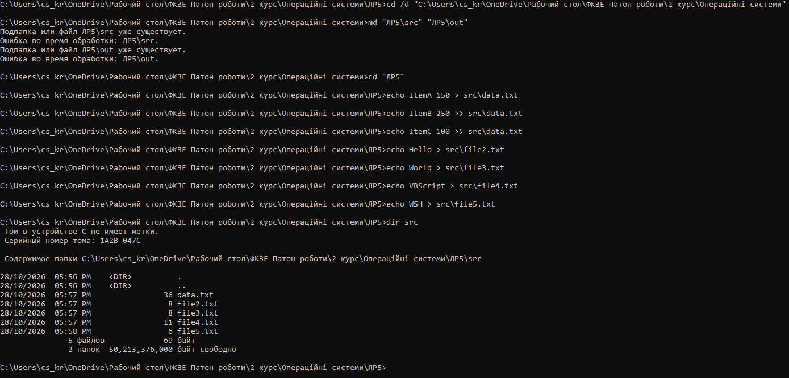
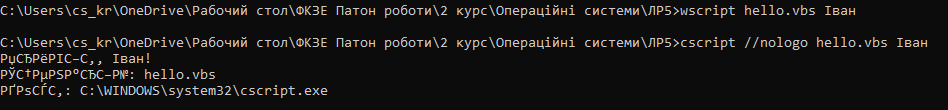
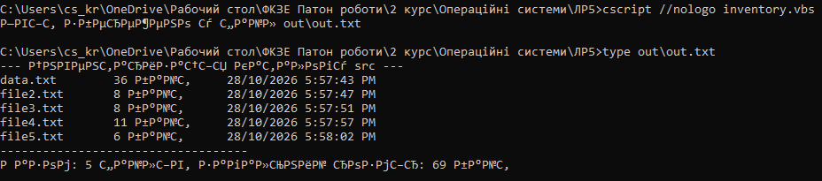
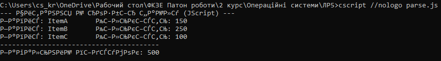
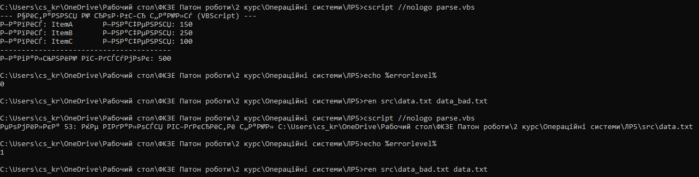

## Хід роботи

1 Отримав у викладача номер індивідуального варіанта 14.

2 Створив на робочому столі каталог ЛР5 з підкаталогами src і out, наповнив src п’ятьма файлами.

3 Написав сценарій hello.vbs, який приймає аргумент, виводить привітання, ім’я сценарію та повне ім’я хоста. Запустив його двома способами через wscript і через cscript і пояснив різницю у виводі. Запуск через wscript виводить результат у графічному віконці, а запуск через cscript виводить текст безпосередньо у консоль командного рядка.

4 Написав сценарій інвентаризації каталогу src, який формує перелік файлів з розмірами й датами, підсумковий рядок та записує результат у файл out.txt в кодуванні Unicode.

5 Реалізував основне завдання свого варіанта згідно з таблицею, використавши об’єкт FileSystemObject для читання й розбору текстового файлу з роздільниками.

6 Додав до сценарію обробку помилки, де звернення до неіснуючого файлу або каталогу дає зрозуміле повідомлення й ненульовий код повернення. Перевірив код через echo %errorlevel%. При зверненні до неіснуючого файлу скрипт вивів повідомлення про помилку та повернув код 1, а при нормальній роботі повернув код 0.

7 Переписав один із написаних сценаріїв мовою JScript і порівняв обидві реалізації за обсягом та читабельністю. Код на JScript вийшов більш компактним завдяки С-подібному синтаксису, але VBScript є більш описовим і тому може читатися легше для початківців.

8 Виконав додаткове завдання свого варіанта. Додав підрахунок підсумків за числовим стовпцем, отримавши загальну суму 500.

9 Оформив звіт і зробив висновок.

## Відповіді на контрольні питання

### Високий рівень

1 Організація має сотню робочих станцій і потребує щотижневого звіту про вільне місце на дисках. Опишіть, як розв’язати задачу засобами WSH: які об’єкти, як зібрати результати, які обмеження виникнуть.

Для розв'язання цієї задачі засобами WSH необхідно використати об'єкт WScript.Network для визначення імені поточної машини та об'єкт Scripting.FileSystemObject разом із колекцією Drives для отримання даних про вільне місце на локальних дисках, після чого сценарій має записувати зібрану інформацію у спільний мережевий файл або надсилати листом, проте головними обмеженнями стануть проблеми з одночасним доступом сотні машин до одного файлу, відсутність вбудованих засобів паралельного виконання та потенційні блокування сценаріїв антивірусом.

2 Сценарій .vbs — класичний носій шкідливого коду. Поясніть, які саме можливості WSH роблять його небезпечним і якими засобами системи цей ризик обмежують.

Небезпека сценаріїв WSH полягає в їхньому прямому та непомітному для користувача доступі до файлової системи через FileSystemObject, можливості модифікувати системний реєстр, керувати процесами через WMI та завантажувати файли з мережі без виклику жодних графічних вікон, тому для обмеження цього ризику в сучасних системах асоціацію таких файлів перехоплює антивірус або Windows Defender, адміністратори вимикають службу Windows Script Host через групові політики, а технологія AppLocker дозволяє запускати лише підписані скрипти.

3 Порівняйте WSH і PowerShell за трьома критеріями: доступ до системи, читабельність коду, наявність у сучасних версіях Windows. У яких випадках вибір WSH сьогодні виправданий?

За критерієм доступу до системи PowerShell значно перевершує WSH завдяки глибокій інтеграції з .NET Framework, тоді як WSH обмежений застарілими COM-об'єктами; щодо читабельності коду синтаксис PowerShell є більш структурованим у порівнянні з багатослівним VBScript, хоча обидві технології присутні в сучасних версіях Windows для зворотної сумісності, проте вибір WSH сьогодні виправданий виключно для підтримки дуже старих систем, де PowerShell не встановлено, або для виконання існуючих старих сценаріїв, які недоцільно переписувати з нуля.

4 Той самий алгоритм реалізовано пакетним файлом і сценарієм WSH. Сформулюйте критерії, за якими ви оберете один із варіантів, і проілюструйте кожен критерій прикладом із цієї роботи.

Головними критеріями вибору між пакетним файлом і WSH є складність математичних обчислень, потреба в гнучкій обробці рядків та взаємодія з об'єктами: пакетні файли краще підходять для простого виклику консольних утиліт, тоді як сценарій WSH варто обирати для задач із парсингом даних, що яскраво ілюструє ця лабораторна робота, адже завдання з читання текстового файлу, розділення його рядків на масиви та підрахунку загальної суми чисел реалізувати на VBScript чи JScript набагато простіше й надійніше, ніж намагатися зробити це через обмежений функціонал у пакетному файлі.

## Висновок

Я ознайомився з підсистемою Windows Script Host, навчився писати сценарії мовами VBScript і JScript, працювати з файловою системою через об’єктну модель FileSystemObject, керувати оточенням і ярликами через WScript.Shell та отримувати відомості про систему через WMI
