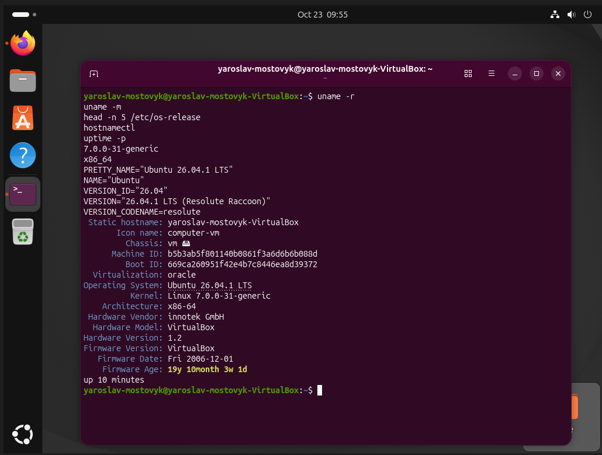
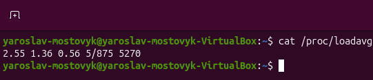
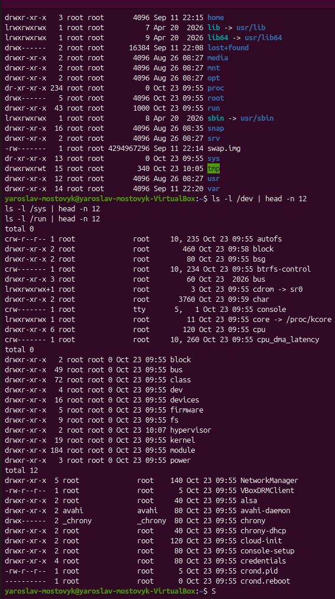
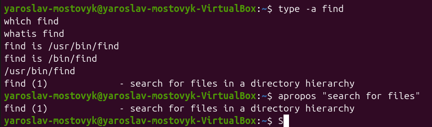
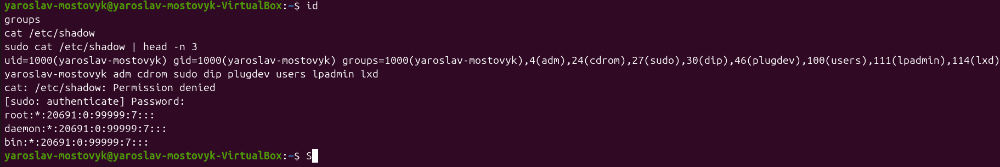
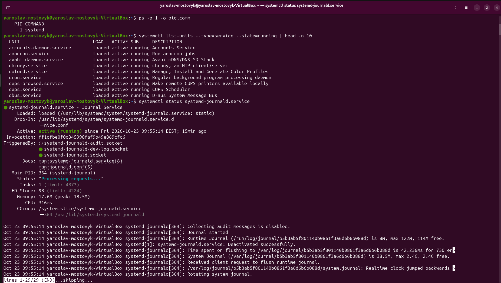
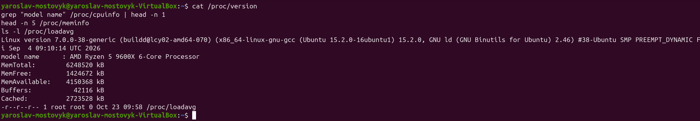

## Хід роботи
1 Отримав індивідуальний варіант №19. Ознайомився з основними принципами функціонування операційної системи Linux.

2 Визначив версію ядра, дистрибутив, архітектуру, ім’я комп’ютера та час роботи системи за допомогою команд `uname -r`, `cat /etc/os-release`, `hostnamectl` і `uptime`.

3 Отримав середнє навантаження системи командою `cat /proc/loadavg`. Дослідив значення навантаження за останні 1, 5 і 15 хвилин.

4 Вивів список каталогів кореневої файлової системи командою `ls /`. Дослідив призначення каталогів `/dev`, `/sys` і `/run`.

5 Перевірив вміст каталогу `/dev`, у якому розташовані файли пристроїв, і каталогу `/sys`, який містить інформацію про пристрої та драйвери. Ознайомився з каталогом `/run`, де зберігаються дані про поточний стан системи.

6 Перевірив команду `find` за допомогою `type find`, визначив розташування виконуваного файлу командою `which find` та переглянув короткий опис за допомогою `whatis find`. Ознайомився з ключами команди.

7 Знайшов інформацію про пошук файлів і каталогів за допомогою команди `apropos find`. Переглянув довідку команди `find` за допомогою `man find`.

8 Переглянув відомості про обліковий запис командами `whoami`, `id` і `groups`. Перевірив доступ до файлу `/etc/shadow` без `sudo` та з його використанням, щоб побачити різницю в правах доступу.

9 Переглянув список процесів за допомогою `ps aux` і визначив процес із PID 1. Вивів список запущених служб командою `systemctl list-units --type=service --state=running` та перевірив стан служби `systemd-journald` командою `systemctl status systemd-journald`. Переглянув її журнал за допомогою `journalctl -u systemd-journald`.

10 Виконав додаткове завдання: дослідив відмінності між каталогами `/dev` і `/sys`. З’ясував, що `/dev` містить файли для безпосередньої взаємодії з пристроями, а `/sys` надає структуровану інформацію ядра про пристрої, шини та параметри драйверів.

Таблиця 1 – Основні команди діагностики системи

| Команда | Призначення |
|---|---|
| `uname -r` | Виведення поточної версії ядра Linux |
| `hostnamectl` | Відомості про ім'я хоста, архітектуру та ОС |
| `uptime -p` | Відображення тривалості роботи системи |
| `cat /proc/loadavg` | Перегляд середнього навантаження системи |
| `systemctl status` | Перевірка статусу системної служби |

## Відповіді на контрольні питання

### Високий рівень

1 Поясніть, як принцип «все є файлом» спрощує написання системних утиліт. Проілюструйте на прикладі читання відомостей про процесор.

Принцип «все є файлом» уніфікує інтерфейс взаємодії з ядром та обладнанням: замість специфічних системних викликів утиліти можуть використовувати стандартні файлові операції введення-виведення (відкриття, читання, запис). Наприклад, утиліта може прочитати відомості про процесор з віртуального файлу `/proc/cpuinfo` звичайною командою читання файлу `cat` або стандартною бібліотечною функцією читання тексту.

2 Два комп’ютери мають однакову версію дистрибутива, але різні версії ядра. Назвіть щонайменше три наслідки цієї різниці для адміністратора.

По-перше, різниця у підтримці апаратного забезпечення: новіше ядро містить драйвери для сучасніших пристроїв. По-друге, відмінності в доступності підсистем безпеки та механізмів виправлення вразливостей. По-третє, різна поведінка системних викликів або доступність функціоналу (наприклад, підтримка нових можливостей cgroups чи eBPF), що впливає на роботу контейнеризації та моніторингу.

3 Сформулюйте критерії вибору дистрибутива для навчального класу й обґрунтуйте кожен із них.

Основними критеріями є: стабільність (версії з тривалою підтримкою LTS мінімізують збої під час навчального процесу); розмір спільноти та документація (студентам легше знаходити рішення типових помилок); простота розгортання та керування пакетами (для швидкого налаштування однакового середовища на всіх робочих місцях).

4 Система завантажилася, але одна зі служб не працює. Опишіть послідовність дій із використанням systemctl і journalctl та поясніть, що саме ви шукаєте на кожному кроці.

Спочатку виконується `systemctl status <назва_служби>` для визначення поточного стану (Active: failed), коду завершення та короткого опису помилки. Потім аналізуються повні логи за допомогою `journalctl -u <назва_служби> -e`, де ведеться пошук точного тексту виключення, помилок конфігурації чи відсутності залежностей. Після виправлення конфігурації служба перезапускається командою `sudo systemctl restart <назва_служби>`.

## Висновок

Під час лабораторної роботи опановано базові команди адміністрування та діагностики ОС Linux, роботу з псевдофайловими системами `/proc`, `/sys` та `/dev`, а також керування службами за допомогою `systemctl` та аналіз системних журналів `journalctl`.
