<!--
  Принципи функціонування ОС Linux
  Варіант 6: Розмір розділу з `/home` — `/home`, `/root`, `/media` — `du` — `ssh` — Пояснити, чому `/root` не всередині `/home`

  Тему, мету й обладнання писати не треба — конвеєр візьме їх із лабораторної.
  Знімки екрана кладіть у assets/, вихідний код — у src/.
  Контрольні питання — лише одного рівня, того, на який захищаєте роботу:
  заголовок «### Достатній рівень», далі «1 Текст питання?» і відповідь.
  Покрокова інструкція — reports/README.md
-->

## Хід роботи

1 Номер індивідуального варіанта – 6.

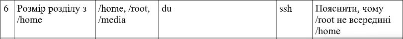

2 Для визначення основних характеристик системи використано команди uname -r, cat /etc/os-release, uname -m, hostnamectl та uptime. uname -r — показує версію ядра Linux. cat /etc/os-release — виводить назву та версію дистрибутива. uname -m — визначає архітектуру системи. hostnamectl — відображає інформацію про ім’я вузла та операційну систему. uptime — показує тривалість роботи системи. Отже, досліджувана система працює на базі ядра Linux 7.0.0-31-generic. Дистрибутив Ubuntu запущено у віртуальному середовищі Oracle VirtualBox. Архітектура x86_64 відповідає 64-бітній системі. 

## Паспорт системи

Таблиця 1 - Паспорт системи

| Параметр | Отримане значення |
| --- | --- |
| Ядро Linux | 7.0.0-31-generic |
| Дистрибутив | Ubuntu 26.04.1 LTS |
| Архітектура | x86_64 |
| Ім'я вузла | ubuntu-server |
| Тип віртуалізації | oracle |
| Час роботи | up 1 day, 3:53 |

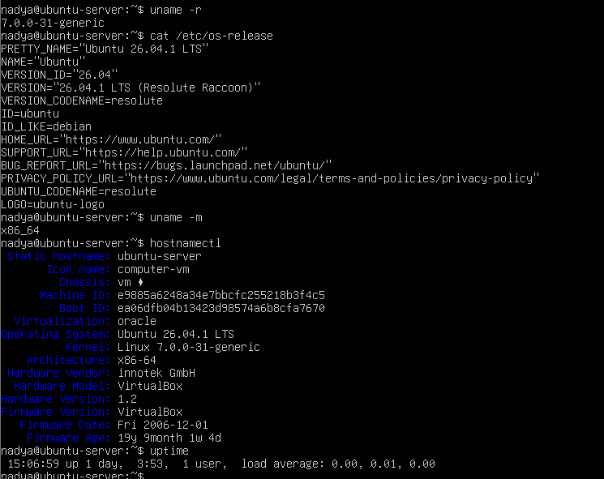

3 Для визначення розміру файлової системи, у якій розташовано каталог /home, використано команду: df -h /home/ Ключ -h дає змогу відображати розміри у зручному для читання форматі: ГБ, МБ тощо. За результатами виконання команди отримано такі значення, як у таблиці. У результаті видно, що каталог /home розташований у кореневій файловій системі /. Це означає, що він не має окремого змонтованого розділу. Тому значення 12 ГБ характеризує всю файлову систему, у якій розташовано /home, а не лише файли користувачів. Для визначення обсягу даних безпосередньо в каталозі /home можна використати команду: du -sh /home. Ключ -s показує загальний обсяг без детального переліку всіх підкаталогів, а -h виводить розмір у зручному форматі. Команда df показує використання файлової системи загалом, а du — обсяг, зайнятий файлами в указаному каталозі.

Таблиця 2 - Результати виконання

| Параметр | Значення |
| --- | --- |
| Файлова система | /dev/mapper/ubuntu--vg-ubuntu--lv |
| Загальний розмір | 12G |
| Використано | 5.4G |
| Доступно | 5.3G |
| Використання | 51% |
| Точка монтування | / |

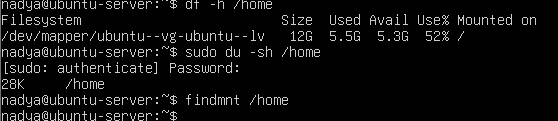

4 Для перегляду каталогів кореневого рівня використано команду: ls -la /. Ключ -l виводить детальну інформацію про об’єкти, а -a дає змогу побачити приховані файли й каталоги. Відповідно до стандарту FHS (Filesystem Hierarchy Standard), основні каталоги мають таке призначення: в таблиці. Для перегляду вмісту каталогів використовувалися команди: ls -la /home, sudo ls -la /root, ls -la /media. Команда sudo перед ls потрібна для отримання адміністративних прав під час перегляду каталогу /root, доступ до якого обмежений. У домашньому каталозі користувача можуть міститися файли .bashrc, .profile і .bash_logout. У каталозі /root розміщуються особисті налаштування адміністратора. Каталог /media призначений для монтування знімних носіїв; якщо вони не підключені, він може бути порожнім.

Таблиця 3 - Результати виконання

| Каталог | Призначення | Приклад |
| --- | --- | --- |
| /home | Містить домашні каталоги звичайних користувачів та їхні особисті файли. | /home/nadya/.bashrc |
| /root | Домашній каталог адміністратора root. | /root/.bashrc |
| /media | Використовується для точок монтування знімних носіїв інформації. | Каталог для змонтованого USB-накопичувача |

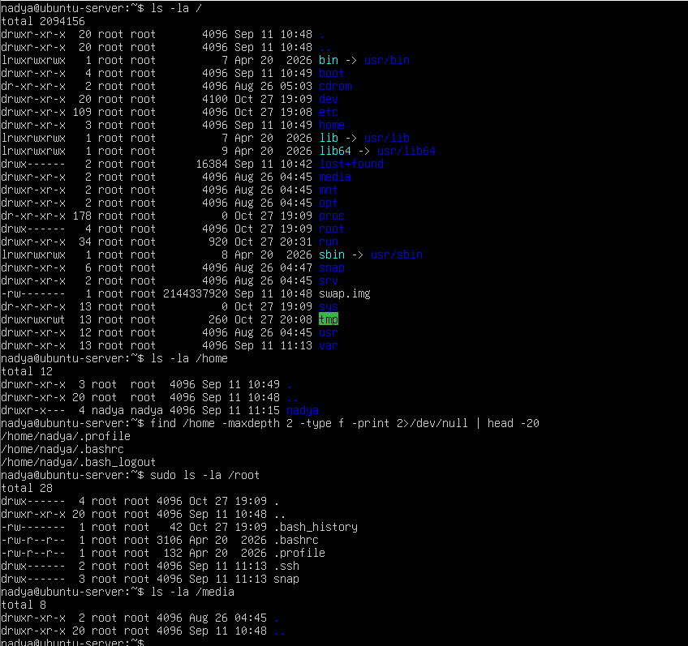

5 Команда du (disk usage) використовується для визначення обсягу дискового простору, зайнятого файлами та каталогами. Для дослідження команди виконано: type -a du, command -v du, whatis du. Команда type -a du показує, як оболонка розпізнає команду, та всі знайдені варіанти її розташування. Команда command -v du виводить шлях до виконуваного файла або інше визначення команди. Команда whatis du показує короткий опис призначення команди з довідкової системи. Команда du зазвичай є зовнішньою програмою, а не вбудованою командою оболонки. Її виконуваний файл у стандартній системі Ubuntu зазвичай розташований у /usr/bin/du. Для ознайомлення з параметрами використано: du --help. Приклад використання: du -sh /home, du -ah /home. Перша команда показує загальний обсяг каталогу /home, а друга — розміри окремих файлів і каталогів усередині нього. Для перевірки обробки помилок можна вказати каталог, якого не існує: du -sh /not_existing_directory У такому випадку команда повідомляє, що не може отримати доступ до вказаного шляху. Це демонструє реакцію програми на некоректні вхідні дані.

Таблиця 4 - Результати виконання

| Ключ | Призначення |
| --- | --- |
| -s | Виводить загальний обсяг для вказаного каталогу без переліку всіх його підкаталогів. |
| -h | Відображає розміри у зручному форматі: КБ, МБ, ГБ. |
| -a | Виводить інформацію не лише про каталоги, а й про окремі файли. |

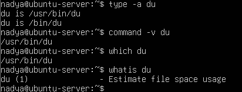

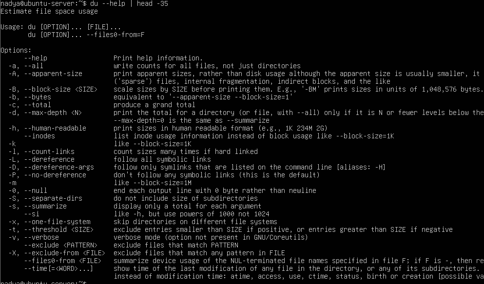

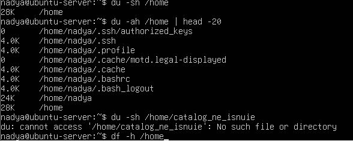

6 Команда apropos використовується для пошуку команд за ключовими словами в коротких описах сторінок довідки Linux. Для пошуку команди, пов’язаної з дослідженням дискового простору, виконано: apropos disk. Система виводить перелік команд і довідкових записів, у короткому описі яких зустрічається слово disk. Серед результатів можна знайти засоби для перегляду використання дискового простору. Отже, за допомогою apropos можна знаходити потрібні системні утиліти, навіть якщо їхня точна назва невідома. Результати залежать від наявних у системі довідкових сторінок.

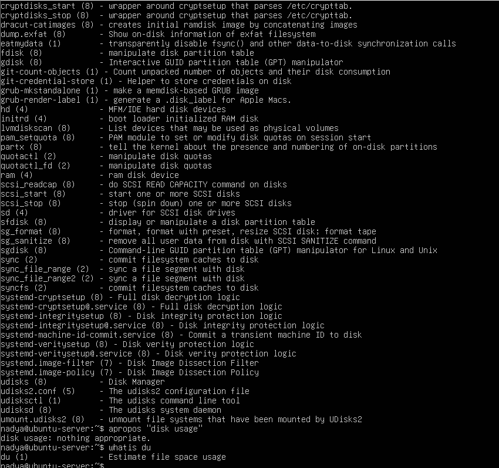

7 Для отримання інформації про поточного користувача використано команди: whoami, id, groups, sudo -l. whoami — показує ім’я поточного користувача. id — відображає UID, основний GID і додаткові групи користувача. groups — показує групи, до яких належить користувач. sudo -l — виводить перелік команд, які користувач може виконувати через sudo, відповідно до налаштувань системи. UID — це числовий ідентифікатор користувача, а GID — ідентифікатор основної групи. Членство в групі sudo в Ubuntu зазвичай дає змогу виконувати дозволені адміністративні команди з підвищеними правами після автентифікації. Для перевірки доступу до файла /etc/shadow використано: head -1 /etc/shadow, sudo head -1 /etc/shadow. Файл /etc/shadow містить захищені відомості про паролі та параметри їхньої дії. Звичайний користувач зазвичай не має дозволу читати цей файл безпосередньо, тому перша команда повинна завершитися повідомленням про відмову в доступі. Друга команда виконується з адміністративними правами, якщо користувач має відповідні дозволи й успішно проходить автентифікацію. Отже, використання sudo дає змогу виконувати дозволені адміністративні дії, не працюючи постійно від імені суперкористувача.

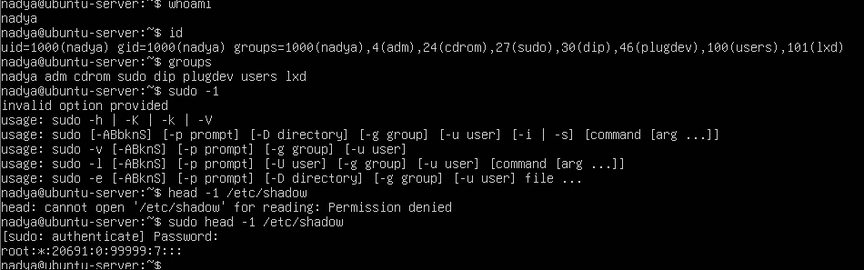

8 Процес — це екземпляр запущеної програми, який має власний ідентифікатор PID. Для перегляду списку процесів використано: ps aux. Команда показує запущені процеси, зокрема ім’я користувача, PID, використання ресурсів і назву команди. Ключі a, u та x розширюють перелік процесів, які відображаються, і додають детальніші відомості. Щоб визначити процес із PID 1, виконано: ps -p 1 -o pid,comm. Ключ -p 1 відбирає процес із PID 1, а -o pid,comm визначає стовпці, які потрібно показати: ідентифікатор процесу та його назву. У стандартній системі Ubuntu з systemd процесом із PID 1 зазвичай є systemd. Він відповідає за ініціалізацію системи та керування службами. Для перегляду запущених служб використано: systemctl list-units --type=service --state=running --no-pager. Команда відображає служби, які перебувають у стані running. Ключ --type=service обмежує результат службами, --state=running відбирає активні служби, а --no-pager виводить результат без інтерактивного переглядача. Для дослідження служби SSH використано: systemctl status ssh --no-pager. Ця команда показує стан служби SSH, її завантаження, активність і пов’язану інформацію журналу. Служба SSH забезпечує віддалене підключення до комп’ютера через протокол Secure Shell. Якщо openssh-server не встановлений, його можна встановити командою: sudo apt update, sudo apt install openssh-server. Перша команда оновлює інформацію про доступні пакети, а друга встановлює сервер OpenSSH. Після цього стан служби перевіряють повторно. У деяких версіях Ubuntu SSH може використовувати активацію через сокет ssh.socket. Це означає, що systemd може очікувати на мережеве підключення через сокет і запускати сервер за потреби. Тому стан ssh.service не завжди сам по собі свідчить про відсутність можливості підключення: необхідно також перевірити стан ssh.socket. 

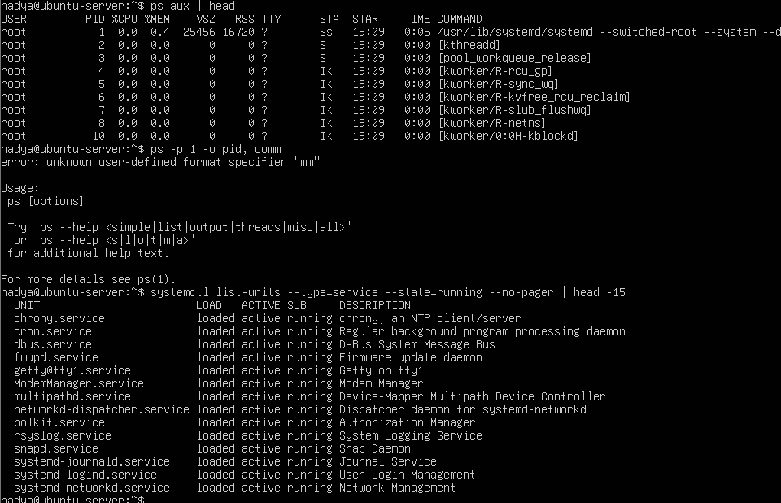

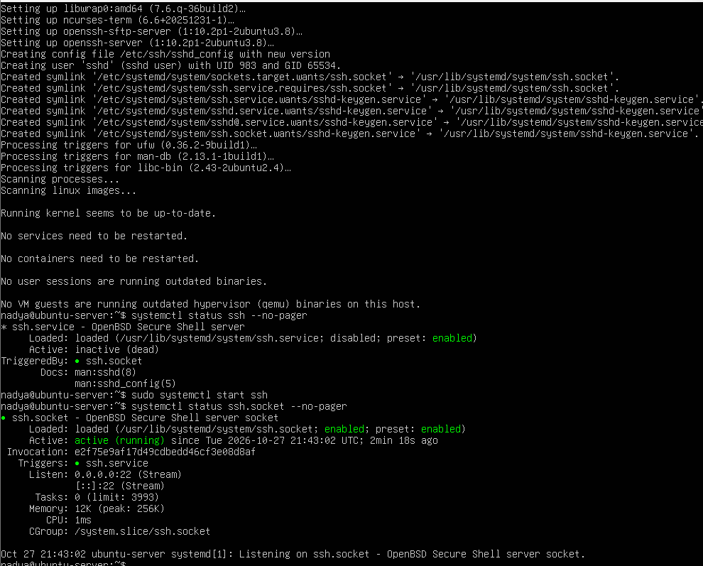

9 Каталог /proc є віртуальною файловою системою Linux, через яку можна отримувати інформацію про ядро, процеси та стан системи. Більшість даних у ній формується динамічно, а не зберігається як звичайні файли на диску. Для дослідження використано такі команди: cat /proc/version, grep -m1 "model name" /proc/cpuinfo, cat /proc/loadavg. Команда cat /proc/version показує інформацію про версію ядра. Команда grep -m1 "model name" /proc/cpuinfo знаходить перший рядок із назвою моделі процесора. Ключ -m1 обмежує кількість знайдених збігів одним. Команда cat /proc/loadavg виводить показники середнього системного навантаження за різні проміжки часу та додаткові дані про процеси. Отримані результати дають змогу дізнатися версію ядра, модель процесора та поточне навантаження системи. Файли в /proc не займають відповідного обсягу місця на диску, оскільки це не звичайні файли, а представлення даних, які ядро формує в оперативній пам’яті. Інформація в них може змінюватися під час роботи системи. 

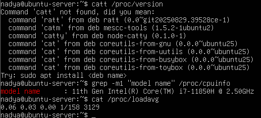

## Додаткове завдання

Запитання: Чому каталог /root не розташований усередині /home?
Каталог /root є домашнім каталогом суперкористувача root, який має адміністративні права в системі. Каталог /home призначений для зберігання домашніх каталогів звичайних користувачів. Таке розташування є навмисним. Каталог /root знаходиться безпосередньо в корені файлової системи /, щоб домашнє середовище адміністратора було доступним незалежно від окремого монтування /home. Якщо /home розміщено на окремому розділі, він може бути недоступним під час певних етапів завантаження або відновлення системи. Водночас /root залишається частиною кореневої файлової системи. Крім того, таке розділення допомагає відокремити файли адміністратора від особистих файлів звичайних користувачів і відповідає стандартній організації каталогів Linux. Для перевірки розташування каталогів використано: ls -ld /home /root, ls -la /home, sudo ls -la /root. Отже, /root і /home мають різне призначення, а їхнє розташування забезпечує зручність адміністрування та організації файлової системи. 

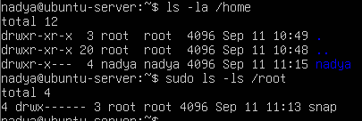

## Відповіді на контрольні питання

## Достатній рівень

1 Поясніть, як принцип «все є файлом» спрощує написання системних утиліт. Проілюструйте на прикладі читання відомостей про процесор.

Принцип «все є файлом» означає, що багато системних ресурсів Linux можна переглядати через файлову систему. Завдяки цьому програми можуть використовувати звичайні засоби читання даних, не звертаючись до кожного ресурсу окремим способом. Наприклад, інформацію про процесор можна отримати командою: cat /proc/cpuinfo. Файл /proc/cpuinfo містить відомості про процесор, які формує ядро. Для пошуку назви моделі можна використати команду: grep -m1 "model name" /proc/cpuinfo. Отже, цей принцип спрощує роботу із системною інформацією, оскільки дає змогу використовувати стандартні команди для читання та обробки даних.

2 Два комп’ютери мають однакову версію дистрибутива, але різні версії ядра. Назвіть щонайменше три наслідки цієї різниці для адміністратора.

Різні версії ядра можуть мати такі наслідки: Сумісність з обладнанням. Новіше ядро може підтримувати пристрої, які не працюють або працюють неправильно зі старішим ядром. Безпека. У новіших версіях можуть бути виправлені вразливості, виявлені в попередніх версіях. Продуктивність. Можуть відрізнятися алгоритми керування пам’яттю, процесами та дисковими операціями. Сумісність із драйверами та модулями. Деякі модулі можуть потребувати повторного збирання або оновлення після зміни ядра. Діагностика несправностей. Адміністратору потрібно враховувати версію ядра під час пошуку причин помилок. Тому навіть за однакового дистрибутива адміністратор повинен перевіряти версію ядра та сумісність програмного забезпечення.

3 Сформулюйте критерії вибору дистрибутива для навчального класу й обґрунтуйте кожен із них.

Під час вибору дистрибутива для навчального класу потрібно враховувати такі критерії: Простота використання. Система повинна бути зрозумілою студентам і викладачам. Стабільність. Важливо, щоб система надійно працювала під час занять і виконання лабораторних робіт. Сумісність з обладнанням. Дистрибутив повинен підтримувати комп’ютери, мережеві пристрої та периферію навчального класу. Наявність програм. Потрібні навчальні середовища, редактори коду, компілятори та інші інструменти. Безпека й оновлення. Система має отримувати виправлення помилок і вразливостей. Вартість. Бажано, щоб використання та встановлення системи не потребували значних витрат. Зручність адміністрування. Важливо мати можливість швидко налаштовувати, оновлювати й відновлювати комп’ютери. На мою думку, для навчального класу доцільно вибирати стабільний дистрибутив із тривалою підтримкою, широкою сумісністю та доступними навчальними матеріалами.

4 Система завантажилася, але одна зі служб не працює. Опишіть послідовність дій із використанням systemctl і journalctl та поясніть, що саме ви шукаєте на кожному кроці.

Спочатку потрібно перевірити стан несправної служби: systemctl status назва-служби Ця команда показує, чи запущена служба, її стан і короткі повідомлення про помилки. Далі можна переглянути журнал конкретної служби: journalctl -u назва-служби --no-pager Команда показує записи журналу, пов’язані з цією службою. У них потрібно шукати повідомлення про помилки, проблеми з правами доступу, відсутні файли або невдалі спроби запуску. Після цього можна спробувати перезапустити службу: sudo systemctl restart назва-служби. Потім необхідно повторно перевірити її стан:systemctl status назва-служби. Якщо проблема залишається, варто переглянути останні записи журналу: journalctl -u назва-служби -n 50 --no-pager. Ключ -n 50 показує останні 50 записів. Під час діагностики важливо спочатку з’ясувати причину помилки, а не лише перезапускати службу. Якщо служба не запускається, потрібно перевірити її конфігурацію, залежності, права доступу та наявність необхідних файлів.

## Висновок
На лабораторній роботі я ознайомилася з будовою операційної системи Linux на практиці: навчилася визначати версію ядра й дистрибутива, орієнтуватися в структурі каталогів, працювати з базовими командами оболонки, отримувати довідку штатними засобами, спостерігати за процесами та станом служб systemd.
