<!--
  Принципи функціонування ОС Linux
  Варіант 9: Тип віртуалізації — `/sys`, `/dev`, `/boot` — `uname` — `cron` — Пояснити, як система визначає, що працює у ВМ

  Тему, мету й обладнання писати не треба — конвеєр візьме їх із лабораторної.
  Знімки екрана кладіть у assets/, вихідний код — у src/.
  Контрольні питання — лише одного рівня, того, на який захищаєте роботу:
  заголовок «### Достатній рівень», далі «1 Текст питання?» і відповідь.
  Покрокова інструкція — reports/README.md
-->

## Хід роботи

1 Склав паспорт системи: версія ядра 7.0.0-42-generic, назва та версія дистрибутива Ubuntu 26.04.1 LTS, архітектура x86-64, ім'я вузла krindlok-VirtualBox, тип віртуалізації oracle, час роботи системи 6 minutes. Скористався командами uname, /etc/os-release, hostnamectl, uptime.

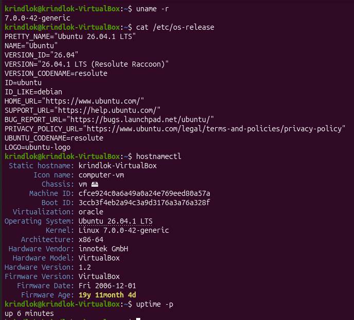

2 Знайшов й записав значення параметра системи, зазначеного в моєму варіанті.

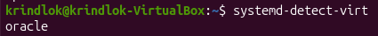

3 Вивів перелік каталогів кореня.

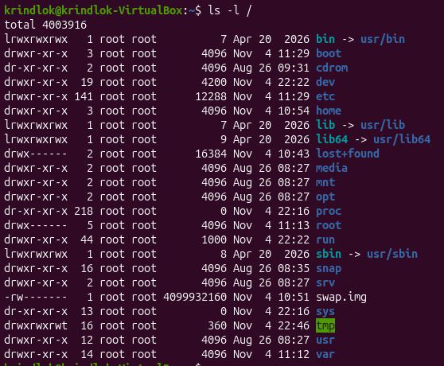

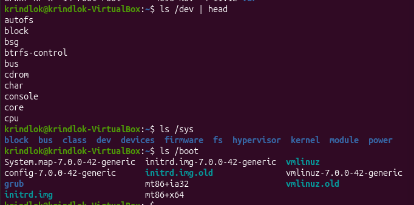

Таблиця 1 - Призначення за стандартом FHS та приклади файлів

|Каталог|Призначення за FHS|Приклад файлу|
|-------|------------------|-------------|
|/sys|віртуальна ФС (sysfs): інформація ядра про пристрої, драйвери, шини	|/sys/class/dmi/id/product_name|
|/dev|файли пристроїв (блокові та символьні)|/dev/null, /dev/sda|
|/boot|статичні файли завантажувача: ядро, initrd, конфігурація GRUB|/boot/vmlinuz-6.8.0-*-generic|

4
```bash
type uname        # uname is /usr/bin/uname → НЕ вбудована в оболонку
whereis uname     # або: which uname → /usr/bin/uname
whatis uname      # uname (1) - print system information
```
Три ключові опції:
```bash
uname -r    # випуск (версія) ядра
uname -m    # архітектура апаратної платформи
uname -a    # вся інформація одним рядком
```
(також -s — назва ядра, -n — ім'я вузла, -o — ОС)

5 Знайшов засобами довідки команду, яка виконує задачу, зазначену в моєму варіанті (скористався apropos). Спочатку шукав за virtualization, результату не було. Потім скоротив запит до кореня слова virtual і знайшов systemd-detect-virt. Це добре показує, що apropos працює за збігом підрядка в короткому описі.

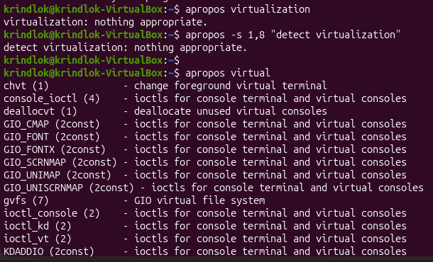

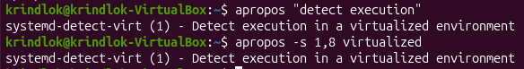

6 Вивів відомості про власний обліковий запис: UID, GID, групи. Членство в групі sudo дозволяє виконувати команди від імені root через sudo (правило %sudo ALL=(ALL:ALL) ALL у /etc/sudoers) після введення власного пароля. Без sudo /etc/shadow недоступний (читати може лише root і група shadow), з sudo показує хеші паролів.

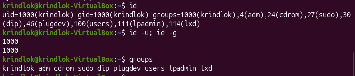

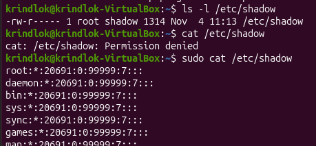

7 Отримав перелік процесів і визначив процес із PID 1. Вивів перелік служб у стані running і показав докладний стан служби свого варіанта.

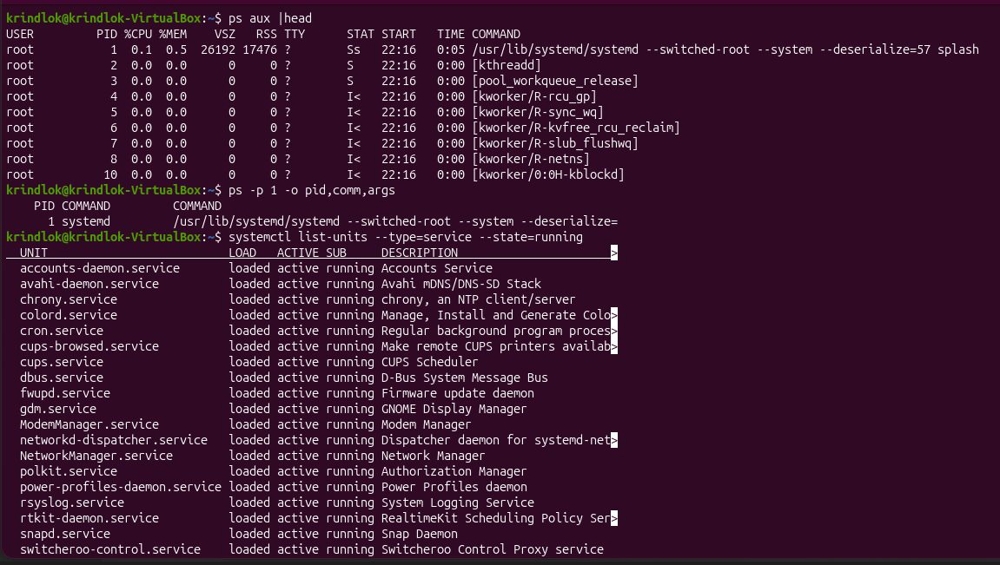

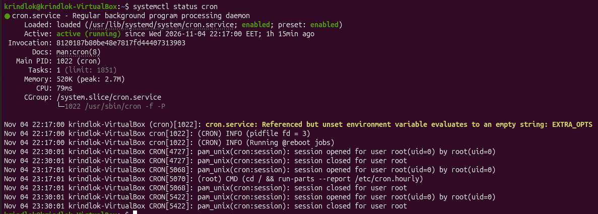

8 Отримав три показники стану системи з віртуальної файлової системи /proc. Розмір цих файлів показується як 0, а /proc змонтована як proc (procfs). Це віртуальна файлова система в оперативній пам'яті: вмісту на диску немає, ядро генерує його «на льоту» під час читання, тому місця на диску вони не займають.

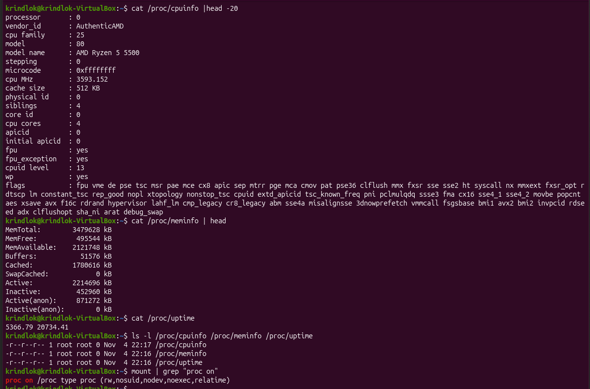

9 systemd-detect-virt перевіряє кілька ознак:

- CPUID: гіпервізор виставляє біт hypervisor (його видно як прапорець у /proc/cpuinfo), а за листом CPUID 0x40000000 повертає сигнатуру виробника (KVMKVMKVM, VBoxVBoxVBox, VMwareVMware, Microsoft Hv).
- DMI/SMBIOS у /sys/class/dmi/id/: поля sys_vendor, product_name містять QEMU, VirtualBox, VMware, Inc. тощо.
- Інші джерела: /sys/hypervisor/type (Xen), device tree, повідомлення ядра в dmesg.
- Для контейнерів: змінна container= у /proc/1/environ, файл /.dockerenv, структура cgroup.

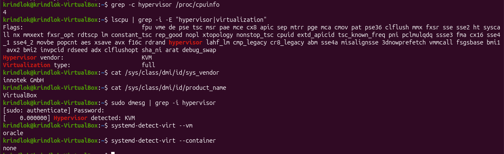

## Відповіді на контрольні питання

### Високий рівень (творчий)

1 Поясніть, як принцип «все є файлом» спрощує написання системних утиліт. Проілюструйте на прикладі читання відомостей про процесор.

Ядро надає доступ до файлів, пристроїв і системної інформації через єдиний інтерфейс файлової системи. Тому утиліті не потрібні спеціальні API для кожного об'єкта: достатньо звичайних операцій open, read, write, close. Приклад: відомості про процесор утиліта отримує простим читанням файлу.
```bash
cat /proc/cpuinfo
grep "model name" /proc/cpuinfo
```
lscpu теж просто читає /proc/cpuinfo і /sys. Такі файли можна обробляти стандартними grep, awk, cut і перенаправленням.

2 Два комп’ютери мають однакову версію дистрибутива, але різні версії ядра. Назвіть щонайменше три наслідки цієї різниці для адміністратора.

- Підтримка обладнання: новіше ядро має драйвери для нових пристроїв, на старому вони можуть не працювати.
- Безпека: різний набір виправлених вразливостей і різний термін підтримки.
- Сумісність модулів: зовнішні модулі (драйвери відеокарт, VirtualBox, DKMS) збираються під конкретну версію ядра й можуть не завантажитись.
- Також різні можливості ядра (файлові системи, cgroups, eBPF) і продуктивність.

3 Сформулюйте критерії вибору дистрибутива для навчального класу й обґрунтуйте кожен із них.

- Стабільність і LTS-підтримка (Ubuntu LTS, Debian): система не ламається посеред курсу.
- Низькі вимоги до ресурсів: клас може мати старі комп'ютери.
- Поширеність і документація: багато інструкцій, легко знайти відповіді.
- Менеджер пакетів і доступність ПЗ: зручне встановлення потрібних інструментів (apt).
- Безкоштовність і ліцензія: не потрібні витрати на ліцензії.
- Простота адміністрування: централізоване розгортання, зрозумілий інсталятор.

4 Система завантажилася, але одна зі служб не працює. Опишіть послідовність дій із використанням systemctl і journalctl та поясніть, що саме ви шукаєте на кожному кроці.

1. systemctl --failed: знайти, які саме юніти в стані failed.
2. systemctl status <служба>: перевірити Active, код завершення, останні рядки логу, чи увімкнена служба.
3. journalctl -u <служба> -b: переглянути повний журнал служби з поточного завантаження, шукаючи причину помилки (немає файлу, помилка конфігурації, порт зайнятий, немає прав).
4. journalctl -p err -b: перевірити загальні помилки системи, можливо причина в залежності (мережа, монтування).
5. systemctl list-dependencies <служба>: переконатися, що залежності запущені.
6. Виправити причину та перезапустити: sudo systemctl restart <служба>. За потреби sudo systemctl enable <служба>.
7. Перевірити результат повторно: systemctl status <служба>.

## Висновок

У ході лабораторної роботи я дослідив ОС Ubuntu засобами командного рядка: склав паспорт системи (uname, hostnamectl, /etc/os-release) і визначив тип віртуалізації за допомогою systemd-detect-virt. Розглянув призначення каталогів /sys, /dev, /boot за стандартом FHS, з'ясував, що uname не вбудована в оболонку, і навчився шукати команди через apropos та whatis. Дослідив обліковий запис, роль групи sudo, процеси та службу cron через systemctl. Також з'ясував, що файли /proc не займають місця на диску, бо це віртуальна ФС у пам'яті, а ВМ визначається за прапорцем hypervisor, даними DMI та іншими ознаками.