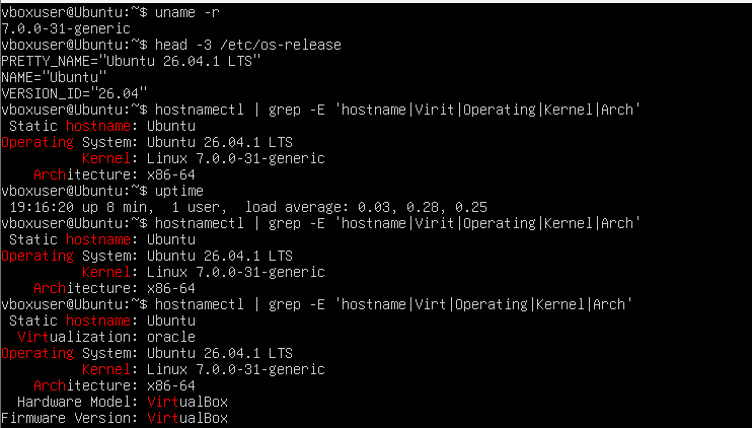
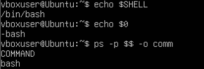
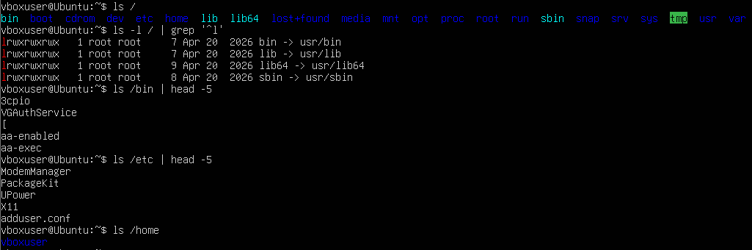
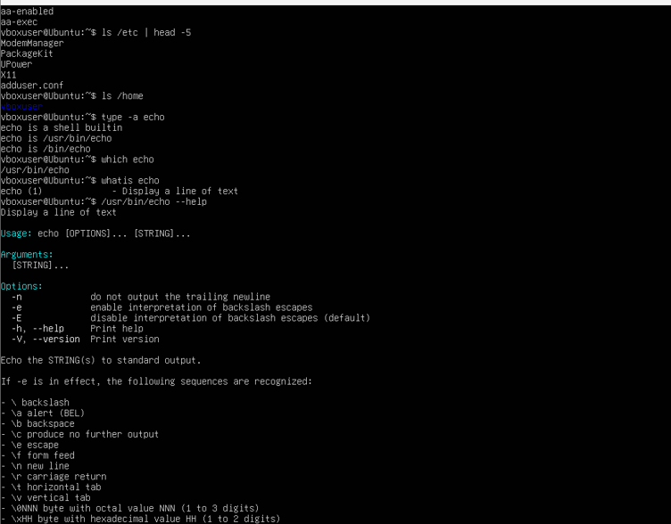
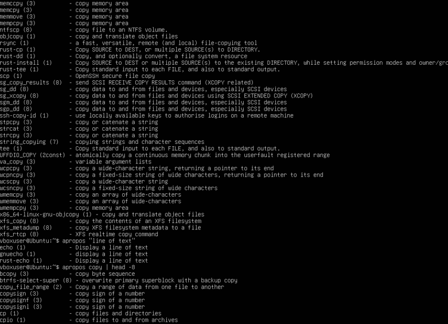
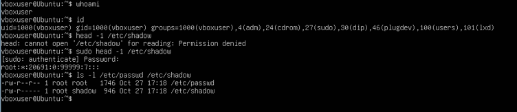
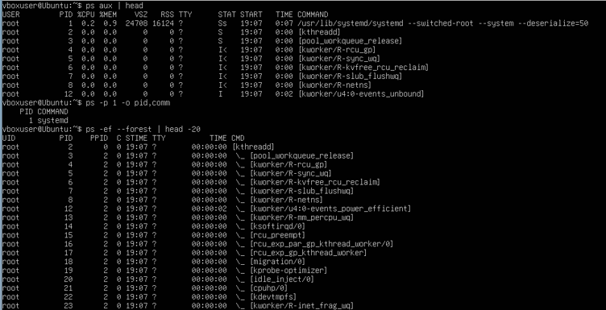
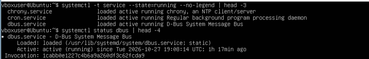
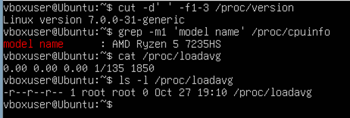
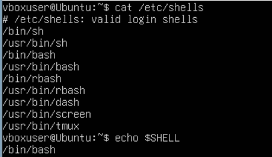

<!--
  Принципи функціонування ОС Linux
  Варіант 11: Ім'я поточної оболонки — `/bin`, `/etc`, `/home` — `echo` — `dbus` — Вивести перелік доступних оболонок системи

  Тему, мету й обладнання писати не треба — конвеєр візьме їх із лабораторної.
  Знімки екрана кладіть у assets/, вихідний код — у src/.
  Контрольні питання — лише одного рівня, того, на який захищаєте роботу:
  заголовок «### Достатній рівень», далі «1 Текст питання?» і відповідь.
  Покрокова інструкція — reports/README.md
-->

## Хід роботи

1 Отримала в викладача номер індивідуального варіанта 11.

2 Склала паспорт системи в терміналі Ubuntu. Командою uname -r визначила версію ядра: 7.0.0-31-generic. Командою head -3 /etc/os-release визначила назву та версію дистрибутива: Ubuntu 26.04.1 LTS (VERSION_ID 26.04). Командою hostnamectl з фільтром grep визначила ім'я вузла: Ubuntu, архітектуру: x86-64 та тип віртуалізації: oracle, тобто система працює у VirtualBox. Командою uptime перевірила час роботи системи: 8 хвилин (19:16:20). Версія ядра 7.0.0 і версія дистрибутива 26.04 не збігаються, бо перша належить проєкту Linux, а друга — Canonical. 

3 Визначила ім'я поточної оболонки в терміналі. Командою echo $SHELL отримала шлях до оболонки користувача за замовчуванням: /bin/bash. Командою echo $0 визначила ім'я оболонки, у якій виконуються команди: -bash (дефіс на початку означає, що це оболонка входу, login shell). Командою ps -p $$ -o comm підтвердила, що процес поточної оболонки має ім'я bash, де $$ — PID самої оболонки. Отже, поточна оболонка — bash, що відповідає типовій інтерактивній оболонці сучасних дистрибутивів.

4 Вивела перелік каталогів кореня командою ls /. Командою ls -l / | grep ‘^l’ перевірила, які з них є символьними посиланнями: /bin -> usr/bin, /lib -> usr/lib, /lib64 -> usr/lib64, /sbin -> usr/sbin. Це наслідок об'єднання /usr (usrmerge). Каталог /bin за стандартом FHS містить виконувані файли команд, доступних усім користувачам; приклади файлів: aa-enabled, aa-exec (команда ls /bin | head -5). Каталог /etc призначений для текстових файлів конфігурації системи та служб; приклад файлу: adduser.conf (команда ls /etc | head -5). Каталог /home містить домашні каталоги користувачів; командою ls /home виявила домашній каталог користувача vboxuser. 

5 Дослідила команду echo. Командою type -a echo визначила, що echo є вбудованою командою оболонки (echo is a shell builtin), а також існує як окрема програма: /usr/bin/echo та /bin/echo (це той самий файл, оскільки /bin є символьним посиланням на /usr/bin). Командою which echo визначила шлях до виконуваного файлу: /usr/bin/echo. Командою whatis echo отримала однорядковий опис: echo (1) — Display a line of text. Командою /usr/bin/echo --help переглянула ключі програми, три з них: -n — не виводити символ нового рядка наприкінці виводу; -e — вмикати інтерпретацію керувальних послідовностей зі зворотною скісною рискою (наприклад, \n — новий рядок, \t — табуляція); -E — вимикати інтерпретацію таких послідовностей (діє за замовчуванням). 

6 Знайшла засобами довідки команду, яка виводить рядок тексту. Командою apropos “line of text” виконала пошук за словами в описі сторінок man. У результаті з'явилися echo (1), gnuecho (1) та rust-echo (1) з описом «Display a line of text», тобто потрібну задачу виконує команда echo. Для порівняння командою apropos copy знайшла команди копіювання, зокрема cp (1) — copy files and directories, scp (1) — OpenSSH secure file copy, rsync (1) — a fast, versatile, remote (and local) file-copying tool. Отже, apropos шукає введене слово в однорядкових описах усіх сторінок man, тому пошук потрібно виконувати англійськими словами. 

7 Вивела відомості про власний обліковий запис. Командою whoami визначила поточного користувача: vboxuser. Командою id отримала UID 1000, GID 1000 і список груп: vboxuser, adm, cdrom, sudo, dip, plugdev, users, lxd. Членство в групі sudo дає право виконувати окремі команди з правами адміністратора через sudo, не входячи в систему під root; факт підвищення прав записується в журнал. Різницю доступу до файлу /etc/shadow показала так: команда head -1 /etc/shadow без sudo завершилася повідомленням Permission denied, а sudo head -1 /etc/shadow після введення пароля вивела рядок root:*:20691:0:99999:7:::. Командою ls -l /etc/passwd /etc/shadow перевірила права: /etc/passwd (-rw-r--r--) читають усі, бо програмам потрібно перетворювати UID на імена, а /etc/shadow (-rw-r-----, власник root, група shadow) з хешами паролів читає лише root і група shadow. Зірочка в полі пароля root означає, що вхід під root паролем вимкнено. Ядро перевіряє права під час кожного відкриття файлу. 

8 Отримала перелік процесів командою ps aux | head. Процес із PID 1 — /usr/lib/systemd/systemd, тобто systemd, який запускає решту процесів і служб та наглядає за ними. Командою ps -p 1 -o pid,comm підтвердила, що PID 1 має ім'я systemd. Командою ps -ef --forest | head -20 вивела дерево процесів: другий корінь дерева — процес kthreadd із PID 2, від якого походять потоки ядра, їхні імена ps показує у квадратних дужках (наприклад, [kworker/R-rcu_gp], [rcu_preempt]). Командою systemctl -t service --state=running --no-legend | head -3 вивела перелік служб у стані running; серед перших трьох: chrony.service (NTP-клієнт/сервер), cron.service (планувальник фонових завдань) та dbus.service (системна шина повідомлень D-Bus). Докладний стан служби свого варіанта переглянула командою systemctl status dbus | head -4: служба dbus.service має стан active (running) з 19:08:14 UTC за часом роботи 1 год 17 хв. У рядку Loaded видно, що опис служби лежить у звичайному текстовому файлі /usr/lib/systemd/system/dbus.service, а значення static означає, що служба не має власного розділу автозапуску й запускається systemd за потреби як залежність інших служб. Служба dbus.service забезпечує обмін повідомленнями між процесами системи.

9 Отримала три показники стану системи з віртуальної файлової системи /proc. Командою cut -d’ ‘ -f1-3 /proc/version визначила версію ядра: Linux version 7.0.0-31-generic. Командою grep -m1 ‘model name’ /proc/cpuinfo визначила модель процесора: AMD Ryzen 5 7235HS. Командою cat /proc/loadavg отримала середнє навантаження за 1, 5 і 15 хвилин (0.00 0.00 0.00), кількість виконуваних і всіх потоків (1/135) та PID, виданий найпізніше (1850). Командою ls -l /proc/loadavg перевірила розмір файлу: він дорівнює 0, хоча cat виводить дані. Файли в /proc не займають місця на диску, бо /proc є віртуальною файловою системою: ядро формує її вміст у пам'яті на момент читання, а на диску цих даних немає. Це наочна ілюстрація принципу «все є файлом». 

10 Виконала додаткове завдання: вивела перелік доступних оболонок системи. Командою cat /etc/shells переглянула текстовий файл, у якому зберігається перелік допустимих оболонок входу: /bin/sh, /usr/bin/sh, /bin/bash, /usr/bin/bash, /bin/rbash, /usr/bin/rbash, /usr/bin/dash, /usr/bin/screen, /usr/bin/tmux. Шляхи /bin/... і /usr/bin/... вказують на ті самі програми, бо /bin є символьним посиланням на /usr/bin. Серед оболонок: bash — основна інтерактивна оболонка, rbash — її обмежена версія, dash — легка оболонка для виконання сценаріїв, sh — стандартна оболонка POSIX, а screen і tmux — це мультиплексори терміналів, які також внесено до цього переліку. Командою echo $SHELL перевірила, яка оболонка використовується зараз: /bin/bash. Отже, оболонка — звичайна програма, яку можна замінити іншою зі списку. 

11 Оформила звіт і зробила висновок.

## Відповіді на контрольні питання

### Високий рівень (творчий)

1 Поясніть, як принцип «все є файлом» спрощує написання системних утиліт. Проілюструйте на прикладі читання відомостей про процесор.

Якби кожен тип об'єкта мав власний інтерфейс, для процесора, пам'яті, процесів і дисків довелося б вивчати окремі виклики. У Linux усе доступне через єдиний набір операцій: open, read, write, close. Утиліті потрібно лише відкрити файл і прочитати текст, спеціальні бібліотеки не потрібні. Через це ж ті самі команди cat, grep і cut працюють і зі звичайним текстом, і з відомостями про ядро.

Приклад із лабораторної роботи: відомості про процесор ядро надає у файлі /proc/cpuinfo. Команда grep -m1 'model name' /proc/cpuinfo вивела в мене model name : AMD Ryzen 5 7235HS. Тобто для читання моделі процесора вистачило звичайного пошуку по тексту. Так само працюють ps і top, які читають каталоги /proc/PID, та free, який читає /proc/meminfo. Ще один плюс: результат можна передати конвеєром (|) іншій програмі або зберегти у файл. Єдине застереження: принцип не абсолютний. Мережеві інтерфейси, наприклад, файлів у /dev не мають.

2 Два комп’ютери мають однакову версію дистрибутива, але різні версії ядра. Назвіть щонайменше три наслідки цієї різниці для адміністратора.

1) Підтримка обладнання. Нове ядро містить драйвери для новішого заліза (процесори, мережеві та відеокарти), старе може не розпізнати пристрій або працювати з ним гірше.
2) Безпека. Різні версії ядра мають різний набір виправлених вразливостей, тому на одному комп'ютері діра може бути закрита, а на іншому ні. Оновлення ядра потребує перезавантаження.
3) Системні можливості. Від ядра залежать підтримувані файлові системи, механізми контейнерів (cgroups, простори імен) та інші функції, тому одна й та сама програма чи налаштування можуть поводитися по-різному.
4) Модулі ядра. Сторонні модулі (наприклад, драйвери VirtualBox чи відеокарт) збираються під конкретну версію ядра і після його зміни потрібно їх перебудовувати.
5) Діагностика й підтримка. Поведінка та формат відомостей у /proc і /sys можуть відрізнятися, тому інструкції та скрипти не завжди переносяться між машинами без перевірки.

Звідси висновок: версія ядра відповідає за підтримку обладнання й системні можливості, а версія дистрибутива за склад програм і термін підтримки.

3 Сформулюйте критерії вибору дистрибутива для навчального класу й обґрунтуйте кожен із них.

1) Тривалий термін підтримки (LTS). Систему ставлять на весь навчальний рік чи більше, і не хочеться переустановлювати її посеред курсу. Оновлення безпеки мають надходити весь цей час.
2) Стабільність і передбачуваність оновлень. Усі студенти мають бачити однакові версії програм і однакову поведінку команд, інакше лабораторні роботи розходитимуться з інструкціями.
3) Вимоги до обладнання. Класні комп'ютери часто старі, тож дистрибутив повинен працювати на наявному залізі, зокрема у віртуальних машинах (як VirtualBox у нашій роботі).
4) Простота встановлення та адміністрування. Викладачеві потрібно швидко розгорнути десятки однакових машин, а початківцям комфортно працювати з системою (графічне середовище, зрозумілий менеджер пакетів).
5) Наявність пакетів і документації. Велика репозиторій програм та активна спільнота дають змогу швидко вирішувати проблеми й знаходити навчальні матеріали.
6) Вільна ліцензія та відсутність витрат. Установка на всі комп'ютери не потребує закупівлі ліцензій.
7) Відповідність реальному середовищу. Дистрибутив, поширений у виробництві (Ubuntu, Debian, Fedora/RHEL-сімейство), дає навички, які студенти застосують на практиці. Структура каталогів за стандартом FHS майже однакова, тому знання переносяться між дистрибутивами.

4 Система завантажилася, але одна зі служб не працює. Опишіть послідовність дій із використанням systemctl і journalctl та поясніть, що саме ви шукаєте на кожному кроці.

1) systemctl status ім'я. Дивлюся на стан у рядку Active (active, inactive чи failed), на рядок Loaded (чи знайдено файл опису служби та чи ввімкнено автозапуск) і на кілька останніх рядків журналу, які команда показує внизу. Так розумію, чи служба взагалі запускалась і чим завершилась.
2) systemctl list-units --type=service --state=failed. Дивлюся, чи не впали ще й інші служби, адже одна несправність може бути причиною іншої (залежності).
3) journalctl -u ім'я. Читаю повний журнал саме цієї служби. Шукаю повідомлення про помилки: відсутній файл, неправильний параметр у конфігурації, зайнятий порт, брак прав.
4) journalctl -b -p err. Дивлюся всі помилки з моменту завантаження. Це допомагає знайти причину поза самою службою, наприклад проблему з диском чи мережею, з якої все почалося.
5) Перевірка конфігурації. Відкриваю файл у /etc, на який вказує журнал, та файл опису служби (у /usr/lib/systemd/system), перевіряю шляхи й параметри.
6) Виправлення та повторний запуск. Після виправлення виконую sudo systemctl restart ім'я.
7) Повторна перевірка. Знову systemctl status ім'я: очікую Active: active (running) і відсутність нових помилок у журналі.

## Висновок

На цій лабораторній роботі я ознайомилася з будовою операційної системи Linux на практиці:навчилася визначати версію ядра й дистрибутива, орієнтуватися в структурі каталогів, працювати з базовими командами оболонки, отримувати довідку штатними засобами, спостерігати за процесами та станом служб systemd.
