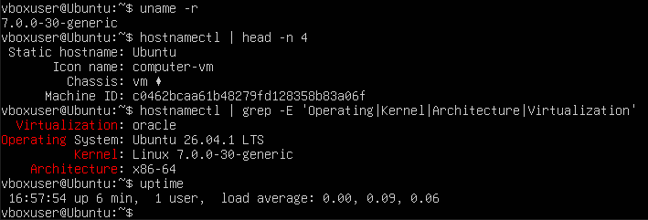
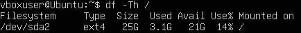
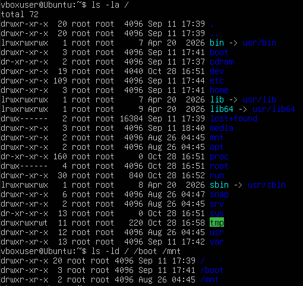
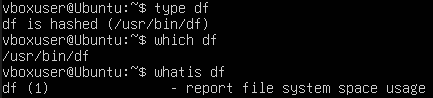
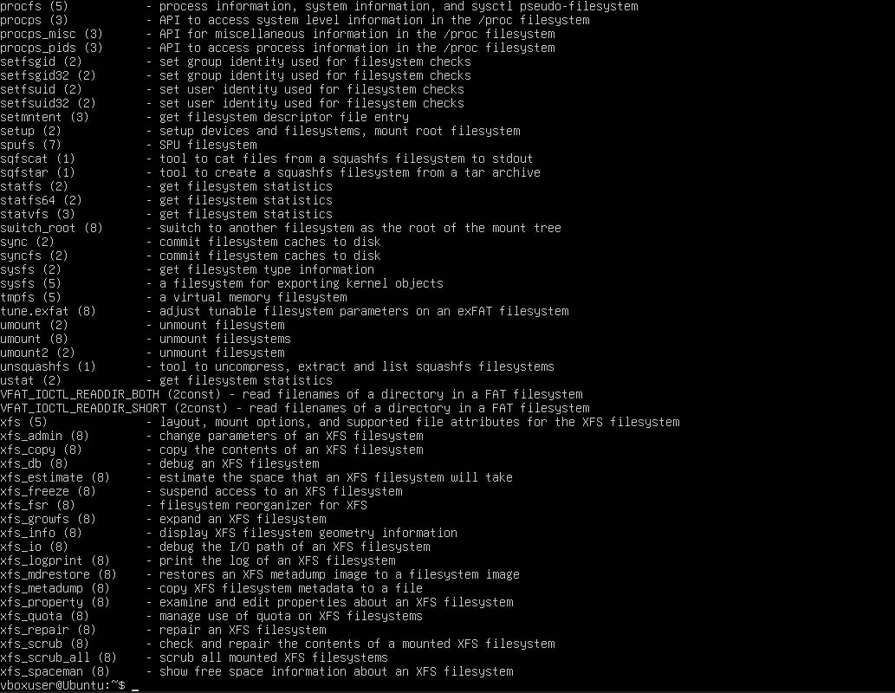
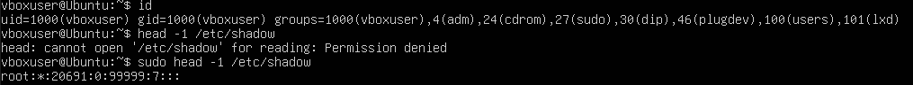
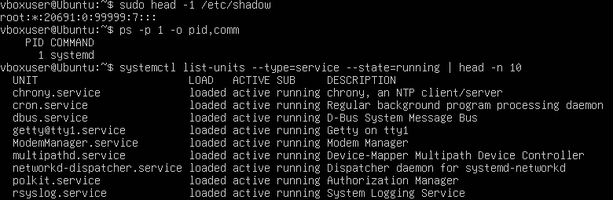
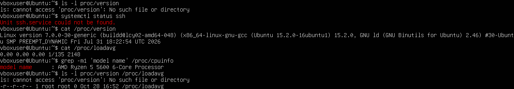

<!--
  Принципи функціонування ОС Linux
  Варіант 14: Файлова система кореневого розділу — `/`, `/boot`, `/mnt` — `df` — `ssh` — Пояснити призначення окремого розділу `/boot`

  Тему, мету й обладнання писати не треба — конвеєр візьме їх із лабораторної.
  Знімки екрана кладіть у assets/, вихідний код — у src/.
  Контрольні питання — лише одного рівня, того, на який захищаєте роботу:
  заголовок «### Достатній рівень», далі «1 Текст питання?» і відповідь.
  Покрокова інструкція — reports/README.md
-->

## Хід роботи

1 Отримав у викладача номер індивідуального варіанта 14.

2 Склав паспорт системи, використовуючи базові утиліти. За допомогою команд `uname -r`, `hostnamectl` та `uptime` я визначив і зафіксував версію ядра Linux 7.0.0-30-generic, точну назву та версію дистрибутива Ubuntu 26.04.1 LTS, архітектуру системи x86-64, ім’я вузла Ubuntu, тип віртуалізації oracle та загальний час безперервної роботи системи 6 хвилин.

3 Знайшов і записав значення параметра системи, зазначеного у моєму варіанті, а саме файлову систему кореневого розділу. Для цього я використав команду `df -Th /`, яка вивела інформацію про змонтовані файлові системи, де я побачив, що тип файлової системи кореневого розділу `/dev/sda2` — `ext4`.

4 Вивів перелік каталогів кореня за допомогою команди `ls -la /`, а також окремо перевірив `ls -ld / /boot /mnt`. Для зазначених у варіанті каталогів я визначив призначення за стандартом FHS: `/` — кореневий каталог системи, що містить усі інші директорії; `/boot` — містить статичні файли завантажувача, наприклад ядро та образ `initrd`; `/mnt` — точка для тимчасового монтування файлових систем.

5 Визначив властивості команди `df`. За допомогою `type df` перевірив, що вона хешована і не є вбудованою та розташована за шляхом `/usr/bin/df`, через `which df` знайшов абсолютний шлях до її виконуваного файлу, а за допомогою `whatis df` отримав її опис report file system space usage. Також я проаналізував три корисні ключі: `-h` для виведення розмірів у зрозумілому форматі, `-T` для показу типу файлової системи та `-a` для включення до виводу псевдофайлових систем розміром 0 блоків.

6 Знайшов засобами довідки команди, що стосуються роботи з файловими системами. Для цього я скористався утилітою пошуку за ключовими словами `apropos filesystem`, яка вивела великий перелік утиліт та системних викликів, зокрема інструменти `xfs`, серед яких можна обрати потрібний засіб для вирішення системної задачі.

7 Вивів відомості про власний обліковий запис за допомогою команди `id`, зафіксувавши свій UID 1000, GID 1000 та перелік груп, серед яких `adm`, `cdrom`, `sudo`. Пояснив, що членство в групі `sudo` надає привілеї на виконання адміністративних команд, що продемонстрував на практиці: спроба прочитати файл `head -1 /etc/shadow` без привілеїв завершилася помилкою Permission denied, тоді як виклик `sudo head -1 /etc/shadow` успішно показав перший рядок із хешем пароля root.

8 Отримав перелік процесів командою `ps -p 1 -o pid,comm` і визначив, що процес із PID 1 — це `systemd`. Вивів перелік служб у стані running за допомогою `systemctl list-units --type=service --state=running | head -n 10` та перевірив стан служби свого варіанта `ssh` командою `systemctl status ssh`, яка показала Unit ssh.service could not be found, оскільки в настільній Ubuntu цей пакет не встановлено за замовчуванням. Також пояснив, що в Ubuntu 24.04 служба SSH запускається через `ssh.socket` лише під час першого підключення через механізм socket activation, тому для виводу `systemctl status ssh` до цього моменту статус був би inactive dead.

9 Отримав три показники стану системи з віртуальної файлової системи `/proc`: версію ядра через `cat /proc/version`, середнє навантаження через `cat /proc/loadavg` та назву моделі процесора через `grep -m1 'model name' /proc/cpuinfo`. Перевіривши ці файли командою `ls -l`, пояснив, що вони не займають фізичного місця на диску і мають розмір 0 байт, оскільки `/proc` — це псевдофайлова система в оперативній пам'яті, яка генерується ядром динамічно для надання системної інформації.

10 Виконав додаткове завдання свого варіанта, пояснивши призначення окремого розділу `/boot`. Виокремлення `/boot` у власний розділ необхідне для того, щоб завантажувач, такий як GRUB, міг отримати доступ до ядра ОС та образу ініціалізації ще до того, як завантажаться драйвери для складних файлових систем, наприклад LVM, RAID або зашифрованих томів LUKS, на яких може знаходитися основний кореневий каталог `/`.

11 Оформив звіт та зробив загальний висновок.

## Відповіді на контрольні питання

### Високий рівень

1 Поясніть, як принцип «все є файлом» спрощує написання системних утиліт. Проілюструйте на прикладі читання відомостей про процесор.

Принцип «все є файлом» спрощує написання системних утиліт, оскільки дозволяє розробникам використовувати єдиний стандартний набір системних викликів вводу-виводу (відкрити, прочитати, закрити) замість створення складних унікальних драйверів для кожного пристрою. Наприклад, для отримання інформації про процесор утиліті не потрібно знати його низькорівневу архітектуру — достатньо просто прочитати текстовий псевдофайл `/proc/cpuinfo`, при зверненні до якого ядро динамічно згенерує потік із технічними даними, який легко обробити будь-яким стандартним інструментом для роботи з текстом.

2 Два комп’ютери мають однакову версію дистрибутива, але різні версії ядра. Назвіть щонайменше три наслідки цієї різниці для адміністратора.

Різні версії ядра при однаковому дистрибутиві призведуть для адміністратора до кількох суттєвих наслідків: по-перше, виникне різниця в підтримці апаратного забезпечення, оскільки новіше ядро розпізнає сучасну периферію чи відеокарти «з коробки», тоді як старе їх не побачить; по-друге, рівень безпеки машин відрізнятиметься через різну вразливість до специфічних експлойтів на рівні ядра (наприклад, новітніх CVE), що вимагатиме роздільного підходу до патчингу; по-третє, адміністратор зіткнеться з нерівномірною доступністю системних технологій, оскільки новіше ядро може підтримувати вдосконалені файлові системи або нові можливості віртуалізації та мережевого стека, які будуть недоступні на старій машині.

3 Сформулюйте критерії вибору дистрибутива для навчального класу й обґрунтуйте кожен із них.

Вибір дистрибутива для навчального класу має базуватися на кількох ключових критеріях: тривалому терміні підтримки (LTS), щоб гарантувати оновлення безпеки без ламання конфігурацій і потреби перевстановлювати ОС посеред навчального року; широті офіційних репозиторіїв для швидкого доступу до необхідних компіляторів та IDE через стандартний пакетний менеджер; легковаговості графічного середовища (наприклад, XFCE), оскільки навчальні аудиторії часто оснащені застарілим обладнанням, і ресурси краще економити для корисних задач; а також можливості централізованого управління, включно з нативною підтримкою мережевого завантаження (PXE), що критично важливо для зручного адміністрування десятків машин одночасно.

4 Система завантажилася, але одна зі служб не працює. Опишіть послідовність дій із використанням systemctl і journalctl та поясніть, що саме ви шукаєте на кожному кроці.

Для діагностики непрацюючої служби спочатку слід виконати `systemctl status <назва_служби>`, щоб здійснити базову оцінку, перевірити статус (наприклад, failed) та побачити останні рядки помилок, аби зрозуміти, чи служба взагалі намагалася стартувати; потім використати `systemctl is-enabled <назва_служби>` для перевірки конфігурації автозавантаження (шукаємо `enabled`), оскільки служба могла просто не отримати команди на старт під час запуску ОС; далі застосувати `journalctl -u <назва_служби> -b` для перегляду всіх журналів конкретної служби за поточне завантаження з метою пошуку точних кодів помилок чи скарг на відсутні конфіги; і насамкінець спробувати перезапустити її через `systemctl restart <назва_служби>`, паралельно відстежуючи логи в реальному часі командою `journalctl -fu <назва_служби>`, щоб зловити точний момент і причину повторного падіння.

## Висновок

Я ознайомився з будовою операційної системи Linux на практиці: навчився визначати версію ядра й дистрибутива, орієнтуватися в структурі каталогів, працювати з базовими командами оболонки, отримувати довідку штатними засобами, спостерігати за процесами та станом служб systemd
