<!--
  Файлова система та управління даними в Linux
  Варіант 6: `/etc/systemd` — каталоги на глибині 2 — `tar.gz` — Показати, що станеться з жорстким посиланням на іншій ФС

  Тему, мету й обладнання писати не треба — конвеєр візьме їх із лабораторної.
  Знімки екрана кладіть у assets/, вихідний код — у src/.
  Контрольні питання — лише одного рівня, того, на який захищаєте роботу:
  заголовок «### Достатній рівень», далі «1 Текст питання?» і відповідь.
  Покрокова інструкція — reports/README.md
-->

## Хід роботи

1 Номер індивідуального варіанта – 6.

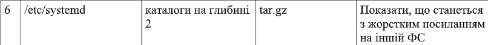

2 На початку роботи було створено робочий каталог ~/lab7 і чотири підкаталоги: src, docs, bak та mnt. Каталог src призначений для вихідних файлів, docs — для документів і посилань, bak — для резервних архівів, а mnt — для тимчасового монтування зовнішнього носія. Структуру каталогів було перевірено командою tree.

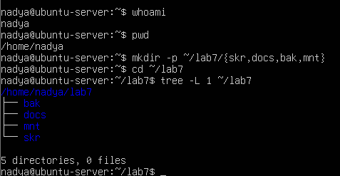

3 Для виконання лабораторної роботи було використано вихідний каталог /etc/systemd. За допомогою команди find визначено наявні звичайні файли, після чого три з них скопійовано до каталогу ~/lab7/src командою cp. Копіювання дозволило працювати з файлами в навчальному каталозі, не змінюючи оригінали системних конфігураційних файлів.

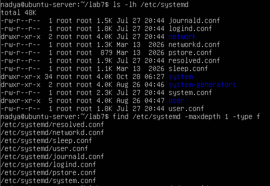

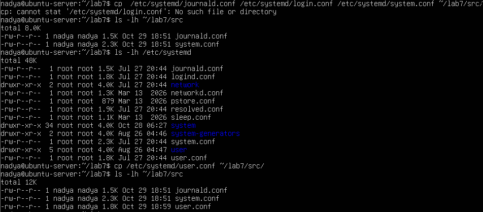

4 За допомогою команди `stat` було отримано метадані одного з файлів. Поле `Inode` містить номер структури, у якій зберігаються метадані файлу, `Links` показує кількість жорстких посилань на нього, а `Access` із числовими правами визначає дозволені дії власника, групи та інших користувачів. Командою `file` було визначено типи трьох скопійованих файлів за їхнім вмістом.

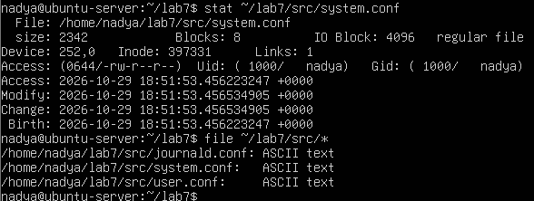

5 Для пошуку файлів було використано команду find з різними параметрами. За допомогою -name виконано пошук за іменем, -size — за розміром, а -mmin — за часом останньої зміни. Для пошуку тексту всередині файлів використано команду grep. Відповідно до індивідуального варіанта №6 окремо виконано команду find /etc/systemd -mindepth 2 -maxdepth 2 -type d. Вона призначена для пошуку каталогів, розташованих рівно на другому рівні вкладеності відносно початкового каталогу. Отримані результати підтверджують, що параметри пошуку дають змогу знаходити об'єкти за різними критеріями.

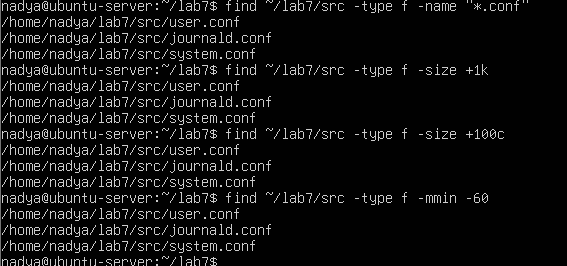

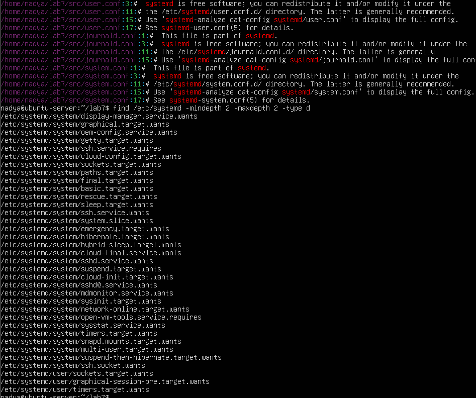

6 Під час роботи було створено жорстке та символічне посилання на один файл. За допомогою команди stat встановлено, що оригінал і жорстке посилання мають однаковий номер inode. Після видалення початкового імені дані залишилися доступними через жорстке посилання. Символічне посилання перестало працювати, оскільки зберігало шлях до видаленого імені. Таким чином, експеримент підтвердив відмінність між двома типами посилань.

| Характеристика | Жорстке посилання (`link-hard.txt`) | Символічне посилання (`link-soft.txt`) |
| --- | --- | --- |
| Команда створення | `ln ~/lab7/docs/link-test.txt ~/lab7/docs/link-hard.txt` | `ln -s link-test.txt ~/lab7/docs/link-soft.txt` |
| Номер inode | Jednakовий з оригіналом (`397353`) | Інший, унікальний (`397358`) |
| Вивід `ls -li` | `-rw-r--r-- 2 ... link-hard.txt` (лічильник посилань: 2) | `lrwxrwxrwx 1 ... link-soft.txt -> link-test.txt` |
| Після видалення оригіналу (`link-test.txt`) | Дані збережені й доступні (упішно читаються через `cat`) | Посилання стає «зламаним» (`No such file or directory`) |

: Таблиця 1 — Результати виконання

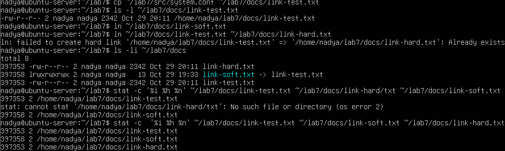

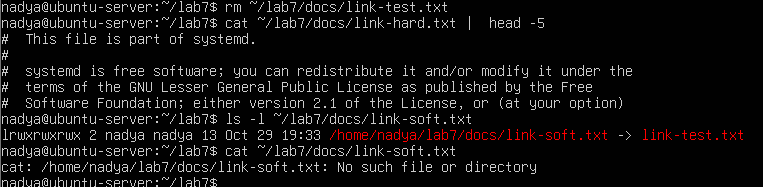

7 У ході роботи було виконано копіювання файлу командою cp і копіювання зі збереженням атрибутів за допомогою cp -p. Команда cp -p намагається зберегти права доступу та часові мітки вихідного файлу. Також за допомогою mv було переміщено тестовий файл до каталогу bak і перейменовано іншу копію. Результати перевірено командами ls та stat.

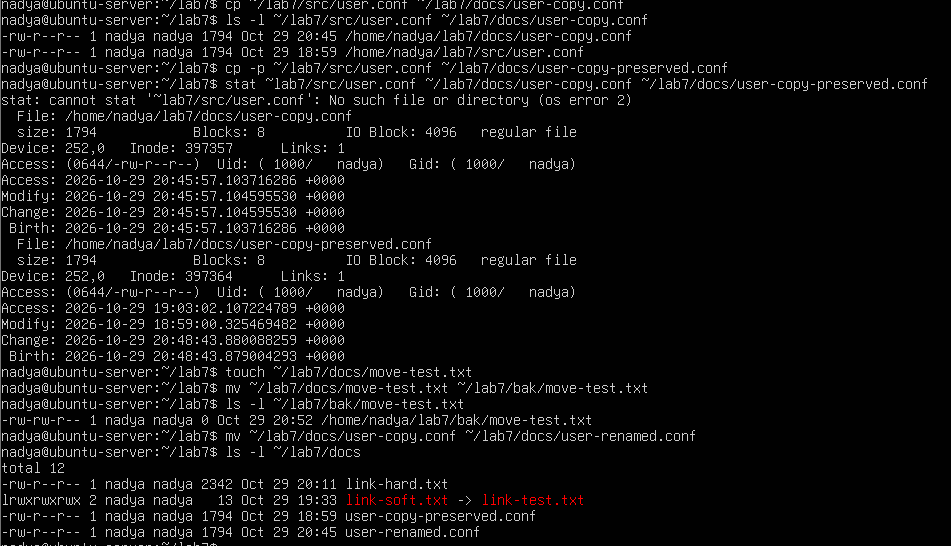

8 За допомогою команд `lsblk` і `blkid` було визначено пристрій, тип файлової системи та UUID. Носій змонтовано в каталог `~/lab7/mnt`. Командою `df -hT` перевірено загальний обсяг, використане та вільне місце. Після копіювання тестового файлу було виконано `sync` і `umount`. Команда `findmnt` підтвердила, що файлову систему відмонтовано.

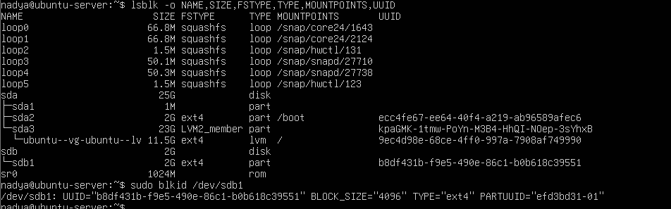

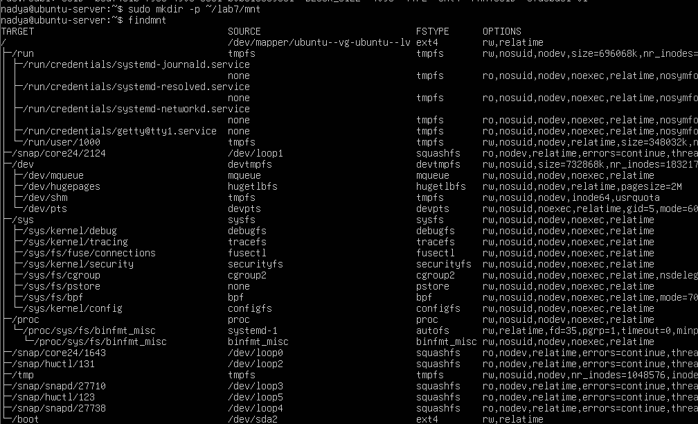

9 Для аналізу використання дискового простору було застосовано команди df -h, df -i та du. Команда df -h показує загальний обсяг файлових систем, використане й вільне місце в байтах. Команда df -i показує кількість використаних і вільних inode. Команда du дозволяє визначити обсяг дискового простору, зайнятого каталогами. За допомогою сортування результатів du було визначено найбільші підкаталоги /etc/systemd. Отримані результати дають змогу оцінити використання дискового простору та зрозуміти, чи є обмеження за обсягом даних або кількістю inode.

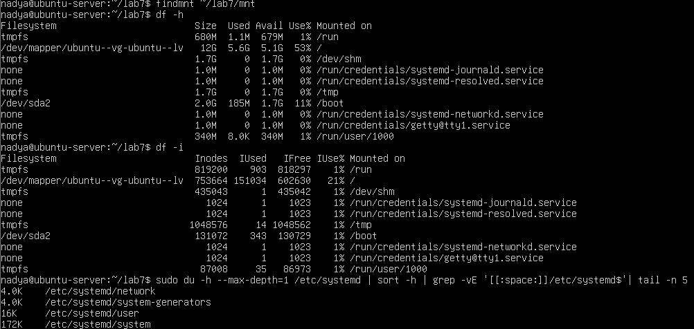

10 За допомогою команди tar -czvf було створено архів tar.gz, що містить каталоги src і docs. Командою tar -tzvf переглянуто вміст архіву без розпакування. Після цього архів було розпаковано до каталогу /tmp/lab7-restore, а результат перевірено командою tree. Було порівняно розмір вихідних даних і створеного архіву для оцінювання ефективності стиснення. Сумарний логічний обсяг вихідних даних становить 11514 байтів (каталог src — 5571 байт, каталог docs — 5943 байти), тоді як фактичний розмір створеного архіву дорівнює 1432 байтам. Це забезпечило коефіцієнт стиснення K≈8,04 та зменшення початкового обсягу даних приблизно на 87,56%. Отримані результати підтверджують високу ефективність алгоритму gzip для текстових файлів, які зазвичай стискаються набагато краще, ніж дані, що вже були попередньо стиснені.

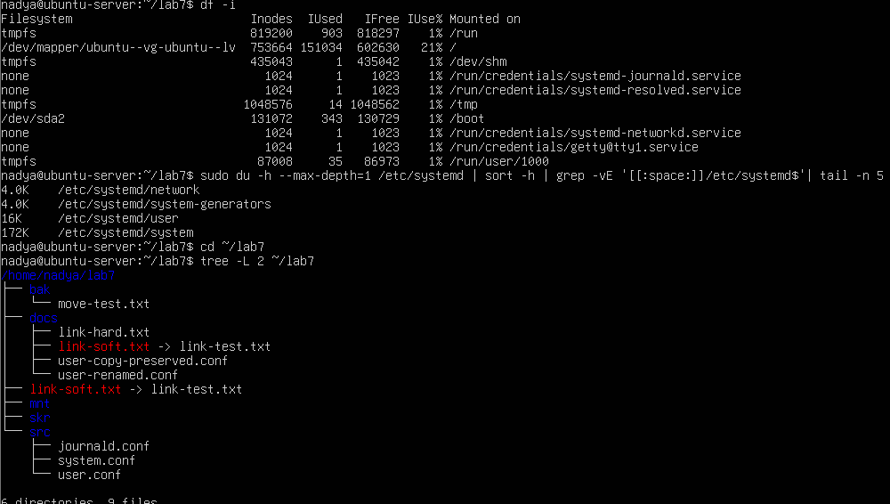

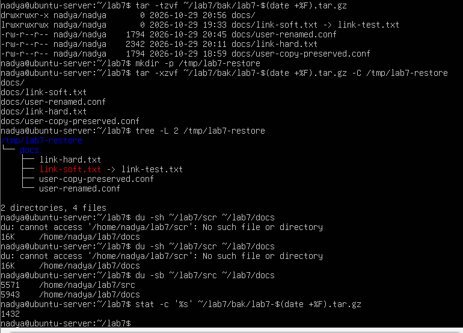

## Додаткове завдання

Було перевірено можливість створення жорсткого посилання на іншій файловій системі. За допомогою команди findmnt -T визначено файлові системи джерела (~/lab7/src/user.conf, що розташована на основній файловій системі ext4 на /dev/mapper/...) та призначення (~/lab7/mnt, змонтовану на окремому віртуальному диску /dev/sdb1). Під час спроби створити жорстке посилання між ними за допомогою команди ln система видала помилку Invalid cross-device link, зафіксувавши неможливість виконання операції між різними пристроями. Це пояснюється архітектурними обмеженнями ОС Linux: жорстке посилання посилається безпосередньо на індексний дескриптор (inode), який є унікальним виключно в межах однієї файлової системи і не може спільно використовуватися різними файловими системами чи пристроями.

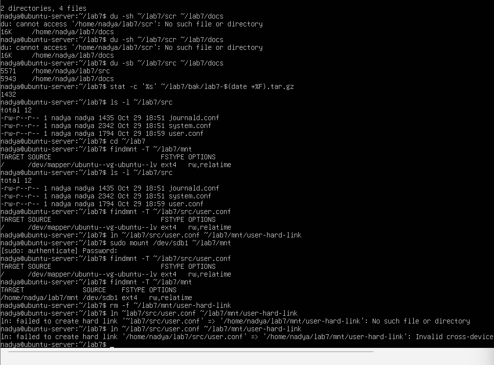

## Відповіді на контрольні питання

### Високий рівень (творчий)
1 Поясніть, які переваги для адміністрування дає єдине дерево каталогів із монтуванням, і наведіть сценарій, неможливий у моделі з літерами дисків.

У Linux усі файли та пристрої об'єднані в одному дереві каталогів, коренем якого є /. Додаткові диски, флешки та мережеві ресурси можна підключати до будь-якого каталогу за допомогою монтування. Це зручно для адміністрування, оскільки не потрібно запам'ятовувати літери дисків. Адміністратор може самостійно визначати, де саме буде доступний певний носій, і організовувати зберігання даних відповідно до потреб системи. Приклад: можна підключити окремий диск для журналів системи безпосередньо до каталогу /var/log. Тоді журнали зберігатимуться на окремому диску, а решта системи продовжуватиме працювати на основному. У Windows подібне також можна реалізувати через точки монтування NTFS, але звичайна модель літер дисків не забезпечує такої організації за замовчуванням.

2 Каталог із журналами заповнив увесь розділ. Опишіть послідовність дій із зазначенням команд на кожному кроці й поясніть, чому просте видалення файлу відкритим процесом не звільняє місце.

Якщо журнали заповнили весь розділ, спочатку потрібно визначити, скільки місця залишилося та які файли займають найбільше простору. Послідовність дій: 
1. Перевірити вільне місце: df -h. Команда показує загальний обсяг файлових систем, використане та вільне місце.
​2. Знайти найбільші файли журналів: sudo du -ah /var/log | sort -h | tail -10. Команда показує десять найбільших файлів і каталогів у /var/log.
3. Перевірити, які процеси використовують видалені файли: sudo lsof +L1. Команда допомагає знайти відкриті файли, які вже видалені з каталогів, але ще використовуються процесами.
4. Визначити процес, який утримує файл. Потрібно з'ясувати, який процес відкрив файл, і за можливості виконати штатне очищення або ротацію журналів за допомогою відповідного сервісу. Наприклад, для системного журналу: sudo journalctl --disk-usage Для обмеження розміру журналів: sudo journalctl --vacuum-size=500M. Ця команда видаляє старі архівні записи журналу, щоб загальний обсяг журналів не перевищував приблизно 500 МБ.
5. Повторно перевірити вільне місце: df -h.
Чому видалення відкритого файлу не завжди звільняє місце? У Linux файл може залишатися відкритим процесом навіть після видалення його імені з каталогу. У такому випадку система прибирає запис про файл, але його дані продовжують займати місце на диску, поки процес використовує файл. Місце звільняється після закриття файлу процесом і видалення останнього посилання на нього.

3 Запропонуйте схему резервного копіювання домашнього каталогу з кількома поколіннями копій. Обґрунтуйте вибір формату архіву та періодичність.

Для резервного копіювання домашнього каталогу я б запропонувала використовувати архіви формату tar.gz. Можна організувати таку схему:

| Покоління копій | Періодичність | Зберігання |
| --- | --- | --- |
| Щоденні | Щодня | Останні 7 копій |
| Щотижневі | Раз на тиждень | Останні 4 копії |
| Щомісячні | Раз на місяць | Останні 6 копій |

: Таблиця 2 — Схема резервного копіювання

Для створення архіву можна використовувати команду:
`tar -czvf backup-$(date +%F).tar.gz ~/`

Архів tar.gz зручний тим, що об'єднує багато файлів і каталогів в один файл та стискає їх. Також він зберігає структуру каталогів і метадані файлів. Щоб не втратити резервні копії разом із комп'ютером у разі несправності диска, їх потрібно зберігати на окремому носії або іншому комп'ютері. Я вважаю, що щоденне копіювання важливе для збереження останніх змін, щотижневе дає змогу повернутися до попереднього стану, а щомісячне допомагає зберігати більш тривалу історію даних.

4 Сформулюйте критерії вибору між жорстким посиланням, символічним посиланням і копією файлу. Проілюструйте кожен критерій прикладом із цієї роботи.

Вибір залежить від того, чи потрібно мати спільні дані, чи важливо зберегти доступ до файлу після переміщення оригіналу та чи потрібна незалежна копія. 

| Критерій | Жорстке посилання | Символічне посилання | Копія файлу |
| --- | --- | --- | --- |
| Спільний вміст | Так | Так, поки доступна ціль | Ні |
| Спільний inode | Так | Ні | Ні |
| Працює між різними ФС | Ні | Так | Так |
| Залежність від початкового імені | Ні | Так, від шляху до цілі | Ні |
| Окреме місце для даних | Ні | Лише для самого посилання | Так |

: Таблиця 3 — Порівняння способів зв'язування та копіювання

Жорстке посилання (ln) доцільно використовувати, коли потрібно мати декілька імен одного файлу в межах однієї файлової системи. Наприклад, у роботі було створено docs/hosts-hard, яке продовжило працювати навіть після видалення src/hosts. Символічне посилання (ln -s) зручно використовувати, коли потрібно створити посилання на файл за певним шляхом, зокрема на іншій файловій системі. У роботі було створено docs/hosts-soft, яке вказувало на ../src/hosts. Після видалення початкового файлу посилання перестало працювати. Копію (cp) варто використовувати, коли потрібен незалежний екземпляр файлу, який можна змінювати або зберігати окремо. Наприклад, під час виконання роботи файли з /etc/systemd копіювалися до ~/lab7/src. Завдяки цьому робочі файли можна було досліджувати, не змінюючи оригінали системної конфігурації.

## Висновок
На лабораторній роботі я навчилася працювати з файловою системою Linux засобами командного рядка: орієнтуватися в структурі FHS, виконувати повний цикл файлових операцій, шукати файли за різними критеріями, розрізняти жорсткі й символічні посилання, монтувати та відмонтовувати носії, аналізувати використання дискового простору й архівувати дані
