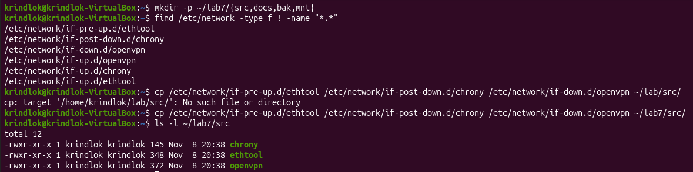
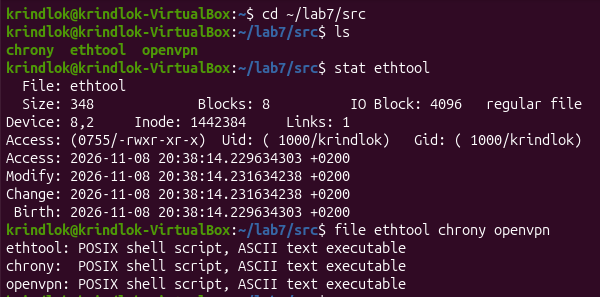
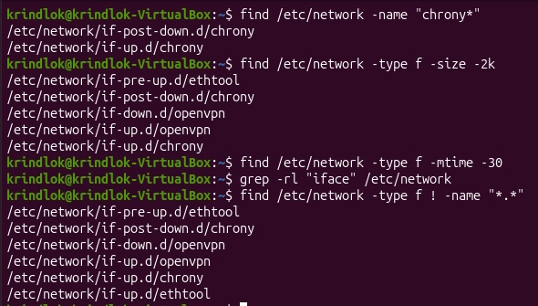
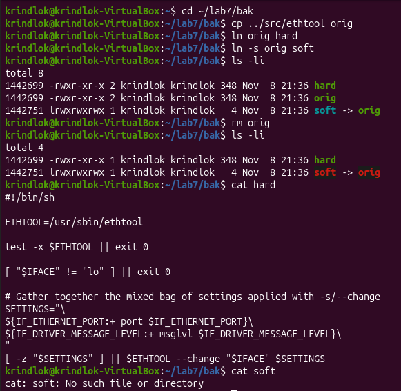
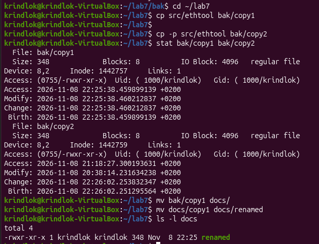
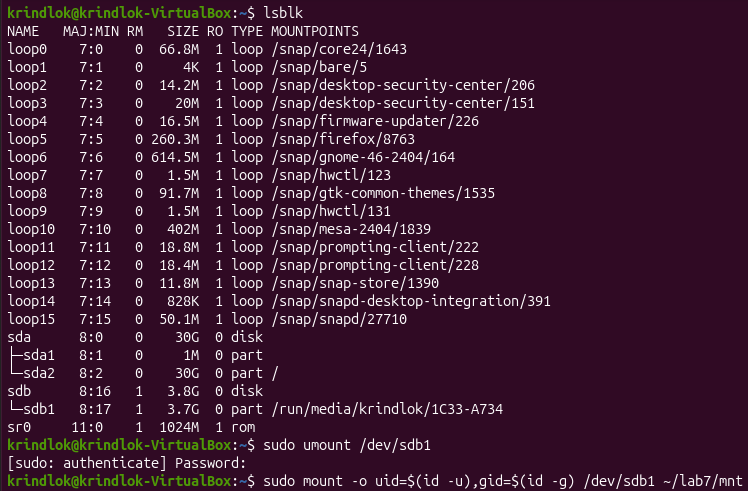
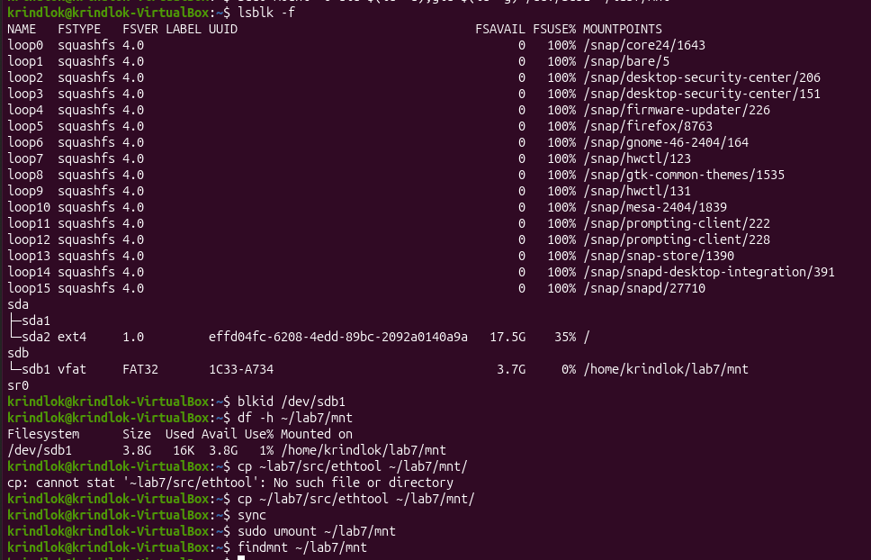
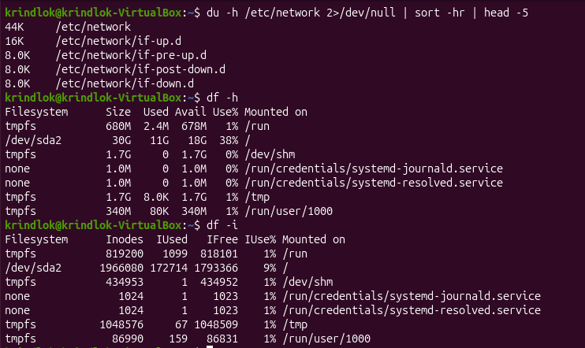
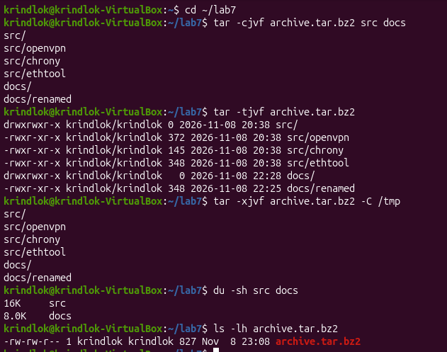

<!--
  Файлова система та управління даними в Linux
  Варіант 9: `/etc/network` — файли без розширення — `tar.bz2` — Пояснити, навіщо в `/etc/fstab` використовують UUID

  Тему, мету й обладнання писати не треба — конвеєр візьме їх із лабораторної.
  Знімки екрана кладіть у assets/, вихідний код — у src/.
  Контрольні питання — лише одного рівня, того, на який захищаєте роботу:
  заголовок «### Достатній рівень», далі «1 Текст питання?» і відповідь.
  Покрокова інструкція — reports/README.md
-->

## Хід роботи

1 Створив в домашньому каталозі структуру ~/lab7 з підкаталогами src, docs, bak, mnt. Скопіював в src три файли з каталогу, зазначеного у варіанті.



2 Вивів метадані одного з файлів командою stat, Inode – унікальний номер запису файлу у файловій системі, де зберігаються метадані (права, власник, розмір, адреси блоків). Ім'я файлу в inode не зберігається. Links – кількість жорстких посилань на цей inode. Access – час останнього читання файлу (atime). Рядок Access: (0644/-rw-r--r--) – це права доступу. Визначив реальний тип трьох файлів командою file.



3 Виконав чотири різні пошуки: за іменем, за розміром, за часом зміни та за вмістом. Критерій пошуку за розміром взяв з варіанта.
```bash
find /etc/network -name "interfaces*"                  # за іменем
find /etc/network -type f -size -2k                    # за розміром
find /etc/network -type f -mtime -30                   # за часом зміни (30 діб)
grep -rl "iface" /etc/network                          # за вмістом
find /etc/network -type f ! -name "*.*"                # критерій варіанта
```



4 Створив жорстке й символічне посилання на один файл. Порівняв номери inode. Видалив оригінал і показав, що сталося з кожним посиланням. Inode: у orig і hard номер однаковий, у soft – свій. Після видалення оригіналу: hard працює, бо дані живуть, поки є хоч одне жорстке посилання. soft стає «битим» (No such file or directory), бо він зберігає лише шлях до імені.



5 Виконав операції копіювання, переміщення та перейменування згідно з варіантом. cp -p зберігає власника, права та час модифікації/доступу оригіналу. Звичайний cp ставить поточний час і власником робить вас.



6 Змонтував носій, зазначений викладачем, у каталог ~/lab7/mnt (для vfat і exFAT - з опціями uid і gid). Визначив тип файлової системи (vfat), UUID (1C33-A734) і обсяг вільного місця (3.8G). Скопіював на носій файл, після чого коректно відмонтував й підтвердив це командою findmnt.





7 Проаналізував дисковий простір: знайшов п'ять найбільших підкаталогів каталогу, зазначеного у варіанті. df -h показує зайняте й вільне місце (у байтах, зручних одиницях). df -i показує inode: скільки записів про файли використано й залишилось. Диск може бути «повним» за inode, навіть якщо місце вільне (багато дрібних файлів).



8 Створив архів каталогів src і docs у форматі свого варіанта, переглянув вміст архіву без розпакування та розпакував його до /tmp. Порівняв обсяг архіву й вихідних даних. Архів зазвичай менший за сумарний розмір src і docs, бо bzip2 стискає дані. Для кількох маленьких файлів різниця може бути малою через службові заголовки tar.



9 Імена пристроїв /dev/sda1, /dev/sdb1 призначаються за порядком виявлення дисків. Вони можуть змінитися після перезавантаження, додавання нового диска або іншого порту підключення, і тоді змонтується не той розділ. UUID унікальний і записується у файлову систему при створенні, тому розділ завжди знаходиться однозначно, незалежно від імені пристрою. Приклад запису: UUID=1234-ABCD  /mnt/data  ext4  defaults  0  2

## Відповіді на контрольні питання

### Високий рівень (творчий)

1 Поясніть, які переваги для адміністрування дає єдине дерево каталогів із монтуванням, і наведіть сценарій, неможливий у моделі з літерами дисків.

Усі диски й розділи підключаються як звичайні каталоги в одному дереві (/), тому шляхи не залежать від кількості й порядку дисків. Можна винести /home, /var, /tmp на окремі розділи або диски, і програми цього не помітять. Це зручно для адміністрування. Сценарій, неможливий з літерами дисків: розділ /home переносять на новий більший диск. Монтують його в /home (запис у /etc/fstab), і всі шляхи /home/user/... працюють без змін. У Windows довелося б змінювати літеру й виправляти шляхи в програмах. Так само мережеву шару можна змонтувати в /mnt/data, і вона виглядатиме як звичайна папка.

2 Каталог із журналами заповнив увесь розділ. Опишіть послідовність дій із зазначенням команд на кожному кроці й поясніть, чому просте видалення файлу відкритим процесом не звільняє місце.

1. df -h – знайти заповнений розділ.
2. du -h --max-depth=1 /var/log | sort -hr | head – знайти найбільші файли.
3. lsof +L1 або lsof | grep deleted – перевірити, чи є видалені файли, відкриті процесами.
4. Очистити великий журнал без видалення: sudo truncate -s 0 /var/log/big.log (або > файл).
5. Старі архіви журналів видалити: sudo rm /var/log/*.gz.
6. df -h – перевірити, що місце звільнилося.
7. Налаштувати logrotate, щоб це не повторювалося.
Чому просте видалення файлу, відкритого процесом, не звільняє місце: rm прибирає лише ім'я (запис у каталозі). Дані й inode існують, поки процес тримає файл відкритим. Місце звільниться після перезапуску процесу (systemctl restart служба) або після обнулення файлу через truncate.

3 Запропонуйте схему резервного копіювання домашнього каталогу з кількома поколіннями копій. Обґрунтуйте вибір формату архіву та періодичність.

Схема: раз на добу робити архів tar.gz каталогу ~, а зберігати 7 щоденних, 4 щотижневих і 3 щомісячних копії, старіші видаляти. Скрипт запускається через cron:
```bash
0 2 * * * tar -czf /backup/home_$(date +\%F).tar.gz /home/krindlok
```
Для видалення старих копій: find /backup -name "home_*.tar.gz" -mtime +7 -delete. Формат: tar.gz швидкий, є скрізь і дає помірне стиснення. tar.bz2 або tar.xz стискають сильніше, але повільніше, тож їх варто брати для рідкісних архівів. Копії краще зберігати на іншому диску чи зовнішньому носії. Періодичність: щодня, бо домашній каталог змінюється часто, а втрата за добу прийнятна.

4 Сформулюйте критерії вибору між жорстким посиланням, символічним посиланням і копією файлу. Проілюструйте кожен критерій прикладом із цієї роботи.

Таблиця 1 - Критерії вибору

|Варіант|Коли використовувати|Приклад із роботи|
|-------|--------------------|-----------------|
|Жорстке посилання|Потрібен ще один «шлях» до тих самих даних у межах однієї ФС, і щоб дані жили після видалення оригіналу|hard мав той самий inode, що й orig, і працював після rm orig|
|Символічне посилання|Потрібне посилання на каталог або на файл в іншій ФС, яке видно як ярлик|soft має свій inode, після видалення orig став «битим»|
|Копія файлу|Потрібен незалежний файл, який можна змінювати окремо, або резервна копія|cp -p створила окремий файл зі своїм inode і збереженими правами та часом|

## Висновок

У роботі я опанував основні команди керування файлами в Ubuntu. Створив структуру каталогів, виконав пошук у /etc/network (find, grep) і вивчив метадані файлів (stat, file). Порівняв жорсткі й символічні посилання за номерами inode та поведінкою після видалення оригіналу. Також відпрацював копіювання (cp, cp -p), змонтував USB-носій у власний каталог і коректно відмонтував його, проаналізував дисковий простір (du, df -h, df -i) і створив архів tar.bz2. Додаткове завдання показало, що в /etc/fstab використовують UUID, бо він постійний, на відміну від імен пристроїв, які можуть змінюватися. Усі завдання варіанта 9 виконано.