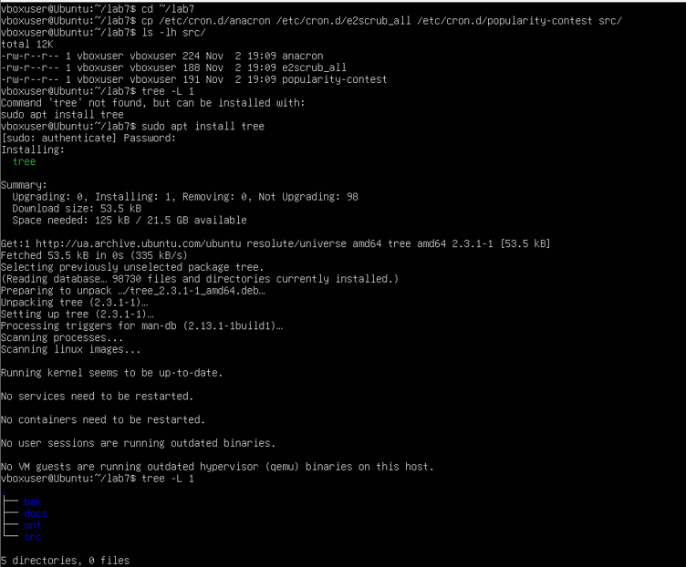
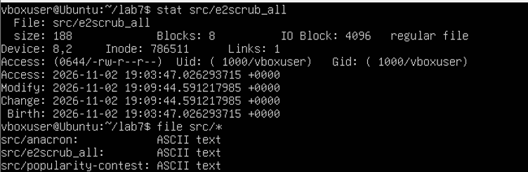
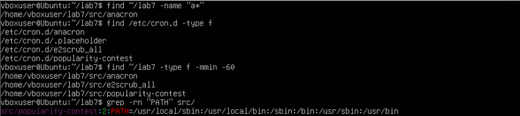
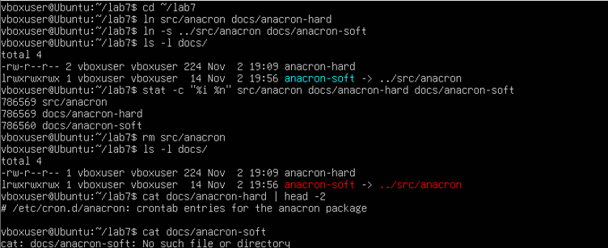
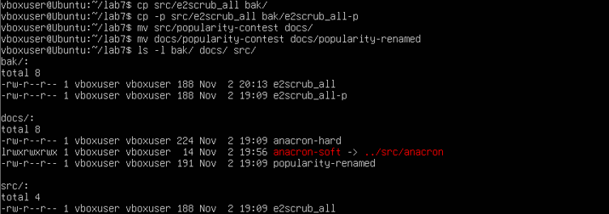
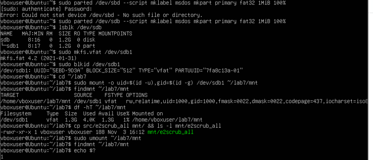
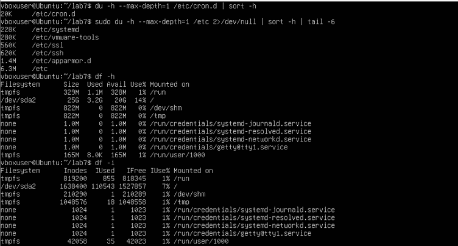
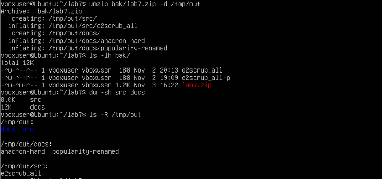
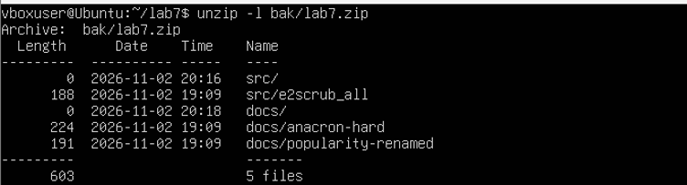

<!--
  Файлова система та управління даними в Linux
  Варіант 11: `/etc/cron.d` — усі звичайні файли — `zip` — Показати вміст архіву без розпакування та пояснити ключі

  Тему, мету й обладнання писати не треба — конвеєр візьме їх із лабораторної.
  Знімки екрана кладіть у assets/, вихідний код — у src/.
  Контрольні питання — лише одного рівня, того, на який захищаєте роботу:
  заголовок «### Достатній рівень», далі «1 Текст питання?» і відповідь.
  Покрокова інструкція — reports/README.md
-->

## Хід роботи

1 Отримала в викладача номер індивідуального варіанта.

2 Створила в домашньому каталозі структуру ~/lab7 з підкаталогами src, docs, bak, mnt однією командою mkdir -p ~/lab7/{src,docs,bak,mnt}: фігурні дужки розгортаються оболонкою, тому один рядок створює одразу чотири каталоги. Перейшла в ~/lab7 командою cd. Командою cp скопіювала в каталог src три файли з каталогу /etc/cron.d, зазначеного у варіанті: anacron, e2scrub_all та popularity-contest. Командою ls -lh src/ перевірила результат: розміри файлів становлять 224, 188 та 191 байт, власником копій є користувач vboxuser. Командою tree -L 1 переглянула створену структуру каталогів. 

3 Вивела метадані файлу e2scrub_all командою stat src/e2scrub_all. Поле Inode має значення 786511 і є унікальним номером файлу у файловій системі: за цим номером система знаходить дані, а ім'я файлу лише запис у каталозі, що вказує на inode. Поле Links має значення 1, тобто на цей inode вказує лише одне ім'я, і файл буде видалено після видалення цього імені. Поле Access (0644/-rw-r--r--) показує права доступу: власник vboxuser (Uid 1000) може читати й записувати файл, а група та інші користувачі лише читати. Також stat показав розмір файлу 188 байт, 8 блоків по 4096 байт і тип regular file. Реальний тип трьох файлів визначила командою file src/*: anacron, e2scrub_all і popularity-contest мають тип ASCII text, тобто є звичайними текстовими файлами. Команда file визначає тип за вмістом, а не за розширенням, бо в Linux розширення є лише частиною імені. 

4 Виконала чотири різні пошуки. Пошук за іменем: find ~/lab7 -name "a*" знайшов у структурі ~/lab7 файл src/anacron, ім'я якого починається з літери a. Пошук за розміром згідно з варіантом (усі звичайні файли): find /etc/cron.d -type f вивів чотири звичайні файли каталогу /etc/cron.d: anacron, e2scrub_all, popularity-contest та прихований файл .placeholder, ім'я якого починається з крапки, тому ls без ключа -a його не показує. Пошук за часом зміни: find ~/lab7 -type f -mmin -60 знайшов три файли в каталозі src, змінені менш ніж 60 хвилин тому, бо їх було скопійовано щойно. Пошук за вмістом: grep -rn "PATH" src/ рекурсивно переглянув файли каталогу src і знайшов рядок із PATH у файлі popularity-contest (рядок 2), де задано змінну PATH зі списком каталогів для запуску команд cron.

5 Створила жорстке й символічне посилання на файл anacron командами ln src/anacron docs/anacron-hard та ln -s ../src/anacron docs/anacron-soft. Командою ls -l docs/ перевірила результат: у жорсткого посилання anacron-hard лічильник посилань дорівнює 2, а символічне anacron-soft відображається зі стрілкою на ціль ../src/anacron. Командою stat -c "%i %n" src/anacron docs/anacron-hard docs/anacron-soft порівняла номери inode: у src/anacron і docs/anacron-hard він однаковий (786569), бо це два імені одного файлу, а в символічного посилання inode інший (786560), оскільки це окремий невеликий файл, що зберігає лише текст шляху. Після видалення оригіналу командою rm src/anacron жорстке посилання лишилося робочим: команда cat docs/anacron-hard | head -2 вивела початок файлу, а лічильник посилань зменшився до 1, тобто дані існують, доки є хоча б одне ім'я. Символічне посилання «повисло»: cat docs/anacron-soft повернула помилку «No such file or directory», бо воно зберігало лише шлях до src/anacron, а такого файлу вже немає.

6 Виконала операції копіювання, переміщення та перейменування. Командою cp src/e2scrub_all bak/ скопіювала файл у каталог bak, а командою cp -p src/e2scrub_all bak/e2scrub_all-p зробила другу копію зі збереженням атрибутів. Командою ls -l bak/ порівняла результат: у копії, створеної звичайним cp, час зміни новий (20:13), бо cp створює новий файл і ставить поточний час, а в копії, створеної з ключем -p, збереглися час зміни оригіналу (19:09), власник і права доступу. Командою mv src/popularity-contest docs/ перемістила файл з каталогу src до docs, а командою mv docs/popularity-contest docs/popularity-renamed перейменувала його. Обидві дії виконує одна команда mv, бо для файлової системи це та сама операція: зміна запису в каталозі. Тому в каталозі src тепер лишився лише e2scrub_all, а в docs з'явився файл popularity-renamed із незмінним часом 19:09.

7 Змонтувала додатковий віртуальний диск у каталог ~/lab7/mnt. Спершу командою lsblk переглянула блокові пристрої: окрім системного диска sda з'явився новий диск sdb об'ємом 1,2 ГБ. Оскільки диск був порожній, створила на ньому розділ sdb1 командою parted і відформатувала його у vfat командою sudo mkfs.vfat /dev/sdb1. Тип файлової системи та UUID визначила командою sudo blkid /dev/sdb1: TYPE="vfat", UUID="5EBD-9D3A". Змонтувала розділ командою sudo mount -o uid=$(id -u),gid=$(id -g) /dev/sdb1 ~/lab7/mnt. Опції uid і gid потрібні тому, що vfat не зберігає власників і прав Unix, і без них усі файли належали б root. Командою findmnt ~/lab7/mnt підтвердила монтування (FSTYPE vfat, uid=1000, gid=1000), а командою df -hT ~/lab7/mnt визначила тип файлової системи vfat, розмір 1,3 ГБ, використано 4,0 КБ, вільно 1,3 ГБ (1%). Командою cp src/e2scrub_all mnt/ скопіювала файл на носій; його права rwxr-xr-x не збереглися з оригіналу, а задані для всього носія, бо у vfat немає прав Unix. Після цього відмонтувала носій командою sudo umount ~/lab7/mnt. Порожній вивід findmnt ~/lab7/mnt і код повернення echo $?, що дорівнює 1, підтверджують, що носій відмонтовано і його можна безпечно вилучити.

8 Проаналізувала дисковий простір. Каталог /etc/cron.d з варіанта підкаталогів не містить, лише три файли, тому команда du -h --max-depth=1 /etc/cron.d | sort -h показала лише загальний розмір каталогу, 20 КБ (du рахує виділені блоки по 4 КБ, а не байти вмісту, до того ж у каталозі є прихований файл .placeholder). Тому п'ять найбільших підкаталогів знайшла для батьківського каталогу /etc командою sudo du -h --max-depth=1 /etc 2>/dev/null | sort -h | tail -6: apparmor.d (1,4 МБ), ssh (620 КБ), ssl (560 КБ), vmware-tools (280 КБ), systemd (228 КБ); загальний розмір /etc становить 6,3 МБ. Перенаправлення 2>/dev/null приховує повідомлення про відмову в доступі. Командою df -h переглянула вільне місце за точками монтування: коренева файлова система /dev/sda2 має розмір 25 ГБ, використано 3,2 ГБ (14%), вільно 20 ГБ. Командою df -i переглянула inode: на /dev/sda2 усього 1638400 inode, використано 110543 (7%). Різниця між командами: df -h показує вільні байти (обсяг даних), а df -i показує вільні inode, тобто записи для файлів. Може виникнути ситуація, коли df -h показує вільне місце, а система повідомляє «No space left on device»: це означає, що вичерпано не байти, а inode, тому дисковий простір перевіряють обома командами.

9 Створила архів каталогів src і docs у форматі zip командою zip -r bak/lab7.zip src docs. Ключ -r додає каталоги рекурсивно. Команда вивела попередження «name not matched: docs/anacron-soft»: символічне посилання «повисло» після видалення оригіналу, а zip за замовчуванням не зберігає посилання як посилання, а намагається відкрити файл, на який воно вказує, тому в архів потрапили лише 5 записів: 2 каталоги й 3 файли. Вміст архіву переглянула без розпакування командою unzip -l bak/lab7.zip, після чого розпакувала його в каталог /tmp командою unzip bak/lab7.zip -d /tmp/out; командою ls -R /tmp/out переконалась, що в /tmp/out з'явилися каталоги src (e2scrub_all) і docs (anacron-hard, popularity-renamed). Порівняла обсяг: архів bak/lab7.zip займає 1,2 КБ, сумарний розмір вмісту файлів становить 603 байти, а du -sh src docs показує 8 КБ і 12 КБ, бо du рахує виділені блоки по 4 КБ разом із блоком каталогу, а не байти вмісту. Стиснення окремих файлів становить від 26% до 40% (deflated), але на таких малих файлах службові заголовки zip перевищують виграш, тому архів за розміром трохи більший за самі дані. Ефективність стиснення проявляється на великих текстових файлах.

10 Показала вміст архіву без розпакування командою unzip -l bak/lab7.zip. Вивід містить стовпці Length (розмір запису в байтах), Date і Time (дата й час зміни) та Name (ім'я запису в архіві). В архіві п'ять записів: каталоги src/ і docs/ (розмір 0) та три файли: src/e2scrub_all (188 байт), docs/anacron-hard (224 байти) і docs/popularity-renamed (191 байт); підсумок: 603 байти в 5 файлах (записах). Символічне посилання docs/anacron-soft в архів не потрапило. Пояснення ключів: у команді zip -r bak/lab7.zip src docs ключ -r (recursive) додає каталоги разом з їхнім вмістом; у команді unzip -l ключ -l (list) лише виводить перелік вмісту архіву й нічого не розпаковує; у команді unzip bak/lab7.zip -d /tmp/out ключ -d (directory) задає каталог, до якого розпаковуються файли. Для порівняння, у tar аналогічну функцію перегляду виконує ключ -t (list).

11 Оформила звіт і зробила висновок.

## Відповіді на контрольні питання

### Високий рівень (творчий)

1 Поясніть, які переваги для адміністрування дає єдине дерево каталогів із монтуванням, і наведіть сценарій, неможливий у моделі з літерами дисків.

У Linux усі носії приєднуються до одного кореня /, тому адміністратор керує простором шляхів, а не набором окремих дисків. Програми й скрипти звертаються до /var/log чи /home, а на якому фізичному диску ці каталоги лежать, можна змінити без зміни конфігурацій. Це дає змогу виносити /home, /var або /tmp на окремі розділи, і переповнення одного з них (наприклад, журналами в /var) не зупиняє систему на кореневому розділі. Крім того, через опції монтування (ro, noexec, nosuid, uid, gid) той самий принцип дозволяє по-різному налаштувати кожну точку: один розділ зробити лише для читання, інший без права виконання програм. Диск, мережевий ресурс і віртуальна файлова система виглядають однаково, як звичайні каталоги, а в нашій роботі розділ sdb1 було змонтовано в ~/lab7/mnt, тобто в будь-якій точці домашнього каталогу може бути окремий носій.

Сценарій, неможливий у моделі з літерами дисків: каталог /var/www із сайтами переповнився. Адміністратор під'єднує новий, більший диск, копіює на нього дані й монтує його в те саме місце /var/www. Сайти, скрипти й налаштування веб-сервера продовжують працювати без жодних змін, бо шлях лишився тим самим. У системі з літерами дисків дані опинилися б, наприклад, на E:\, і довелося б змінювати шляхи в усіх програмах і конфігураціях.

2 Каталог із журналами заповнив увесь розділ. Опишіть послідовність дій із зазначенням команд на кожному кроці й поясніть, чому просте видалення файлу відкритим процесом не звільняє місце.

Спершу потрібно підтвердити проблему командою df -h, а командою df -i перевірити, чи не вичерпано inode. Далі командою sudo du -h --max-depth=1 /var | sort -h знаходять, який каталог займає найбільше місця, і повторюють її для найбільшого підкаталогу, наприклад /var/log. Конкретні великі файли шукають командою sudo find /var/log -type f -size +100M. Після цього перевіряють, чи не тримає файл відкритим якийсь процес, командою sudo lsof +L1, яка показує видалені, але ще відкриті файли. Старі архівні журнали можна безпечно видалити командою sudo rm, а файл, у який програма пише просто зараз, краще не видаляти, а обнулити командою sudo truncate -s 0 /var/log/назва.log. Якщо файл уже видалено, а місце не звільнилося, потрібно перезапустити службу, що тримає його відкритим: sudo systemctl restart назва_служби. Щоб проблема не повторилася, налаштовують ротацію журналів у /etc/logrotate.d/ і за потреби обмежують журнал systemd командою sudo journalctl --vacuum-size=200M. Наприкінці результат перевіряють повторною командою df -h.

Просте видалення файлу, який відкритий процесом, не звільняє місце тому, що команда rm видаляє лише ім'я файлу, тобто запис у каталозі, і зменшує лічильник посилань. Дані та inode звільняються лише тоді, коли лічильник дорівнює нулю й жоден процес не тримає файл відкритим. Поки процес не закрив файл, його дані лишаються на диску й займають місце, хоча імені вже немає, тому du їх не бачить, а df показує, що місце зайняте. Це та сама логіка, що з жорстким посиланням у пункті 5: файл існує, доки є хоча б одне посилання на нього, а відкритий дескриптор процесу теж є таким посиланням.

3 Запропонуйте схему резервного копіювання домашнього каталогу з кількома поколіннями копій. Обґрунтуйте вибір формату архіву та періодичність.

Пропоную схему «дід-батько-син» із трьома рівнями копій: щоденні копії (зберігаються 7 останніх), щотижневі (4 останні) і щомісячні (6 останніх). Копію створюють командою на кшталт tar -czvf /backup/home-$(date +%F).tar.gz /home/student: дата в імені файлу, як у методичці, дає змогу розрізняти покоління. Запуск автоматизують через cron, а застарілі копії видаляють командою find /backup -name "home-*.tar.gz" -mtime +7 -delete. Копії слід зберігати на іншому диску або в іншому місці, щоб збій основного диска не знищив одночасно і оригінал, і резерв.

Формат tar.gz обрано тому, що tar зберігає права доступу, власників і символічні посилання, чого не робить zip: у нашій роботі символічне посилання anacron-soft у zip-архів не потрапило, а tar зберіг би його як посилання. Gzip стискає швидко й підтримується скрізь. Для рідкісних щомісячних копій доцільно взяти tar.xz (ключ -J), який стискає краще, хоча й повільніше. Для вже стиснених даних (JPEG, MP4) стиснення майже нічого не дає, тому варто враховувати склад каталогу.

Щоденна періодичність обґрунтована тим, що за добу змінюється відносно небагато даних, і втрата одного дня роботи зазвичай прийнятна. Тижневі й місячні копії захищають від помилок, виявлених із запізненням: якщо файл було пошкоджено три тижні тому, щоденних копій із правильною версією вже немає, а місячна або тижнева ще збереглася.

4 Сформулюйте критерії вибору між жорстким посиланням, символічним посиланням і копією файлу. Проілюструйте кожен критерій прикладом із цієї роботи.

Жорстке посилання обирають, коли файл має існувати доти, доки є хоча б одне його ім'я, і не залежати від переміщення оригіналу. У нашій роботі після видалення src/anacron файл docs/anacron-hard лишився робочим, бо вказував на той самий inode (786569), а лічильник посилань зменшився з 2 до 1. Водночас жорстке посилання неможливе на каталог і між різними файловими системами, тому в таких випадках обирають символічне: воно є окремим маленьким файлом із шляхом і працює де завгодно, зокрема й на носії, змонтованому як sdb1. Символічне посилання також зручне, коли потрібно бачити, куди веде посилання: anacron-soft -> ../src/anacron видно прямо в ls -l. Недолік такого посилання в тому, що воно «ламається», якщо ціль видалено або переміщено, що ми й спостерігали, коли cat docs/anacron-soft повернула помилку «No such file or directory».

Копію обирають, коли потрібна незалежність від оригіналу: зміни в одному файлі не повинні впливати на інший. Команда cp src/e2scrub_all bak/ створила окремий файл з іншим inode, який не зміниться разом з оригіналом. Якщо важливо зберегти атрибути (час зміни, власника, права), використовують cp -p: у нашій роботі копія bak/e2scrub_all-p зберегла час оригіналу 19:09, а звичайна копія отримала новий час 20:13. Нарешті, якщо потрібен захист від втрати даних через збій диска, копію слід робити на іншому носії, як це було з файлом e2scrub_all, скопійованим на змонтований sdb1: посилання тут не допоможуть, бо вони не створюють нових даних. Отже, посилання доречні, коли файл має бути доступний під кількома іменами без дублювання даних, а копія потрібна, коли важливі незалежність і захист від втрати чи зміни оригіналу.

## Висновок

На цій лабораторній роботі я навчилася працювати з файловою системою Linux засобами командного рядка: орієнтуватися в структурі FHS, виконувати повний цикл файлових операцій, шукати файли за різними критеріями, розрізняти жорсткі й символічні посилання, монтувати та відмонтовувати носії, аналізувати використання дискового простору й архівувати дані.
