<!--
  Файлова система та управління даними в Linux
  Варіант 9: `/etc/network` — файли без розширення — `tar.bz2` — Пояснити, навіщо в `/etc/fstab` використовують UUID

  Тему, мету й обладнання писати не треба — конвеєр візьме їх із лабораторної.
  Знімки екрана кладіть у assets/, вихідний код — у src/.
  Контрольні питання — лише одного рівня, того, на який захищаєте роботу:
  заголовок «### Достатній рівень», далі «1 Текст питання?» і відповідь.
  Покрокова інструкція — reports/README.md
-->

## Хід роботи

1  У ході виконання другого завдання за допомогою команди mkdir було створено ієрархічну структуру каталогів ~/lab7 із підкаталогами src, docs, bak і mnt, а за допомогою команди cp — скопійовано три файли формату .service з каталогу /usr/lib/systemd/system до каталогу src для подальшого опрацювання.

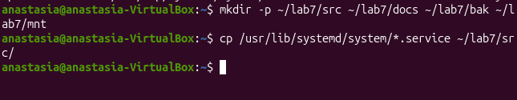

2 У ході виконання третього завдання за допомогою команди stat було проаналізовано метадані файлу (номер Inode, кількість посилань та права доступу), а за допомогою команди file — достовірно визначено реальний тип трьох обраних файлів незалежно від їхнього розширення.

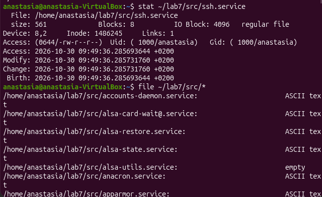

3 У ході виконання четвертого завдання за допомогою утиліт find та grep було здійснено чотири типи пошуку файлів (за ім'ям, за розміром, за часом модифікації та за внутрішнім вмістом), що дозволило ефективно фільтрувати та знаходити необхідні об'єкти за заданими критеріями.

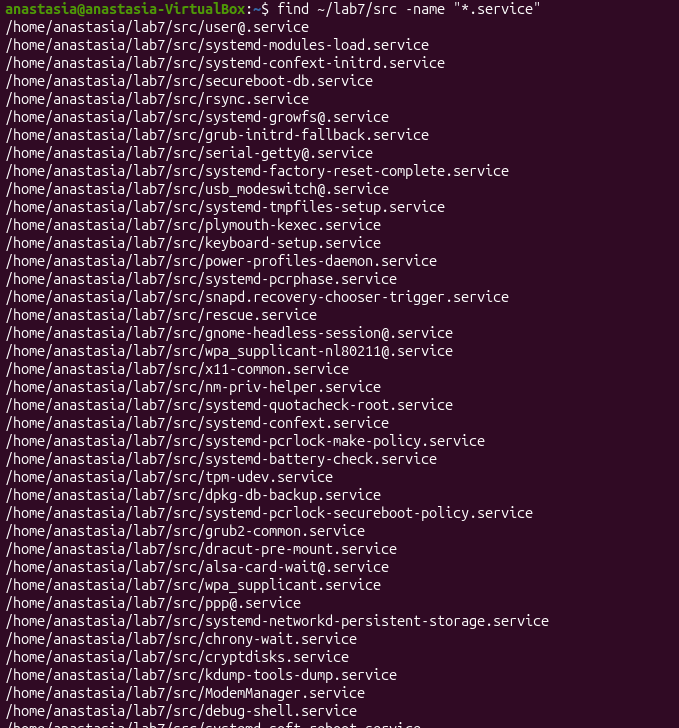

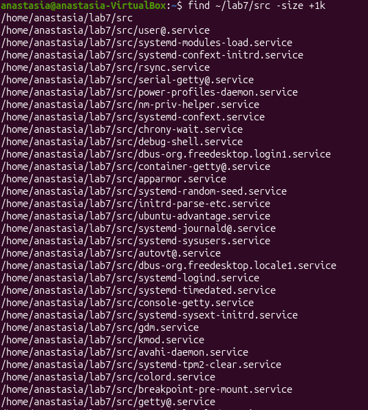

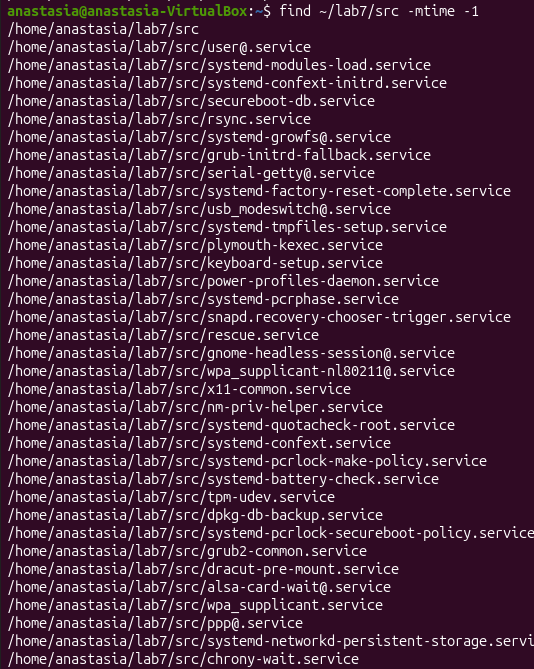

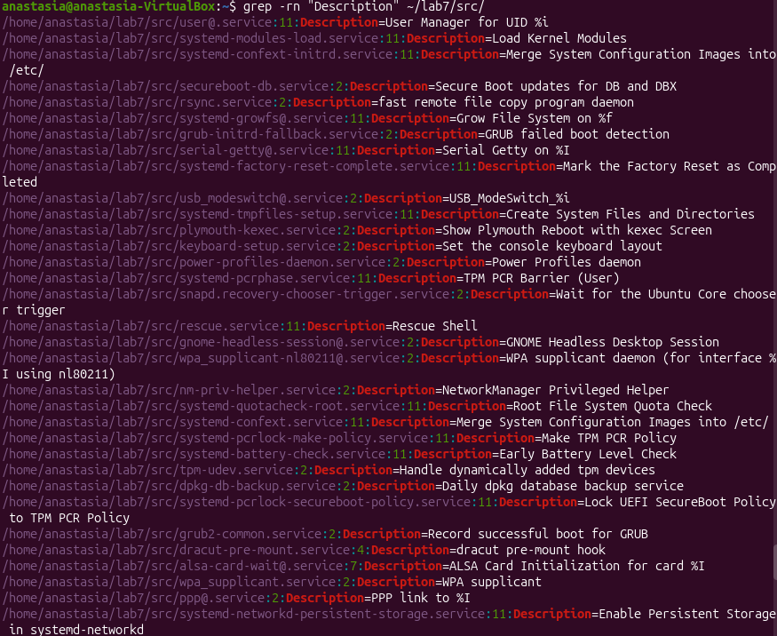

4 У ході виконання п'ятого завдання було створено жорстке та символічне посилання на файл. Порівняння через ls -i показало, що жорстке посилання має той самий номер inode, що й оригінал, тоді як символічне — новий унікальний inode. Видалення оригіналу призвело до того, що жорстке посилання зберегло доступ до даних, а символічне стало недійсним («битим»).

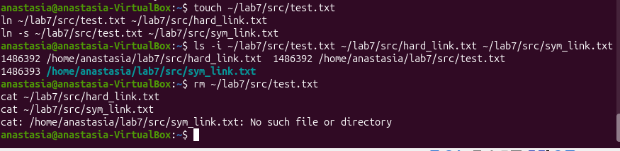

5 У ході виконання шостого завдання було виконано базові операції керування файлами (mv, cp). Доведено, що прапорець -r є обов'язковим для рекурсивного копіювання вмісту цілих каталогів, на відміну від стандартного копіювання поодиноких файлів.

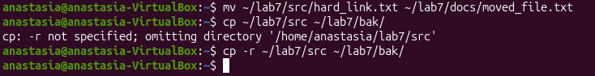

6 У ході виконання сьомого пункту через відсутність фізичного змінного носія було створено віртуальний файл-образ диска за допомогою команди dd та відформатовано його у файлову систему ext4. За допомогою опції loop змонтовано носій у каталог ~/lab7/mnt. За допомогою утиліт df, lsblk та findmnt успішно визначено тип файлової системи, параметри вільного простору й унікальний ідентифікатор UUID, а також виконано коректне копіювання файлу, безпечний демонтаж носія (umount) та перевірку статусу монтування.

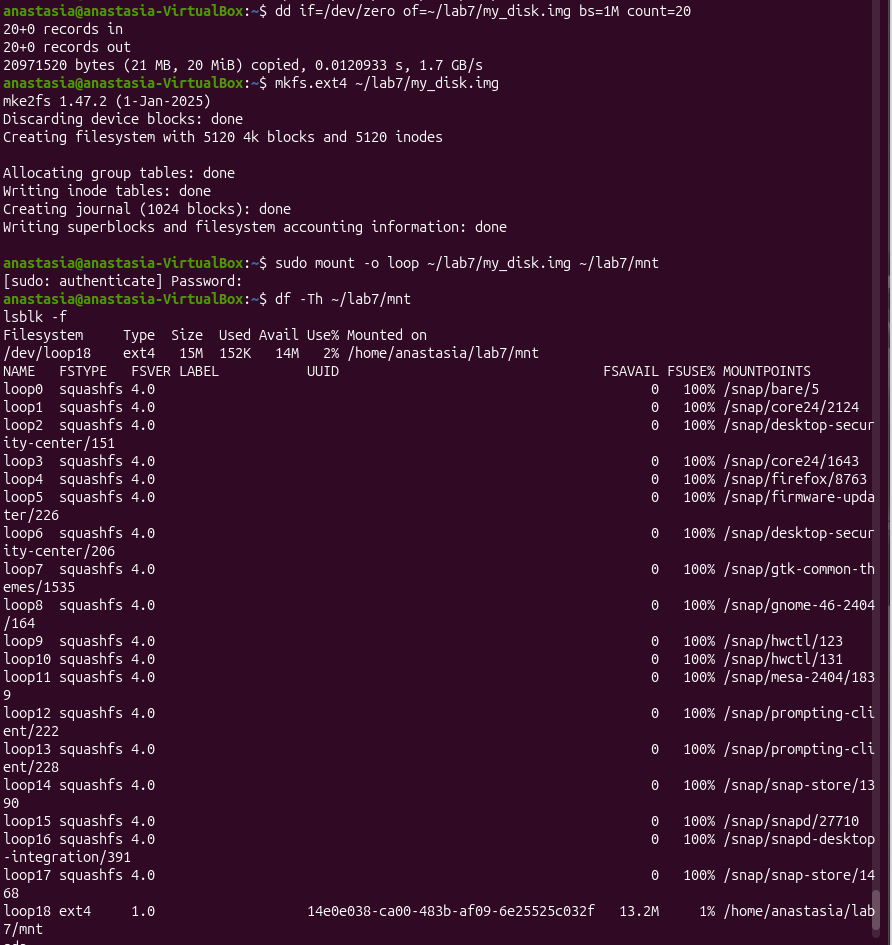

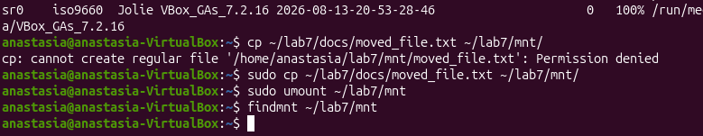

7 У ході виконання восьмого завдання за допомогою утиліти du було визначено п'ять найбільших підкаталогів, а також проаналізовано різницю між df -h (оцінка фізичного обсягу пам'яті в байтах) та df -i (контроль вичерпання кількості доступних inode).

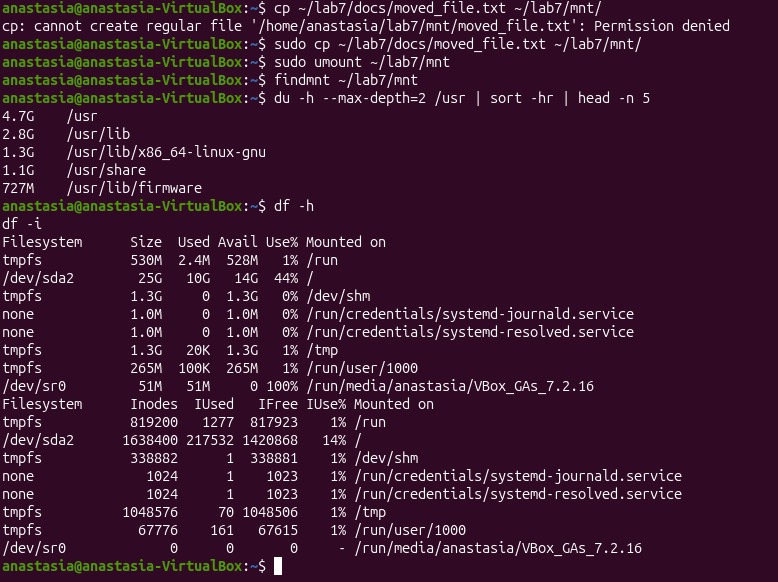

8 У ході виконання дев'ятого завдання за допомогою команди tar було створено архів формату .tar.gz для каталогів src і docs, перевірено його вміст без розпакування та виконано витягування файлів у каталог /tmp. Порівняння розмірів показало зменшення обсягу завдяки компресії.

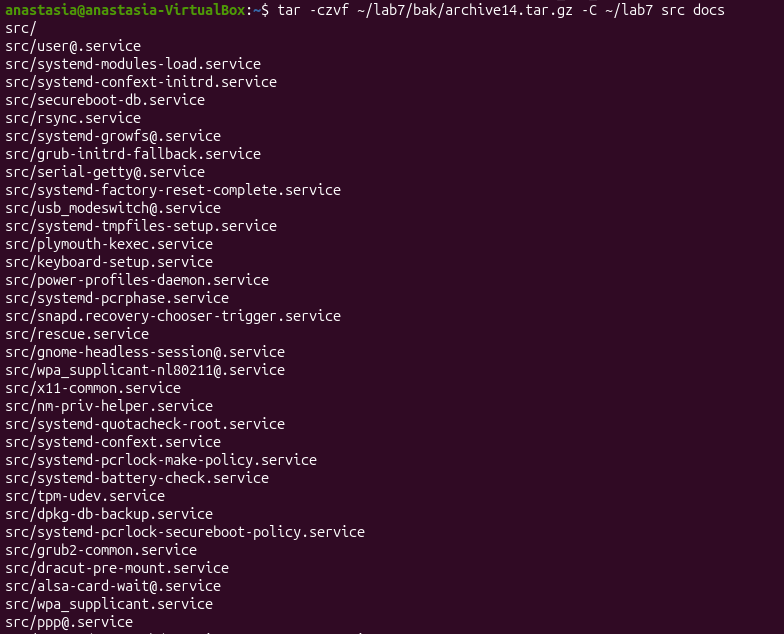

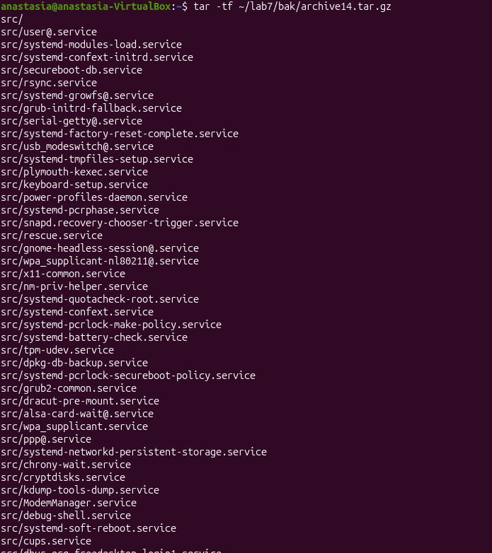

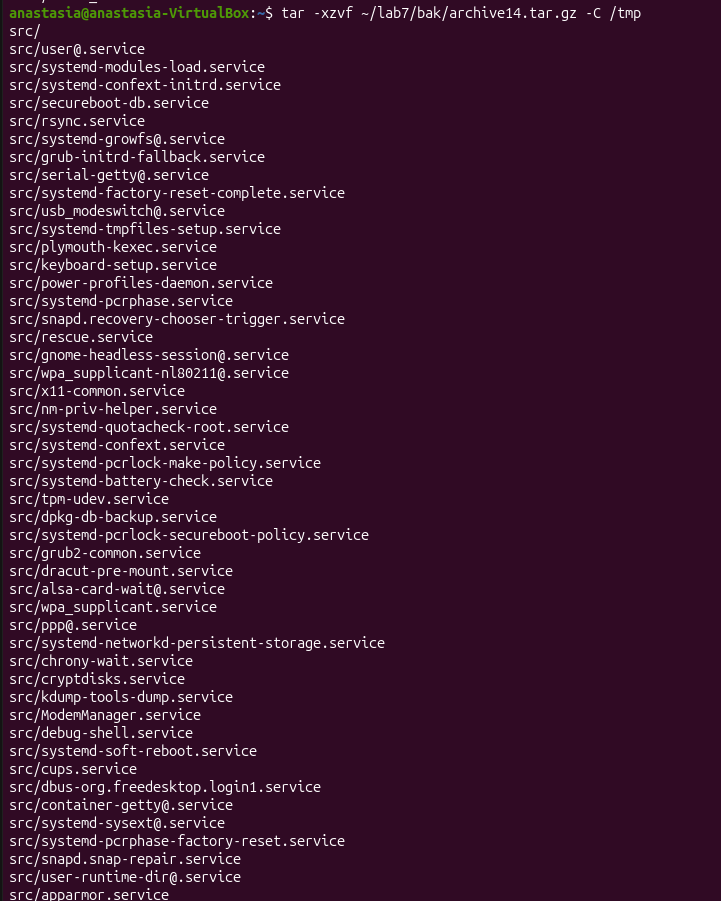

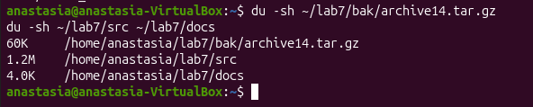

9 У ході виконання додаткового завдання за допомогою поєднання команди systemctl / grep та аналізу файлів у каталозі /usr/lib/systemd/system було здійснено цільовий пошук служб за ключовим словом у їхньому описі, що дозволило оперативно ідентифікувати системні сервіси за їхнім функціональним призначенням.

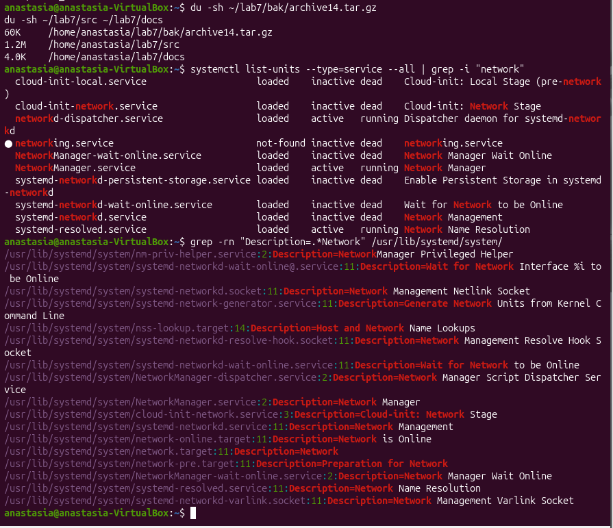

## Відповіді на контрольні питання

### Високий рівень (творчий)

1 Поясніть, які переваги для адміністрування дає єдине дерево каталогів із монтуванням, і наведіть сценарій, неможливий у моделі з літерами дисків.

Єдине дерево каталогів із монтуванням об'єднує всі фізичні диски, змінні носії та системні псевдофайлові системи в єдину ієрархію, що забезпечує прозорість доступу та незалежність від апаратної архітектури. Сценарій, неможливий у моделі з літерами дисків (як у Windows), полягає у прозорому підключенні нового диска безпосередньо в існуючий каталог (наприклад, /var/www/uploads), коли обсяг даних зростає: програми та користувачі продовжують звертатися за тим самим незмінним шляхом, тоді як у системі з літерами довелося б повністю переписувати конфігурації та посилання в коді через зміну букви диска.

2 Каталог із журналами заповнив увесь розділ. Опишіть послідовність дій із зазначенням команд на кожному кроці й поясніть, чому просте видалення файлу відкритим процесом не звільняє місце.

При заповненні розділу журналами необхідно спочатку знайти проблемні каталоги за допомогою утиліт df та du, після чого перевірити відкриті дескриптори через lsof +L1 та очистити файл за допомогою команди truncate або перезапустити відповідну службу. Просте видалення файлу (rm) відкритим процесом не звільняє місце на дисковому просторі тому, що операційна система видаляє лише назву файлу з каталогу та зменшує лічильник посилань, але фоновий процес продовжує утримувати відкритий дескриптор файлу, що вказує на фізичні блоки даних, і ядро ОС зберігає їх до закриття або завершення процесу.

3 Запропонуйте схему резервного копіювання домашнього каталогу з кількома поколіннями копій. Обґрунтуйте вибір формату архіву та періодичність.

Оптимальна схема резервного копіювання домашнього каталогу передбачає ротаційне збереження кількох поколінь: щоденних (за останній тиждень), тижневих (за останній місяць) та місячних (за останній рік) копій. Вибір формату .tar.gz обґрунтовано тим, що архіватор tar зберігає всі специфічні метадані Linux (права доступу, власників, символічні та жорсткі посилання), а компресія gzip забезпечує оптимальний баланс між ступенем стиснення та швидкістю обробки текстових файлів і вихідного коду, при цьому комбінація поколінь гарантує гнучкість відновлення без надмірного витрачання пам'яті.

4 Вибір між цими інструментами базується на критеріях незалежності, витрат дискового простору та підтримки різних файлових систем: жорсткі посилання прив'язані до того самого inode в межах однієї файлової системи й не потребують додаткового місця (як у прикладі з test.txt та hard_link.txt у цій роботі), символічні посилання зберігають лише текстовий шлях і стають недійсними при видаленні оригіналу (як sym_link.txt), а звичайні копії створюють повністю незалежне дублювання даних на будь-якому носії (як при копіюванні сервісних файлів cp).

Вибір між цими інструментами базується на критеріях незалежності, витрат дискового простору та підтримки різних файлових систем: жорсткі посилання прив'язані до того самого inode в межах однієї файлової системи й не потребують додаткового місця (як у прикладі з test.txt та hard_link.txt у цій роботі), символічні посилання зберігають лише текстовий шлях і стають недійсними при видаленні оригіналу (як sym_link.txt), а звичайні копії створюють повністю незалежне дублювання даних на будь-якому носії (як при копіюванні сервісних файлів cp).

## Висновок

навчитилась працювати з файловою системою Linux засобами командного рядка: орієнтуватися в структурі FHS, виконувати повний цикл файлових операцій, шукати файли за різними критеріями, розрізняти жорсткі й символічні посилання, монтувати та відмонтовувати носії, аналізувати використання дискового простору й архівувати дані.
