<!--
  Облікові записи та права доступу до файлів
  Варіант 6: `students` / st1, st2 — `644` — `022` — групи: читання — Показати, що дає біт sticky в каталозі `/tmp`

  Тему, мету й обладнання писати не треба — конвеєр візьме їх із лабораторної.
  Знімки екрана кладіть у assets/, вихідний код — у src/.
  Контрольні питання — лише одного рівня, того, на який захищаєте роботу:
  заголовок «### Достатній рівень», далі «1 Текст питання?» і відповідь.
  Покрокова інструкція — reports/README.md
-->

## Хід роботи

1 Номер індивідуального варіанта – 6.

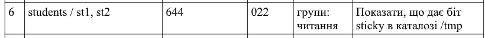

2 Для виконання лабораторної роботи було використано віртуальну машину з операційною системою Ubuntu. Роботу виконувала через термінал. Перевірила версію операційної системи, поточного користувача та можливість виконання команд із правами адміністратора. Також перевірила наявність утиліти ACL

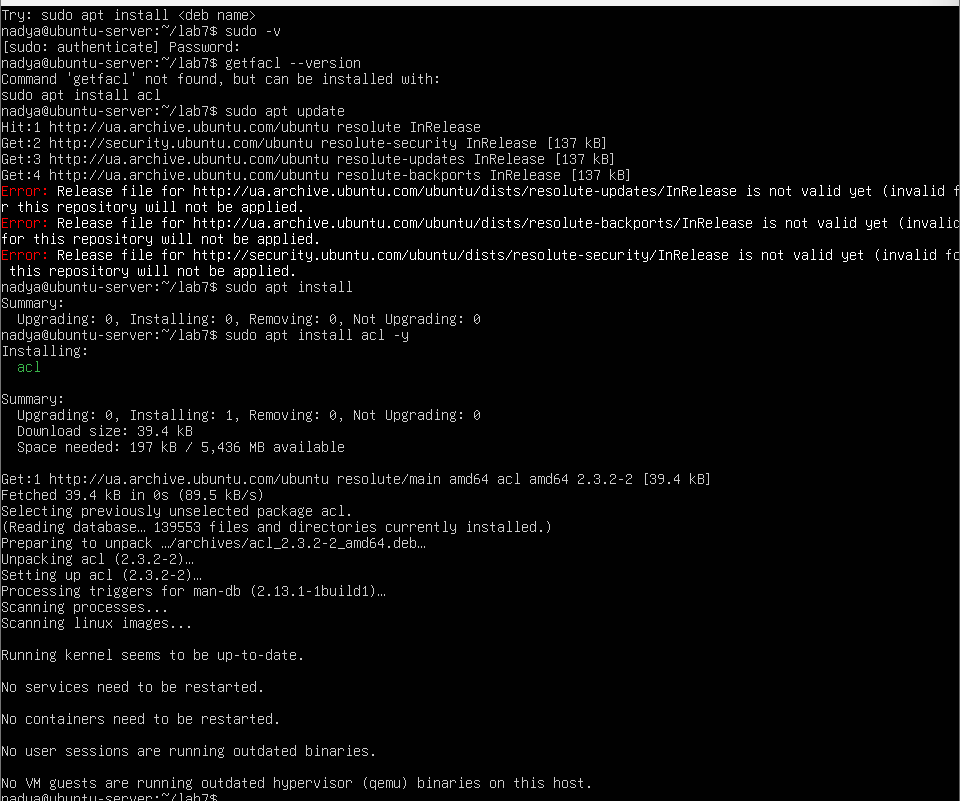

3 Створила групу students та два навчальні облікові записи st1 і st2. За допомогою команди usermod -aG додала обох користувачів до створеної групи. Перевірила налаштування командами id та getent group. Результат підтвердив, що обидва користувачі входять до групи students.

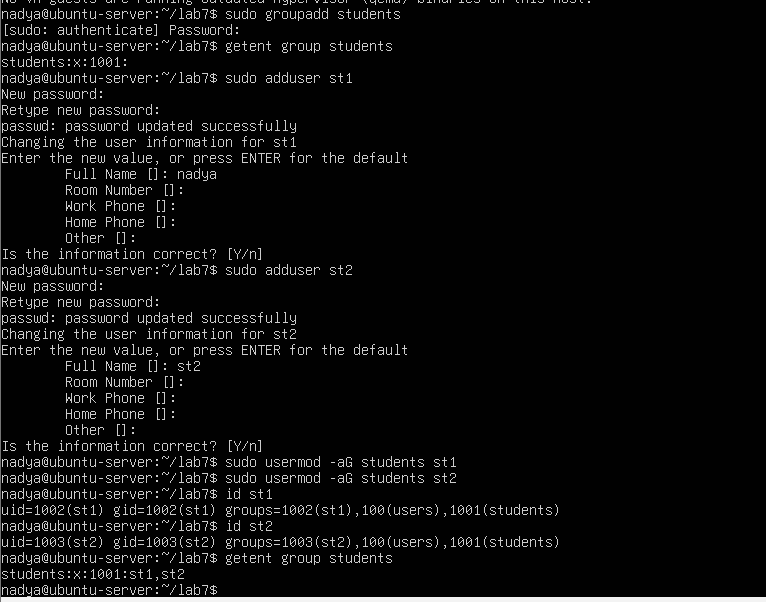

4 За допомогою команди chage -l переглянула інформацію про терміни дії пароля користувача st1. Командою usermod -L заблокувала пароль користувача st2. Перевірила результат у файлі /etc/shadow: перед хешем пароля з'явився символ !, що підтверджує блокування.

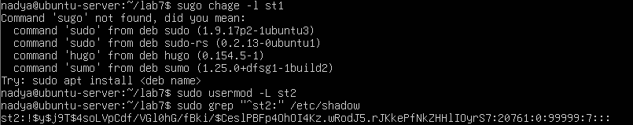

5 Створила робочий каталог lab8, у якому розмістила тестовий файл та скрипт. Для файлу rights.txt встановила права 644 спочатку символьним, а потім числовим способом. Результат перевірила командою stat. Також створила скрипт hello.sh, надала йому права на виконання та перевірила його роботу. Переконалася, що обидва способи встановлення прав дають однаковий результат.

Таблиця 1 - Порівняння символьного та числового способів зміни прав доступу

| Спосіб | Команда | Результат |
| --- | --- | --- |
| Символьний | `chmod u=rw,g=r,o=r rights.txt` | `rw-r--r--` |
| Числовий | `chmod 644 rights.txt` | `rw-r--r--` |
| Символьний | `chmod u=rwx,g=rx,o=rx hello.sh` | `rwxr-xr-x` |
| Числовий | `chmod 755 hello.sh` | `rwxr-xr-x` |

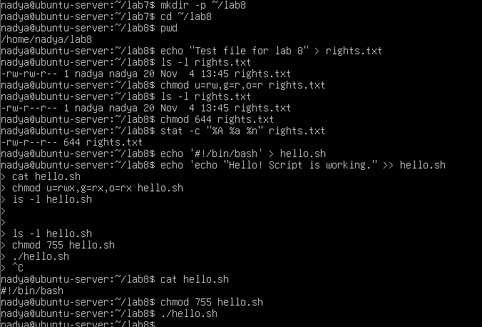

6 Створила каталог restricted та файл data.txt усередині нього. Змінила права каталогу на 644, унаслідок чого було втрачено право виконання x. Під час спроби прочитати файл система видала повідомлення Permission denied. Після повернення прав 755 доступ до файлу відновився. Отже, право x для каталогу необхідне для переходу до нього та доступу до файлів усередині.

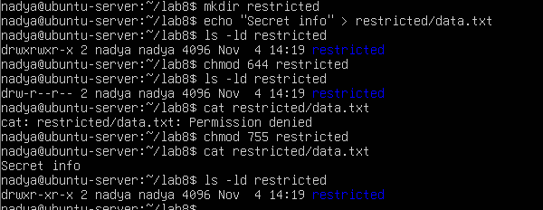

7 Дослідила вплив маски umask на права новостворених файлів і каталогів. Спочатку перевірила поточне значення маски та створила тестові об'єкти. Після цього встановила маску 022 відповідно до індивідуального варіанта. У результаті файл отримав права 644, а каталог — 755. З'ясувала, що маска визначає права нових об'єктів і не змінює права вже створених файлів.

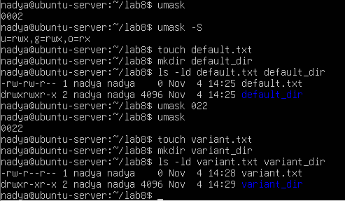

8 Створила спільний каталог /srv/team та призначила йому групу-власника students. Встановила права 3770, які містять біти SGID і sticky. Перевірила роботу обох користувачів: створені ними файли автоматично отримали групу students, що є результатом дії SGID. Під час спроби видалити чужі файли система видала повідомлення Operation not permitted. Це підтверджує дію sticky-біта, який забороняє видаляти файли інших користувачів у спільному каталозі.

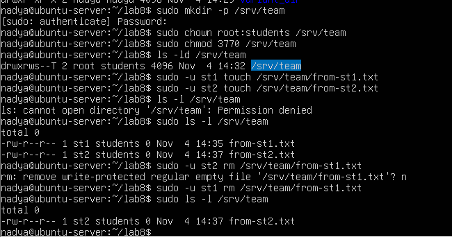

9 Створила файл acl-report.txt та встановила стандартні права доступу 644. За допомогою команди setfacl надала групі students додаткове право читання. Перевірила налаштування командою getfacl. У результаті виводу з'явився окремий запис group:students:r--, а у правах файлу — знак +. Перевірила читання файлу від імені користувачів st1 і st2. Обидва користувачі змогли прочитати його, оскільки входять до групи students.

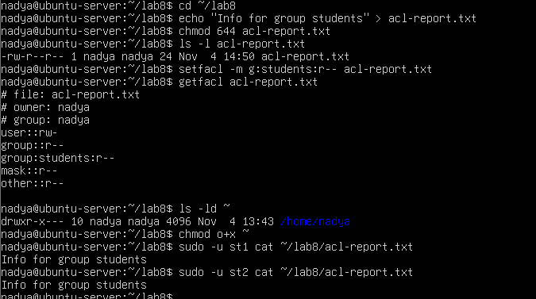

10 Дослідила дію sticky-біта на прикладі системного каталогу /tmp. За допомогою команди ls -ld /tmp перевірила наявність спеціального біта, який позначається літерою t. Створила тимчасовий файл від імені користувача st1. Під час спроби видалити його від імені st2 система видала повідомлення Operation not permitted. Після цього власник файлу st1 успішно видалив його. Отже, sticky-біт захищає файли користувачів від видалення іншими користувачами спільного каталогу

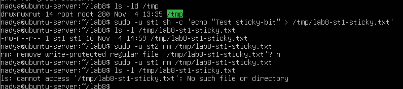

11 Після завершення експериментів відновила початкові права доступу до домашнього каталогу. Видалила створених для лабораторної роботи користувачів st1 і st2 разом із домашніми каталогами, а також групу students. За допомогою команди getent перевірила, що навчальні облікові записи та група більше не присутні в системі.

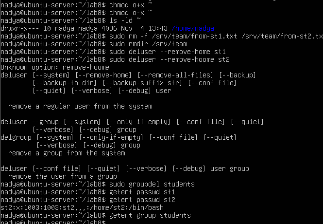

## Відповіді на контрольні питання
### Високий рівень (творчий)
1 Спроєктуйте права для каталогу проєкту, у якому працюють дві групи: одна редагує файли, друга лише читає. Опишіть команди й обґрунтуйте кожне рішення. 

Є дві групи користувачів:
- editors — можуть переглядати та редагувати файли;
- readers — можуть тільки переглядати та читати файли.
Спочатку створимо групи: sudo groupadd editors; sudo groupadd readers. Створимо каталог проєкту: sudo mkdir -p /srv/project. Призначимо власником каталогу адміністратора, а групою-власником — editors: sudo chown root:editors /srv/project. Встановимо права: sudo chmod 2770 /srv/project. Біт SGID забезпечує автоматичне успадкування групи editors для нових файлів і підкаталогів. Надамо групі readers право читання та перегляду каталогу через ACL: sudo setfacl -m g:readers:rx /srv/project.  Щоб нові файли та каталоги також отримували відповідні права, налаштуємо ACL за замовчуванням: sudo setfacl -d -m g:editors:rwx /srv/project; sudo setfacl -d -m g:readers:rx /srv/project. Перевіримо результат: getfacl /srv/project. - Група editors отримує права на читання, запис і виконання. Група readers може переглядати каталог і читати файли, але не може їх змінювати. SGID забезпечує успадкування групи для нових файлів. ACL дозволяє надати різні права двом групам одночасно. Отже, використання ACL дозволяє організувати спільну роботу двох груп із різними рівнями доступу.

2 Поясніть, навіщо програмі passwd потрібен біт SUID, які ризики це створює і як система їх обмежує.

Програма passwd використовується для зміни пароля користувача. Інформація про паролі зберігається у файлі /etc/shadow, доступ до якого має тільки адміністратор (root). Звичайний користувач не може самостійно змінювати цей файл. Тому програмі passwd потрібен спеціальний біт SUID. SUID дозволяє програмі під час виконання отримувати права її власника, яким зазвичай є root. Перевірити це можна командою: ls -l /usr/bin/passwd. Приклад результату: -rwsr-xr-x. Літера s замість x у правах власника означає наявність SUID. Які ризики це створює? Якщо програма має вразливості, зловмисник може спробувати використати їх для отримання привілеїв адміністратора. Це може призвести до несанкціонованої зміни системних файлів або налаштувань.Як система обмежує ці ризики? - Програма passwd має виконувати лише необхідні операції. Доступ до /etc/shadow контролюється системою прав Linux. Програми з SUID повинні ретельно перевіряти введені дані. Система обмежує небезпечну поведінку привілейованих програм. Отже, SUID потрібен для того, щоб звичайний користувач міг змінювати власний пароль без надання йому повних прав адміністратора.

3 Користувача видалено, а його файли залишилися. Опишіть, що станеться з цими файлами і чому, та запропонуйте коректний порядок видалення облікового запису.

У Linux кожен файл має власника, який визначається числовим ідентифікатором UID. Якщо користувача видалити, його файли не обов'язково видаляються разом із ним. Вони залишаються у файловій системі, але замість імені власника система може показувати його числовий UID. Наприклад, якщо користувач мав UID 1002, після видалення облікового запису файли можуть відображатися так: -rw-r--r-- 1 1002 1002 1500 file.txt. Це відбувається тому, що файлова система зберігає UID і GID власника, а не саме ім'я користувача. Коректний порядок видалення облікового запису:
1. Перевірити, чи є в користувача важливі файли.
2. За потреби зберегти резервну копію його даних.
3. Завершити активні сеанси користувача та перевірити його процеси.
4. Видалити обліковий запис разом із домашнім каталогом: sudo deluser --remove-home st1
5. Якщо група користувача більше не потрібна, видалити її:
sudo groupdel st1
6. Перевірити, чи залишилися файли з UID видаленого користувача:
sudo find / -uid 1002 -ls 2>/dev/null
Отже, видалення користувача не означає автоматичного видалення всіх його файлів. Тому перед видаленням потрібно перевірити та зберегти важливі дані.

4 Сформулюйте принцип найменших привілеїв і покажіть на трьох прикладах із цієї роботи, як він реалізується засобами прав доступу Linux.

Принцип найменших привілеїв означає, що кожен користувач або програма повинні отримувати тільки ті права доступу, які необхідні для виконання їхніх завдань. Це допомагає захистити файли від випадкового або навмисного пошкодження та обмежує можливості несанкціонованого доступу. Приклади з лабораторної роботи:
1. Встановлення прав файлу 644: chmod 644 rights.txt. Власник може читати та змінювати файл, а група й інші користувачі можуть тільки читати. Це обмежує можливість сторонніх користувачів змінювати інформацію.
2. Використання ACL для групи students: setfacl -m g:students:r-- acl-report.txt. Група students отримує тільки право читання файлу, без можливості його змінювати.
3. Використання sticky-біта: sudo chmod 3770 /srv/team. У спільному каталозі користувачі можуть створювати файли, але не можуть видаляти файли інших користувачів. Це захищає дані учасників групи.
Отже, принцип найменших привілеїв реалізується через надання користувачам лише необхідних прав. Це підвищує безпеку системи та зменшує ризик втрати або пошкодження даних.

## Висновок
На лабораторній роботі я навчилася адмініструвати облікові записи в Linux: створювати й налаштовувати користувачів і групи, керувати правами доступу до файлів символьним і числовим способом, застосовувати спеціальні біти та маску umask, налаштовувати спільний каталог для групи й розмежовувати доступ списками ACL
