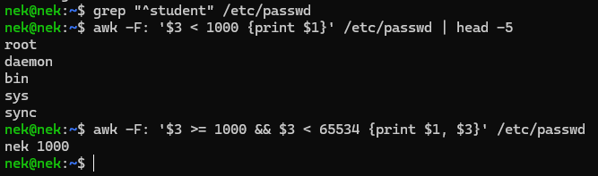
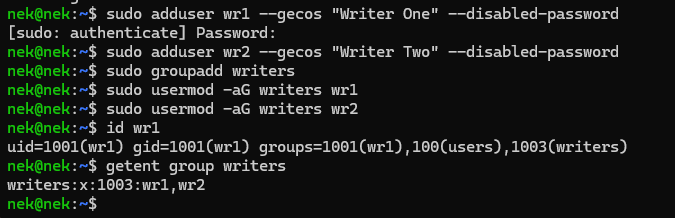
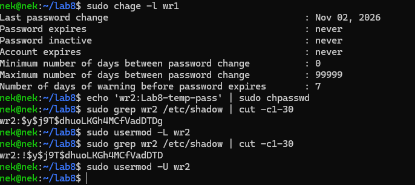
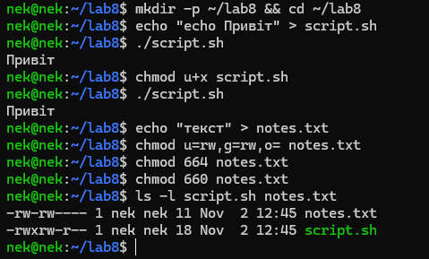
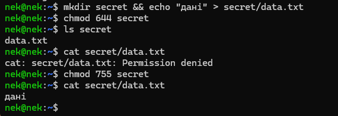
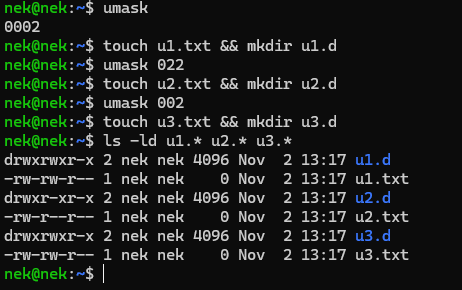
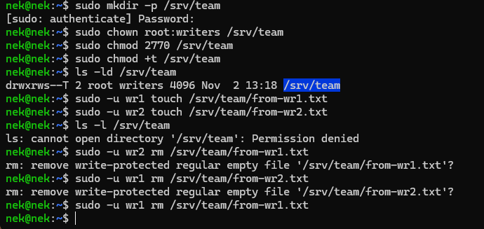
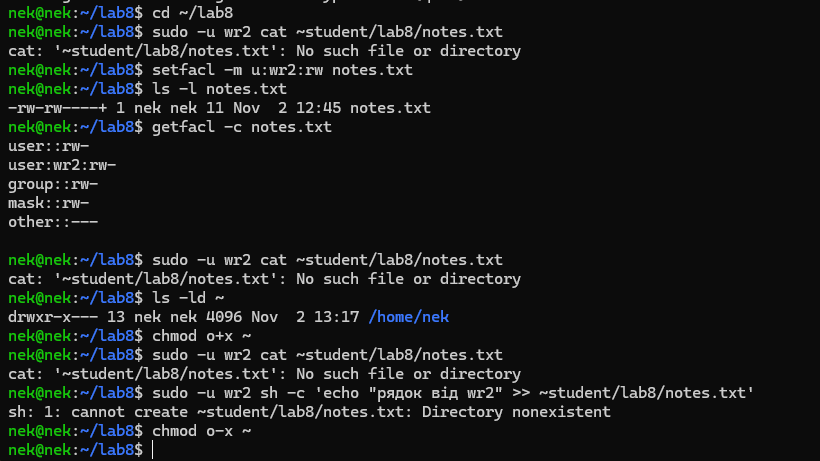
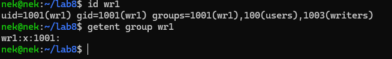
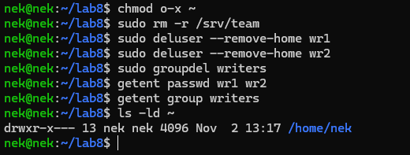

<!--
  Облікові записи та права доступу до файлів
  Варіант 7: `writers` / wr1, wr2 — `660` — `002` — другого користувача: читання й запис — Пояснити схему user private group

  Тему, мету й обладнання писати не треба — конвеєр візьме їх із лабораторної.
  Знімки екрана кладіть у assets/, вихідний код — у src/.
  Контрольні питання — лише одного рівня, того, на який захищаєте роботу:
  заголовок «### Достатній рівень», далі «1 Текст питання?» і відповідь.
  Покрокова інструкція — reports/README.md
-->

## Хід роботи

Індивідуальний варіант 7: група `writers`, користувачі `wr1` і `wr2`; права файлу 660; маска umask 002; ACL для другого користувача (`wr2`) — читання й запис; додаткове завдання — пояснити схему user private group. Усі файлові експерименти виконувалися лише в `~/lab8` та `/srv/team`.

1 Дослідження структури `/etc/passwd`. Вивів власний запис і розібрав його поля (таблиця 1), а також окремо вивів системні облікові записи (UID < 1000) і записи людей. Це потрібно, щоб побачити, що користувач у Linux — це насамперед рядок у текстовому файлі з числовими ідентифікаторами, а не «об'єкт» невідомої природи.

```bash
grep "^student" /etc/passwd
awk -F: '$3 < 1000 {print $1}' /etc/passwd | head -5
awk -F: '$3 >= 1000 && $3 < 65534 {print $1, $3}' /etc/passwd
```

Пояснення ключів: `^student` — рядок, що починається з `student`; `-F:` — роздільник полів у `awk` — двокрапка; `$3` — третє поле (UID); межа 65534 відсікає службового користувача `nobody`; `head -5` — лише перші п'ять рядків.

Таблиця 1 – Поля запису `/etc/passwd` (обліковий запис `student`)

| № | Поле | Значення | Пояснення |
|---|------|----------|-----------|
| 1 | Ім'я | student | логін користувача |
| 2 | Пароль | x | хеш пароля зберігається в `/etc/shadow` |
| 3 | UID | 1000 | числовий ідентифікатор користувача (≥ 1000 — звичайна людина) |
| 4 | GID | 1000 | числовий ідентифікатор основної групи |
| 5 | Опис (GECOS) | Student,,, | повне ім'я та службові відомості |
| 6 | Домашній каталог | /home/student | початковий каталог після входу |
| 7 | Оболонка | /bin/bash | програма, що запускається при вході |



2 Створення групи й двох навчальних користувачів. Користувачів створено командою `adduser`, групу `writers` — після них навмисне, щоб номери UID і GID нових користувачів збігалися (інакше група зайняла б GID 1001). Обох користувачів додано до групи, результат перевірено командами `id` і `getent`.

```bash
sudo adduser wr1 --gecos "Writer One" --disabled-password
sudo adduser wr2 --gecos "Writer Two" --disabled-password
sudo groupadd writers
sudo usermod -aG writers wr1
sudo usermod -aG writers wr2
id wr1                    # uid=1001(wr1) gid=1001(wr1) groups=1001(wr1),1003(writers)
getent group writers      # writers:x:1003:wr1,wr2
```

Пояснення ключів: `--gecos` — поле опису користувача; `--disabled-password` — створити обліковий запис без пароля (вхід за паролем неможливий); `-G` — список додаткових груп; `-a` (append) — **доповнити**, а не замінити список груп (без `-a` користувач втратив би решту додаткових груп, зокрема `sudo`). Основна група `wr1` створена автоматично з тим самим іменем.



3 Терміни дії пароля та блокування облікового запису. Для `wr1` виведено відомості про терміни дії пароля. Оскільки обліковий запис `wr2` створено з `--disabled-password`, у `/etc/shadow` на місці хеша вже стоїть `!`; щоб наочно показати дію блокування, спершу тимчасово задано пароль, потім обліковий запис заблоковано, після демонстрації — розблоковано.

```bash
sudo chage -l wr1
echo 'wr2:Lab8-temp-pass' | sudo chpasswd
sudo grep wr2 /etc/shadow | cut -c1-30     # wr2:$y$j9T$... — хеш без позначки
sudo usermod -L wr2
sudo grep wr2 /etc/shadow | cut -c1-30     # wr2:!$y$j9T$... — перед хешем з'явився !
sudo usermod -U wr2                        # розблоковано після демонстрації
```

Пояснення ключів: `chage -l` — показати терміни дії пароля й облікового запису; `usermod -L` — заблокувати пароль (додає `!` перед хешем); `usermod -U` — зняти блокування. Блокування пароля не закриває вхід за ключем SSH; для повного закриття додатково застосовують `usermod -e 1` (строк дії минув) або оболонку `/usr/sbin/nologin`.



4 Права файлу: символьний і числовий спосіб. У `~/lab8` створено скрипт `script.sh` і файл `notes.txt`. Спершу показано роль біта `x`: без нього скрипт не запускається. Потім права 660 (за варіантом) встановлено символьним способом, повернуто початкові 664 і встановлено ті самі 660 числовим способом — результат однаковий.

```bash
mkdir -p ~/lab8 && cd ~/lab8
echo "echo Привіт" > script.sh
./script.sh                       # bash: ./script.sh: Permission denied
chmod u+x script.sh
./script.sh                       # Привіт
echo "текст" > notes.txt
chmod u=rw,g=rw,o= notes.txt      # символьний спосіб → 660
chmod 664 notes.txt               # повернення до початкових прав
chmod 660 notes.txt               # числовий спосіб → 660
ls -l script.sh notes.txt
```

Пояснення: `u+x` — додати власнику право виконання; `u=rw,g=rw,o=` — задати права власника й групи рівно `rw`, а для інших — порожні. Права 664 у щойно створених файлів — наслідок маски 0002 (див. крок 6). Числове значення 660 = `rw-` (6) для власника, `rw-` (6) для групи, `---` (0) для інших.

Таблиця 2 – Права до і після кожної зміни

| № | Команда | Файл | Символьно | Числом |
|---|---------|------|-----------|--------|
| 1 | `echo "echo Привіт" > script.sh` | script.sh | -rw-rw-r-- | 664 |
| 2 | `chmod u+x script.sh` | script.sh | -rwxrw-r-- | 764 |
| 3 | `echo "текст" > notes.txt` | notes.txt | -rw-rw-r-- | 664 |
| 4 | `chmod u=rw,g=rw,o= notes.txt` | notes.txt | -rw-rw---- | 660 |
| 5 | `chmod 664 notes.txt` | notes.txt | -rw-rw-r-- | 664 |
| 6 | `chmod 660 notes.txt` | notes.txt | -rw-rw---- | 660 |



5 Права каталогу. Створено каталог `secret` із файлом усередині та зніто біт `x` (права 644). Каталог без `x` дозволяє лише прочитати перелік імен, але не звертатися до файлів, хоча права самого файлу не змінювалися. Команда `ls` показала ім'я `data.txt` (право `r` на каталог), але з помилкою, бо не змогла прочитати відомості про файл (немає `x`); `cat` дістала відмову. Після повернення прав 755 файл читається.

```bash
mkdir secret && echo "дані" > secret/data.txt
chmod 644 secret
ls secret                  # ls: cannot access 'secret/data.txt': Permission denied
cat secret/data.txt        # cat: secret/data.txt: Permission denied
chmod 755 secret
cat secret/data.txt        # дані
```



6 Маска umask. Поточна маска — 0002 (типова для Ubuntu). Значення за варіантом (002) збігається з нею, тому для наочності порівняння додатково взято маску 022. Права нових об'єктів: файл — 666 без бітів маски, каталог — 777 без бітів маски. Це побітова операція «і не», а не віднімання. Маска діє лише на об'єкти, створені після її встановлення, і лише в поточній оболонці.

```bash
umask                             # 0002
touch u1.txt && mkdir u1.d
umask 022
touch u2.txt && mkdir u2.d
umask 002                         # значення за варіантом
touch u3.txt && mkdir u3.d
ls -ld u1.* u2.* u3.*
```

Таблиця 3 – Результати для різних масок umask

| Маска | Файл (666 і не маска) | Каталог (777 і не маска) |
|-------|-----------------------|--------------------------|
| 0002 (початкова) | -rw-rw-r-- (664) | drwxrwxr-x (775) |
| 022 (для порівняння) | -rw-r--r-- (644) | drwxr-xr-x (755) |
| 002 (за варіантом) | -rw-rw-r-- (664) | drwxrwxr-x (775) |

Різниця: з маскою 022 група втрачає право запису, а з маскою 002 група отримує його — це доречно, коли в кожного користувача власна основна група (див. крок 9).



7 Спільний каталог команди `/srv/team`. Власником каталогу зроблено `root`, групою — `writers`. Встановлено SGID (2000) і sticky (1000): разом права складають 3770. Далі від імені обох користувачів створено файли й виконано спроби видалення.

```bash
sudo mkdir -p /srv/team
sudo chown root:writers /srv/team
sudo chmod 2770 /srv/team
sudo chmod +t /srv/team
ls -ld /srv/team                              # drwxrws--T 2 root writers ...
sudo -u wr1 touch /srv/team/from-wr1.txt
sudo -u wr2 touch /srv/team/from-wr2.txt
ls -l /srv/team
sudo -u wr2 rm /srv/team/from-wr1.txt         # Operation not permitted
sudo -u wr1 rm /srv/team/from-wr2.txt         # Operation not permitted
sudo -u wr1 rm /srv/team/from-wr1.txt         # видалено (власник файлу)
```

Таблиця 4 – Результати роботи в `/srv/team`

| Дія | Результат | Пояснення |
|-----|-----------|-----------|
| `ls -ld /srv/team` | drwxrws--T root writers | `s` на місці `x` групи — SGID, `T` — sticky без `x` для інших |
| `wr1` створює файл | файл належить групі `writers` | SGID: нові файли успадковують групу каталогу, а не основну групу `wr1` |
| `wr2` створює файл | файл належить групі `writers` | те саме |
| `wr2` видаляє файл `wr1` | Operation not permitted | sticky: видаляти може лише власник файлу (або власник каталогу чи root) |
| `wr1` видаляє файл `wr2` | Operation not permitted | те саме |
| `wr1` видаляє власний файл | успішно | власник файлу має право його видалити |

Біт SGID гарантує, що всі файли команди автоматично належать спільній групі `writers`, а біт sticky не дозволяє учасникам видаляти чужі файли, хоча право запису в каталог у групи є. Права файлів `rw-r--r--` (а не `rw-rw-r--`) пояснюються тим, що `sudo` за замовчуванням запускає команди з маскою не м'якшою за 0022.



8 Точковий доступ через ACL. Користувачеві `wr2` надано читання й запис файлу `notes.txt` (права 660, власник — `student`). Спершу `wr2` отримав відмову. Після `setfacl` у виводі `ls -l` з'явився знак `+`, але доступ усе ще був закритий: домашній каталог `/home/student` має права 750, тому `wr2` не міг пройти через нього. Лише після тимчасового `chmod o+x ~` читання й запис запрацювали; потім право відкликано.

```bash
cd ~/lab8
sudo -u wr2 cat ~student/lab8/notes.txt      # Permission denied
setfacl -m u:wr2:rw notes.txt
ls -l notes.txt                              # -rw-rw----+
getfacl -c notes.txt
sudo -u wr2 cat ~student/lab8/notes.txt      # все ще Permission denied
ls -ld ~                                     # drwxr-x---
chmod o+x ~
sudo -u wr2 cat ~student/lab8/notes.txt      # текст
sudo -u wr2 sh -c 'echo "рядок від wr2" >> ~student/lab8/notes.txt'
chmod o-x ~
```

Вивід `getfacl -c notes.txt`: `user::rw-`, `user:wr2:rw-`, `group::rw-`, `mask::rw-`, `other::---`. Ключі: `-m` — змінити (додати) запис ACL; `u:wr2:rw` — користувач `wr2`, права `rw`; `-c` — не показувати заголовок. Рядок `mask::rw-` — верхня межа прав для всіх записів, крім власника й «інших».

Права на батьківські каталоги знадобилися, бо для доступу до файлу потрібне право `x` на **кожен** каталог шляху (`/home`, `/home/student`, `~/lab8`) незалежно від ACL самого файлу. ACL лише розширила права на файл, але не на каталог `/home/student`.



9 Додаткове завдання: схема user private group. У Ubuntu кожен користувач при створенні отримує власну основну групу з тим самим іменем і UID = GID (у групі лише він сам). Перевірка:

```bash
id wr1                 # uid=1001(wr1) gid=1001(wr1) groups=1001(wr1),1003(writers)
getent group wr1       # wr1:x:1001:
```

Користь схеми: файли користувача за замовчуванням належать його приватній групі, у якій більше нікого немає, тому право запису для групи (маска 0002) не відкриває доступ сторонім. Для спільної роботи користувачів додають до окремої групи (як `writers`) і працюють через каталог із SGID. Без такої схеми (усі в спільній групі `users`) для безпеки довелося б використовувати жорсткішу маску 022. Модуль `pam_umask` вмикає м'якшу маску 0002, коли ім'я користувача збігається з іменем його основної групи.



10 Прибирання. Повернуто права домашнього каталогу, видалено навчальний спільний каталог, користувачів і групу `writers`; результат зафіксовано перевіркою.

```bash
chmod o-x ~
sudo rm -r /srv/team
sudo deluser --remove-home wr1
sudo deluser --remove-home wr2
sudo groupdel writers
getent passwd wr1 wr2      # порожньо
getent group writers       # порожньо
ls -ld ~                   # drwxr-x---
```



## Відповіді на контрольні питання

### Високий рівень

1 Спроєктуйте права для каталогу проєкту, у якому працюють дві групи: одна редагує файли, друга лише читає. Опишіть команди й обґрунтуйте кожне рішення.

```bash
sudo groupadd editors
sudo groupadd viewers
sudo mkdir -p /srv/project
sudo chown root:editors /srv/project
sudo chmod 2770 /srv/project
sudo setfacl -m g:viewers:rX /srv/project
sudo setfacl -d -m g:editors:rwX /srv/project
sudo setfacl -d -m g:viewers:rX /srv/project
```

Обґрунтування: групу-власника `editors` і права 770 дають редакторам повний доступ, а іншим — нічого (`other` = 0); SGID (2000) змушує нові файли успадковувати групу `editors`; ACL `g:viewers:rX` додає читачам лише читання й вхід у каталог без права запису; ACL за замовчуванням (`-d`) поширює ці самі права на всі нові файли й підкаталоги, щоб не виконувати налаштування вручну. За потреби заборонити редакторам видаляти чужі файли додають sticky (`chmod +t`). Права на батьківські каталоги (`/srv`) мають дозволяти прохід (`x`) обом групам.

2 Поясніть, навіщо програмі passwd потрібен біт SUID, які ризики це створює і як система їх обмежує.

Хеші паролів лежать у `/etc/shadow`, доступному для запису лише root. Звичайний користувач повинен мати змогу змінити власний пароль, тому `/usr/bin/passwd` має біт SUID (`-rwsr-xr-x`): під час запуску програма отримує права власника файлу, тобто root, і може змінити свій рядок у `shadow`.

Ризик: будь-яка вразливість у такій програмі (наприклад, переповнення буфера) дає зловмиснику права root. Обмеження: програма мала й ретельно перевірена; вона визначає, хто її запустив, за реальним UID і дозволяє змінювати лише пароль цього користувача (а root — будь-якого); кількість SUID-файлів у системі мінімальна, їх можна періодично перевіряти (`find /usr/bin -perm -4000`); розділи з користувацькими даними монтують з параметром `nosuid`.

3 Користувача видалено, а його файли залишилися. Опишіть, що станеться з цими файлами і чому, та запропонуйте коректний порядок видалення облікового запису.

Власник файлу в файловій системі зберігається як **числовий UID**, а не як ім'я. Після видалення запису з `/etc/passwd` файли залишаються на місці, а `ls -l` показує замість імені число. Якщо пізніше новому користувачеві призначать той самий UID, він автоматично отримає доступ до чужих «осиротілих» файлів. `deluser --remove-home` видаляє лише домашній каталог (і поштову скриньку), а не всі файли користувача по системі.

Коректний порядок: 1) заблокувати обліковий запис (`usermod -L -e 1 user`); 2) завершити його процеси (`pkill -u user`); 3) знайти всі його файли (`find / -xdev -uid UID`); 4) зберегти потрібне й передати іншому власнику (`chown -R new:group`); 5) перевірити завдання cron тощо; 6) вилучити з груп і видалити обліковий запис (`deluser --remove-home user`, за потреби `--backup`); 7) перевірити, що немає файлів із невідомим власником (`find / -nouser`).

4 Сформулюйте принцип найменших привілеїв і покажіть на трьох прикладах із цієї роботи, як він реалізується засобами прав доступу Linux.

Принцип найменших привілеїв: суб'єкт (користувач, процес) має отримувати лише ті права, які потрібні для його завдання, і лише на потрібний час. Приклади з роботи:

а) Точкова ACL: щоб `wr2` міг працювати з одним файлом, йому надано `rw` лише на `notes.txt` (`setfacl -m u:wr2:rw`), а не розширено права групи чи «інших»; доступ до домашнього каталогу `o+x` відкрито тимчасово й відкликано (`chmod o-x ~`).

б) Спільний каталог `/srv/team` (права 3770): доступ мають лише учасники групи `writers`, «інші» — нічого; sticky не дає учасникам видаляти чужі файли, хоча записувати вони можуть.

в) Права 660 на файл (`o=` — нічого для інших) і домашній каталог із правами 750; `/etc/shadow` читає лише root; блокування облікового запису (`usermod -L`), який тимчасово не потрібен. Тобто за замовчуванням доступ закритий і відкривається лише точково.

## Висновок

Під час лабораторної роботи я опанував адміністрування облікових записів у Linux: вивчив будову запису в `/etc/passwd` і зв'язок із `/etc/shadow`, створив групу `writers` та користувачів `wr1`, `wr2` (`adduser`, `groupadd`, `usermod -aG`), перевірив терміни дії пароля (`chage -l`) і заблокував обліковий запис (`usermod -L`). Я встановлював права доступу символьним і числовим способом (`chmod`) і переконався, що результат однаковий, а також побачив, що для каталогу право `x` означає право доступу до вмісту. За допомогою маски umask показав, як формуються права нових файлів (операція «і не», а не віднімання), налаштував спільний каталог `/srv/team` з бітами SGID і sticky, що забезпечили спільну групу файлів і захист від видалення чужих файлів, а також розібрав схему user private group.

Модель «власник — група — інші» описує права лише для трьох категорій, тому не дозволяє надати доступ окремому користувачеві поза групою, не розширивши права для всієї групи чи для всіх. Списки ACL доповнюють її точковими записами для конкретних користувачів і груп та правами за замовчуванням для нових файлів, тож дають змогу дотримуватися принципу найменших привілеїв. Водночас ACL не скасовують потреби в праві `x` на кожному каталозі шляху: у роботі доступ `wr2` до файлу з'явився лише після того, як було відкрито прохід через домашній каталог.


