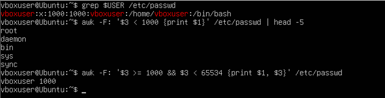
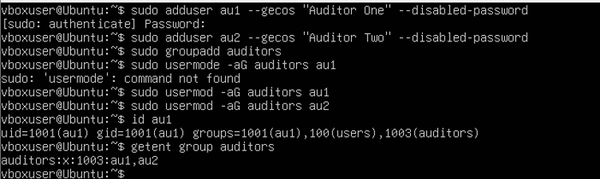
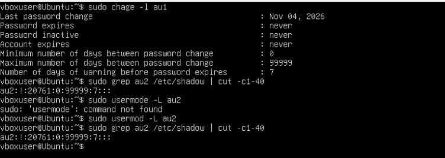
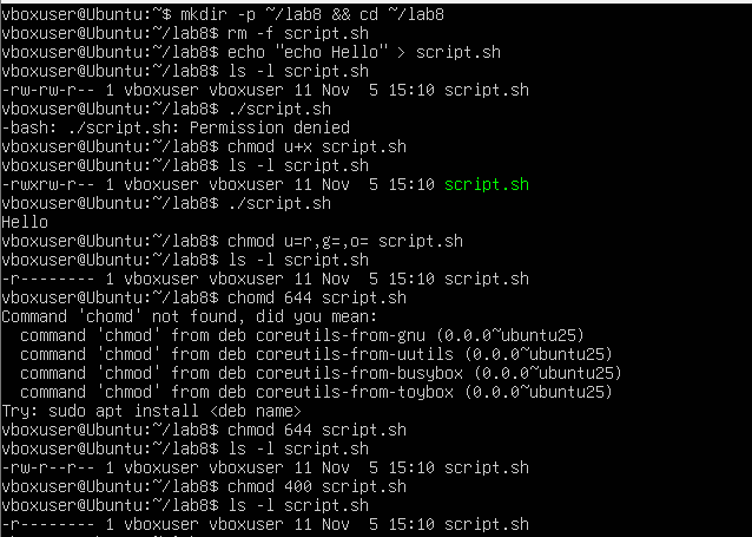
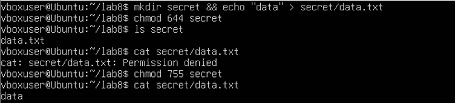
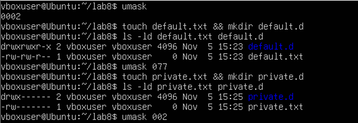
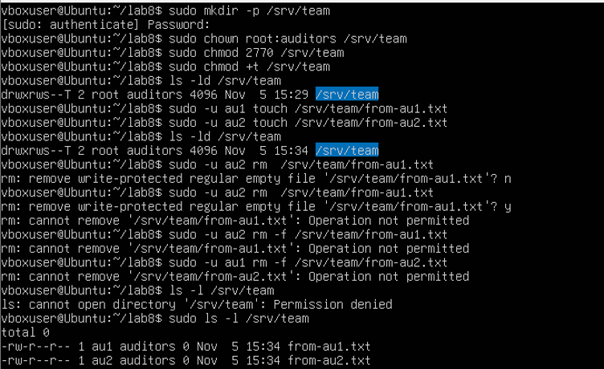
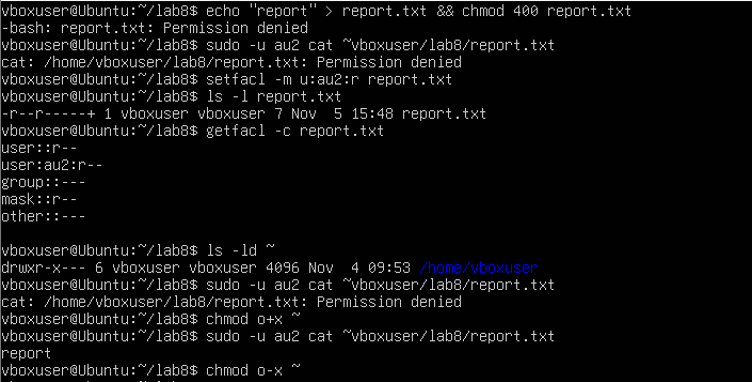
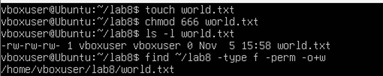
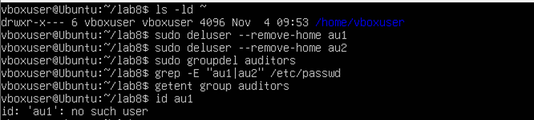

<!--
  Облікові записи та права доступу до файлів
  Варіант 11: `auditors` / au1, au2 — `400` — `077` — другого користувача: читання — Знайти файли, доступні на запис усім користувачам

  Тему, мету й обладнання писати не треба — конвеєр візьме їх із лабораторної.
  Знімки екрана кладіть у assets/, вихідний код — у src/.
  Контрольні питання — лише одного рівня, того, на який захищаєте роботу:
  заголовок «### Достатній рівень», далі «1 Текст питання?» і відповідь.
  Покрокова інструкція — reports/README.md
-->

## Хід роботи

1 Отримала в викладача номер індивідуального варіанта 11.

2 Дослідила структуру файлу /etc/passwd. Командою grep $USER /etc/passwd вивела власний запис: vboxuser:x:1000:1000:vboxuser:/home/vboxuser:/bin/bash. Поля розділені двокрапкою: vboxuser — ім'я користувача; x — позначка того, що хеш пароля зберігається окремо у файлі /etc/shadow; 1000 — UID (числовий ідентифікатор користувача); 1000 — GID (основна група); vboxuser — опис облікового запису; /home/vboxuser — домашній каталог; /bin/bash — оболонка входу. Командою awk -F: ‘$3 < 1000 {print $1}’ вивела системні облікові записи (UID менший за 1000): root, daemon, bin, sys, sync — вони існують для служб, а не для людей. Командою awk -F: ‘$3 >= 1000 && $3 < 65534 {print $1, $3}’ вивела облікові записи людей: у системі такий запис один — vboxuser з UID 1000.

3 Створила навчальних користувачів au1 та au2 командою adduser з ключем --disabled-password, після цього командою groupadd створила групу auditors (групу створено після користувачів, щоб номери UID та GID не розійшлися). Командою usermod -aG auditors додала обох користувачів до групи, ключ -a зберігає наявні групи, а не замінює їх. Командою id au1 перевірила результат: uid=1001(au1) gid=1001(au1) groups=1001(au1),100(users),1003(auditors), тобто основна група au1 створена автоматично з тим самим іменем, а auditors є додатковою. Командою getent group auditors підтвердила склад групи: auditors:x:1003:au1,au2. 

4 Командою sudo chage -l au1 вивела відомості про терміни дії пароля користувача au1: останню зміну пароля виконано 04.11.2026, термін дії пароля, неактивність і термін дії облікового запису — never (необмежені), мінімальний строк між змінами пароля — 0 днів, максимальний — 99999 днів, попередження про завершення дії пароля — за 7 днів. Для другого користувача командою sudo grep au2 /etc/shadow | cut -c1-40 переглянула запис у /etc/shadow до блокування: au2:!:20761:0:99999:7:::. Знак оклику на місці хеша означає, що пароль уже заблоковано, бо обліковий запис створено з ключем --disabled-password. Після виконання sudo usermod -L au2 запис набув вигляду au2:!!:20761:0:99999:7:::, тобто команда додала ще один знак оклику перед хешем (якого тут немає), і вхід за паролем для au2 неможливий. Число 20761 — це дата останньої зміни пароля в днях від 1 січня 1970 року (04.11.2026). 

5 Створила каталог ~/lab8 і скрипт script.sh командою echo “echo Hello” > script.sh (розмір файлу 11 байтів). Початкові права файлу -rw-rw-r-- (наслідок маски 0002), тому спроба запуску ./script.sh завершилася помилкою Permission denied: без біта x ядро відмовляється виконувати файл. Командою chmod u+x script.sh додала власнику право виконання (права -rwxrw-r--), після чого скрипт запустився й вивів Hello. Права за варіантом (400) встановила двома способами. Символьним: chmod u=r,g=,o= script.sh — власнику лише читання, групі й іншим усі права прибрано. Числовим: chmod 400 script.sh (перед цим для наочності змінила права на 644 і отримала -rw-r--r--). В обох випадках результат однаковий: -r--------, тобто числове й символьне подання прав еквівалентні. 

6 Продемонструвала різницю прав для каталогу. Створила каталог secret з файлом data.txt (mkdir secret && echo “data” > secret/data.txt) і зняла з каталогу біт x командою chmod 644 secret. Команда ls secret показала ім'я файлу data.txt, оскільки право r на каталог дозволяє прочитати перелік імен. Проте команда cat secret/data.txt завершилася помилкою Permission denied: щоб звернутися до файлу всередині каталогу, потрібне право x на каталог, а воно відсутнє, хоча права на сам файл не змінювалися. Після повернення права командою chmod 755 secret команда cat secret/data.txt вивела вміст файлу (data). Отже, для каталогу r дозволяє переглядати перелік імен, а x — входити в каталог і звертатися до файлів усередині нього. 

7 Дослідила маску umask. Командою umask з'ясувала поточну маску: 0002. За цієї маски команди touch default.txt та mkdir default.d створили файл з правами -rw-rw-r-- (666 без 002 = 664) і каталог з правами drwxrwxr-x (777 без 002 = 775). Потім змінила маску на значення за варіантом командою umask 077 і повторила: touch private.txt та mkdir private.d створили файл з правами -rw------- (600) і каталог з правами drwx------ (700). Різниця пояснюється тим, що програма запитує права 666 для файлів і 777 для каталогів, а umask визначає, які біти з них прибрати (побітова операція «і не», а не віднімання): маска 077 прибирає всі права групи й інших, тому нові файли й каталоги стають приватними. Маска не змінює вже створені файли й діє лише в поточній оболонці та її дочірніх процесах. Наприкінці повернула маску командою umask 002. 

8 Налаштувала спільний каталог команди /srv/team. Створила його командою sudo mkdir -p /srv/team, передала групі auditors командою sudo chown root:auditors /srv/team та встановила права командами sudo chmod 2770 /srv/team (біт SGID) і sudo chmod +t /srv/team (біт sticky). Командою ls -ld перевірила результат: drwxrws--T 2 root auditors; мала літера s у правах групи означає SGID, а велика T — sticky-біт без права x для інших. Від імені обох користувачів створила файли: sudo -u au1 touch /srv/team/from-au1.txt та sudo -u au2 touch /srv/team/from-au2.txt. Обидва файли автоматично отримали групу auditors — це дія біта SGID, який передає файлам групу каталогу. Права файлів -rw-r--r--, бо sudo запускає команду з маскою 0022. Спроба au2 видалити файл au1 (sudo -u au2 rm /srv/team/from-au1.txt) завершилася помилкою «Operation not permitted», так само й спроба au1 видалити файл au2: хоча права групи на каталог дозволяють запис, біт sticky дозволяє видаляти файл лише його власнику. Спроба переглянути каталог від імені vboxuser завершилася помилкою «Permission denied», бо vboxuser не входить до групи auditors, а права каталогу 770 не надають доступу іншим користувачам; тому вміст каталогу переглянула через sudo. 

9 Надала доступ до файлу конкретному користувачу через ACL. Створила файл report.txt і встановила права за варіантом (400): echo “report” > report.txt && chmod 400 report.txt. Спроба користувача au2 прочитати файл (sudo -u au2 cat ~vboxuser/lab8/report.txt) завершилася помилкою Permission denied, бо за правами 400 файл доступний лише власнику. Командою setfacl -m u:au2:r report.txt надала au2 право читання. У виводі ls -l з'явився знак +: -r--r-----+, що означає наявність ACL (на місці прав групи ls показує маску). Командою getfacl -c report.txt перевірила список: user::r--, user:au2:r--, group::---, mask::r--, other::---. Проте повторна спроба au2 прочитати файл знову завершилася помилкою Permission denied: домашній каталог vboxuser має права drwxr-x--- (750), тобто інші користувачі не мають права x на нього й не можуть пройти до файлу, а право x на кожен каталог шляху обов'язкове незалежно від ACL на самому файлі. Після команди chmod o+x ~ користувач au2 зміг прочитати файл (cat вивів report). Наприкінці відкликала право командою chmod o-x ~, щоб не залишати домашній каталог відкритим. 

10 Виконала додаткове завдання: знайшла файли, доступні на запис усім користувачам. Для перевірки створила файл world.txt і встановила для нього права 666 (touch world.txt, chmod 666 world.txt); команда ls -l показала -rw-rw-rw-. Потім командою find ~/lab8 -type f -perm -o+w знайшла звичайні файли, у яких увімкнено право запису для категорії «інші» (o). Ключ -type f обмежує пошук файлами, а -perm -o+w означає, що біт w для інших має бути встановлений (інші біти не мають значення). Команда вивела єдиний файл: /home/vboxuser/lab8/world.txt. Решта файлів каталогу ~/lab8 (script.sh, report.txt, default.txt, private.txt тощо) права запису для інших не мають, тому в результат не потрапили. Такі файли небезпечні, бо будь-який користувач системи може змінити їхній вміст. 

11 Прибрала за собою. Командою ls -ld ~ перевірила, що права домашнього каталогу повернуто до drwxr-x--- (право x для інших знято командою chmod o-x ~ у пункті 9). Видалила навчальних користувачів командами sudo deluser --remove-home au1 та sudo deluser --remove-home au2 (разом з їхніми домашніми каталогами) і групу командою sudo groupdel auditors. Результат перевірила: grep -E “au1|au2” /etc/passwd і getent group auditors нічого не вивели, а команда id au1 повідомила «no such user», отже облікових записів і групи в системі більше немає. Файли в каталозі /srv/team після видалення користувачів лишилися б із числовими UID і GID замість імен, тому каталог також видалила командою sudo rm -r /srv/team. 

12 Оформила звіт і зробила висновок.

## Відповіді на контрольні питання

### Високий рівень (творчий)

1 Спроєктуйте права для каталогу проєкту, у якому працюють дві групи: одна редагує файли, друга лише читає. Опишіть команди й обґрунтуйте кожне рішення.

Класична модель прав має лише одну групу-власника, тому для двох груп із різним рівнем доступу використовують ACL. Нехай група editors редагує файли, а група readers лише читає. Спочатку створюю групи й каталог командами sudo groupadd editors, sudo groupadd readers, sudo mkdir /srv/project. Групою-власником призначаю редакторів: sudo chown root:editors /srv/project. Права встановлюю командою sudo chmod 2770 /srv/project: власник і група отримують повний доступ, інші не мають жодного. Біт SGID (2000) потрібен, щоб нові файли успадковували групу editors, а не основну групу того, хто їх створив. Далі даю читачам доступ через ACL: sudo setfacl -m g:readers:rX /srv/project. Право r дозволяє переглядати перелік імен, а X додає право виконання (входу) лише каталогам, тож читачі зможуть зайти в каталог, але не створювати й не видаляти файли. Щоб ці самі правила діяли для файлів, які з'являться пізніше, додаю ACL за замовчуванням: sudo setfacl -d -m g:editors:rwx,g:readers:rX /srv/project. Наявні файли оновлюю рекурсивно: sudo setfacl -R -m g:readers:rX /srv/project. Якщо потрібно захистити файли від видалення сторонніми редакторами, додаю sticky-біт командою sudo chmod +t /srv/project: тоді видалити файл зможе лише його власник. Перевіряю результат командою getfacl /srv/project. Таке рішення обґрунтоване тим, що ACL дозволяє описати доступ для другої групи без створення додаткових груп і без розширення прав для категорії «інші», а SGID і default ACL гарантують, що правила діють і для нових файлів, а не лише для наявних.

2 Поясніть, навіщо програмі passwd потрібен біт SUID, які ризики це створює і як система їх обмежує.

Програма passwd змінює пароль користувача, а хеш пароля зберігається у файлі /etc/shadow, доступному для запису лише root. Звичайний користувач сам змінити цей файл не може, але має мати змогу змінити власний пароль. Біт SUID (4000) розв'язує це протиріччя: програма виконується з правами власника файлу, тобто root, а не з правами того, хто її запустив. У виводі ls -l /usr/bin/passwd це видно як -rwsr-xr-x (літера s замість x у правах власника). Тому під час роботи passwd процес має права root і може записати новий хеш у /etc/shadow.

Ризик полягає в тому, що будь-яка помилка в такій програмі (переповнення буфера, некоректна обробка параметрів чи змінних оточення) дає зловмиснику можливість виконати код з правами root, тобто підвищити привілеї. Тому кількість SUID-програм у системі мінімізують, а їхній код ретельно перевіряють. Система обмежує ці ризики кількома способами. По-перше, passwd сам перевіряє, чий пароль змінюється: звичайний користувач може змінити лише власний, а змінювати чужі може тільки root. По-друге, програма записує в /etc/shadow лише потрібне поле й не надає користувачу оболонки з правами root. По-третє, SUID діє лише на виконувані файли, а для скриптів ядро його ігнорує. По-четверте, власник файлу passwd — root, і змінити його звичайний користувач не може, тож підмінити програму неможливо. Також адміністратор може періодично шукати SUID-файли командою find / -perm -4000 і стежити, щоб серед них не з'явилося зайвих.

3 Користувача видалено, а його файли залишилися. Опишіть, що станеться з цими файлами і чому, та запропонуйте коректний порядок видалення облікового запису.

Файл у Linux пов'язаний із власником не за іменем, а за числовим ідентифікатором: у inode зберігаються UID і GID. Ім'я система підставляє лише під час виведення, звіряючи число з /etc/passwd і /etc/group. У моїй роботі це добре видно: після видалення au1, au2 і групи auditors команда ls -l /srv/team показала замість імен числа 1001 і 1002 (власники) та 1003 (група). Файли залишилися на місці з тими самими правами, але стали «осиротілими»: їхній власник не існує. Небезпека в тому, що якщо пізніше буде створено нового користувача, якому система призначить той самий UID (наприклад, 1001), він автоматично отримає доступ до чужих файлів, бо система порівнює саме числа. Крім того, такі файли займають місце й ніхто за них не відповідає.

Коректний порядок видалення облікового запису такий. Спочатку блокую обліковий запис, щоб користувач не міг увійти (sudo usermod -L ім'я та sudo usermod -e 1 ім'я), і завершую його процеси. Потім знаходжу всі його файли в системі командою sudo find / -user ім'я (або -uid номер) і вирішую, що з ними робити: потрібні дані передаю іншому користувачеві командою sudo chown новий_власник файли, непотрібні архівую або видаляю. Лише після цього видаляю обліковий запис командою sudo deluser --remove-home ім'я, яка прибирає й домашній каталог. Наприкінці, якщо група більше не потрібна, видаляю її командою sudo groupdel група, а командою find / -nouser -o -nogroup перевіряю, що не лишилося файлів без власника.

4 Сформулюйте принцип найменших привілеїв і покажіть на трьох прикладах із цієї роботи, як він реалізується засобами прав доступу Linux.

Принцип найменших привілеїв означає, що користувач, процес або програма повинні мати лише ті права, які потрібні для виконання їхнього завдання, і не більше. Це зменшує шкоду від помилок і зловмисних дій: якщо обліковий запис або програму скомпрометовано, зловмисник отримує лише обмежений доступ.

Перший приклад — права файлу 400 за моїм варіантом. Файл report.txt доступний лише власнику й лише для читання: навіть власник не може його випадково змінити, а група й інші не мають жодного доступу. Другий приклад — umask 077. За цієї маски всі нові файли й каталоги автоматично створюються приватними (600 і 700), тобто доступ для групи й інших потрібно надавати свідомо, а не забирати вже після створення. Третій приклад — ACL для au2. Замість того щоб змінити права для всієї групи чи відкрити файл усім (наприклад, chmod o+r), я виділила лише одного користувача й лише одну дію: setfacl -m u:au2:r report.txt. Решта користувачів і далі не мають доступу, а сам au2 може лише читати, але не змінювати файл.

Доповнюють ці приклади й інші рішення з роботи. Спільний каталог /srv/team отримав права 2770, тобто закритий для сторонніх, а біт sticky не дозволяє учасникам групи видаляти чужі файли. Також після демонстрації ACL я відкликала право на домашній каталог (chmod o-x ~), щоб не залишати доступ ширшим, ніж потрібно, а додаткове завдання з пошуку файлів, доступних на запис усім, спрямоване саме на виявлення порушень цього принципу.

## Висновок

На цій лабораторній роботі я навчилася адмініструвати облікові записи в Linux: створювати й налаштовувати користувачів і групи, керувати правами доступу до файлів символьним і числовим способом, застосовувати спеціальні біти та маску umask, налаштовувати спільний каталог для групи й розмежовувати доступ списками ACL.
