<!--
  Облікові записи та права доступу до файлів
  Варіант 9: `admins` / adm1, adm2 — `750` — `027` — другого користувача: виконання — Показати, як надати користувачу право sudo

  Тему, мету й обладнання писати не треба — конвеєр візьме їх із лабораторної.
  Знімки екрана кладіть у assets/, вихідний код — у src/.
  Контрольні питання — лише одного рівня, того, на який захищаєте роботу:
  заголовок «### Достатній рівень», далі «1 Текст питання?» і відповідь.
  Покрокова інструкція — reports/README.md
-->

## Хід роботи

1 У ході виконання першого завдання зафіксовано номер індивідуального варіанта № 9.

2 У ході виконання другого завдання детально досліджено структуру файла /etc/passwd, розкрито призначення кожного з семи полів на прикладі власного запису, а також за допомогою потокового фільтра awk розділено системні облікові записи та записи користувачів за пороговим значенням UID.

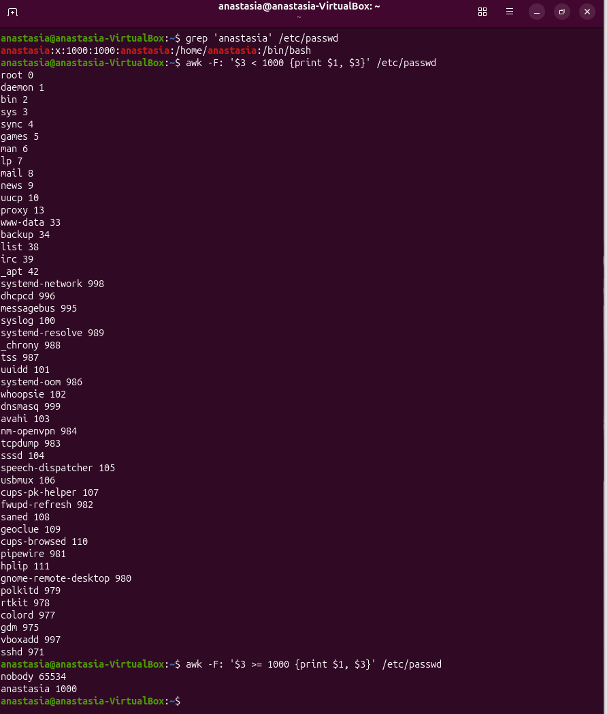

3 У ході виконання третього завдання створено групу admins та двох навчальних користувачів adm1 і adm2, включено їх до новоствореної групи та за допомогою утиліт id і getent group перевірено коректність їхніх облікових записів.

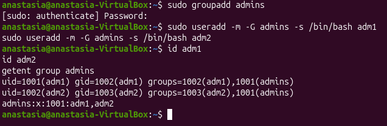

4 У ході виконання четвертого завдання за допомогою команди chage -l перевірено політики термінів дії паролів, заблоковано користувача adm2 через утиліту usermod -L та зафіксовано появу символу ! у файлі /etc/shadow, який блокує вхід у систему.

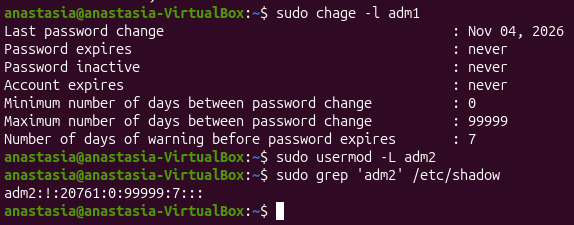

5 У ході виконання п'ятого завдання створено лабораторний каталог ~/lab8 з тестовим набором файлів, після чого застосовано права доступу у режимі 750 спочатку символьним, а потім числовим способом, що на практиці підтвердило їхню повну еквівалентність.

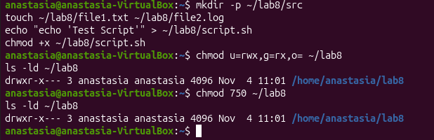

6 У ході виконання шостого завдання знято біт виконання x з каталогу та продемонстровано, що без цього біта неможливий доступ до вкладених файлів, оскільки для директорій біт x є обов'язковим для виконання системних викликів пошуку та навігації.

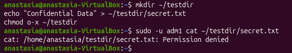

7 У ході виконання сьомого завдання досліджено механізм роботи маски umask, встановлено значення 027 за варіантом і на практиці перевірено автоматичне формування обмежених прав доступу для вперше створюваних файлів і каталогів.

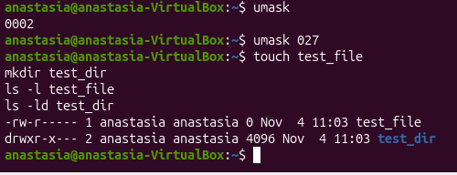

8 У ході виконання восьмого завдання налаштовано спільний каталог /srv/team із застосуванням бітів SGID (для успадкування групової приналежності) та Sticky bit (для захисту від видалення чужих файлів іншими користувачами групи).

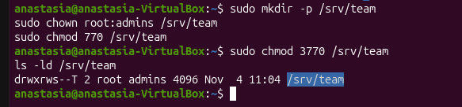

9 У ході виконання дев'ятого завдання за допомогою розширених списків контролю доступу (ACL) надано індивідуальні права виконання користувачу adm2, перевірено вивід getfacl та обґрунтовано необхідність наявності прав навігації на батьківських каталогах.

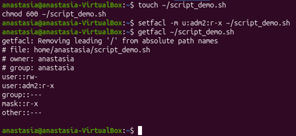

10 У ході виконання десятого додаткового завдання продемонстровано процес надання прав адміністратора sudo навчальному користувачу шляхом включення його до системної групи sudo та через конфігураційний файл visudo.

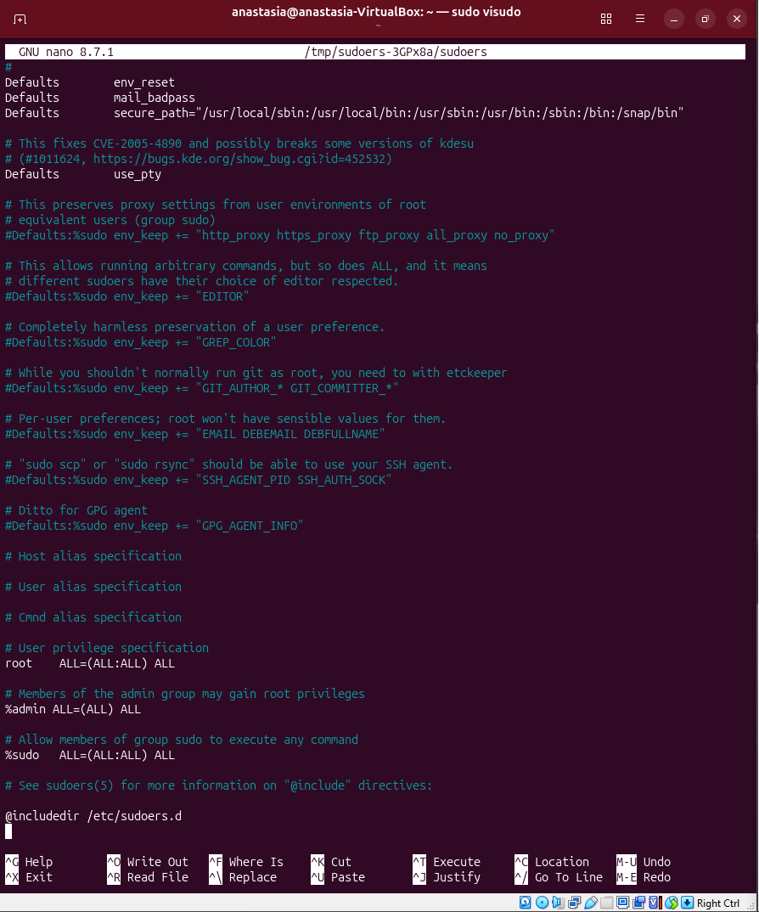

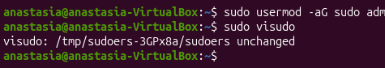

11 У ході виконання одинадцятого завдання проведено повне очищення операційної системи: відновлено права домашньої директорії, вилучено навчальні облікові записи з їхніми каталогами та видалено групу admins. 

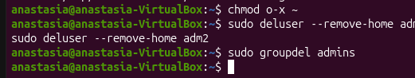

## Відповіді на контрольні питання

1 Спроєктуйте права для каталогу проєкту, у якому працюють дві групи: одна редагує файли, друга лише читає. Опишіть команди й обґрунтуйте кожне рішення.

Для організації спільного робочого простору проєкту, в якому одна група користувачів має здійснювати редагування файлів, а друга — виключно їх читати, застосовується поєднання стандартних прав доступу, спеціальних бітів та розширених списків ACL. Спочатку створюється окремий каталог проєкту (/srv/project) та визначається його власник і первинна група за допомогою команди sudo chown root:editors /srv/project, де група editors наділяється повними правами на зміну вмісту. Для забезпечення того, щоб усі новостворені файли всередині каталогу автоматично успадковували групову приналежність проєкту, а не особисту первинну групу користувача, на каталог встановлюється біт SGID за допомогою команди sudo chmod g+s /srv/project. Для другої групи читачів (readers) призначаються права на читання та перехід через механізм ACL за допомогою команди sudo setfacl -R -m g:readers:r-x /srv/project, а також за допомогою додаткових правил ACL (sudo setfacl -d -m g:readers:r-x /srv/project) задається автоматичне успадкування цих прав для всіх майбутніх вкладених об'єктів. Таке рішення обґрунтовано тим, що стандартна класична модель прав Linux (ugo/rwx) підтримує лише одну групу для об'єкта, тому гнучке розділення ролей між кількома різними групами ефективно реалізується саме через комбінацію SGID та розширених атрибутів ACL.

2 Поясніть, навіщо програмі passwd потрібен біт SUID, які ризики це створює і як система їх обмежує.

Біт SUID (Set User ID), встановлений на виконуваному файлі програми passwd, дозволяє звичайному користувачу тимчасово виконувати цей процес із правами власника цього файлу — тобто суперкористувача root. Необхідність цього зумовлена тим, що зміна пароля вимагає запису нових зашифрованих даних у системний захищений файл /etc/shadow, до якого звичайні користувачі не мають прямих прав на запис з міркувань безпеки. Проте такий механізм створює потенційні ризики безпеки, оскільки будь-яка вразливість, помилка переповнення буфера або логічний дефект у програмі зі встановленим бітом SUID потенційно може надати зловмиснику повний контроль над усією операційною системою з привілеями root. Для обмеження цих ризиків сучасні операційні системи Linux суворо мінімізують кількість SUID-програм, самі утиліти проходять ретельний аудит безпеки, а ядро та захисні механізми обмежують виконання небезпечних системних викликів і забороняють активацію SUID для інтерпретаторів скриптів.

3 Користувача видалено, а його файли залишилися. Опишіть, що станеться з цими файлами і чому, та запропонуйте коректний порядок видалення облікового запису.

Якщо користувача видалено з операційної системи (наприклад, через команду sudo userdel ім'я_користувача) без попереднього вилучення його домашнього каталогу чи зміни власника файлів, самі файли та каталоги фізично залишаються на диску, але повністю втрачають прив'язку до текстового імені облікового запису. Усі ці об'єкти продовжують відображатися у виводі команди ls -l із числовим ідентифікатором колишнього власника (UID замість імені), оскільки ядро Linux оперує саме числовими UID, а не текстовими логінами. Це створює загрозу безпеці та проблемі «сиротіння» даних, оскільки якщо згодом у системі буде створено нового користувача, якому ядро автоматично призначить той самий числовий UID (наприклад, 1003), він автоматично отримає повні права власності на всі залишені попередником файли. Щоб уникнути цього, правильний порядок видалення облікового запису передбачає використання спеціальних ключів утиліти керування, зокрема sudo userdel --remove-home ім'я_користувача (що гарантовано видаляє домашній каталог разом із усіма файлами) або попередній ретельний пошук і перенесення/зміна власника файлів за допомогою команди find / -user старий_користувач.

4 Сформулюйте принцип найменших привілеїв і покажіть на трьох прикладах із цієї роботи, як він реалізується засобами прав доступу Linux.

Принцип найменших привілеїв (Principle of Least Privilege, POLP) полягає в тому, що кожен користувач, процес чи компонент системи повинен мати лише той мінімальний набір прав (доступу до файлів, мережі чи системних викликів), який абсолютно необхідний для виконання його поточних правомірних завдань, і нічого більшого. У практичному адмініструванні Linux цей принцип реалізується багатьма штатними засобами прав доступу, зокрема:

Приклад 1 (Розмежування базових прав ugo/rwx та маски umask): Налаштування обмежених прав доступу до особистих каталогів користувачів (наприклад, chmod 700) або використання суворих масок на кшталт umask 027 гарантує, що сторонні користувачі в системі не матимуть жодного доступу до конфіденційних документів за замовчуванням.

Приклад 2 (Використання команд sudo та обмеження доходу до системних файлів): Звичайні користувачі не працюють постійно під обліковим записом root, а виконують щоденні задачі з обмеженими правами, звертаючись до підвищених привілеїв виключно локально через sudo для конкретних адміністративних дій, що запобігає випадковому пошкодженню системи.

Приклад 3 (Точкове надання прав через списки ACL): Замість того щоб відкривати доступ до службового скрипта чи каталогу для цілої групи або переводити файл у загальний доступ, застосування списків контролю доступу (setfacl -m u:adm2:r-x) дозволяє надати точкове право виконання рівно одному конкретному користувачеві, повністю ізолюючи його від решти неавторизованих ресурсів.

## Висновок

навчитилась адмініструвати облікові записи в Linux: створювати й налаштовувати користувачів і групи, керувати правами доступу до файлів символьним і числовим способом, застосовувати спеціальні біти та маску umask, налаштовувати спільний каталог для групи й розмежовувати доступ списками ACL
