<!--
  Оболонка mc та редактор vi
  Варіант 7: `hosts`, `hostname`, `networks` — `host*` — `127.0.1.1` → `127.0.1.2` — Пояснити, навіщо в mc порівняння каталогів

  Тему, мету й обладнання писати не треба — конвеєр візьме їх із лабораторної.
  Знімки екрана кладіть у assets/, вихідний код — у src/.
  Контрольні питання — лише одного рівня, того, на який захищаєте роботу:
  заголовок «### Достатній рівень», далі «1 Текст питання?» і відповідь.
  Покрокова інструкція — reports/README.md
-->

## Хід роботи

Індивідуальний варіант 7: конфігураційні файли `hosts`, `hostname`, `networks`; маска пошуку `host*`; заміна `127.0.1.1` → `127.0.1.2`; додаткове завдання — пояснити, навіщо в mc порівняння каталогів. Усі зміни виконувалися лише на копіях у `~/lab9`, оригінали в `/etc` не змінювалися.

1 Підготовка. Установлено пакети `mc` і `vim` (без `vim` команда `vi` запускає урізаний `vim.tiny`, у якому стрілки в режимі вставки друкують літери). Створено структуру `~/lab9` з підкаталогами `conf` і `bak` та скопійовано в `conf` три файли за варіантом. Усі вони доступні для читання звичайному користувачеві, тож `sudo` не потрібен.

```bash
sudo apt install -y mc vim
mkdir -p ~/lab9/{conf,bak}
cp /etc/hosts /etc/hostname /etc/networks ~/lab9/conf/
ls -l ~/lab9/conf
```

Пояснення: `-y` — автоматично погодитися із запитами `apt`; `-p` — створити весь шлях і не видавати помилку, якщо каталог існує; `{conf,bak}` — розкриття дужок оболонкою в два каталоги.

2 Запуск mc та опис інтерфейсу. Командою `mc ~/lab9/conf ~/lab9/bak` запущено Midnight Commander з двома каталогами одразу: у лівій панелі `conf`, у правій `bak` (на цей момент порожній).

```bash
mc ~/lab9/conf ~/lab9/bak
```

Інтерфейс складається з таких частин. **Ліва й права панелі** показують вміст двох різних каталогів; активна панель має підсвічений рядок, перемикаються вони клавішею Tab. Файлові операції зазвичай беруть джерело з активної панелі, а ціль — з протилежної. **Рядок функціональних клавіш** унизу підказує дію кожної з F1–F10. **Меню F9** угорі містить розділи «Лівий», «Файл», «Команда», «Налаштування», «Правий»; через нього виконують порівняння каталогів, пошук файлу, змінюють режим панелі. Над рядком функціональних клавіш розташовано командний рядок оболонки.

Таблиця 1 – Клавіші mc, використані в роботі

| Клавіші | Дія |
|---------|-----|
| Tab | перемкнути активну панель |
| Enter | увійти в каталог або підтвердити діалог |
| Insert | позначити (зняти позначення) файл під курсором для групової операції |
| F3 | переглянути файл без можливості змінити |
| F4 | відкрити файл у вбудованому редакторі mcedit |
| F2 | зберегти файл у mcedit |
| F5 | скопіювати позначені файли на протилежну панель |
| F6 | перемістити або перейменувати |
| F7 | створити каталог |
| F9 | відкрити меню |
| F10 | вийти з переглядача, редактора або з mc |

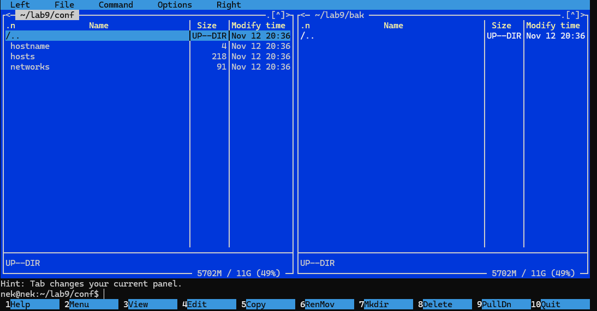

3 Файлові операції в mc. Виконано чотири операції: групове копіювання двох файлів, перейменування, створення каталогу, перегляд файлу. Групове копіювання зручніше за `cp`, бо файли позначаються візуально (Insert) і обробляються однією дією. Особливу увагу приділено F8 — вона видаляє остаточно, без кошика, тому в роботі не застосовувалася.

1. Ліва панель активна (`conf`). Insert на `hosts`, Insert на `hostname` — обидва файли позначено.
2. F5, Enter — позначені файли скопійовано на протилежну панель (`bak`).
3. F6 на `networks`, у полі імені `networks.orig`, Enter — файл перейменовано.
4. F7, `tmp`, Enter — у `conf` створено каталог `tmp`.
5. F3 на `hosts` — перегляд вмісту, вихід — F10 (або F3).

```bash
ls -R ~/lab9
# /home/student/lab9:
# bak  conf
#
# /home/student/lab9/bak:
# hostname  hosts
#
# /home/student/lab9/conf:
# hostname  hosts  networks.orig  tmp
#
# /home/student/lab9/conf/tmp:
```

Таблиця 2 – Вміст панелей після кожної дії

| Дія | Ліва панель (conf) | Права панель (bak) |
|-----|--------------------|--------------------|
| Початковий стан | hosts, hostname, networks | порожньо |
| Insert на hosts і hostname, F5 | hosts, hostname, networks | hosts, hostname |
| F6: networks → networks.orig | hosts, hostname, networks.orig | hosts, hostname |
| F7: каталог tmp | hosts, hostname, networks.orig, tmp | hosts, hostname |
| F3 на hosts | без змін | без змін |

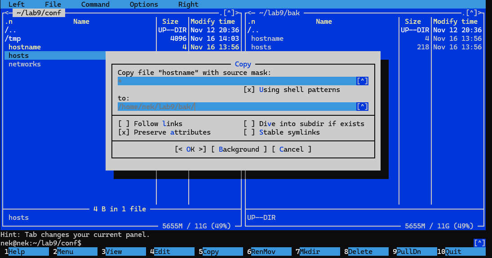

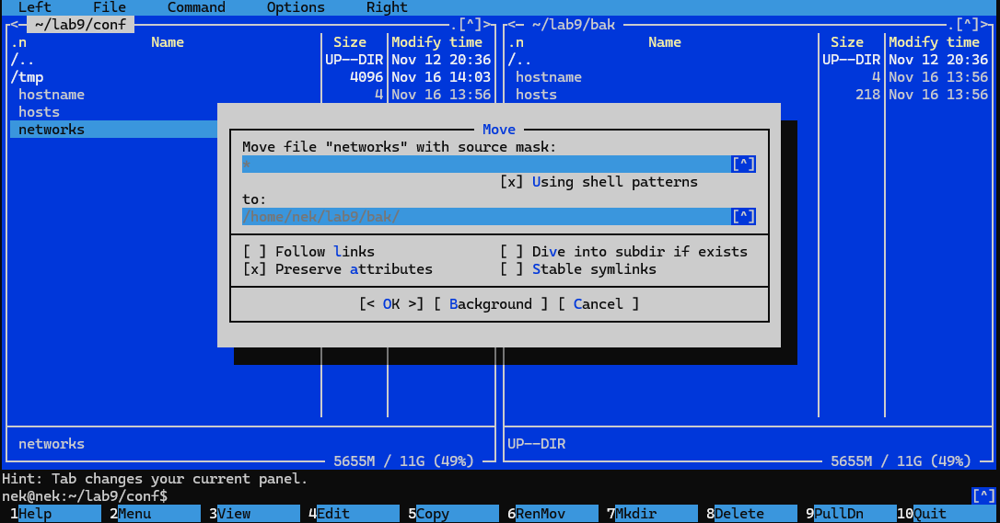

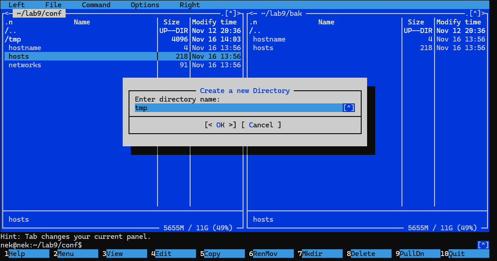

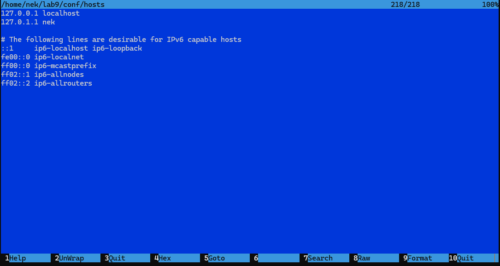

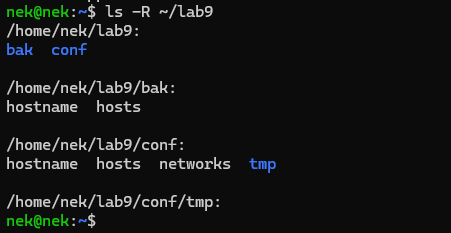

4 Можливості меню F9. Виконано порівняння каталогів `conf` і `bak` та пошук файлів за маскою варіанта.

Порівняння: F9 → Команда → Порівняти каталоги (режим «Швидке»: порівнюються розмір і час зміни). Спільні файли `hosts` і `hostname` збігаються й не позначені; файли, яких немає в `bak`, — `networks.orig` і `tmp` — у лівій панелі позначено.

Пошук: F9 → Команда → Пошук файлу; початковий каталог `~/lab9`, маска імені `host*`. Знайдено чотири файли: `bak/hosts`, `bak/hostname`, `conf/hosts`, `conf/hostname`. Файли `networks.orig` і `tmp` під маску не підпали.

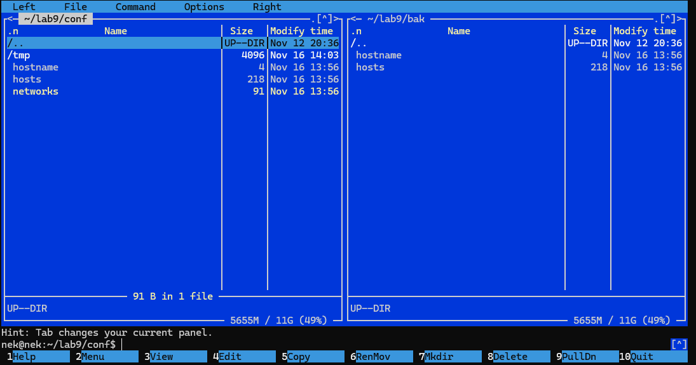

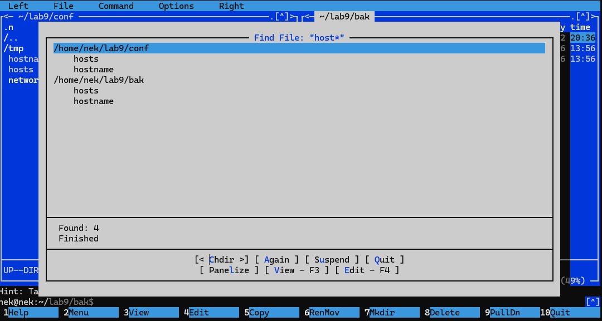

5 Вбудований редактор mc. У правій панелі відкрито `bak/hosts` клавішею F4 (mcedit), дописано рядок, збережено F2, вихід — F10. Рядок у методичному завданні для варіанта не визначено, тому використано рядок із прикладу. Після правки повторно виконано порівняння каталогів: файл `bak/hosts` став новішим і відрізняється від `conf/hosts`, тому позначається як змінений.

```bash
# дописаний рядок:
192.168.1.10   lab-server
tail -2 ~/lab9/bak/hosts
# ff02::2 ip6-allrouters
# 192.168.1.10   lab-server
```

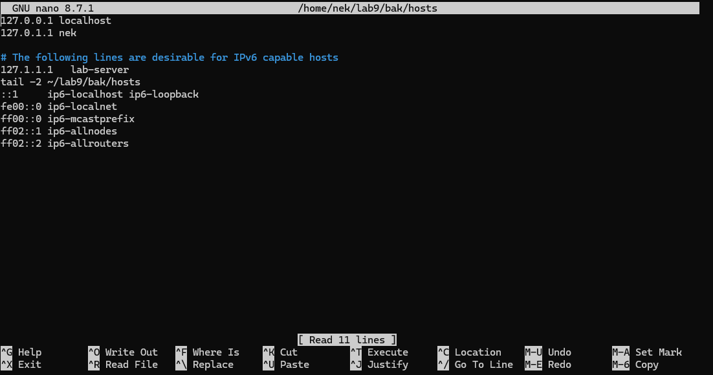

6 Перші кроки у vi. Створено файл `conf/notes.txt` із трьома рядками. Показано перемикання режимів: після запуску vi перебуває в командному режимі; клавіша `i` вмикає режим вставки, `Esc` повертає в командний, `:` вмикає режим останнього рядка, `o` відкриває новий рядок нижче й вмикає режим вставки.

```bash
cd ~/lab9
vi conf/notes.txt
```

Послідовність у vi:

```
i                         → режим вставки
Лабораторна робота 9
Робота в текстовому режимі
Esc                       → командний режим
:w                        → зберегти
:set number               → показати номери рядків
o                         → новий рядок нижче, режим вставки
Автор: Студент
Esc
:wq                       → зберегти й вийти
```

```bash
cat -n conf/notes.txt
#      1  Лабораторна робота 9
#      2  Робота в текстовому режимі
#      3  Автор: Студент
```

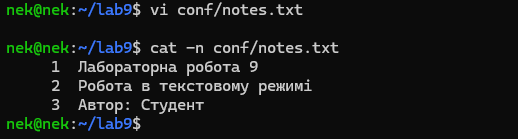

7 Переміщення, пошук, видалення й скасування у vi. Роботу виконано на копії `conf/hosts`. Пошук проведено за параметром варіанта (`127.0.1.1`), крапки у шаблоні пошуку означають «будь-який символ», що на результат тут не впливає. Файл закрито командою `:q!`, тому жодна зміна в ньому не збереглася.

```bash
vi conf/hosts
```

```
:set number         → номери рядків
G                   → кінець файлу
gg                  → початок файлу
/127.0.1.1          → знайти параметр варіанта
n                   → наступне збігання
dd                  → видалити поточний рядок
u                   → скасувати видалення
:5                  → перейти до рядка 5
3dd                 → видалити три рядки
u                   → скасувати
:q!                 → вийти без збереження
```

Таблиця 3 – Застосовані команди vi

| Команда | Призначення |
|---------|-------------|
| `i`, `o`, `Esc` | вставка перед курсором; новий рядок нижче; повернення в командний режим |
| `:set number` | показати номери рядків |
| `gg`, `G` | перехід на початок і кінець файлу |
| `/текст`, `n` | пошук уперед, наступне збігання |
| `dd`, `3dd` | видалити рядок; видалити три рядки |
| `u` | скасувати останню дію |
| `:5` | перейти до рядка 5 |
| `:w`, `:w ім'я` | зберегти; зберегти під іншим іменем |
| `:%s/старе/нове/g` | замінити в усьому файлі |
| `:wq`, `:q!` | зберегти й вийти; вийти без збереження |

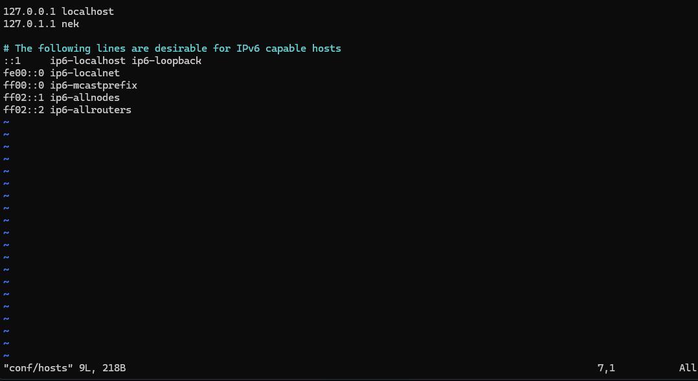

8 Заміна параметра за варіантом і перевірка через `diff`. У `conf/hosts` виконано заміну `127.0.1.1` на `127.0.1.2` у всьому файлі, результат збережено під новим іменем `conf/hosts.new`, оригінальну копію не змінено (вихід `:q!`). Крапки в шаблоні екрановано (`\.`), щоб вони означали саме крапку, а не довільний символ.

```bash
vi conf/hosts
```

```
:%s/127\.0\.1\.1/127.0.1.2/g     → замінити в усьому файлі
:w conf/hosts.new                → зберегти під новим іменем
:q!                              → вийти (оригінал не змінено)
```

```bash
grep -n "127.0.1.2" conf/hosts.new
diff conf/hosts conf/hosts.new
# 2c2
# < 127.0.1.1 lab-vm
# ---
# > 127.0.1.2 lab-vm
```

Пояснення: `%` — діапазон «весь файл»; `g` — замінювати всі входження в рядку, а не лише перше; `diff` показує єдину відмінність: рядок 2 змінився з `127.0.1.1` на `127.0.1.2` (номер рядка й ім'я вузла залежать від системи). Така перевірка обов'язкова перед застосуванням змін у конфігурації.


9 Додаткове завдання: навіщо в mc порівняння каталогів. Команда «Порівняти каталоги» (F9 → Команда → Порівняти каталоги) зіставляє вміст двох панелей і позначає файли, які є лише в одному каталозі або відрізняються. Режими порівняння: «Швидке» (розмір і час зміни), «Лише розмір» і «Повне» (побайтове порівняння вмісту).

Адміністраторові це потрібно, щоб за кілька секунд знайти відмінності між двома деревами файлів, не порівнюючи їх вручну: перевірити, чи резервна копія повна й збігається з оригіналом; побачити, які конфігураційні файли змінилися після оновлення чи правки; з'ясувати, які файли ще не скопійовано на іншу машину або в архів. Позначені файли можна одразу обробити (F5 — докопіювати відсутні), що поєднує пошук різниць і їх усунення в одному інтерфейсі. У цій роботі порівняння показало, що в `conf` є `networks.orig` і `tmp`, яких немає в `bak`, а після правки `bak/hosts` — що цей файл відрізняється.

## Відповіді на контрольні питання

### Середній рівень

1 Що таке Midnight Commander і як улаштовано його інтерфейс?

Midnight Commander (mc) — двопанельний файловий менеджер у текстовому режимі. Ліва й права панелі показують різні каталоги (активна підсвічена), угорі — меню (F9), унизу — рядок функціональних клавіш F1–F10, над ним — командний рядок оболонки.

2 Які дії виконують клавіші F3, F4, F5, F6, F7 і F8?

F3 — переглянути файл; F4 — редагувати файл у вбудованому редакторі; F5 — копіювати на протилежну панель; F6 — перемістити або перейменувати; F7 — створити каталог; F8 — видалити (остаточно, без кошика).

3 Як у mc позначити кілька файлів для групової операції?

Клавішею Insert на кожному файлі або клавішами `+` і `-`, які відкривають діалог позначення (зняття позначення) за маскою. Позначені файли обробляються однією операцією (F5, F6, F8).

4 Назвіть три режими редактора vi.

Командний (переміщення, видалення, копіювання; режим за замовчуванням), вставки (введення тексту) та останнього рядка (команди `:w`, `:q`, `:%s` тощо).

5 Якими клавішами переходять у режим вставки?

`i` (перед курсором), `a` (після курсора), `o` (новий рядок нижче), `I` (на початку рядка), `A` (у кінці рядка), `O` (новий рядок вище).

6 Як зберегти файл і вийти з vi?

`:wq` або `ZZ` у командному режимі.

7 Як вийти з vi без збереження змін?

`:q!` у командному режимі.

8 Якою командою виконують пошук тексту у vi?

`/текст` — пошук уперед (`n` — наступне збігання, `N` — попереднє), `?текст` — пошук назад.

### Достатній рівень

1 Чому набраний одразу після запуску vi текст «зникає» і що робити в цій ситуації?

Після запуску vi перебуває в командному режимі, де літери — це команди (`x` видаляє символ, `dd` — рядок тощо), а не текст. Тому набране не вводиться, а виконується як команди. Що робити: натиснути Esc, за потреби скасувати випадкові зміни командою `u`, перейти в режим вставки клавішею `i` і набирати текст; якщо все зіпсовано — вийти `:q!` без збереження.

2 Чим i відрізняється від a та o? Наведіть задачу для кожної команди.

`i` починає вставку перед символом під курсором (виправити помилку перед символом), `a` — після нього (дописати в кінець слова), `o` відкриває новий порожній рядок нижче поточного (додати новий запис, наприклад новий рядок у `hosts`). Варіанти `I`, `A`, `O` вставляють на початку рядка, у його кінці й рядком вище.

3 Поясніть схему «кількість + дія + об'єкт» на прикладі команд 3dd і 2yy.

Команда може мати числовий префікс, дію й об'єкт: у `3dd` кількість 3, дія `d` (видалити), об'єкт — рядок (`d` удруге); видаляються три рядки. У `2yy` — скопіювати (`y`) два рядки; вставляються командою `p`. Так само `3dw` видаляє три слова.

4 Запишіть команду заміни всіх входжень слова в файлі з підтвердженням кожної заміни.

`:%s/старе/нове/gc` — для кожного входження vi запитує підтвердження (`y` — замінити, `n` — пропустити, `a` — замінити всі, що лишилися, `q` — припинити).

5 Що робить Ctrl+O у mc і коли це потрібно?

Ховає обидві панелі й показує звичайну консоль з історією виведених команд (повторне Ctrl+O повертає панелі). Це потрібно, коли треба виконати команду в оболонці й побачити її повний вивід або перевірити результат попередньої команди, не виходячи з mc.

6 Чим вбудований редактор mcedit зручніший за vi, а чим поступається йому?

mcedit має меню, прості клавіші (F2 — зберегти, F10 — вийти), підсвічування, підтримує виділення й мишу; він доступний без вивчення режимів, тому зручний для швидкої правки. Поступається тим, що mc і mcedit можуть бути не встановлені на чужому сервері, тоді як vi є практично в кожній Unix-системі (його вимагає POSIX) і працює навіть у мінімальному або аварійному середовищі; vi також швидше в досвідчених руках завдяки комбінаціям команд.

7 Як зберегти зміни, якщо файл відкрито без прав на запис? Чим sudoedit безпечніший за sudo vi?

З редактора: `:w !sudo tee % > /dev/null` — буфер передається команді `tee`, запущеній через `sudo`, `%` підставляє ім'я файлу. `sudoedit файл` безпечніший: редактор працює з правами звичайного користувача над тимчасовою копією, а `sudo` лише записує результат на місце, тому редактор разом із плагінами, конфігурацією та командою `:!` (запуск оболонки) не отримує прав root. У `sudo vi` увесь редактор виконується від root.

8 Як у mc порівняти вміст двох каталогів і навіщо це потрібно адміністраторові?

Відкрити потрібні каталоги в обох панелях і виконати F9 → Команда → Порівняти каталоги (режими: швидке, лише розмір, повне). Файли, що відсутні в іншій панелі або відрізняються, позначаються. Це потрібно для перевірки резервних копій, пошуку змінених конфігураційних файлів та синхронізації каталогів.

### Високий рівень

1 Сервер доступний лише через SSH, графічної оболонки немає, потрібно терміново виправити помилку в конфігурації служби. Опишіть повний порядок дій із зазначенням інструментів і поясніть, чому обрали саме їх.

1) Підключитися через `ssh` і залишити другий сеанс відкритим як запасний вхід (якщо виправлення зламає доступ). 2) З'ясувати причину: `systemctl status служба`, `journalctl -u служба`, перевірка конфігурації вбудованою командою (наприклад, `sshd -t`, `nginx -t`). 3) Зробити резервну копію: `sudo cp файл файл.bak` (або F5 у mc, якщо він є). 4) Відредагувати: `sudoedit файл` (редактором vi) — vi гарантовано є на будь-якому сервері, працює по повільному SSH, а `sudoedit` не дає редактору прав root. Знайти параметр `/параметр`, змінити, `:wq`. 5) Перевірити `diff файл.bak файл` — змінилося лише потрібне. 6) Повторно перевірити синтаксис конфігурації. 7) Застосувати `systemctl reload` (м'якше, ніж `restart`), перевірити стан служби й, якщо не допомогло, повернути копію. Інструменти обрано за надійністю й наявністю на кожній системі; mc — лише зручне доповнення, якщо він установлений.

2 Поясніть, чому модальність vi, яка спершу здається незручною, у роботі досвідченого адміністратора дає виграш у швидкості. Проілюструйте прикладом із цієї роботи.

У командному режимі кожна клавіша — окрема команда, тож не потрібні модифікатори (Ctrl, Alt) і миша, руки лишаються на основному ряду. Команди складаються за схемою «кількість + дія + об'єкт» і повторюються клавішею `.`, тому одна коротка комбінація замінює багато рухів. Приклад із роботи: замість пошуку й ручної правки кожного входження одна команда `:%s/127\.0\.1\.1/127.0.1.2/g` виконала заміну в усьому файлі, `3dd` видаляє три рядки, а `u` повертає їх. Модальність також захищає від випадкового введення тексту й працює на будь-якому терміналі.

3 Сформулюйте правила безпечного редагування системних конфігураційних файлів і обґрунтуйте кожне з них наслідками помилки.

а) Працювати з копією або зробити резервну копію (`cp файл файл.bak`): помилка в `fstab` може зробити систему такою, що не завантажується, а копія дозволяє швидко відновити стан. б) Редагувати через `sudoedit` (а файл `sudoers` — тільки через `visudo`): редактор не отримує прав root, а `visudo` перевіряє синтаксис; помилка в `sudoers` може позбавити адміністратора права `sudo`. в) Перевіряти зміни через `diff`: випадкова заміна не в тому місці лишиться непомітною. г) Перевіряти синтаксис перед застосуванням (`sshd -t`, `nginx -t`): некоректна конфігурація не дасть службі запуститися, а для SSH це втрата віддаленого доступу. ґ) Тримати запасний сеанс або консольний доступ: якщо після застосування змін основний вхід зламано, є шанс виправити. д) Вносити мінімальні зміни й не видаляти файли без потреби (у mc F8 видаляє остаточно, без кошика): після помилки нічого не повернути.

4 Порівняйте роботу з файлами в mc і в чистому командному рядку за трьома критеріями: швидкість, надійність, можливість автоматизації. Для яких задач ви оберете кожен варіант?

Швидкість: mc швидший для огляду незнайомого дерева каталогів, вибіркового позначення файлів і порівняння каталогів; командний рядок швидший, коли шляхи відомі (`cp /etc/{hosts,hostname} ~/lab9/conf/`) і для повторюваних дій. Надійність: у mc видно, з чим працюєш, менше помилок у шляхах, але F8 видаляє без кошика, а помилка у виборі панелі призведе до копіювання не туди; у командному рядку команда відтворювана й точна, її можна попередньо перевірити (`ls`, `rm -i`), але помилка в шаблоні (`rm *`) може бути руйнівною. Автоматизація: mc інтерактивний і не придатний для скриптів; командний рядок повністю автоматизується скриптами, `cron`, інструментами конфігурації. Вибір: mc — для разового ручного огляду, порівняння й групового копіювання; командний рядок — для повторюваних, віддалених і автоматизованих задач.

## Висновок

Під час лабораторної роботи я опанував основні прийоми роботи в текстовому режимі. У Midnight Commander виконав групове копіювання файлів із позначенням клавішею Insert, перейменування, створення каталогу, перегляд (F3) і редагування (F4) файлу, порівняння каталогів та пошук файлів за маскою `host*`. У редакторі vi освоїв три режими й перемикання між ними, переміщення, пошук, видалення, скасування, перехід до рядка, збереження під іншим іменем і заміну `:%s`; результат заміни `127.0.1.1` на `127.0.1.2` підтвердив командою `diff`, працюючи лише на копіях конфігураційних файлів.

Адміністратор змушений працювати в текстовому режимі, бо сервер зазвичай не має графічного середовища (воно споживає ресурси й збільшує поверхню атаки), доступ до нього відбувається через SSH, а в аварійних ситуаціях, коли графічна оболонка не стартує, залишається лише консоль TTY. Редактор vi вважається обов'язковою навичкою, бо присутній практично в кожній Unix-системі (його вимагає стандарт POSIX) — від мінімального контейнера до вбудованого пристрою, працює через будь-яке з'єднання, а вміння вийти з нього та зберегти файл потрібне, коли жодного іншого редактора немає. mc та mcedit зручні, але вони можуть бути не встановлені, тому на них не можна покладатися.
