<!--
  Оболонка mc та редактор vi
  Варіант 11: `sshd_config`, `ssh_config` — `ssh*` — `#MaxAuthTries 6` → `MaxAuthTries 3` — Пояснити призначення клавіші `Insert` у mc

  Тему, мету й обладнання писати не треба — конвеєр візьме їх із лабораторної.
  Знімки екрана кладіть у assets/, вихідний код — у src/.
  Контрольні питання — лише одного рівня, того, на який захищаєте роботу:
  заголовок «### Достатній рівень», далі «1 Текст питання?» і відповідь.
  Покрокова інструкція — reports/README.md
-->

## Хід роботи

1 Отримала в викладача номер індивідуального варіанта 11.

2 Встановила необхідні пакети командою sudo apt install -y mc vim openssh-server. Створила робочу структуру командою mkdir -p ~/lab9/{conf,bak}: каталог conf призначений для конфігураційних файлів, каталог bak — для їх копій. Відповідно до варіанта 11 скопіювала у каталог conf два конфігураційні файли: sshd_config та ssh_config з каталогу /etc/ssh. Оригінали в /etc не змінювала, подальша робота виконується лише на копіях. Командою ls -R ~/lab9 перевірила результат: у каталозі conf наявні файли ssh_config і sshd_config, каталог bak поки порожній. 

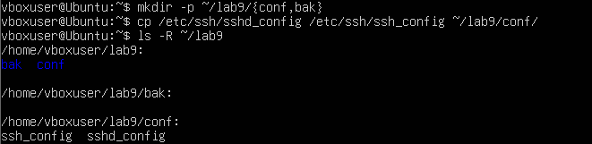

3 Запустила Midnight Commander командою mc ~/lab9/conf ~/lab9/bak, яка одразу відкриває вказані каталоги у двох панелях. Ліва панель відображає вміст каталогу ~/lab9/conf (файли ssh_config і sshd_config), права панель — вміст каталогу ~/lab9/bak, який поки порожній. Активна панель позначена підсвіченим рядком, перемикання між панелями виконується клавішею Tab. У нижній частині вікна розташований рядок функціональних клавіш F1–F10, кожна з яких відповідає за окрему дію: F3 — перегляд файлу, F4 — редагування, F5 — копіювання, F6 — переміщення або перейменування, F7 — створення каталогу, F8 — видалення, F9 — виклик меню, F10 — вихід. У верхній частині вікна розташоване меню, яке відкривається клавішею F9 і містить пункти для налаштування лівої та правої панелей, файлових операцій, команд (зокрема порівняння каталогів і пошук файлу), параметрів програми. 

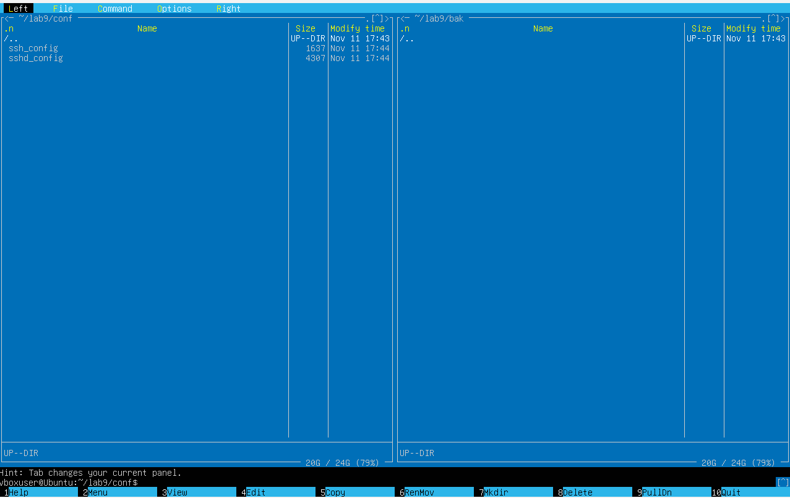

4  Виконала в Midnight Commander файлові операції. Клавішею Insert позначила два файли ssh_config і sshd_config в лівій панелі, після чого клавішею F5 скопіювала їх однією операцією у каталог ~/lab9/bak, який відкрито в протилежній панелі. Клавішею F6 перейменувала файл sshd_config на sshd_config.orig: у полі призначення вказала лише нове ім'я, тому файл залишився в тому самому каталозі. Клавішею F7 створила у каталозі conf новий каталог tmp. Клавішею F3 переглянула вміст файлу ssh_config у вбудованому переглядачі, який не дозволяє змінювати файл, і вийшла з нього клавішею F10. Результат перевірила командою ls -R ~/lab9: у каталозі bak містяться файли ssh_config і sshd_config, у каталозі conf — ssh_config, sshd_config.orig та каталог tmp. 

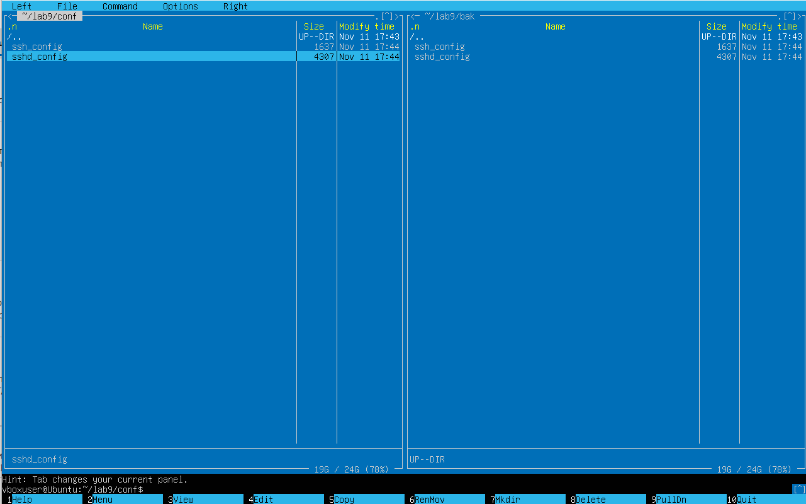

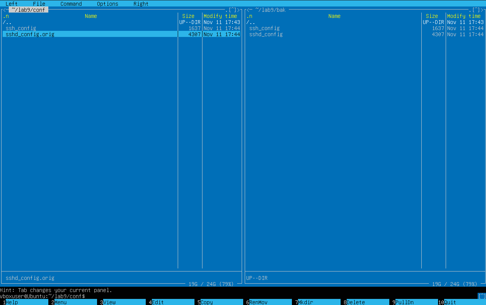

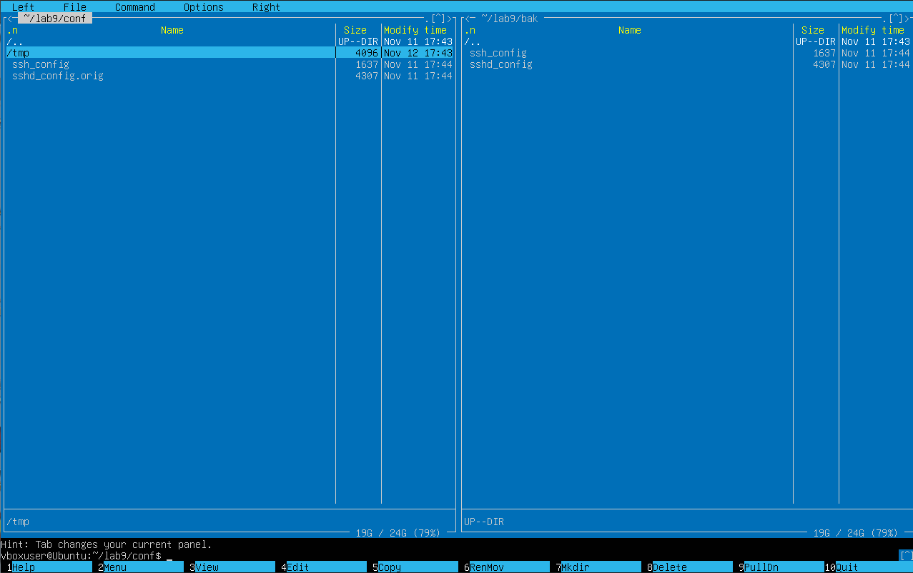

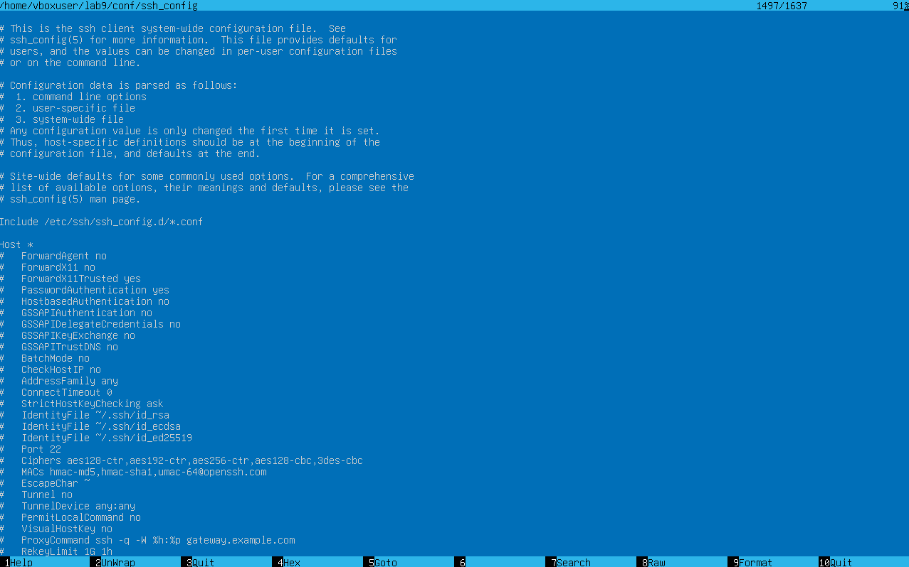

5 Скористалася можливостями меню F9. У пункті Command вибрала Compare directories і режим Quick, щоб порівняти каталоги conf і bak. Mc виділив жовтим кольором файли, які відсутні в протилежній панелі під тим самим іменем: sshd_config.orig у каталозі conf та sshd_config у каталозі bak, оскільки в conf цей файл було перейменовано. Файл ssh_config наявний в обох каталогах, тому виділення не отримав. Далі через Command → Find file виконала пошук за маскою ssh* у каталозі /home/vboxuser/lab9. Пошук знайшов чотири файли: у каталозі conf — ssh_config і sshd_config.orig, у каталозі bak — ssh_config і sshd_config. Каталог tmp масці не відповідає, тому в результатах його немає. 

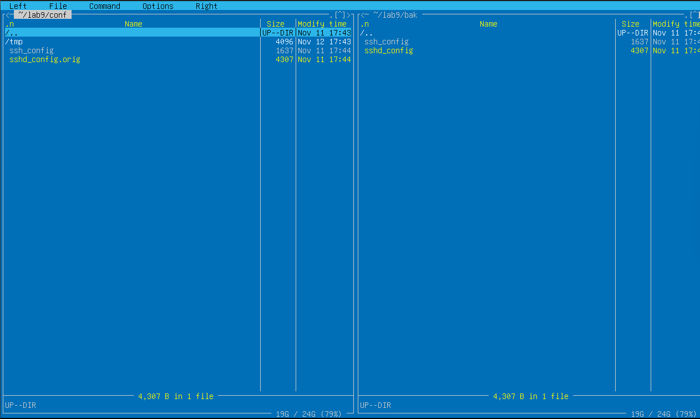

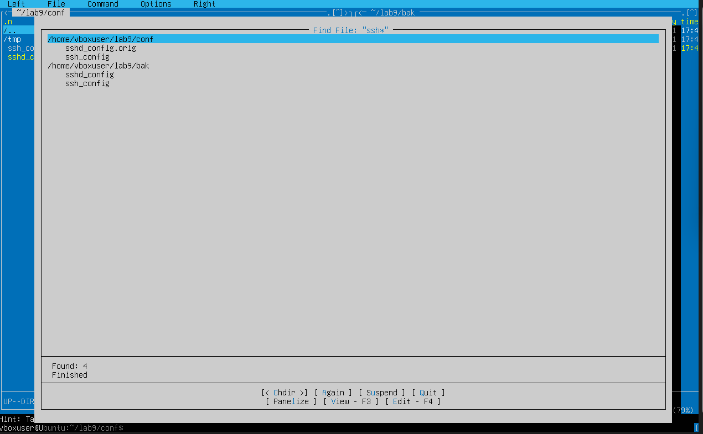

6 Відредагувала файл ssh_config з каталогу bak вбудованим редактором mc. Клавішею F4 відкрила файл у редакторі mcedit (під час першого запуску в системному запиті обрала mcedit як редактор), перейшла в кінець файлу та дописала рядок-коментар «# Added in mcedit during lab 9». Зміни зберегла клавішею F2, після чого вийшла з редактора клавішею F10. Оскільки рядок починається з символу #, він є коментарем і не впливає на роботу конфігурації. 

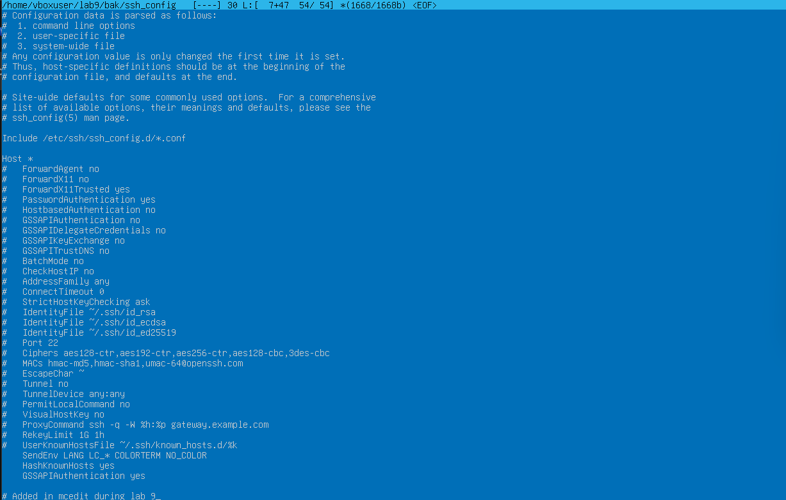

7 Створила у редакторі vi файл notes.txt у каталозі conf. Після запуску командою vi conf/notes.txt редактор перебував у командному режимі, тому клавішею i перейшла в режим вставки та ввела два рядки тексту (через розкладку текст введено латиницею). Клавішею Esc повернулася в командний режим і зберегла файл командою :w. Командою :set number увімкнула нумерацію рядків. Клавішею o додала новий рядок нижче та ввела третій рядок «Author: Student», після чого натиснула Esc і зберегла файл із виходом командою :wq. Результат перевірила командою cat -n: файл містить три рядки. 

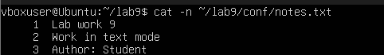

8 Виконала в редакторі vi роботу на копії конфігураційного файлу sshd_config.orig. Командою :set number увімкнула нумерацію рядків. Клавішею G перейшла в кінець файлу, а командою gg повернулася на його початок. Командою /MaxAuthTries знайшла параметр свого варіанта: він розташований у рядку 56. Клавішею dd видалила поточний рядок, а клавішею u скасувала видалення. Командою :15 перейшла до рядка 15. Після цього вийшла з редактора командою :q! без збереження, тому файл залишився незмінним. Це підтвердила командою ls -l: розмір файлу 4307 байт і час зміни 17:44 збігаються з початковими. 

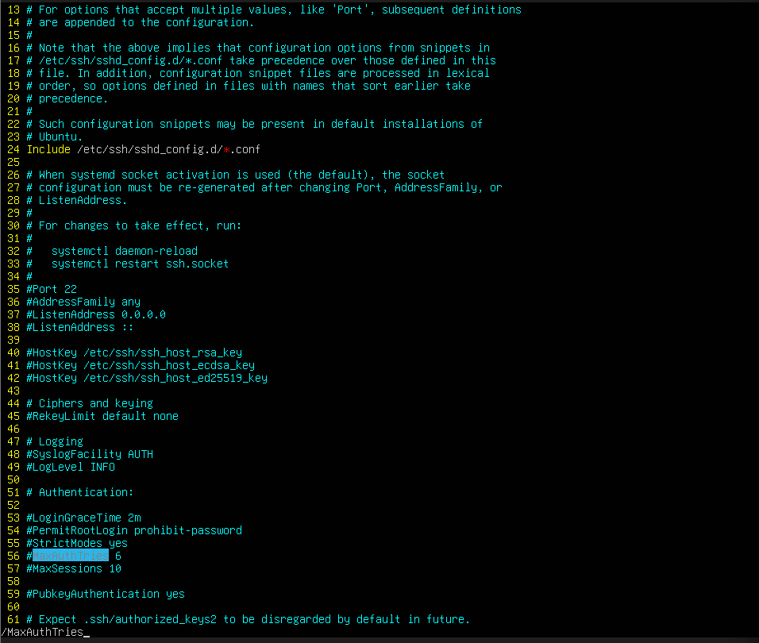

9 Виконала заміну параметра згідно з варіантом 11 на копії конфігураційного файлу. Спочатку командою cp створила копію sshd_config.test із файлу sshd_config.orig та відкрила її в редакторі vi. Знайшла параметр командою /MaxAuthTries, після чого виконала заміну командою :%s/#MaxAuthTries 6/MaxAuthTries 3/g, яка прибрала символ коментаря та змінила значення з 6 на 3. Зберегла файл під новим іменем командою :w і вийшла командою :q. Командою grep -n перевірила результат: у рядку 56 тепер стоїть MaxAuthTries 3. Командою diff порівняла sshd_config.orig і sshd_config.test: єдина відмінність — рядок 56, де «#MaxAuthTries 6» замінено на «MaxAuthTries 3», тому змінено саме те, що планувалося. 

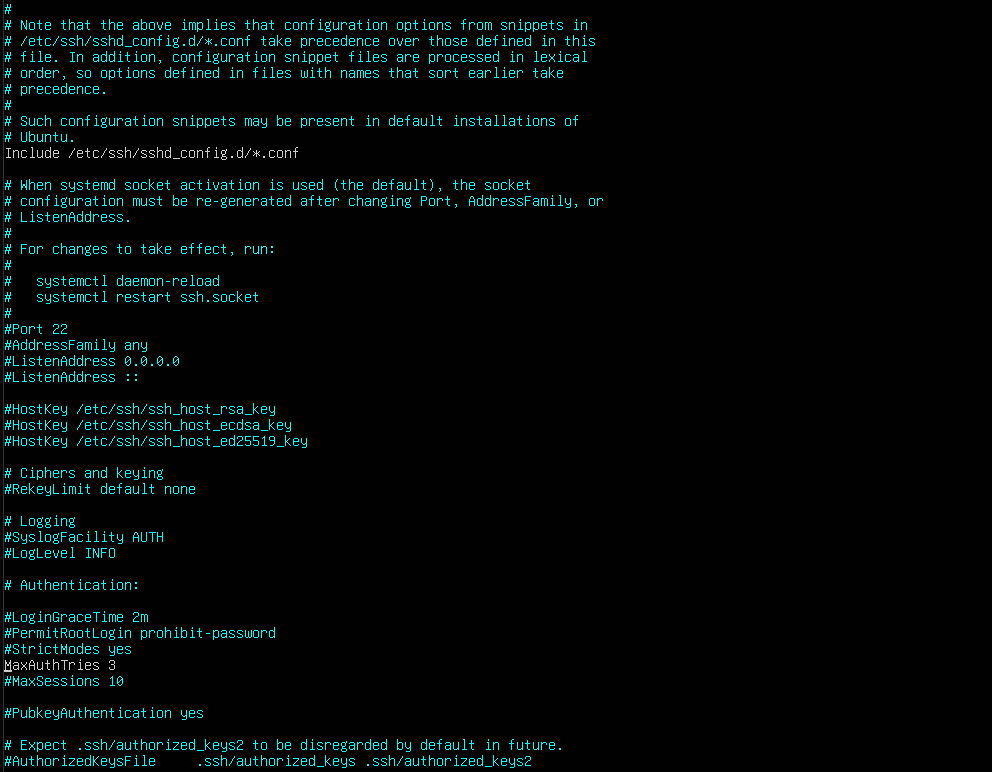

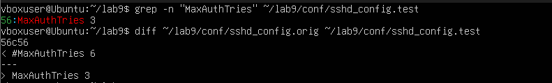

10 Клавіша Insert у Midnight Commander призначена для позначення файлів і каталогів під курсором для групової операції. Після натискання Insert поточний файл виділяється (змінює колір), а курсор автоматично переходить на наступний рядок, тому можна швидко позначити кілька файлів поспіль. Повторне натискання Insert на позначеному файлі знімає позначення. Усі позначені файли обробляються однією операцією: F5 копіює їх на протилежну панель, F6 переміщує, F8 видаляє. Це основний спосіб масових дій у текстовому режимі, який замінює окремі виклики cp, mv чи rm з переліком імен. У роботі я позначила клавішею Insert файли ssh_config і sshd_config та скопіювала їх у каталог bak однією операцією F5. Для позначення групи файлів за маскою також використовуються клавіші + і -. 

11 Оформила звіт і зробила висновок.

## Відповіді на контрольні питання

### Високий рівень (творчий)

1 Сервер доступний лише через SSH, графічної оболонки немає, потрібно терміново виправити помилку в конфігурації служби. Опишіть повний порядок дій із зазначенням інструментів і поясніть, чому обрали саме їх.

Спочатку я під'єдналась би до сервера через SSH і, перш ніж щось змінювати, зробила б резервну копію проблемного файлу командою cp, наприклад cp /etc/ssh/sshd_config ~/sshd_config.bak. Копія потрібна, щоб у разі невдалої правки можна було швидко повернути початковий стан. Далі я знайшла б місце помилки: переглянула б журнал служби та повідомлення про помилку, а потім відкрила б файл і за допомогою пошуку (/параметр) у редакторі vi перейшла б до потрібного рядка. Vi я обрала б тому, що він є практично в кожній Unix-системі, його вимагає стандарт POSIX, тому він буде доступний навіть на мінімальному сервері чи в контейнері, де mc і mcedit можуть бути не встановлені. Для системних файлів надійніше користуватися sudoedit: редактор працює з правами звичайного користувача над тимчасовою копією, а sudo лише записує результат на місце, тож редактор разом із плагінами не отримує прав root. Після виправлення я порівняла б результат з копією командою diff, щоб переконатися, що змінено лише потрібний рядок, а для служби sshd додатково перевірила б синтаксис конфігурації перед перезапуском. Лише після цього я перезапустила б службу. Важливо не закривати поточну SSH-сесію, поки не підтверджено, що нова сесія підключається успішно, інакше помилка в конфігурації може повністю закрити доступ до сервера. Таким чином, набір інструментів (cp, vi або sudoedit, diff) обраний за принципом доступності на будь-якій системі, передбачуваності та можливості перевірити кожну зміну.

2 Поясніть, чому модальність vi, яка спершу здається незручною, у роботі досвідченого адміністратора дає виграш у швидкості. Проілюструйте прикладом із цієї роботи.

Модальність означає, що те, що робить клавіша, залежить від поточного режиму: у командному режимі літери є командами, а у режимі вставки вони вводять текст. Спочатку це здається незручним, бо потрібно постійно перемикатися між режимами, а набирати текст одразу після запуску неможливо. Однак виграш у швидкості виникає саме завдяки цьому поділу. Оскільки у командному режимі всі клавіші вільні для команд, не потрібні складні поєднання з Ctrl чи Alt, а руки не залишають основний ряд клавіатури. Команди комбінуються за схемою «кількість + дія + об'єкт»: 3dd видаляє три рядки, 2yy копіює два рядки, 3dw видаляє три слова. Тому після засвоєння базових команд складні правки виконуються кількома натисканнями. У цій роботі це було видно на кількох прикладах. Щоб знайти параметр MaxAuthTries у файлі sshd_config.orig, достатньо було набрати /MaxAuthTries, і курсор одразу перейшов на рядок 56, хоча в довгому файлі шукати його вручну прокруткою було б значно довше. Для переходу на початок і кінець файлу вистачило gg і G, для переходу до рядка 15 — :15, для видалення рядка — dd, а для скасування — u. Заміну параметра я виконала однією командою :%s/#MaxAuthTries 6/MaxAuthTries 3/g, яка обробила весь файл без ручного пошуку. Також безпечний вихід через :q! гарантує, що експериментальні зміни не потраплять у файл. Отже, початкова незручність компенсується тим, що досвідчений користувач виконує правки без мишки й без зайвих рухів, а набір команд однаково працює на будь-якому сервері.

3 Сформулюйте правила безпечного редагування системних конфігураційних файлів і обґрунтуйте кожне з них наслідками помилки.

Перше правило: перед змінами завжди робити резервну копію. Якщо цього не зробити, то після невдалої правки неможливо швидко повернути початковий стан, а для службових файлів це може означати довге відновлення. Друге правило: редагувати копію, а не оригінал, доки результат не перевірено. У цій роботі всі зміни виконувалися лише на копіях у каталозі ~/lab9, а оригінали в /etc залишалися недоторканими. Помилка в оригіналі, наприклад у sshd_config чи fstab, може призвести до втрати віддаленого доступу або до того, що система не завантажиться. Третє правило: після змін порівнювати файл з оригіналом командою diff і переконуватися, що змінено лише заплановане. Це видно на прикладі пункту 9, де diff показав єдину відмінність — рядок 56. Без такої перевірки випадкове видалення чи зміна іншого рядка може залишитися непоміченою і виявитися лише тоді, коли служба перестане працювати. Четверте правило: для системних файлів користуватися sudoedit замість запуску редактора від імені root, бо тоді редактор разом з усіма плагінами не отримує прав root, а це зменшує ризик випадкових чи шкідливих дій. П'яте правило: не видаляти файли необдумано, особливо в mc, де клавіша F8 видаляє остаточно, без кошика, тому помилкове видалення неможливо скасувати. Шосте правило: перед застосуванням змін перевіряти синтаксис конфігурації та не закривати активну сесію, доки не підтверджено, що нова сесія працює. Інакше помилка у конфігурації SSH може повністю закрити доступ до віддаленого сервера.

4 Порівняйте роботу з файлами в mc і в чистому командному рядку за трьома критеріями: швидкість, надійність, можливість автоматизації. Для яких задач ви оберете кожен варіант?

За швидкістю mc зручніший для інтерактивної роботи, коли потрібно візуально орієнтуватися у структурі каталогів: обидві панелі показують вміст одразу, а копіювання чи перейменування виконується кількома клавішами, наприклад F5 чи F6. Групове копіювання двох файлів у цій роботі я виконала однією операцією після позначення їх клавішею Insert. Проте в командному рядку досвідчений користувач часто швидший, якщо знає точний шлях: одна команда cp чи mv виконує дію без навігації по панелях. За надійністю mc має перевагу в наочності, бо видно, що саме позначено, і перед виконанням з'являється діалог з вказаним шляхом призначення. Водночас у ньому легко помилитися через підставлений шлях: у моїй роботі через це файл під час F6 спочатку не перейменувався, бо в полі лишився шлях до каталогу bak. До того ж F8 видаляє файли остаточно. У командному рядку помилка теж можлива, але команда явно записує всі параметри, а результат можна одразу перевірити через ls чи diff. За можливістю автоматизації командний рядок значно кращий: команди можна записати в скрипт, виконати за розкладом, повторити для сотень файлів, поєднати в конвеєр, а дії в mc потребують ручного натискання клавіш і не повторюються автоматично. Тому mc я обрала б для разової інтерактивної роботи з невеликою кількістю файлів, для огляду структури каталогів, порівняння каталогів і швидкого перегляду вмісту. Чистий командний рядок я обрала б для повторюваних задач, масових операцій, скриптів, роботи через SSH на мінімальному сервері, де mc може бути не встановлений, а також для випадків, коли потрібна відтворюваність і точний протокол виконаних дій.

## Висновок

На цій лабораторній роботі я опанувала роботу в текстовому режимі без графічного середовища: навчилася виконувати файлові операції у двопанельному менеджері Midnight Commander, користуватися його вбудованими переглядачем і редактором, а також редагувати файли в редакторі vi — перемикати режими, переміщатися текстом, виконувати пошук і заміну, зберігати зміни.
