<!--
  Командні файли в середовищі Linux
  Варіант 6: Ротація журналів: стиснути старі, видалити дуже старі — щодня о 2:00 — Пояснити, навіщо потрібен `trap` для тимчасових файлів

  Тему, мету й обладнання писати не треба — конвеєр візьме їх із лабораторної.
  Знімки екрана кладіть у assets/, вихідний код — у src/.
  Контрольні питання — лише одного рівня, того, на який захищаєте роботу:
  заголовок «### Достатній рівень», далі «1 Текст питання?» і відповідь.
  Покрокова інструкція — reports/README.md
-->

## Хід роботи

1 Номер індивідуального варіанта – 6.

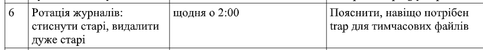

2 Створено робочий каталог lab10 із підкаталогами src, bak та logs. У каталозі src розміщено п'ять тестових файлів, один із яких містить дані, розділені символом ;. Ці файли використовуватимуться для перевірки роботи Bash-скриптів.

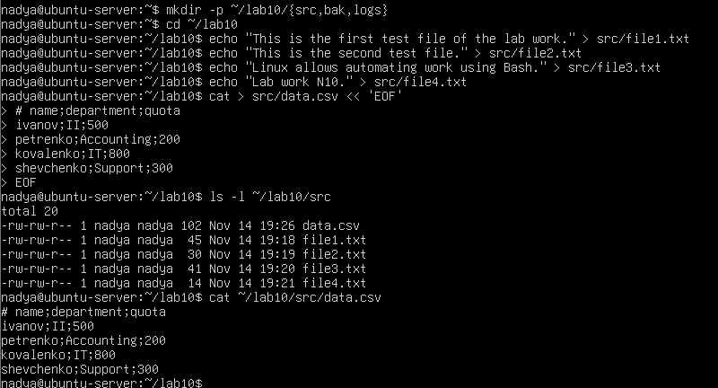

3 Створено скрипт hello.sh, який виводить основні параметри процесу. Під час першого запуску отримано помилку Permission denied, оскільки файл не мав права виконання. Після використання chmod +x скрипт запустився успішно. Команда ./script.sh запускає скрипт як окремий процес, bash script.sh передає його на виконання інтерпретатору Bash, а source script.sh виконує команди в поточній оболонці. Тому змінні після перших двох способів не зберігаються, а після source залишаються доступними.

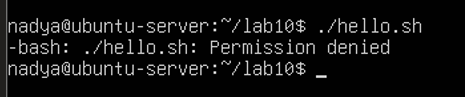

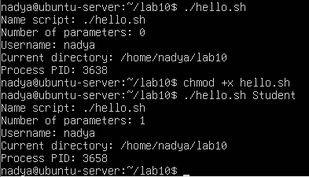

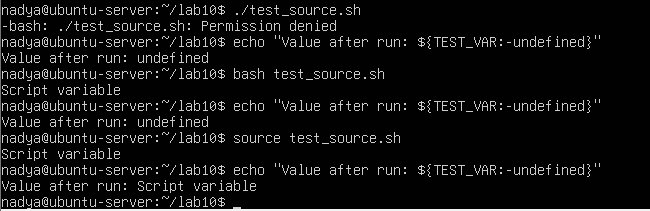

4 Створено скрипт info.sh, який перевіряє наявність переданого параметра, існування об'єкта та визначає його тип. Для отримання інформації використовуються команди stat, find і wc. Передбачено різні коди завершення: 0 — успішне виконання, 1 — параметр не вказано, 2 — об'єкт не знайдено.

Скрипт:

#!/bin/bash
# info.sh — отримання інформації про файл або каталог

set -euo pipefail

# Перевірка наявності параметра
if [[ $# -eq 0 ]]; then
    echo "Помилка: вкажіть шлях до файлу або каталогу." >&2
    echo "Використання: $0 <шлях>" >&2
    exit 1
fi

target="$1"

# Перевірка існування об'єкта
if [[ ! -e "$target" ]]; then
    echo "Помилка: об'єкт '$target' не існує." >&2
    exit 2
fi

# Визначення типу об'єкта
if [[ -d "$target" ]]; then
    echo "Тип: каталог"
    echo "Кількість файлів: $(find "$target" -maxdepth 1 -type f | wc -l)"
else
    echo "Тип: файл"
    echo "Розмір: $(stat -c%s "$target") байт"
    echo "Кількість рядків: $(wc -l < "$target")"
fi

echo "Власник: $(stat -c%U "$target")"
echo "Права доступу: $(stat -c%A "$target")"

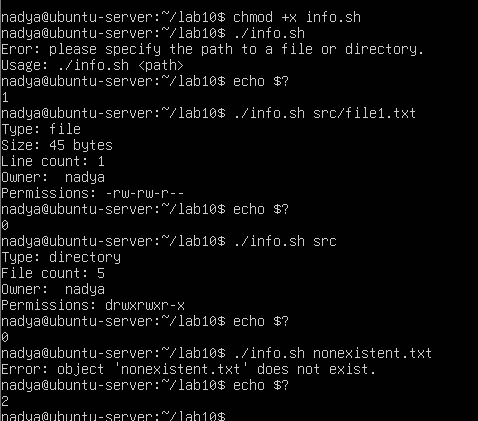

5 Створено скрипт count.sh, який за допомогою циклу for обробляє всі звичайні файли вибраного каталогу. Команда stat визначає розмір кожного файлу, а арифметичні операції використовуються для підрахунку загального та середнього розміру. Якщо каталог не існує, скрипт повідомляє про помилку.

Скрипт:
#!/bin/bash
# count.sh — підрахунок кількості та розміру файлів

set -euo pipefail

dir="${1:-$HOME/lab10/src}"

# Перевірка каталогу
if [[ ! -d "$dir" ]]; then
    echo "Помилка: каталог '$dir' не існує." >&2
    exit 1
fi

count=0
bytes=0

# Обробка кожного файлу
for file in "$dir"/*; do
    [[ -f "$file" ]] || continue

    size=$(stat -c%s "$file")

    count=$((count + 1))
    bytes=$((bytes + size))

    printf "%2d) %-20s %8d байт\n" \
        "$count" "$(basename "$file")" "$size"
done

echo "------------------------------"
echo "Кількість файлів: $count"
echo "Загальний розмір: $bytes байт"

if [[ $count -gt 0 ]]; then
    echo "Середній розмір: $((bytes / count)) байт"
else
    echo "Каталог не містить файлів."
fi

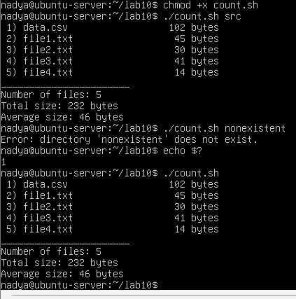

6 Для індивідуального варіанта №6 створено скрипт rotate.sh, який автоматизує ротацію журналів. Скрипт знаходить файли, що належать до журналів, стискає ті, які не змінювалися понад 7 днів, а також видаляє стиснуті архіви, старші за 30 днів. Для виконання операцій використано функції, цикл while, команду find, програму gzip та команду rm. Результати операцій записуються до файлу rotation.log. Також реалізовано перевірку вхідного каталогу та обробку помилок.

Скрипт:

#!/bin/bash
# rotate.sh — ротація журналів
# Варіант 6: стискання та видалення старих журналів

set -euo pipefail

# Каталог із журналами
LOG_DIR="${1:-$HOME/lab10/logs}"

# Файл для запису результатів
LOG="$HOME/lab10/logs/rotation.log"

# Перевірка вхідного каталогу
if [[ ! -d "$LOG_DIR" ]]; then
    echo "Помилка: каталог $LOG_DIR не існує." >&2
    exit 1
fi

# Захист від роботи за межами каталогу лабораторної
if [[ "$LOG_DIR" != "$HOME/lab10/logs" ]]; then
    echo "Помилка: дозволено працювати лише з каталогом lab10/logs." >&2
    exit 2
fi

# Функція запису повідомлень у журнал
log() {
    echo "[$(date '+%F %T')] $*" | tee -a "$LOG"
}

# Функція стискання старих журналів
compress_logs() {
    local file
    local count=0

    TMP_FILE=$(mktemp "$LOG_DIR/.rotation.XXXXXX")
    trap 'rm -f -- "$TMP_FILE"' EXIT

    find "$LOG_DIR" -maxdepth 1 -type f \
        -name 'app-*.log' -mmin +10080 -print0 > "$TMP_FILE"

    while IFS= read -r -d '' file; do
        log "Стискання: $(basename "$file")"
        gzip -- "$file"
        count=$((count + 1))
    done < "$TMP_FILE"

    log "Стиснуто журналів: $count"
}

# Функція видалення дуже старих архівів
delete_old_logs() {
    local file
    local count=0

    : > "$TMP_FILE"

    find "$LOG_DIR" -maxdepth 1 -type f \
        -name 'app-*.log.gz' -mmin +43200 -print0 > "$TMP_FILE"

    while IFS= read -r -d '' file; do
        log "Видалення старого архіву: $(basename "$file")"
        rm -- "$file"
        count=$((count + 1))
    done < "$TMP_FILE"

    log "Видалено архівів: $count"
}

# Виконання ротації
log "Початок ротації журналів"

compress_logs
delete_old_logs

log "Ротацію журналів завершено успішно"

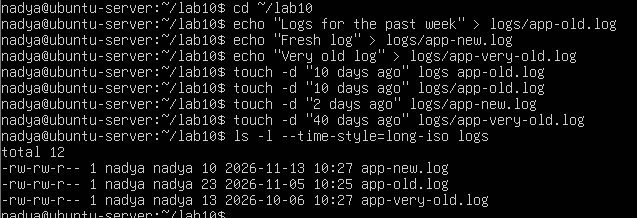

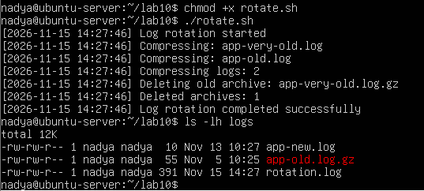

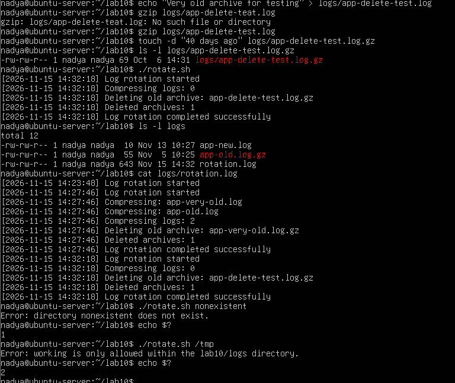

7 Конструкція set -euo pipefail використовується для підвищення надійності Bash-скриптів. Параметр -e зупиняє виконання після помилки команди, -u забороняє використання невизначених змінних, а pipefail дає змогу виявляти помилки всередині конвеєрів команд. Під час експерименту було встановлено, що без set -e скрипт продовжує виконання після помилки, а з цією конструкцією завершується.

Скрипт 1:

#!/bin/bash

echo "Початок скрипта"

ls /nonexistent_directory

echo "Скрипт продовжує роботу"

Скрипт 2:

#!/bin/bash

set -euo pipefail

echo "Початок скрипта"

ls /nonexistent_directory

echo "Це повідомлення не з'явиться"

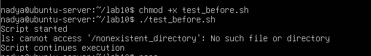

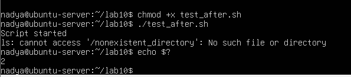

8 Створено скрипт users.sh, який зчитує CSV-файл рядок за рядком за допомогою циклу while. Для розділення полів використовується символ ;. Скрипт виводить дані користувачів і підраховує загальну суму числового поля. Також реалізовано перевірку існування файлу та правильності числових даних.

Скрипт:

#!/bin/bash
# users.sh — обробка CSV-файлу

set -euo pipefail

if [[ $# -eq 0 ]]; then
    echo "Помилка: вкажіть CSV-файл." >&2
    exit 1
fi

input="$1"

if [[ ! -f "$input" ]]; then
    echo "Помилка: файл '$input' не знайдено." >&2
    exit 2
fi

total=0

# Читання файлу рядок за рядком
while IFS=';' read -r name department quota; do

    # Пропускаємо коментарі та порожні рядки
    [[ "$name" == \#* || -z "$name" ]] && continue

    # Перевірка числового поля
    if [[ ! "$quota" =~ ^[0-9]+$ ]]; then
        echo "Помилка: неправильне числове значення: $quota" >&2
        exit 3
    fi

    printf "%-12s %-12s %s МБ\n" \
        "$name" "$department" "$quota"

    total=$((total + quota))

done < "$input"

echo "Загальна квота: $total МБ"

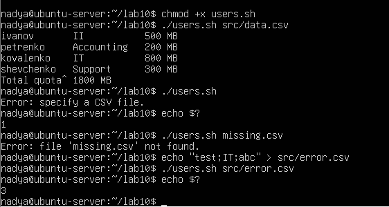

9 Для автоматичного запуску скрипта rotate.sh налаштовано планувальник завдань cron. Відповідно до індивідуального варіанта скрипт має виконуватися щодня о 02:00. Для перевірки роботи планувальника тимчасово встановлено запуск щохвилини. Після успішного тестування розклад повернуто до початкового значення. Результати автоматичного виконання записуються у файл cron.log.

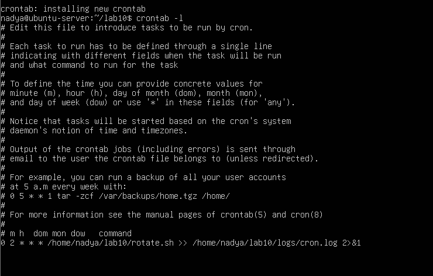

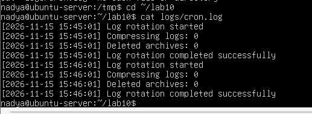

10 Додаткове завдання — призначення trap для тимчасових файлів. Команда trap використовується для перехоплення певних сигналів і виконання заданих дій під час завершення скрипта. У нашому випадку вона потрібна для автоматичного видалення тимчасового файлу після завершення роботи програми. Наприклад, конструкція trap 'rm -f -- "$tmp"' EXIT забезпечує очищення тимчасового файлу незалежно від того, чи завершився скрипт звичайним способом, чи через помилку, яка призвела до виходу. Це допомагає уникнути накопичення непотрібних файлів і підтримувати порядок у файловій системі. У скрипті rotate.sh також використано trap, щоб видаляти тимчасовий файл зі списком журналів після завершення ротації.

Скрипт:

#!/bin/bash
# trap_test.sh — демонстрація очищення тимчасових файлів

set -euo pipefail

# Створення тимчасового файлу
tmp=$(mktemp)

# Видалення файлу після завершення скрипта
trap 'rm -f -- "$tmp"; echo "Тимчасовий файл видалено."' EXIT

echo "Тимчасовий файл: $tmp"

echo "Тестові дані" > "$tmp"

echo "Вміст тимчасового файлу:"
cat "$tmp"

echo "Роботу скрипта завершено."

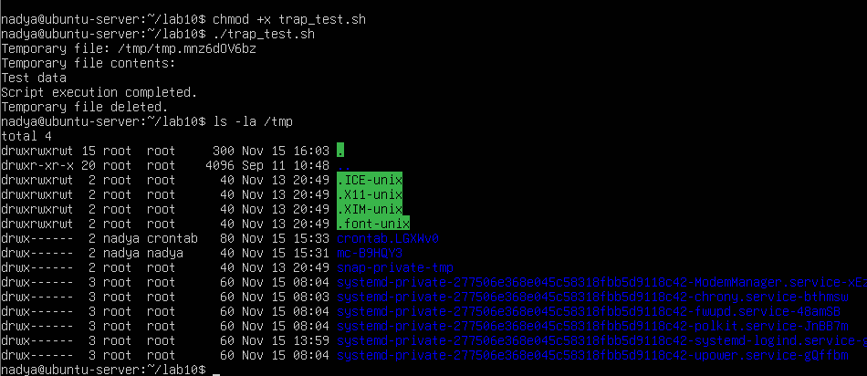

## Відповіді на контрольні питання

### Високий рівень (творчий)

1 Опишіть структуру скрипта резервного копіювання, що зберігає сім останніх копій і видаляє старіші. Які перевірки, цикли й коди повернення потрібні?

Спочатку скрипт має перевірити, чи існує потрібна папка та чи є в ній файли для копіювання. Далі потрібно створити резервну копію з датою та часом у назві. За допомогою циклу можна переглянути всі копії, відсортувати їх за датою та видалити ті, що старші за сім останніх. Також потрібні перевірки успішності копіювання та коди повернення: 0 — успішне виконання, 1 — помилка вхідних даних, 2 — помилка копіювання.

2 Поясніть, чому конструкція rm -rf &quot;$dir&quot;/* небезпечна, і запропонуйте три різні способи захисту від помилки в змінній.

Ця команда примусово видаляє всі файли та папки всередині каталогу, який вказаний у змінній $dir. Якщо змінна порожня або містить неправильний шлях, можна випадково видалити важливі дані.
Три способи захисту:
1. Перевіряти, чи змінна не порожня: [[ -n "$dir" ]].
2. Перевіряти, чи каталог існує: [[ -d "$dir" ]].
3. Використовувати дозволений повний шлях і перевіряти його перед видаленням, наприклад порівнювати з очікуваним каталогом.

3 Порівняйте bash і PowerShell як засоби автоматизації за трьома критеріями. У яких задачах ви оберете кожен?

| Критерій | Bash | PowerShell |
| --- | --- | --- |
| Основна система | Linux, Unix | Windows, а також Linux |
| Робота з командами | Переважно текстовий результат команд | Працює з об'єктами та їхніми властивостями |
| Автоматизація | Зручний для роботи з файлами, каталогами та системними процесами в Linux | Зручний для адміністрування Windows і керування її службами |

: Таблиця 1 — Порівняння Bash та PowerShell

Я б обрала Bash для автоматизації завдань у Linux, наприклад резервного копіювання та очищення журналів. PowerShell краще підійде для налаштування Windows, роботи з користувачами та системними службами.

4 Сформулюйте критерії, за якими адміністративну задачу варто автоматизувати скриптом, а коли доцільніше застосувати готовий інструмент. Проілюструйте прикладом із цієї роботи.

Скрипт доцільно створювати, якщо завдання повторюється, має чітку послідовність дій і потребує перевірок. Це допомагає заощадити час і зменшити кількість помилок. Готовий інструмент краще використовувати, якщо він уже виконує потрібну роботу, має необхідні налаштування та не потребує додаткового програмування. Наприклад, у цій лабораторній роботі я використовувала Bash-скрипт для автоматичного опрацювання файлів і журналів. Це зручніше, ніж щоразу вручну виконувати однакові команди. А для стиснення файлів можна використати готову програму gzip, яку скрипт запускає автоматично.

## Висновок
На мою думку, Bash-скрипти мають перевагу над пакетними файлами Windows, оскільки дають більше можливостей для автоматизації роботи з файлами, каталогами та системними процесами. За допомогою Bash зручно створювати складніші сценарії, використовувати цикли, функції, перевірки помилок і запускати завдання за розкладом. Також Bash дозволяє об'єднувати різні системні команди в один скрипт. Тому його використання значно спрощує виконання повторюваних завдань і робить адміністрування Linux зручнішим.
