<!--
  Командні файли в середовищі Linux
  Варіант 7: Звіт про облікові записи з `/etc/passwd` — щотижня — Пояснити, чому `while read` краще за `for` для рядків файлу

  Тему, мету й обладнання писати не треба — конвеєр візьме їх із лабораторної.
  Знімки екрана кладіть у assets/, вихідний код — у src/.
  Контрольні питання — лише одного рівня, того, на який захищаєте роботу:
  заголовок «### Достатній рівень», далі «1 Текст питання?» і відповідь.
  Покрокова інструкція — reports/README.md
-->

## Хід роботи

Індивідуальний варіант 7: скрипт формує звіт про облікові записи з файлу формату `/etc/passwd`; запуск за розкладом cron щотижня (неділя, 03:00); додаткове завдання — пояснити, чому `while read` краще за `for` для обробки рядків файлу. Усі дії виконувалися всередині каталогу `~/lab10`; скрипт звіту лише читає копію `passwd` і нічого не видаляє.

1 Підготовка. Створено структуру `~/lab10` з підкаталогами `src`, `bak`, `logs`. У `src` скопійовано чотири системні файли і створено п'ятий — текстовий файл з даними, розділеними символом `;`. Копія `passwd` у `src` — вхідні дані для основного скрипта, тому звіт будується на копії, а не на оригіналі.

```bash
mkdir -p ~/lab10/{src,bak,logs} && cd ~/lab10
cp /etc/hosts /etc/passwd /etc/services /etc/hostname src/
cat > src/users.csv <<'EOF'
# name;department;quota
ivanov;IT;500
petrenko;Accounting;200

kovalenko;IT;800
EOF
ls -l src
```

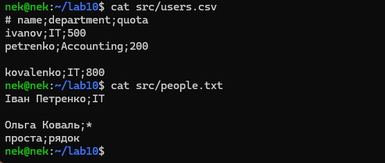

2 Перший скрипт `hello.sh`. Скрипт виводить своє ім'я, кількість параметрів, ім'я користувача, поточний каталог і PID. Спершу його запущено без права виконання: оболонка відмовила (`Permission denied`), бо в Linux право виконання не надається автоматично. Після `chmod +x` скрипт запустився.

```bash
#!/bin/bash
# hello.sh — перший скрипт: відомості про власний запуск
echo "Скрипт:      $0"      # ім'я, під яким викликано скрипт
echo "Параметрів:  $#"      # кількість переданих параметрів
echo "Користувач:  $USER"   # змінна середовища
echo "Каталог:     $PWD"    # поточний каталог
echo "PID:         $$"      # PID поточного процесу
```

```bash
./hello.sh                  # bash: ./hello.sh: Permission denied   rc=126
chmod +x hello.sh
./hello.sh Студент
# Скрипт:      ./hello.sh
# Параметрів:  1
# Користувач:  nek
# Каталог:     /home/nek/lab10
# PID:         2414
```

Пояснення: перший рядок `#!/bin/bash` (shebang) вказує ядру інтерпретатор; `chmod +x` додає біт виконання.

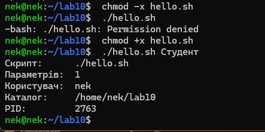

3 Різниця між `./script.sh`, `bash script.sh` і `source script.sh`. Для експерименту використано скрипт `setvar.sh`, який задає змінну `MYVAR` і показує PID процесу, у якому виконується.

```bash
#!/bin/bash
# setvar.sh — задає змінну й показує PID процесу, у якому виконується
MYVAR="значення зі скрипта"
echo "  усередині скрипта: PID=$$, MYVAR=[$MYVAR]"
```

```bash
chmod +x setvar.sh
./setvar.sh;      echo "  після: MYVAR=[$MYVAR]"
bash setvar.sh;   echo "  після: MYVAR=[$MYVAR]"
source setvar.sh; echo "  після: MYVAR=[$MYVAR], PID оболонки=$$"
```

Таблиця 1 – Результат експерименту зі змінною

| Спосіб запуску | Де виконується | PID у скрипті | MYVAR після завершення |
|----------------|----------------|---------------|------------------------|
| `./setvar.sh` | дочірній процес (інтерпретатор із shebang) | 2418 (новий) | порожня |
| `bash setvar.sh` | дочірній процес (інтерпретатор указано явно, право `x` не потрібне) | 2419 (новий) | порожня |
| `source setvar.sh` | поточна оболонка | 2403 (збігається з PID оболонки) | `значення зі скрипта` |

Висновок: перші два способи створюють дочірній процес, і змінні зникають разом із ним; `source` виконує команди в поточній оболонці й змінює її стан (потрібно, коли скрипт має задати змінні або функції для подальшої роботи, наприклад підвантажити налаштування).

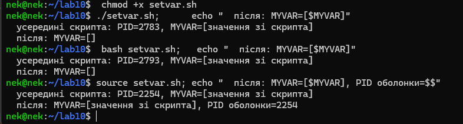

4 Скрипт `info.sh`: перевірка шляху і коди повернення. Скрипт приймає шлях параметром, перевіряє його існування й тип та виводить відомості. Різні причини відмови мають різні коди повернення, які перевірено через `$?`.

```bash
#!/bin/bash
# info.sh — відомості про об'єкт файлової системи
# Коди повернення: 0 — успіх; 1 — не вказано шлях; 2 — об'єкт не існує
set -euo pipefail

if [[ $# -eq 0 ]]; then
    echo "Використання: $0 <шлях>" >&2
    exit 1
fi

target="$1"

if [[ ! -e "$target" ]]; then
    echo "Об'єкт '$target' не існує" >&2
    exit 2
fi

if [[ -d "$target" ]]; then
    echo "Тип:     каталог"
    echo "Файлів:  $(find "$target" -maxdepth 1 -type f | wc -l)"
else
    echo "Тип:     файл"
    echo "Розмір:  $(stat -c%s "$target") байт"
    echo "Рядків:  $(wc -l < "$target")"
fi
echo "Власник: $(stat -c%U "$target")"
echo "Права:   $(stat -c%A "$target")"
```

```bash
./info.sh;               echo "rc=$?"     # Використання: ./info.sh <шлях>      rc=1
./info.sh src/hosts;     echo "rc=$?"     # Тип: файл, Розмір: 218 байт, Рядків: 9, Власник: nek, Права: -rw-r--r--   rc=0
./info.sh src;           echo "rc=$?"     # Тип: каталог, Файлів: 6, Власник: nek, Права: drwxrwxr-x   rc=0
./info.sh /nonexistent;  echo "rc=$?"     # Об'єкт '/nonexistent' не існує     rc=2
```

Таблиця 2 – Коди повернення `info.sh`

| Ситуація | Код `$?` |
|----------|----------|
| успішний запуск | 0 |
| шлях не передано | 1 |
| об'єкт не існує | 2 |

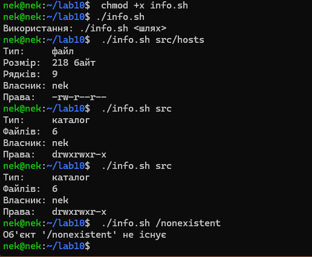

5 Скрипт із циклом `count.sh`. Скрипт обробляє всі файли каталогу `src`: рахує кількість, сумарний і середній обсяг. Використано підстановку команд `$(...)` і арифметику `$((...))`; значення за замовчуванням `${1:-$PWD}` дозволяє запускати скрипт без параметра. Останню перевірку записано повним `if`, а не `[[ ... ]] && ...`, щоб для порожнього каталогу код завершення скрипта не став рівним 1.

```bash
#!/bin/bash
# count.sh — кількість файлів, сумарний і середній обсяг каталогу
set -euo pipefail

dir="${1:-$PWD}"          # за замовчуванням — поточний каталог
count=0
bytes=0

for file in "$dir"/*; do
    if [[ ! -f "$file" ]]; then   # пропускаємо підкаталоги й інші об'єкти
        continue
    fi
    size=$(stat -c%s "$file")
    count=$((count + 1))
    bytes=$((bytes + size))
    printf "%2d) %-20s %8d байт\n" "$count" "$(basename "$file")" "$size"
done

echo "Разом: $count файлів, $bytes байт"
if [[ $count -gt 0 ]]; then
    echo "Середній розмір: $((bytes / count)) байт"
fi
```

```bash
./count.sh src
#  1) hostname                    4 байт
#  2) hosts                     218 байт
#  3) passwd                   1731 байт
#  4) people.txt                 80 байт
#  5) services                12990 байт
#  6) users.csv                  80 байт
# Разом: 6 файлів, 15103 байт
# Середній розмір: 2517 байт
```

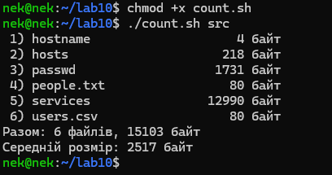

6 Основне завдання варіанта: `passwd_report.sh`. Скрипт будує звіт про облікові записи з файлу формату `/etc/passwd` (за замовчуванням — копія `~/lab10/src/passwd`). Він містить: перевірку вхідних даних (функція `check_input` з різними кодами повернення), цикл `while read` із розбором полів за роздільником `:`, три функції (`log`, `die`, `is_login_shell`) і запис у журнал.

```bash
#!/bin/bash
# passwd_report.sh — звіт про облікові записи з файлу формату /etc/passwd
# Використання: ./passwd_report.sh [файл]   (за замовчуванням ~/lab10/src/passwd)
# Коди повернення: 0 — успіх; 2 — файлу немає; 3 — не звичайний файл;
#                  4 — немає права читання; 5 — файл порожній
set -euo pipefail

readonly INPUT="${1:-$HOME/lab10/src/passwd}"
readonly LOG="$HOME/lab10/logs/passwd_report.log"
readonly REPORT="$HOME/lab10/logs/passwd-report-$(date +%F).txt"

mkdir -p "$(dirname "$LOG")"

# log — вивід повідомлення на екран і дописування його в журнал
log() {
    echo "[$(date '+%F %T')] $*" | tee -a "$LOG"
}

# die КОД ТЕКСТ — записати помилку в журнал і завершити скрипт із кодом
die() {
    local code="$1"
    shift
    log "ПОМИЛКА: $*"
    exit "$code"
}

# check_input ФАЙЛ — перевірка вхідних даних
check_input() {
    local f="$1"
    [[ -e "$f" ]] || die 2 "файл '$f' не існує"
    [[ -f "$f" ]] || die 3 "'$f' не є звичайним файлом"
    [[ -r "$f" ]] || die 4 "немає права читання '$f'"
    [[ -s "$f" ]] || die 5 "файл '$f' порожній"
}

# is_login_shell ОБОЛОНКА — код 0, якщо оболонка дозволяє інтерактивний вхід
is_login_shell() {
    case "$1" in
        */nologin|*/false|"") return 1 ;;
        *)                    return 0 ;;
    esac
}

check_input "$INPUT"
log "Початок звіту. Джерело: $INPUT"

total=0; system=0; regular=0; with_login=0; broken=0; root_like=""

{
    echo "ЗВІТ ПРО ОБЛІКОВІ ЗАПИСИ ($(date '+%F %T'))"
    echo "Джерело: $INPUT"
    echo
    printf "%-12s %-6s %-6s %-18s %s\n" "Користувач" "UID" "GID" "Оболонка" "Домашній каталог"
} > "$REPORT"

while IFS=: read -r name _ uid gid _ home shell; do
    # пропускаємо порожні рядки й коментарі
    if [[ -z "$name" || "$name" == \#* ]]; then
        continue
    fi
    # перевірка числового поля
    if [[ ! "$uid" =~ ^[0-9]+$ ]]; then
        log "ПОПЕРЕДЖЕННЯ: некоректний UID у записі '$name'"
        broken=$((broken + 1))
        continue
    fi

    total=$((total + 1))
    if is_login_shell "$shell"; then
        with_login=$((with_login + 1))
    fi
    if [[ "$uid" -eq 0 ]]; then
        root_like="$root_like $name"
    fi

    if [[ "$uid" -ge 1000 && "$uid" -lt 65534 ]]; then
        regular=$((regular + 1))
        exists="ні"
        if [[ -d "$home" ]]; then
            exists="так"
        fi
        printf "%-12s %-6s %-6s %-18s %s (існує: %s)\n" \
            "$name" "$uid" "$gid" "$shell" "$home" "$exists" >> "$REPORT"
    else
        system=$((system + 1))
    fi
done < "$INPUT"

{
    echo
    echo "Усього записів:                $total"
    echo "Системних (UID < 1000):        $system"
    echo "Звичайних (UID >= 1000):       $regular"
    echo "З інтерактивною оболонкою:     $with_login"
    echo "Записи з UID 0:               ${root_like:- немає}"
    echo "Пошкоджених записів:           $broken"
} >> "$REPORT"

log "Оброблено записів: $total (звичайних: $regular, пошкоджених: $broken)"
log "Звіт збережено: $REPORT"
```

Ключові рішення. Цикл читає файл через перенаправлення `done < "$INPUT"`, а не через конвеєр, тому лічильники зберігаються після циклу (у конвеєрі цикл виконується в підоболонці, і зміни змінних зникають). `IFS=:` задає роздільник полів, `_` відкидає непотрібні поля (пароль, опис). Оболонки `nologin` і `false` не дозволяють інтерактивного входу, тому такі облікові записи не рахуються як «з оболонкою». Значення `${root_like:- немає}` підставляє текст, якщо змінна порожня.

Запуск зі звичайними вхідними даними:

```bash
./passwd_report.sh; echo "rc=$?"
# [2026-11-16 20:38:54] Початок звіту. Джерело: /home/nek/lab10/src/passwd
# [2026-11-16 20:38:54] Оброблено записів: 33 (звичайних: 1, пошкоджених: 0)
# [2026-11-16 20:38:54] Звіт збережено: /home/nek/lab10/logs/passwd-report-2026-11-16.txt
# rc=0
cat logs/passwd-report-*.txt
```

Вміст звіту (кількість записів та перелік звичайних користувачів залежать від вашої системи):

```
ЗВІТ ПРО ОБЛІКОВІ ЗАПИСИ (2026-11-16 20:38:54)
Джерело: /home/nek/lab10/src/passwd

Користувач UID    GID    Оболонка   Домашній каталог
nek          1000   1000   /bin/bash          /home/nek (існує: так)

Усього записів:                33
Системних (UID < 1000):        32
Звичайних (UID >= 1000):       1
З інтерактивною оболонкою:     3
Записи з UID 0:                root
Пошкоджених записів:           0
```

Запуск із хибними вхідними даними (кожна причина відмови має свій код):

```bash
./passwd_report.sh /nonexistent; echo "rc=$?"
# [2026-11-16 20:38:54] ПОМИЛКА: файл '/nonexistent' не існує         rc=2
./passwd_report.sh src;          echo "rc=$?"
# [2026-11-16 20:38:54] ПОМИЛКА: 'src' не є звичайним файлом          rc=3
: > src/empty; ./passwd_report.sh src/empty; echo "rc=$?"
# [2026-11-16 20:38:55] ПОМИЛКА: файл 'src/empty' порожній            rc=5
rm src/empty
```

Таблиця 3 – Коди повернення `passwd_report.sh`

| Ситуація | Код `$?` |
|----------|----------|
| звіт створено | 0 |
| файлу не існує | 2 |
| шлях — не звичайний файл (наприклад, каталог) | 3 |
| немає права читання | 4 |
| файл порожній | 5 |

Вміст журналу `logs/passwd_report.log` після успішного й невдалих запусків:

```
[2026-11-16 20:38:54] Початок звіту. Джерело: /home/nek/lab10/src/passwd
[2026-11-16 20:38:54] Оброблено записів: 33 (звичайних: 1, пошкоджених: 0)
[2026-11-16 20:38:54] Звіт збережено: /home/nek/lab10/logs/passwd-report-2026-11-16.txt
[2026-11-16 20:38:54] ПОМИЛКА: файл '/nonexistent' не існує
[2026-11-16 20:38:54] ПОМИЛКА: 'src' не є звичайним файлом
[2026-11-16 20:38:55] ПОМИЛКА: файл 'src/empty' порожній
```

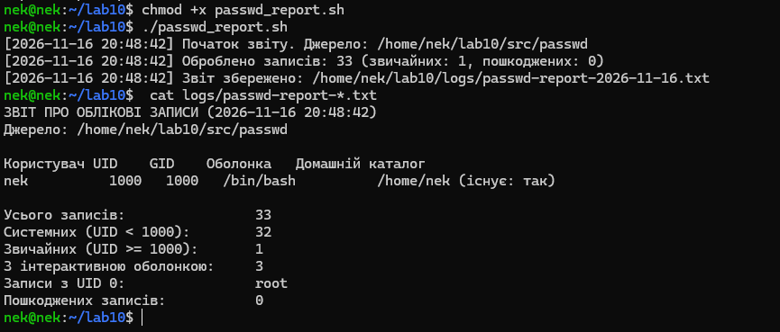

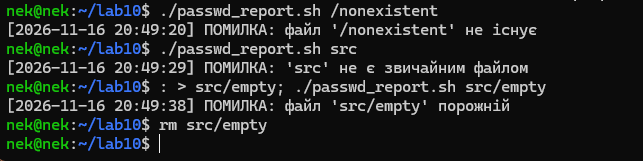

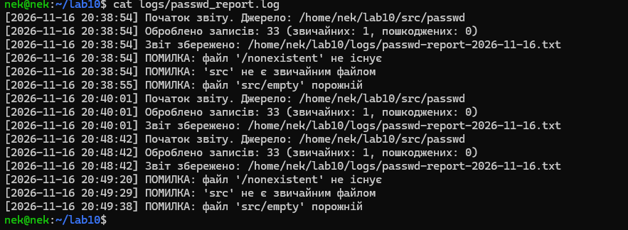

7 Вплив `set -euo pipefail`. Для порівняння написано скрипт `demo_set.sh`, у якому захисні параметри вмикаються змінною `SAFE=1` (без неї скрипт працює «як є»). Перевірено три ситуації.

```bash
#!/bin/bash
# demo_set.sh — вплив set -euo pipefail. Режим 1-3 задається параметром,
# SAFE=1 вмикає захисні параметри (без SAFE скрипт працює «як є»).
if [[ "${SAFE:-0}" == "1" ]]; then
    set -euo pipefail
fi

case "${1:-1}" in
    1) cp /nonexistent /tmp/x.$$
       echo "Після cp: працюємо далі, ніби все гаразд" ;;
    2) n=$(cat /nonexistent | wc -l)
       echo "Рядків у файлі: $n" ;;
    3) echo "Каталог: $dirr/tmp" ;;       # помилка в імені змінної
esac
echo "Кінець скрипта"
```

Результати (повідомлення системних команд виводяться мовою локалі):

```
$ ./demo_set.sh 1                     (до)
cp: cannot stat '/nonexistent': No such file or directory
Після cp: працюємо далі, ніби все гаразд
Кінець скрипта                        rc=0
$ SAFE=1 ./demo_set.sh 1              (після)
cp: cannot stat '/nonexistent': No such file or directory
                                      rc=1

$ ./demo_set.sh 2                     (до)
cat: /nonexistent: No such file or directory
Рядків у файлі: 0
Кінець скрипта                        rc=0
$ SAFE=1 ./demo_set.sh 2              (після)
cat: /nonexistent: No such file or directory
                                      rc=1

$ ./demo_set.sh 3                     (до)
Каталог: /tmp
Кінець скрипта                        rc=0
$ SAFE=1 ./demo_set.sh 3              (після)
./demo_set.sh: line 13: dirr: unbound variable
                                      rc=1
```

Пояснення: `-e` зупинило скрипт після першої невдалої команди (режим 1), тоді як без нього скрипт продовжив і повідомив про «успіх»; `-o pipefail` зробив помилкою конвеєр, у якому невдалою була не остання команда (режим 2: без нього код конвеєра — код `wc`, тобто 0, і скрипт «рахує» нуль рядків); `-u` перетворив помилку в імені змінної на зупинку (режим 3), а не на мовчазну підміну порожнім рядком: без `-u` вираз `$dirr/tmp` перетворився на хибний шлях `/tmp` (у реальному скрипті з `rm` це небезпечно).

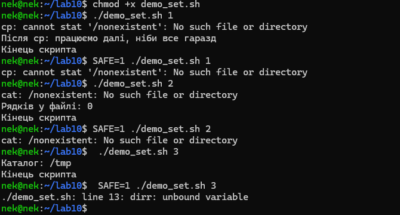

8 Обробка текстового файлу рядок за рядком: `users.sh`. Скрипт читає `users.csv`, розбирає поля за роздільником `;`, пропускає коментарі й порожні рядки та виводить підсумок за числовим полем (квотою). Конструкція `${1:?Вкажіть файл}` завершує скрипт із повідомленням, якщо файл не вказано.

```bash
#!/bin/bash
# users.sh — розбір текстового файлу з роздільником ';' і підсумок за квотою
set -euo pipefail

input="${1:?Вкажіть файл}"     # без параметра — повідомлення й завершення
total=0

while IFS=';' read -r name dept quota; do
    if [[ -z "$name" || "$name" == \#* ]]; then
        continue
    fi
    printf "%-12s %-12s %s МБ\n" "$name" "$dept" "$quota"
    total=$((total + quota))
done < "$input"

echo "Загальна квота: $total МБ"
```

```bash
./users.sh src/users.csv
# ivanov       IT           500 МБ
# petrenko     Accounting   200 МБ
# kovalenko    IT           800 МБ
# Загальна квота: 1500 МБ
./users.sh; echo "rc=$?"
# ./users.sh: line 5: 1: Вкажіть файл      rc=1
```

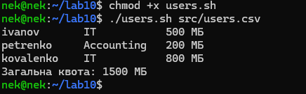

9 Запуск за розкладом cron. Скрипт `passwd_report.sh` налаштовано на щотижневий запуск (неділя, 03:00). Для перевірки спрацювання тимчасово додано запуск кожні 2 хвилини; обидва рядки використовують абсолютні шляхи, бо cron виконує завдання з мінімальним оточенням (`PATH`, робочий каталог — домашній). Вивід перенаправлено в журнал `logs/cron.log`.

```bash
crontab -e
# додати рядок (в одному рядку):
0 3 * * 0 /home/nek/lab10/passwd_report.sh >> /home/nek/lab10/logs/cron.log 2>&1

# тимчасово — для перевірки спрацювання:
( crontab -l; echo "*/2 * * * * $HOME/lab10/passwd_report.sh >> $HOME/lab10/logs/cron.log 2>&1" ) | crontab -
crontab -l | tail -2
sleep 130 && tail -3 logs/cron.log
```

Рядок розкладу: `0 3 * * 0` — хвилина 0, година 3, будь-який день місяця, будь-який місяць, день тижня 0 (неділя). Підтвердження спрацювання — записи в `cron.log`, зроблені без участі користувача:

```
[2026-11-16 20:40:01] Початок звіту. Джерело: /home/nek/lab10/src/passwd
[2026-11-16 20:40:01] Оброблено записів: 33 (звичайних: 1, пошкоджених: 0)
[2026-11-16 20:40:01] Звіт збережено: /home/nek/lab10/logs/passwd-report-2026-11-16.txt
```

Після перевірки тестовий рядок видалено з розкладу командою `crontab -e`; у розкладі лишився лише щотижневий запуск (або, якщо вимагає викладач, усі завдання прибрано).

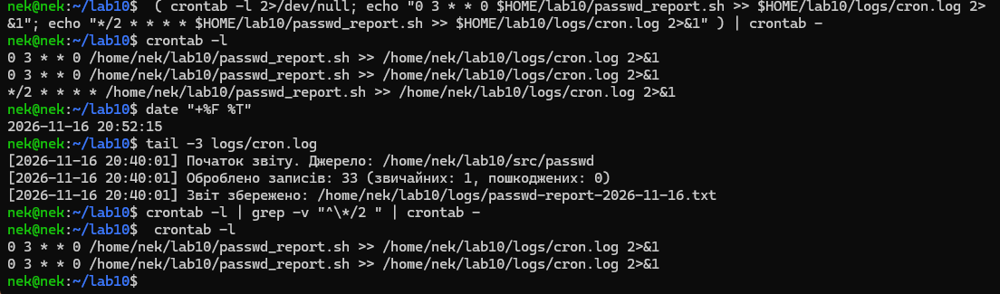

10 Додаткове завдання: чому `while read` краще за `for` для рядків файлу. Для порівняння використано файл `people.txt` з пробілами в рядках і порожнім рядком, а скрипт `demo_read.sh` обробляє його двома способами.

```bash
#!/bin/bash
# demo_read.sh — for і while read на файлі з пробілами та порожнім рядком
file="$1"
echo "--- for line in \$(cat файл):"
n=0
for line in $(cat "$file"); do
    n=$((n + 1)); echo "  [$n] '$line'"
done
echo "--- while IFS= read -r line:"
n=0
while IFS= read -r line; do
    n=$((n + 1)); echo "  [$n] '$line'"
done < "$file"
```

```
--- for line in $(cat файл):
  [1] 'Іван'
  [2] 'Петренко;IT'
  [3] 'Ольга'
  [4] 'Коваль;*'
  [5] 'проста;рядок'
--- while IFS= read -r line:
  [1] 'Іван Петренко;IT'
  [2] ''
  [3] 'Ольга Коваль;*'
  [4] 'проста;рядок'
```

Пояснення: цикл `for` обробляє не рядки, а **слова**: результат `$(cat файл)` розбивається за пробілами й табуляціями, тому рядок «Іван Петренко;IT» розпався на два елементи, а порожній рядок зник зовсім. Також слова піддаються розкриттю шаблонів (`*` у слові міг би перетворитися на перелік файлів каталогу, якби слово складалося лише з нього), а весь вміст файлу спершу завантажується в пам'ять. `while IFS= read -r line` читає файл **рядок за рядком**: зберігає пробіли, не пропускає порожніх рядків, `-r` не обробляє зворотні скісні риски, `IFS=` не обрізає початкові й кінцеві пробіли, а потоковий режим не потребує пам'яті під увесь файл. Крім того, `read` вміє розбивати рядок на поля (`IFS=: read -r name _ uid ...`), що й використано в `passwd_report.sh`.

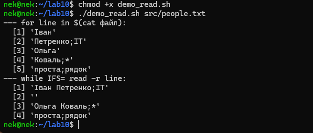

Таблиця 4 – Використані конструкції bash

| Конструкція | Призначення |
|-------------|-------------|
| `#!/bin/bash` | shebang: вказує інтерпретатор скрипта |
| `$0`, `$1`, `$#`, `$?`, `$$` | ім'я скрипта, перший параметр, кількість параметрів, код попередньої команди, PID |
| `"${1:-значення}"`, `"${1:?текст}"` | значення за замовчуванням; зупинка з повідомленням, якщо параметра немає |
| `$(команда)`, `$((вираз))` | підстановка результату команди; арифметика |
| `[[ -e ]]`, `-f`, `-d`, `-r`, `-s`, `-z`, `-eq`, `-ge` | перевірки існування, типу, прав, порожнечі, порівняння чисел |
| `if … elif … fi`, `case … esac` | умовні конструкції |
| `for … in … do`, `while read … done` | цикли за списком і за рядками файлу |
| `function() { … }`, `local`, `return` | функції, локальні змінні, код повернення |
| `exit N` | завершення скрипта з кодом |
| `&&`, `\|\|` | виконання наступної команди за кодом попередньої |
| `set -euo pipefail` | зупинка на помилці, неоголошеній змінній, помилці в конвеєрі |
| `\| tee -a файл` | вивід на екран і дописування у журнал |
| `IFS=: read -r …` | розбір рядка на поля за роздільником |
| `crontab` | запуск за розкладом |

## Відповіді на контрольні питання

### Високий рівень

1 Опишіть структуру скрипта резервного копіювання, що зберігає сім останніх копій і видаляє старіші. Які перевірки, цикли й коди повернення потрібні?

Структура скрипта (спрощена):

```bash
#!/bin/bash
set -euo pipefail
readonly SRC="${1:?Вкажіть каталог для копіювання}"
readonly DEST="${2:-$HOME/backups}"
readonly KEEP=7
readonly LOG="$DEST/backup.log"

log() { echo "[$(date '+%F %T')] $*" | tee -a "$LOG"; }
die() { local code="$1"; shift; log "ПОМИЛКА: $*"; exit "$code"; }

[[ -d "$SRC" && -r "$SRC" ]] || die 2 "джерело '$SRC' недоступне"
mkdir -p "$DEST"

archive="$DEST/backup-$(date +%F_%H%M%S).tar.gz"
tar -czf "$archive" -C "$SRC" . || die 3 "архівування не вдалося"
tar -tzf "$archive" > /dev/null  || die 4 "архів пошкоджений"
log "Створено архів: $archive"

# ротація — лише після успішного створення нової копії
mapfile -t old < <(find "$DEST" -maxdepth 1 -name 'backup-*.tar.gz' | sort | head -n -"$KEEP")
for f in "${old[@]}"; do
    rm -- "$f"
    log "Видалено стару копію: $f"
done
```

Перевірки: наявність і доступність джерела (код 2); успіх архівування (код 3); перевірка цілісності створеного архіву `tar -tzf` (код 4); обов'язковий параметр через `${1:?}`; каталог призначення створюється `mkdir -p`. Цикл `for` обходить перелік зайвих копій. Імена копій містять дату у форматі `РРРР-ММ-ДД_ГГММСС`, тому звичайне сортування за алфавітом збігається з сортуванням за часом, і `head -n -7` залишає сім найновіших. Ротацію виконують лише після успішного створення й перевірки нової копії: якщо б помилка трапилася після видалення, не залишилося б жодної копії. Коди повернення: 0 — успіх, 2 — джерело недоступне, 3 — помилка архівування, 4 — пошкоджений архів, різні коди дають змогу cron-завданню або системі моніторингу відрізнити причину збою. Для запуску за розкладом використовують абсолютні шляхи й перенаправлення виводу в журнал; для захисту від одночасного запуску двох копій додають блокування (`flock`).

2 Поясніть, чому конструкція rm -rf "$dir"/* небезпечна, і запропонуйте три різні способи захисту від помилки в змінній.

Якщо змінна `dir` порожня (не задано, через помилку в імені або невдалу підстановку команди), підстановка дає `rm -rf /*`: оболонка розкриває `/*` у перелік усіх каталогів кореня (`/bin`, `/etc`, `/home` …), і команда починає видаляти систему в межах прав користувача (від root — повністю). Захист `--preserve-root` тут не допомагає, бо `rm` бачить уже розкритий перелік, а не `/`. Помилку не обов'язково зупинить і `set -u`, якщо змінна оголошена, але порожня.

Три способи захисту:

а) Параметрична підстановка `${dir:?}`: `rm -rf "${dir:?}"/*` — якщо змінна порожня або не задана, оболонка завершує скрипт із повідомленням, а `rm` не запускається.

б) Явна перевірка перед видаленням: `[[ -n "$dir" && -d "$dir" && "$(realpath "$dir")" == "$HOME/lab10/"* ]] || die ...` — змінна не порожня, це справді каталог, і він лежить усередині дозволеного дерева (а не `/`, `/home` чи `$HOME`).

в) Обмежити дію самою командою: перейти в каталог і видаляти лише відносні шляхи — `cd "$dir" || exit 1; rm -rf ./*` (якщо `cd` не вдався, скрипт завершується), або `find "$dir" -mindepth 1 -delete` з перевіркою, що `dir` задано. Додатково перед першим запуском замінюють `rm` на `echo` (так само, як вимагає завдання), використовують режим `--dry-run` і запускають скрипт не від root.

3 Порівняйте bash і PowerShell як засоби автоматизації за трьома критеріями. У яких задачах ви оберете кожен?

Модель даних: bash передає між командами текстові потоки, тож для розбору потрібні `grep`, `awk`, `cut` та уважність до роздільників (приклад із роботи — розбір `/etc/passwd` за `IFS=:`). PowerShell передає між командами **об'єкти** з властивостями й типами, тому фільтрувати й сортувати можна за полем (`Get-Process | Where-Object CPU -gt 10`) без розбору тексту. Середовище й доступність: bash є за замовчуванням на кожному Linux-сервері, у мінімальних контейнерах і на системах запуску, інтегрований із `cron`, `systemd` і стандартними утилітами; PowerShell 7 кросплатформний, але потребує встановлення на Linux, зате є рідним для Windows (Active Directory, реєстр, WMI/CIM, Exchange, Azure). Надійність і зручність розробки: у bash багато пасток (лапки, розбиття слів, `set -e` з винятками), помилки — це коди завершення; у PowerShell є типи, структурована обробка помилок `try/catch`, функції з параметрами, режим `-WhatIf` для безпечного перегляду дій, зате вищі накладні витрати запуску.

Вибір: bash — для адміністрування Linux-серверів, обробки логів і текстових файлів, завдань cron, скриптів завантаження й контейнерів; PowerShell — для автоматизації Windows-інфраструктури (домен, служби, реєстр, хмара Azure/Microsoft 365) і для роботи зі структурованими даними (JSON, XML, API).

4 Сформулюйте критерії, за якими адміністративну задачу варто автоматизувати скриптом, а коли доцільніше застосувати готовий інструмент. Проілюструйте прикладом із цієї роботи.

Скрипт варто писати, коли: задача повторюється (щотижня, на багатьох серверах); помилка під час ручного виконання коштує дорого, а скрипт знімає людський фактор; логіка специфічна для середовища (власний формат, власні перевірки), і готового інструмента для неї немає; задача проста й легко перевіряється (кілька десятків рядків), тож супровід не складніший за користь. Готовий інструмент доцільніший, коли: він покриває складні випадки, яких скрипт не врахує (часткові збої, блокування, відновлення, шифрування, інкрементальність); він широко протестований і підтримується спільнотою; вимоги ростуть і скрипт перетворюється на невеликий проєкт з усіма його складнощами супроводу; потрібна гарантована ідемпотентність і масштабування на велику кількість вузлів.

Приклади з роботи: щотижневий звіт про облікові записи (`passwd_report.sh`) варто автоматизувати скриптом, бо задача повторюється, специфічна (власний формат звіту й перевірки, журнал, коди повернення) і проста, хоча одноразово вистачило б `getent passwd | awk -F: '$3>=1000'`. Натомість для ротації журналів чи синхронізації каталогів (варіанти 6 і 8) краще застосувати готові `logrotate` і `rsync`: вони враховують повторні запуски, права, посилання й перерване копіювання, а власний скрипт довелося б довго доводити до тієї ж надійності. Одноразове копіювання кількох файлів у mc взагалі не потребує автоматизації.

## Висновок

Під час лабораторної роботи я опанував створення й виконання командних файлів bash: написав скрипти з shebang і правом виконання, параметрами, змінними та підстановками, перевірками `[[ ]]`, циклами `for` і `while read`, функціями з `local`, журналом (`tee -a`) і різними кодами повернення, перевіряючи їх через `$?`. Експериментально встановив різницю між запуском `./script.sh`, `bash script.sh` і `source script.sh` (дочірній процес чи поточна оболонка), показав вплив `set -euo pipefail` на три типові помилки (невдала команда, збій у конвеєрі, помилка в імені змінної) і налаштував запуск основного скрипта звіту про облікові записи за розкладом cron із використанням абсолютних шляхів. Додаткове завдання показало, що `while read` обробляє рядки коректно, а `for` розбиває вміст файлу на слова.

Скрипти bash мають перевагу над пакетними файлами Windows (`.bat`) завдяки повноцінним функціям із локальними змінними, умовам і циклам, масивам, перенаправленню потоків і конвеєрам, підстановці результатів команд, надійній обробці помилок (`set -e`, `trap`), потужному набору текстових утиліт (`grep`, `awk`, `sed`, `find`) та вбудованій інтеграції з cron і systemd. Пакетні файли обмежені слабкою обробкою помилок і складним синтаксисом підстановок. Для сучасного Windows цю роль виконує PowerShell, який близький до bash за можливостями.
