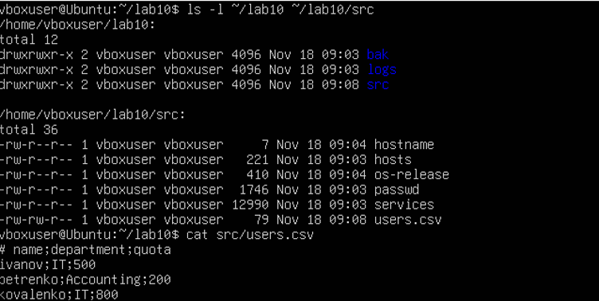
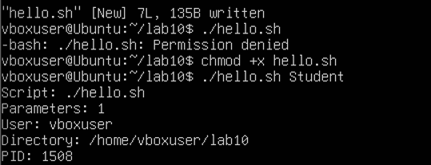
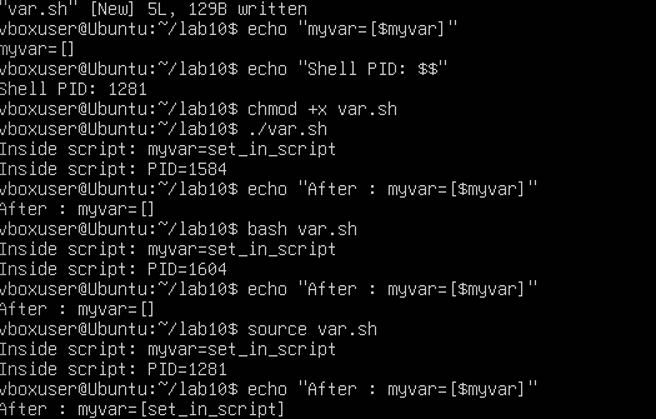
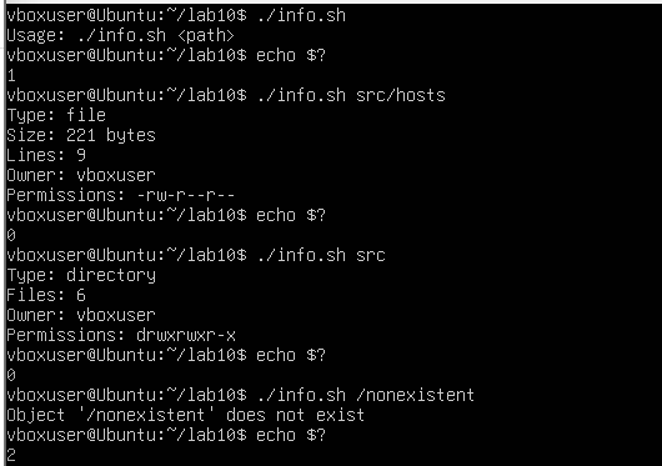
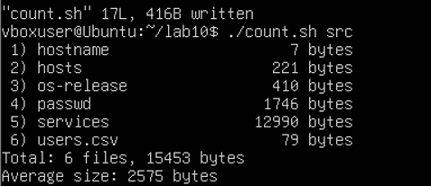
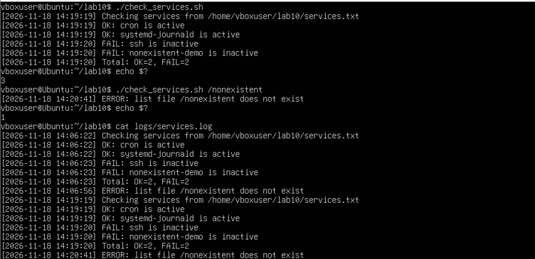
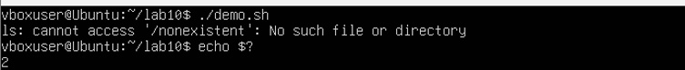
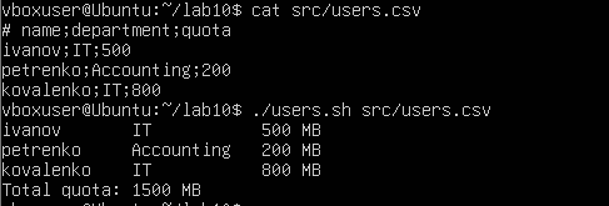
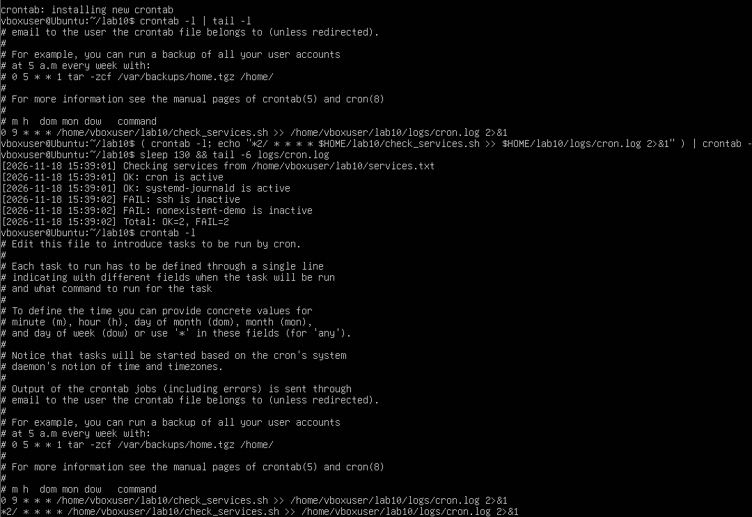
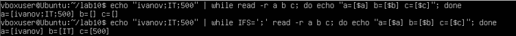

<!--
  Командні файли в середовищі Linux
  Варіант 11: Підрахунок статистики за CSV-файлом — щодня о 9:00 — Пояснити призначення `IFS` у циклі read

  Тему, мету й обладнання писати не треба — конвеєр візьме їх із лабораторної.
  Знімки екрана кладіть у assets/, вихідний код — у src/.
  Контрольні питання — лише одного рівня, того, на який захищаєте роботу:
  заголовок «### Достатній рівень», далі «1 Текст питання?» і відповідь.
  Покрокова інструкція — reports/README.md
-->

## Хід роботи

1 Отримала в викладача номер індивідуального варіанта 11.

2 Створила структуру робочого каталогу командою mkdir -p ~/lab10/{src,bak,logs}: підкаталоги src, bak і logs. У каталог src скопіювала п'ять системних файлів: hosts, passwd, services, hostname та os-release. Також створила текстовий файл users.csv з даними, розділеними символом «;» (поля: ім'я, відділ, квота). Таким чином у src є шість файлів, що перевищує мінімально потрібні п'ять. Правильність структури та вмісту перевірила командами ls -l і cat. 

3 Написала скрипт hello.sh, який виводить своє ім'я, кількість переданих параметрів, ім'я користувача, поточний каталог і PID. Перший запуск ./hello.sh завершився помилкою «Permission denied», оскільки в Linux право виконання файлу не надається автоматично. Командою chmod +x hello.sh надала це право, після чого скрипт запустила з параметром ./hello.sh Student. Він вивів ім'я скрипта ./hello.sh, кількість параметрів 1, користувача vboxuser, каталог /home/vboxuser/lab10 та PID 1508. 

4 Різницю між способами запуску скрипта перевірила експериментом зі змінною. Скрипт var.sh задає змінну myvar і виводить її значення та свій PID. PID поточної оболочки дорівнював 1281, а змінна myvar до запуску була порожньою. Після ./var.sh (PID скрипта 1584) і bash var.sh (PID 1604) змінна в оболонці залишилася порожньою, оскільки в обох випадках створюється дочірній процес, а його змінні зникають після завершення. Різниця між ними в тому, що ./var.sh потребує права виконання й рядка shebang, а bash var.sh явно запускає інтерпретатор і працює без права виконання. Після source var.sh PID дорівнював 1281, тобто збігався з PID оболонки, а змінна myvar отримала значення set_in_script, бо команди виконуються в поточній оболонці й змінюють її стан. 

5 Написала скрипт info.sh, який приймає шлях параметром, перевіряє його існування й тип та виводить відомості про об'єкт. Для різних причин відмови передбачила різні коди повернення. Без параметра скрипт виводить підказку про використання й завершується з кодом 1 ($? = 1). Для неіснуючого шляху /nonexistent виводиться повідомлення, що об'єкта не існує, і код повернення 2. Для файлу src/hosts скрипт визначив тип «файл», розмір 221 байт, 9 рядків, власника vboxuser та права -rw-r--r--, код повернення 0. Для каталогу src визначив тип «каталог», кількість файлів 6, власника vboxuser і права drwxrwxr-x, код повернення 0. 

6 Написала скрипт count.sh, який у циклі for обробляє всі файли каталогу src. Для кожного файла розмір визначається командою stat -c%s (підстановка команди), а лічильник файлів і сумарний обсяг накопичуються за допомогою арифметики $((...)). Скрипт вивів перелік із шести файлів з їх розмірами, підсумок «Total: 6 files, 15453 bytes» та середній розмір 2575 байт. Перевірку [[ -f "$file" ]] || continue використано, щоб пропускати все, що не є звичайним файлом. Середній розмір рахується лише тоді, коли файлів більше нуля, тобто запобігає діленню на нуль. 

7 Реалізувала основне завдання варіанта 11: скрипт check_services.sh, який перевіряє стан служб systemd зі списку у файлі services.txt. Скрипт перевіряє вхідні дані: якщо файл зі списком не існує, він записує помилку в журнал і завершується з кодом 1. Перевірка стану кожної служби виконується функцією check_service командою systemctl is-active, яка викликається в циклі while read -r для кожного рядка списку (порожні рядки та коментарі пропускаються). Функції log і die пишуть повідомлення з міткою часу на екран і в журнал logs/services.log через tee -a. У результаті перевірки служби cron і systemd-journald мають стан active (OK), а служби ssh і nonexistent-demo мають стан inactive (FAIL). Підсумок «Total: OK=2, FAIL=2» записано в журнал. Якщо хоча б одна служба неактивна, скрипт завершується з кодом 3, інакше з кодом 0. 

8 Додала до скрипта рядок set -euo pipefail і перевірила зміну поведінки на скрипті demo.sh. До додавання рядка команда ls /nonexistent завершилася помилкою, але скрипт продовжив роботу, вивів наступне повідомлення «After error: script continues» і завершився з кодом 0, тобто помилка залишилася непоміченою. Після додавання set -euo pipefail скрипт зупинився одразу після помилки команди ls, наступний рядок не виконався, а код повернення дорівнює 2. Параметр -e зупиняє виконання після першої помилки, -u робить помилкою звертання до неоголошеної змінної, а -o pipefail змушує конвеєр повертати код невдалої команди. У скрипті check_services.sh цей рядок використано одразу після shebang. 

9 Написала скрипт users.sh, який читає текстовий файл users.csv рядок за рядком циклом while IFS=';' read -r name dept quota. Рядок розбивається на поля за роздільником «;», коментарі та порожні рядки пропускаються. Для кожного запису виводяться ім'я, відділ і квота, а числове поле квоти додається до загальної суми. Для початкового значення суми використано ${total:-0}, оскільки через set -u звертання до неоголошеної змінної є помилкою. Скрипт вивів дані трьох користувачів (ivanov, petrenko, kovalenko) та підсумок «Total quota: 1500 MB». 

10 Налаштувала запуск скрипта check_services.sh за розкладом через cron з періодичністю варіанта: щодня о 9:00. Командою crontab -e додала рядок 0 9 * * * /home/vboxuser/lab10/check_services.sh >> /home/vboxuser/lab10/logs/cron.log 2>&1, у якому використано абсолютні шляхи, а вивід перенаправлено в журнал cron.log, оскільки cron запускає скрипт із мінімальним оточенням. Наявність рядка підтвердила командою crontab -l. Щоб не чекати до 9:00, додала тестовий рядок із періодичністю кожні 2 хвилини (*/2 * * * *). Через 130 секунд у файлі logs/cron.log з'явився запис про перевірку служб (о 15:39:01 за часом віртуальної машини) з підсумком «Total: OK=2, FAIL=2», що підтверджує спрацювання скрипта за розкладом. Після перевірки обидва завдання з розкладу прибрала командою crontab -e, а crontab -l показує, що рядків із check_services.sh більше немає. 

11 Призначення IFS (Internal Field Separator) у циклі read — задавати символи-роздільники, за якими оболонка ділить прочитаний рядок на поля для змінних. За замовчуванням IFS містить пробіл, табуляцію та перехід на новий рядок, тому read розбиває рядок за пробілами. Це підтвердила експериментом. Команда echo "ivanov;IT;500" | while read -r a b c записала весь рядок у змінну a: a=[ivanov;IT;500] b=[] c=[], бо в рядку немає пробілів. Команда з IFS=';' розділила той самий рядок за символом «;»: a=[ivanov] b=[IT] c=[500]. Присвоєння IFS=';' перед read діє лише на цю команду й не змінює IFS оболонки в цілому. У скрипті users.sh саме while IFS=';' read -r name dept quota дозволяє розібрати рядки файлу users.csv на ім'я, відділ і квоту. 

12 Оформила звіт і зробила висновок.

## Відповіді на контрольні питання

### Високий рівень (творчий)

1 Опишіть структуру скрипта резервного копіювання, що зберігає сім останніх копій і видаляє старіші. Які перевірки, цикли й коди повернення потрібні?

Скрипт резервного копіювання з ротацією починається з рядка shebang і set -euo pipefail, після чого задаються змінні: каталог-джерело SRC, каталог для копій DST, файл журналу LOG і кількість копій KEEP=7. Їх варто оголосити як readonly. Далі описуються функції: log дописує повідомлення з міткою часу в журнал через tee -a, а die записує помилку й завершує скрипт з потрібним кодом. Перед копіюванням скрипт перевіряє вхідні дані: чи передано параметр, чи є джерело каталогом ([[ -d "$SRC" ]]), чи доступне воно для читання, а також створює каталог призначення командою mkdir -p. Потім створюється архів з датою в імені (tar -czf "$DST/backup-$(date +%F).tar.gz"), і результат команди перевіряється через || або if. Для ротації використовується цикл: архіви збираються за шаблоном backup-*.tar.gz, сортуються за іменем (дата в імені забезпечує хронологічний порядок), підраховується їх кількість, а старіші за сім видаляються в циклі, причому перед кожним rm перевіряється, що змінна не порожня і файл існує. Скрипт повертає різні коди: 0 для успіху, 1 для неправильних параметрів, 2 для відсутнього джерела, 3 для помилки архівування, 4 для помилки видалення старих копій. Під час перших запусків rm слід замінити на echo, щоб переконатися, що перелік файлів для видалення правильний.

2 Поясніть, чому конструкція rm -rf &quot;$dir&quot;/* небезпечна, і запропонуйте три різні способи захисту від помилки в змінній.

Конструкція rm -rf "$dir"/* небезпечна тим, що значення змінної dir підставляється до виконання команди. Якщо змінна порожня або не задана через помилку в імені чи невдалу команду, рядок перетворюється на rm -rf /*, і видаляється вміст кореневого каталогу. Захист самої команди rm від видалення «/» тут не допомагає, бо оболонка розкриває /* у перелік окремих каталогів (/bin, /etc, /home), і для rm це вже не корінь. Перший спосіб захисту — параметр set -u або конструкція ${dir:?повідомлення}, яка зупиняє скрипт із помилкою, якщо змінна порожня або не оголошена. Другий спосіб — явна перевірка значення перед видаленням: змінна має бути непорожньою, бути існуючим каталогом і міститися всередині дозволеного шляху, наприклад ~/lab10, а не збігатися з «/» чи домашнім каталогом. Третій спосіб — пробний запуск, коли rm тимчасово замінюється на echo, і за виведеним переліком файлів видно, що саме буде видалено. Додатково можна переходити в каталог через cd "$dir" || exit 1 і видаляти вміст відносним шляхом, тоді помилка в змінній не призведе до видалення за межами поточного каталогу.

3 Порівняйте bash і PowerShell як засоби автоматизації за трьома критеріями. У яких задачах ви оберете кожен?

Bash і PowerShell можна порівняти за моделлю передавання даних, за платформою та доступністю і за зручністю та надійністю коду. За першим критерієм bash передає між командами текстові потоки, тому для вибору потрібного поля доводиться використовувати grep, awk, cut і розбирати вивід вручну, а PowerShell передає об'єкти .NET з властивостями, тож відфільтрувати, наприклад, служби за станом можна без розбору тексту. За другим критерієм bash встановлений майже в усіх системах Linux за замовчуванням, невеликий, працює в cron, через ssh і в режимі відновлення, тоді як PowerShell є рідною оболонкою Windows з прямим доступом до реєстру, служб, журналів подій і Active Directory, а на Linux потребує окремого встановлення. За третім критерієм PowerShell має типізовані параметри, обробку помилок try/catch і зрозумілі імена cmdlet у форматі дієслово-іменник, але запускається повільніше й важчий, а bash дає короткі скрипти й коди повернення, проте вимагає уважності до лапок, пробілів і розбиття слів. Тому bash я оберу для адміністрування серверів Linux, завдань за розкладом, обробки текстових журналів і швидких конвеєрів, як у скрипті check_services.sh, а PowerShell для адміністрування Windows, роботи зі структурованими даними (CSV, JSON) та завдань, де потрібні об'єкти й складні вибірки.

4 Сформулюйте критерії, за якими адміністративну задачу варто автоматизувати скриптом, а коли доцільніше застосувати готовий інструмент. Проілюструйте прикладом із цієї роботи.

Адміністративну задачу варто автоматизувати скриптом, якщо вона повторюється регулярно, містить чіткий формалізований алгоритм, у якому легко помилитися вручну, стосується багатьох об'єктів або потребує журналу виконання й відтворюваності, а час на написання скрипта менший за час, який він заощадить. Готовий інструмент доцільніше застосувати, коли задача виконується одноразово, коли вже існує перевірене рішення (rsync, logrotate, системи моніторингу, засоби керування конфігурацією на кшталт Ansible) або коли потрібні складна логіка, сповіщення, історія й підтримка, які довго й дорого писати самостійно. У цій роботі скрипт check_services.sh виправданий: перевірка служб зі списку повторюється щодня, має простий алгоритм, запускається через cron о 9:00 і пише результат у журнал, тож скрипт економить час і виключає людські помилки. Водночас для промислового моніторингу краще використовувати готовий інструмент (наприклад, системи моніторингу або параметр Restart=on-failure у службах systemd), який вміє автоматично перезапускати службу, надсилати сповіщення й зберігати історію. Так само для резервного копіювання великих обсягів доцільніше застосовувати rsync, а не власний цикл копіювання. Створення робочої структури каталогів, навпаки, одноразова дія, яку швидше виконати вручну, ніж автоматизувати.

## Висновок

На цій лабораторній роботі я навчилася автоматизувати адміністративні задачі засобами оболонки bash: писати скрипти з параметрами, перевіряти вхідні дані умовними конструкціями, обробляти групи файлів циклами, виносити повторювані дії у функції, вести журнал виконання та коректно повертати коди завершення.
